# SugarCraft

<p align="center">
  
</p>

<!-- BADGES:BEGIN -->
[](https://github.com/detain/sugarcraft/actions/workflows/ci.yml)
[](https://github.com/detain/sugarcraft/actions/workflows/pty-matrix.yml)
[](https://app.codecov.io/gh/detain/sugarcraft)
[](LICENSE)
[](https://www.php.net/)
[](CONTRIBUTING.md)
<!-- BADGES:END -->

SugarCraft is a complete terminal-application stack for modern PHP: an
MVC-style Model–Update–View runtime for terminal user interfaces (TUIs);
styling, layout, and form engines; reusable components; charts; and terminal
emulators and plumbing — plus a fleet of finished apps. Every package is
composer-installable and requires PHP 8.3+; the interactive stack — runtime,
components, and apps — runs async on a ReactPHP event loop.

🌐 **Website:** [sugarcraft.github.io](https://sugarcraft.github.io/) — library matrix, quickstart, comparison page.
📖 **New here?** [Getting started](docs/GETTING-STARTED.md) — a finished binary, a first app, or a chart in five minutes.
📚 **Vocabulary:** [Glossary](docs/GLOSSARY.md) — every term this README uses, defined with its source file.

```sh
composer require sugarcraft/sugarcraft        # umbrella metapackage — every library
composer require sugarcraft/sugar-style   # …or just the package you need
```

> **Before you install** — `sugarcraft/*` packages publish from `dev-master`
> until their first tags are cut, so a Composer project left on the default
> `stable` minimum-stability cannot resolve them. Add
> `"minimum-stability": "dev", "prefer-stable": true` to your root
> `composer.json` (or suffix your require with `@dev`).

## What's in the box

Every package installs independently with Composer. The libraries are grouped by layer:

| | Library | Role |
|---|---|---|
| 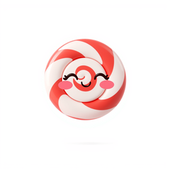 | **[SugarCraft](sugar-core/)** | MVC-style Model–Update–View TUI runtime — `Model` / `Msg` / `Cmd` / `Program`, plus a frame-diff renderer with an opt-in cursed cell-diff mode. |
| 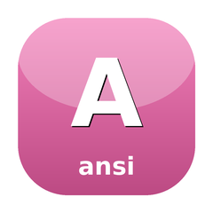 | **[SugarAnsiParser](sugar-ansi-parser/)** | ECMA-48 VT500 state machine — ANSI byte-stream parser with abstract Handler interface. Extraction from sugar-vterm; formerly published as `sugarcraft/candy-ansi` (renamed 2026-10). |
| 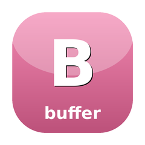 | **[SugarCellBuffer](sugar-cellbuffer/)** | Cell-grid value objects — immutable Buffer (2-D cell grid) and Cell (`rune`/style/link/width). Shared foundation for all rendering; `Buffer::diff()` included. |
|  | **[SugarConstraints](sugar-constraints/)** | Constraint-based layout solver — `LayoutSolver` interface with a deterministic `GreedySolver` engine (`CassowarySolver` kept only as a deprecated shim). |
| 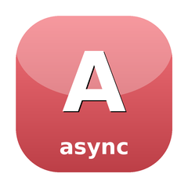 | **[SugarAsync](sugar-async/)** | Shared async vocabulary for ReactPHP — CancellationToken, Subscriptions, AsyncOps helpers (withTimeout, withDeadline, cancellable, retry, debounce, throttle, all/race, onPending, singleFlight) + TTL async cache. |
| 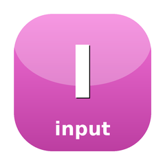 | **[SugarInput](sugar-input/)** | Terminal input decoder — raw TTY bytes to typed events: keyboard (Kitty progressive protocol, xterm modifyOtherKeys, legacy encodings) and mouse (SGR, urxvt, X10) via `InputDriver` / `EscapeDecoder`. |
| 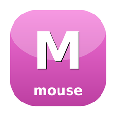 | **[SugarMouse](sugar-mouse/)** | Mouse hit-testing — mark rendered regions, scan the frame, hit-test the event; `ZoneClickTracker` for press/release dedupe, plus the absorbed bubblezone-style `Zones` facade and the `Zones\Manager` layer (hover / drag / multi-click) under `SugarCraft\Mouse\Zones`. Shared default via `Zones::defaultManager()`; `newGlobal()` mints a fresh independent one. Pointer-driven; keyboard paths are consumer-owned — see sugar-mouse README Accessibility. |
|  | **[SugarStyle](sugar-style/)** | Declarative styling + layout — `Style`, `Border`, `Table\Table`, `Listing\ItemList`, `Tree\Tree`, `Layout::joinHorizontal`/`joinVertical`, `Layout::place`, multi-layer `Canvas`, `Theme`. |
|  | **[SugarTesting](sugar-testing/)** | Test harness for SugarCraft programs — ProgramSimulator, scripted input, golden/snapshot assertions, VHS tape building, graphics-stream decoding. |
|  | **[SugarSpring](sugar-spring/)** | Damped spring physics + Newtonian projectile simulation. |
| 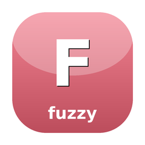 | **[SugarFuzzy](sugar-fuzzy/)** | Fuzzy string matching with scored match indices — powers filter-as-you-type highlighting across the ecosystem. |
|  | **[SugarWidgets](sugar-widgets/)** | Components: Tabs, Tree, Table, Progress, Help, Key, Paginator, Stopwatch, Timer, TextEdit, OptionRow; plus 8 deprecated sugar-forms re-export alias families (Cursor, FilePicker, ItemList, Scrollbar, Spinner, TextArea, TextInput, Viewport) — prefer sugar-forms. |
| 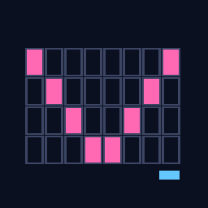 | **[SugarVterm](sugar-vterm/)** | Virtual terminal emulator — ANSI byte stream → cell grid + cursor + mode state. |
| 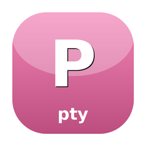 | **[SugarPty](sugar-pty/)** | Pseudo-terminal primitives — `PtySystemFactory` → `Contract\PtySystem` master/slave: POSIX via FFI to libc (Linux/macOS, opt-in controlling terminal) plus a Windows ConPTY backend (`CreatePseudoConsole`; beware its empty-`$env` full-parent inversion). Legacy `Pty` facade @deprecated through v1.x. |
| 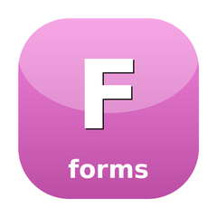 | **[SugarForms](sugar-forms/)** | Form library (port of charmbracelet/huh) and shared form engine behind SugarWidgets — Note, Input, Confirm, Select, MultiSelect, Text, FilePicker, Date, Slider, Color, NumberField, RadioPills; multi-page Groups; stock themes; validators; fuzzy / async suggestions; ActionSpinner. |
|  | **[SugarFocus](sugar-focus/)** | Tiny dependency-free focus ring — ordered focusable regions, single focused member, wrap-around Tab/Shift-Tab. |
|  | **[SugarGallery](sugar-gallery/)** | Poster grids & rails for media TUIs — virtualized PosterGrid, Rail carousel, PosterCard. |
|  | **[SugarCharts](sugar-charts/)** | Canvas + Sparkline, Bar, Line, Heatmap, Scatter, TimeSeries, Streamline, Waveline, OHLC, Picture (Sixel/Kitty/iTerm2) + Aggregation toolbox. |
|  | **[SugarImage](sugar-image/)** | Image-to-cell renderer for the terminal — Sixel, Kitty, iTerm2, the chafa CLI, and Unicode text tiers (half/quarter block, ASCII ramp, chafa-style symbol coverage); ext-gd decode. |
|  | **[SugarMarkdown](sugar-markdown/)** | Markdown → ANSI renderer with word-wrap, OSC 8 hyperlinks, 9 built-in themes (notty aliases plain). |
|  | **[SugarCli](sugar-cli/)** | CLI presentation helpers — StatusLine, Banner, Section, Stage, HelpText, Frame, Logo, and themes. |
|  | **[SugarSshServer](sugar-ssh-server/)** | SSH-server middleware framework (leans on host `sshd`); pluggable Transport: InProcessTransport (default — sugar-pty supervisor + Spawn middleware) or HostSshdTransport (legacy, opt-in — inline middleware, including running SugarCraft apps in SSH sessions). |
| 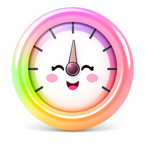 | **[SugarMetrics](sugar-metrics/)** | Telemetry primitives — counters, gauges, histograms, UpDownCounters, AsyncCounters, AsyncGauges across five backends (InMemory, JsonStream, StatsD, Prometheus textfile, Multi fan-out), plus drop-in SSH session middleware for SugarSshServer. |
|  | **[SugarLog](sugar-log/)** | Colorful leveled logger — Debug / Info / Warn / Error / Fatal with structured context, Text / JSON / Logfmt formatters, sub-loggers, and StandardLogAdapter. |
|  | **[SugarColorprofile](sugar-colorprofile/)** | Detects the terminal's color profile and degrades colors, strings and whole streams one-way down the ladder (reads TERM/COLORTERM/NO_COLOR…, may exec infocmp). StandardColors, ProfileWriter and an opt-in perceptual matcher. |
|  | **[SugarTreelist](sugar-treelist/)** | List view with box-drawing prefixes, cursor navigation, word-wrap, and live filtering (host-driven). |
|  | **[SugarPanels](sugar-panels/)** | H/V panels with flex/natural sizing, borders, nesting, and stateful delta rendering. |
|  | **[SugarOverlay](sugar-overlay/)** | Terminal overlay compositor — composites Veil overlays with backdrop dimming, z-stack ordering, positioning, and click-outside hit-testing; opt-in `Veil::withUntrustedContent()` at the veil boundary. |
|  | **[SugarNavstack](sugar-navstack/)** | Navigation breadcrumbs — mutable NavStack with explicit push/pop, width-aware breadcrumbs, and substring filter. |
|  | **[SugarDashboard](sugar-dashboard/)** | Dashboard TUI library — column grid, constraint layout, ratio grid, data grid, tree, modal, status bar, tabs, plot/canvas, and a module/plugin system. |
|  | **[SugarQuickpick](sugar-quickpick/)** | Fuzzy finder / quick-pick overlay for terminal UIs — embeds into your app via the package-local Model contract: your loop decodes keys and forwards them (type()/cursorUp()/Down(); Enter reads selected()). |
|  | **[SugarFlexbox](sugar-flexbox/)** | FlexBox layout engine + delta-rendering Table (sort/filter/cursor) + sticky Viewport + Scrollbar. Ratio-based sizing, gap, align, per-column styling. |
| 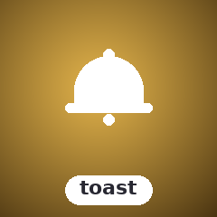 | **[SugarToast](sugar-toast/)** | Floating notification overlays — Error / Warning / Info / Success types, configurable position and host-driven auto-dismiss. |
|  | **[SugarDatepicker](sugar-datepicker/)** | Interactive month-grid date picker — keyboard navigation, min/max date constraints, locale-ready day names (English ships today), ANSI rendering; weeks start Monday (firstDayOfWeek is not configurable). |
| 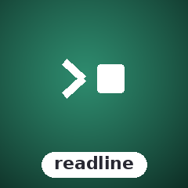 | **[SugarReadline](sugar-readline/)** | Interactive prompts — Text, Confirm, Selection, MultiSelect, Textarea. State-machine model, no external readline dependency. |
|  | **[SugarTable](sugar-table/)** | Customizable data table — column definitions, StyledCell ANSI formatting, pagination, frozen columns. Keyboard-driven; wire sugar-input/sugar-mouse events yourself. |
|  | **[SugarDiff](sugar-diff/)** | Unified-diff engine — LCS line diff, `diff -u` hunks, writer + line-number scanner. Extracted from candy-code. |
|  | **[Sugar MCP Client](sugar-mcp-client/)** | Model Context Protocol (MCP) client core — JSON-RPC 2.0 codec, stdio transport with bounded child lifecycle, initialize/tools handshake, deny-before-allow SERVER narrowing (tool rosters follow servers). Extracted from candy-code. |
|  | **[SugarReleases](sugar-releases/)** | Phar self-update engine + launch-time update notice — GitHub release selection (stable + rolling dev channel), sha256-sidecar and pinned-key Ed25519 verification before the swap, one-shot `.old` rollback, Windows relaunch-dance swap. Extracted from candy-code. |
|  | **[SugarIgnore](sugar-ignore/)** | gitignore-style ignore matching over injected file contents (no IO) — negation, dir-only, anchoring, `**`, escapes, nested ignore files, `.git/info/exclude` precedence, and a backtrack-free matcher that fails closed on hostile patterns. Extracted from candy-code. |
|  | **[SugarAnimation](sugar-animation/)** | ANSI/GIF animation toolkit (formerly published as `sugarcraft/candy-flip`, renamed 2026-10) — ext-gd decode, cell-grid downsample, solid / density (luminance-ramp) presets, `.ansi` art playback; the viewer CLI lives in candy-gifview. |
|  | **[SugarVideo](sugar-video/)** | Terminal video player — pipes mp4/webm/avi (and more) through `ffmpeg`/`ffprobe` on the fly and renders to ASCII / ANSI / truecolor half- and quarter-block / sixel / kitty / iTerm2 (GIF and animated WebP via ext-gd, no ffmpeg). |

## Apps built on the stack

| | App | Role |
|---|---|---|
|  | **[CandyStarter](candy-starter/)** | `composer create-project sugarcraft/candy-starter my-app --stability=dev` — bootstrap skeleton with a working counter Model (Packagist carries only dev-master until a `candy-starter/*` tag exists). |
|  | **[CandyScriptui](candy-scriptui/)** | Composer-installable CLI of 13 presentation subcommands (choose, confirm, file, filter, format, input, join, log, pager, spin, style, table, write) — scriptable terminal UI in one-liners. |
|  | **[CandyCodeshot](candy-codeshot/)** | Code → SVG (or PNG via `ext-gd`) screenshot generator. |
|  | **[CandyMdview](candy-mdview/)** | Markdown CLI viewer / pager. |
|  | **[CandyAnsiInspect](candy-ansi-inspect/)** | ANSI escape-sequence inspector. |
|  | **[CandySshLauncher](candy-ssh-launcher/)** | TUI directory of SSH endpoints — YAML/JSON config + `pcntl_exec` into the chosen `ssh`. |
| 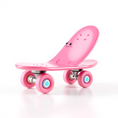 | **[CandyKv](candy-kv/)** | Personal key/value store — one SQLite file per database, glob + fuzzy listing, TTL, binary-safe values, JSON/YAML import/export. |
|  | **[CandyMail](candy-mail/)** | Email library + CLI — SMTP + Resend API transports, attachments, HTML + plain-text multipart, fluent interface. |
| 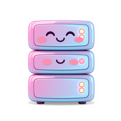 | **[CandyGitServer](candy-git-server/)** | Self-hostable Git server — smart-HTTP clone/fetch/push via `serve --http`; SSH delegates real git under host-sshd `ForceCommand`; git:// daemon advertisement-only. Users, repos, access control, optional LFS. |
|  | **[CandyTetris](candy-tetris/)** | Tetris clone — SRS rules, 7-bag, ghost piece, NES-style base scoring with Guideline bonuses, level-driven gravity. |
|  | **[CandyFiles](candy-files/)** | Dual-pane file manager — Midnight Commander style, multi-select, sort, delete-with-confirm. |
|  | **[CandyCode](candy-code/)** | Terminal AI coding agent (TUI) — eleven provider type keys over nine engines (OpenAI / Anthropic / Claude Code / Codex / SGLang / Bedrock / Vertex / Gemini / custom), thirty-eight built-in tools on every launch behind permission modes, sub-agents, teams and workflows, MCP client and server, hooks, skills and image/video generation — plus an offline echo backend for demos. |
|  | **[CandyCodeWeb](candy-code-web/)** | Browser UI for CandyCode's server mode — Vite + Vue 3 bundle committed as `dist/`, located by a one-class PHP shim so `candy-code serve` needs no Node. Multi-session live: up to twelve tabs, and a tiled grid of up to nine sessions, with tool cards, diffs and approvals. |
| 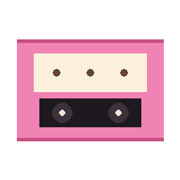 | **[CandyVcr](candy-vcr/)** | Record + replay sugar-core sessions — JSONL/YAML cassettes, Recorder hook (`setRecorder`/`withRecorder`), `Player` with byte + cell-grid assertions, `.tape`→GIF renderer, CLI. |
|  | **[CandyGit](candy-git/)** | Terminal Git client — a TUI for diff/hunk staging, branching, log, stash, worktrees and rebase; shells out to `git` for every mutation. |
|  | **[CandySql](candy-sql/)** | Terminal SQL client — SQLite, MySQL and PostgreSQL: schema browsing, row browsing, ad-hoc queries, EXPLAIN plans (PDO + `:memory:` test fixtures). |
|  | **[CandyCodetime](candy-codetime/)** | Privacy-first coding-time tracker — heartbeats in JSONL day-files by default, optional SQLite backend (`--backend`), SugarCharts-driven dashboard, no cloud. |
|  | **[CandyMinesweeper](candy-minesweeper/)** | Minesweeper — first-click safety, iterative flood-fill, flag toggle, win/lose detection, deterministic-RNG injectable. |
| 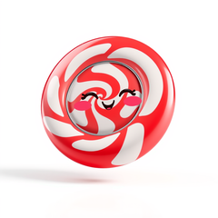 | **[CandyGifView](candy-gifview/)** | Terminal GIF viewer — the sugar-animation CLI: sizes to the viewport, plays in the alternate screen (solid 24-bit blocks or an ASCII luminance ramp). |
|  | **[CandyImage](candy-image/)** | Terminal image viewer — the chafa-independent CLI over sugar-image: protocol tiers (sixel/kitty/iTerm2), half/quarter block and text tiers with colored-character modes, cell sizing with `--scale`, `--canvas`/`--work` dials, GIF animation, `--dump-detect`. |
|  | **[CandyTop](candy-top/)** | Terminal system monitor — cpu / mem+disks / net / process boxes with braille, block and sextant graphs, gradient meters; up to six AMD/Intel GPU and Intel/AMD NPU boxes, an ipmi BMC band and a VM dashboard; battery readouts, menus, presets, 43 themes (42 ported from btop plus candy-top's own pastel), and btop-compatible config with save/reload, over Linux `/proc` + `/sys` and FreeBSD collectors. |
|  | **[CandyFlappy](candy-flappy/)** | Flappy-Bird-style game — bird motion is a SugarSpring projectile, pipes scroll left at a fixed cell rate. |

**Renamed packages (2026-10):** every package moved to the two-prefix
scheme above — `candy-` for runnable apps and CLI tools, `sugar-` for
libraries (the `honey-` family was retired). The full old → new map, with
redirect notes, lives in
[`PROJECT_NAMES.md`](./PROJECT_NAMES.md#renamed-in-2026-10).

Each library has its own `README.md` with usage examples and a deep dive into
its public API.

## Quickstart — a counter app

Save as `counter.php` in a project with `composer require sugarcraft/sugar-core`,
then run `php counter.php`:

```php
<?php

require __DIR__ . '/vendor/autoload.php';

use SugarCraft\Core\{Cmd, KeyType, Model, Msg, Program, Subscriptions};
use SugarCraft\Core\Msg\KeyMsg;

final class Counter implements Model
{
    public function __construct(public readonly int $n = 0) {}
    public function init(): ?\Closure { return null; }

    public function update(Msg $msg): array
    {
        if ($msg instanceof KeyMsg && $msg->type === KeyType::Char && $msg->rune === 'q') {
            return [$this, Cmd::quit()];
        }
        return [
            $msg instanceof KeyMsg && $msg->type === KeyType::Up
                ? new self($this->n + 1)
                : ($msg instanceof KeyMsg && $msg->type === KeyType::Down
                    ? new self($this->n - 1)
                    : $this),
            null,
        ];
    }

    public function view(): string { return "n = {$this->n}\n↑ ↓ to count, q to quit\n"; }

    public function subscriptions(): ?Subscriptions { return null; }
}

(new Program(new Counter()))->run();
```

## Architecture

- **PHP 8.3+** — fibers, readonly props, enums, `match`, intersection types.
- **Runtime**: ReactPHP event loop — input, signals, render tick, and command
  execution all run concurrently on a single loop.
- **Style**: PSR-12 + readonly DTOs. Every `Style`, `Model`, etc. is
  immutable — `with*()` returns a new instance.
- **Testing**: PHPUnit 10. Snapshot ANSI tests for renderers; scripted-input
  event tests for the runtime.
- **Layout**: monorepo; every library also publishes as a standalone package
  and will later split into its own repo.

## Status

Every library in the table above ships at **v1**, each with its own composer
package and PHPUnit suite, and CI publishes per-library coverage to Codecov;
the rendering libraries pin their output with snapshot-ANSI tests. The
[website](https://sugarcraft.github.io/) library matrix carries live
per-package status, and each library's `README.md` documents its full public
API.

## Adding a new library or app

The full package roster lives in
[MATCHUPS.md](./docs/MATCHUPS.md), and the contributor / agent playbook in
[AGENTS.md](./AGENTS.md) walks through the complete integration checklist:
naming conventions, package skeleton, tests, examples, VHS demos (terminal
sessions recorded as GIFs), website tiles, and the central docs to update.
AI assistants should read AGENTS.md first.

## Running the test suites

The umbrella package is a metapackage; each library has its own
`composer.json` + `vendor/`. To test everything:

```sh
for d in candy-* sugar-*; do
    [ -f "$d/phpunit.xml" ] || continue
    (cd "$d" && composer install --quiet && vendor/bin/phpunit) || exit 1
done
```

Code style is enforced via `php-cs-fixer` (root `.php-cs-fixer.dist.php`). Run from the repo root:

```sh
PHP_CS_FIXER_IGNORE_ENV=1 php-cs-fixer fix --diff --allow-risky=yes
```

## Contributing

See [CONTRIBUTING.md](./CONTRIBUTING.md). Bugs, feature requests,
and new libraries — original tools, components, and terminal apps that
fill gaps in the PHP stack — are all welcome.
For security issues, see [SECURITY.md](./SECURITY.md).
The fleet trust model — what counts as untrusted input and where the
sanitize gates must sit — is [docs/TRUST-BOUNDARY.md](./docs/TRUST-BOUNDARY.md).

## License

[MIT](./LICENSE).

## Credits & inspiration

SugarCraft is a PHP-native project. Its original design inspiration came
from the Go terminal ecosystem — notably
[Bubble Tea](https://github.com/charmbracelet/bubbletea) and the wider
[Charm](https://github.com/charmbracelet) family of libraries — reimagined
here for PHP 8.3+.

---

<p align="center">
  <a href="https://sugarcraft.github.io/"></a><br>
  <em>made with sugar · sweet to build · fun to use</em>
</p>
