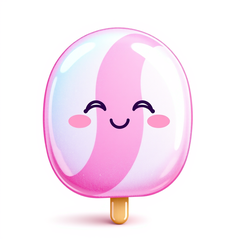
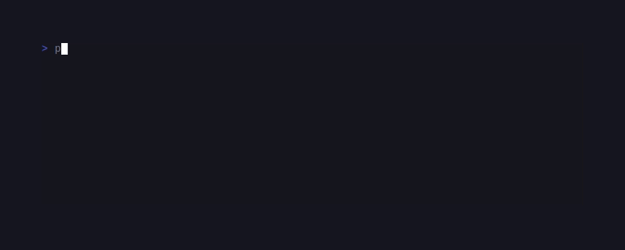
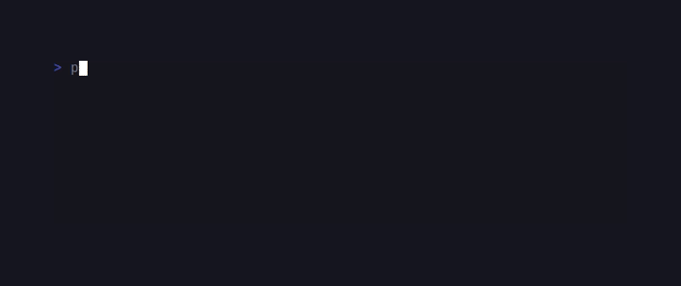

# CandyCodeshot

> Formerly published as `sugarcraft/candy-freeze` (renamed 2026-10). <!-- @rename-keep -->
> Namespace changed: `SugarCraft\Freeze\` → `SugarCraft\CodeShot\`. <!-- @rename-keep -->

<!-- BADGES:BEGIN -->
[](https://github.com/detain/sugarcraft/actions/workflows/ci.yml)
[](https://app.codecov.io/gh/detain/sugarcraft?flags%5B0%5D=candy-codeshot)
[](https://packagist.org/packages/sugarcraft/candy-codeshot)
[](LICENSE)
[](https://www.php.net/)
<!-- BADGES:END -->




candy-codeshot — turn code or terminal output into an SVG (or PNG) screenshot,
for PHP 8.3+. SVG output needs **no `ext-gd` / Imagick**; the SVG is plain text
suitable for git diffs and CI artifacts. PNG output is also available and
requires `ext-gd`.

```sh
composer require sugarcraft/candy-codeshot
```

## CLI

```sh
echo "function hello() { return 'world'; }" \
    | candy-codeshot --theme dracula --line-numbers > out.svg

candy-codeshot input.php \
    --theme tokyo-night --no-window --output screenshot.svg

candy-codeshot notes.md --format png -o notes.png
```

### Flags

All sixteen options. Flag values are **separate arguments** —
`--theme dracula`, not `--theme=dracula` (the `=` form is rejected as an
unrecognised flag).

- `--theme <name>` — colour palette: `dark` (default), `light`, `dracula`, `tokyo-night`, `nord`.
- `--padding <n>` — content padding inside the frame (default 24).
- `--no-window` — drop the window chrome entirely (traffic lights, title bar).
- `--no-shadow` — drop the drop-shadow.
- `--no-border` — drop the frame outline.
- `--line-numbers` — render a left-gutter line counter.
- `--border-radius <n>` — corner radius of the frame (default 8).
- `--window-style <style>` — chrome style: `macos` (default), `windows-terminal`, `iterm`, `hyper`, `none`. `none` collapses the title-bar band (no empty 36 px strip).
- `--ligatures` — enable ligatures (`font-variant-ligatures: normal`). **SVG only.**
- `--font <path>` — embed a TTF/OTF/WOFF/WOFF2 font in the SVG. **SVG only.**
- `--unsafe-paths` — allow input / `--font` / `--output` paths outside the CWD (see Path confinement).
- `--highlight <start:end[:color]>` — highlight lines `start:end` with an optional colour (default `#fffbe6`). Ranges are validated: `start >= 1`, `end >= start`, else a friendly refusal, exit 2. **SVG only.**
- `--format <svg|png>` — output format (default `svg`; `png` requires `ext-gd`).
- `-t`, `--type <lang>` — force the syntax-highlighting language (default: filename, then shebang, then content detection).
- `-o`, `--output <path>` — write the screenshot to a file instead of stdout.
- `-h`, `--help` — show the help message.

### Exit codes

- `0` — success.
- `1` — missing composer `autoload.php` (installation problem; the binary names itself and says to run `composer install`).
- `2` — usage or input error (bad flag, value missing, path outside the CWD, refused highlight, missing `ext-gd` for PNG, …).

### Path confinement

For security, the input path, `--font` path and `--output` path must resolve
inside the current working directory; anything outside (including `..`
traversal) is refused with exit 2. This keeps an untrusted command line — or a
scripted caller feeding paths from outside data — from reading arbitrary files
(embedding a font or reading input) or writing outside the project. Pass
`--unsafe-paths` to lift the restriction deliberately.

### PNG output

`--format png` renders the same screenshot through `PngRenderer` using the GD
bitmap fonts:

```sh
candy-codeshot script.php --theme dracula --format png -o shot.png
```

PNG mode is more limited than SVG (see [Known limitations](#known-limitations)):
theme `fontSize`/`lineHeight` are not honoured (GD's built-in bitmap font is
fixed-size), fonts cannot be embedded, and the SVG-only options `--ligatures`,
`--font` and `--highlight` are ignored. When you pass any of them together with
`--format png`, the CLI **announces each dropped option on stderr** instead of
failing silently. If `ext-gd` is missing, PNG requests exit 2 with a clear
message. Writing `--format svg` (or omitting it) to a `*.png` filename — or
`--format png` to a `*.svg` filename — still writes the bytes of the requested
format but warns on stderr that the extension and format disagree.

## Library

```php
use SugarCraft\CodeShot\SvgRenderer;

$svg = SvgRenderer::dracula()
    ->withLineNumbers(true)
    ->withWindow(true)
    ->withPadding(24)
    ->withLigatures(true)
    ->render($code);

file_put_contents('out.svg', $svg);
```

ANSI input is honoured — SGR foreground **and background** colours (16 / 256 /
24-bit truecolor) plus **bold / italic / underline** become `<tspan>` segments
and per-segment `<rect>` fills in the output. Foreground colours are read in
both spellings xterm allows — the flat `38;2;R;G;B` and the grouped
`38:2::R:G:B` (ECMA-48 sub-parameters, where the slot after the mode is a
colour-space id and not the red component) — and both resolve to the same
`#rrggbb`. SGR codes the renderers deliberately do not map: `reverse` (7),
`hidden` (8), `strikethrough` (9) and `dim` (2) — they are parsed and ignored.

```php
$svg = SvgRenderer::dark()->render("\x1b[31merror:\x1b[0m something broke");

// With background colour
$svg = SvgRenderer::dark()->render("\x1b[44m\x1b[37malert:\x1b[0m background highlight");
```

`PngRenderer` is the GD-backed sibling with the same fluent surface:

```php
use SugarCraft\CodeShot\PngRenderer;

$png = PngRenderer::dracula()
    ->withLineNumbers(true)
    ->render($code); // requires ext-gd
```

### API map

| Class | Role |
|---|---|
| `SvgRenderer` | TEA-style renderer producing SVG; factories `dark()/light()/dracula()/tokyoNight()/nord()`, fluent `with*()`. |
| `PngRenderer` | GD-backed renderer producing PNG bytes; same theme, fixed bitmap fonts. |
| `Theme` | Immutable palette + font config shared by both renderers (window-chrome style lives on the renderers). |
| `WindowStyle` | Enum of chrome styles: `Macos`, `WindowsTerminal`, `ITerm2`, `Hyper`, `None`. |
| `WindowChromeGeometry` | Per-style traffic-light / title-bar geometry (used by the SVG chrome). |
| `CodeHighlighter` | Keyword/string/comment highlighting for a detected language under a theme. |
| `LanguageDetector` | Heuristic language detection from filename, shebang and content. |
| `LayoutCalculator` | Canvas maths: content box, header band, shadow margin, totals. |
| `Segment` | One styled run of text (text + fg/bg/style flags) produced by the parser/highlighter. |
| `Theme\VsCodeThemeLoader` | Import a VS Code `themes/*.json` colour scheme into a `Theme`. |
| `Theme\ChromaThemeLoader` | Import a Chroma style map into a `Theme`. |
| `OutputWriter` (+ `StringOutputWriter`, `FileOutputWriter`) | Chunked-output helpers for callers that stream screenshots themselves; the renderers return complete bytes and do not call them. |
| `Lang` | i18n lookup wrapper (16 locales shipped under `lang/`). |

## Ligatures

Code editors render ligatures (→, >=, !==, etc.) when `font-variant-ligatures: normal` is set. Enable it explicitly (**SVG only**):

```php
$svg = SvgRenderer::dracula()
    ->withLigatures(true)
    ->render($code);
```

## Language Detection

`LanguageDetector` provides heuristic detection from filename, shebang or content:

```php
use SugarCraft\CodeShot\LanguageDetector;

// From filename extension (first choice for file input)
$lang = LanguageDetector::detectFromFilename('script.py');  // "python"
$lang = LanguageDetector::detectFromFilename('foo.php');    // "php"

// From content (shebang, then content signatures)
$lang = LanguageDetector::detect($code);        // "php", "bash", "python", ...
```

The CLI applies these sources in this order for a file argument: **filename
extension first** (so a Python file whose body has no distinctive markers still
highlights as Python), then shebang, then content signatures for stdin or when
the extension is unknown. Force a language explicitly with `-t/--type`.

Source details:
- **Filename extension** — the richest source (`detectFromFilename`): `.php`, `.py`/`.pyw`, `.js`/`.mjs`/`.cjs`, `.ts`/`.tsx`, `.rb`, `.sh`, `.go`, `.rs`, `.c`, `.cpp`, `.java`, `.cs`, `.swift`, `.kt`, `.scala`, `.sql`, `.html`, `.css`/`.scss`/`.sass`, `.json`, `.yaml`/`.yml`, `.md`, `.xml`, and more.
- **Shebang** — `#!/bin/bash`, `#!/usr/bin/env node`, `#!/usr/bin/env php`, etc.
- **Content signatures** — a deliberately small list matched by `detect()`: php, javascript, python, ruby, bash, sql, html, css, json, yaml, markdown (TypeScript/Go/Rust are recognised **by extension only**, not by content).

Returns `"text"` when no match is found.

## Themes

```php
SvgRenderer::dark();        // charm-ish #0d1117
SvgRenderer::light();       // #f6f8fa
SvgRenderer::dracula();     // #282a36
SvgRenderer::tokyoNight();  // #1a1b26
SvgRenderer::nord();        // #2e3440
```

Build a custom theme via the `Theme` constructor — set background / foreground
/ border / shadow / line-number colour / window-control colours / font family
/ size / line height. VS Code and Chroma palettes can be imported with
`Theme\VsCodeThemeLoader::load()` and `Theme\ChromaThemeLoader::load()`.

## Known limitations

- **PNG / GD bitmap fonts** — `PngRenderer` uses GD's built-in bitmap font: no
  Unicode beyond Latin-1, and the theme's `fontSize` / `lineHeight` are not
  honoured. Font embedding, ligatures and `--highlight` are SVG-only (the CLI
  announces what PNG drops).
- **Shadow technique differs by format** — SVG uses an `feDropShadow` filter;
  PNG draws a flat offset rectangle. Expect slightly different shadows.
- **`windows-terminal` chrome is deliberately dark** — its title bar uses the
  hard-coded `#1e1e1e` / `#303030` / `#444444` of the real Windows Terminal
  default theme and is not re-tinted by `--theme` (future seam: theme-derived
  chrome colours).
- **No SVG `<title>`/`<desc>`** — screenshots carry no accessible name yet.
- **Tabs and East-Asian-width glyphs count as one cell** — layout width uses
  `mb_strlen` per code point, so tab stops and wide CJK glyphs can shift the
  frame width relative to a browser's rendering.
- **Theme JSON truncation** — theme loaders read at most 1 MB; larger files
  fail with a `JsonException`.

## Demos

### Code screenshot


### ANSI input



## Testing

```sh
cd candy-codeshot && composer install && vendor/bin/phpunit
```

## Credits & inspiration

Originally inspired by the Go [Charm](https://github.com/charmbracelet) ecosystem; SugarCraft is developed as a native PHP project.
