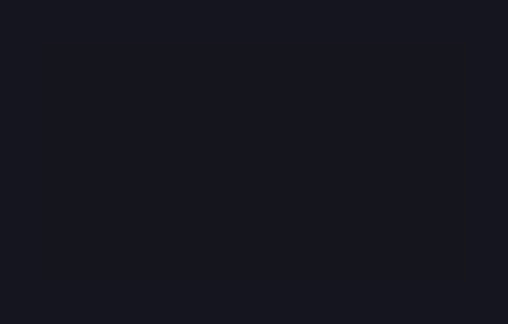

# CandyFlappy

<!-- BADGES:BEGIN -->
[](https://github.com/detain/sugarcraft/actions/workflows/ci.yml)
[](https://app.codecov.io/gh/detain/sugarcraft?flags%5B0%5D=candy-flappy)
[](https://packagist.org/packages/sugarcraft/candy-flappy)
[](LICENSE)
[](https://www.php.net/)
<!-- BADGES:END -->




candy-flappy — a Flappy-Bird-style game for the terminal, built on the SugarCraft stack, for PHP 8.3+. The bird's vertical motion is a SugarSpring projectile (gravity + an upward velocity kick on each tap), pipes scroll left at a fixed cell rate, collision is per-cell.

*Formerly published as `sugarcraft/honey-flap` (renamed 2026-10; namespace `SugarCraft\Flap\` → `SugarCraft\Flappy\`). The first run of `bin/candy-flappy` migrates a pre-rename `.honey-flap` high-score directory automatically, under the same config base the game itself uses: `$XDG_CONFIG_HOME` first, `$HOME/.config` as fallback (see "High scores, config, and environment").*

## Requirements

PHP **8.3+** and two PHP extensions — **`intl`** and **`mbstring`** — are
hard requirements: `sugar-core`'s cell-width maths depends on them. They are
declared in `composer.json`, so the composer path enforces them directly.
The phar below ships its vendor **frozen** and never consults composer
metadata, so the CLI runs a named launch preflight instead: it prints the
missing extension(s) and exits 2 rather than dying mid-first-frame with an
undefined-function error.

The in-game text is localized through a `lang/` catalogue (16 locales;
`lang/en.php` is the source of truth, and the active locale is picked up
from `$LANG`/`$LC_ALL`). The CLI's own usage and refusal lines deliberately
stay English so they remain parseable even when the locale is broken.

## Install & run

```bash
# From a clone of the monorepo (each lib carries its own vendor):
cd candy-flappy
composer install
./bin/candy-flappy      # or: php examples/play.php — interactive use only, no migration

# As a library dependency (pre-1.0: the package publishes a dev branch only):
#   composer require sugarcraft/candy-flappy:@dev

# Standalone executable (the published channel is currently FROZEN — see below):
wget https://github.com/detain/sugarcraft/releases/download/candy-flappy/latest/candy-flappy.phar
php candy-flappy.phar
```

A rolling latest phar is published on the host repository
[`detain/sugarcraft`](https://github.com/detain/sugarcraft) under the GitHub
Releases tag [`candy-flappy/latest`](https://github.com/detain/sugarcraft/releases/tag/candy-flappy/latest)
as `candy-flappy.phar`. Once the freeze below lifts, that artifact is
rebuilt automatically whenever the game's code changes on master. **It is
currently FROZEN at the 2026-11-04 build
(commit `f1c90bb34`)** — the 2026-11-05 sibling-pin CI wave has blocked phar
rebuilds fleet-wide. Until the release page shows an artifact newer than
2026-11-04, prefer the composer/path installs above — the download there is
a stale build, not the fresh one the wording once promised. Local rebuilds
are unaffected: `php -d phar.readonly=0 tools/build-phar.php` still works,
and its clean-published-vendor door fails CLOSED by design.

### Verify the phar

The release carries a `candy-flappy.phar.sha256` sidecar at the tag above;
`.phar.commit` and `.phar.pins.json` provenance sidecars join the set with
the fleet cure's post-freeze builds. Check a download with:

```bash
sha256sum -c candy-flappy.phar.sha256   # integrity
grep -m1 . candy-flappy.phar.commit     # which build you actually hold
```

No minisign public key is anchored for this app (candy-flappy ships no
self-update consumer), so `.sha256` plus `.phar.commit` are a disclosure of
what you hold, not a cryptographic attestation of who built it.

### Command line

`bin/candy-flappy` takes exactly two diagnostic flags; the table also covers
how other invocations behave (the game itself takes no arguments):

| Invocation              | Behaviour                                       |
|-------------------------|-------------------------------------------------|
| `--version`             | print the stamped version line, exit 0          |
| `-h` / `--help`         | print usage, exit 0                             |
| unknown argument        | echo sanitized args + usage on stderr, exit 2   |
| killed by a signal      | exit `128 + signo` (the conventional shell code) |

`php examples/play.php` is the bare-`Program` path: it boots the same game but
deliberately ignores all flags (no `--version`/`--help`/refusal handling).

## Keys

| Key                  | Action                                                |
|----------------------|-------------------------------------------------------|
| `Space` / `Enter` / `↑` / `w` (either case) | Flap (the first flap also starts the run)  |
| Mouse click / touch tap | Flap (the first click also starts the run)      |
| `r`                  | Restart — after a crash or mid-flight; a qualifying mid-flight score settles first, landing on the ready card |
| `q` / `Esc` / `Ctrl+C` | Quit                                              |

Other `Ctrl`-combinations do nothing; `Ctrl+C` is the only chord the game
reads. Legacy byte-degradation excepted: on terminals without kitty-protocol
reporting the control codes arrive as plain bytes indistinguishable from the
keys they collide with — `Ctrl+M`/`Ctrl+J` arrive as Enter and flap, `Ctrl+I`
arrives as Tab, which the game does not bind, and `Ctrl+[` is byte-identical
to `Esc`, so it quits by byte identity. Under kitty-protocol reporting all of
these arrive as distinct chords, which none of the bindings reads.

The board opens on a **ready card**: the bird hovers and the world is frozen
until your first flap, so launching never drops you into the floor. Quitting
or restarting (`q` or `r`) mid-flight with a qualifying score settles it onto
the leaderboard before the board resets — you do not have to die to keep your
best.

## Terminal requirements

The framed world needs a 62 x 21 viewport (`Game::MIN_COLS` x `Game::MIN_ROWS`
— the 60 x 18 world plus the two border columns and three status rows); on a
wider, taller terminal the frame stays that size and the surplus rows are
simply unused.

- **Smaller viewport** — a plain "needs a 62x21 terminal" notice replaces the
  board and the world freezes (no ticks burn on an unplayable frame). Resize
  back and the game resumes in place; `r` never snaps the layout away.
- **`TERM=dumb` / no TTY** (`ColorProfile::NoTty`) — candy-flappy refuses to
  play with a plain message instead of spraying escape codes into a terminal
  that cannot render them. A launch whose stdout is not a terminal (pipe,
  redirect, `/dev/null`) is refused by the CLI itself before anything is
  drawn: a two-line message on stderr, exit 1, zero bytes on stdout.
  `--version` / `--help` still answer when piped, and a truthy
  `CLICOLOR_FORCE` / `FORCE_COLOR` plays into the pipe on purpose. A real
  terminal reporting `TERM=dumb` gets the in-band NoTty refusal frame
  instead: the CLI probes the capability once and that single answer gates
  the alternate-screen contract, so a dumb terminal is never switched away
  from its normal screen and its cursor stays visible.
- **ASCII-only terminal** (`ColorProfile::Ascii`, e.g. `NO_COLOR` on a real
  tty) — same layout in plain glyphs: `+--+` borders, `#` pipes, no emoji,
  no colour.
- **Colour posture** — the detected `ColorProfile` only gates the refusal /
  ASCII branch above. Once the game draws in colour, every styled cell emits
  TrueColor SGR: there is no 16/256-colour degradation step (flappy never
  calls `Style::setDefaultProfile()`), so a 16- or 256-colour terminal shows
  whatever the emulator decides to do with the TrueColor bytes. The status
  hint collapses to a short form before any line could wrap past the window
  width.

The palette is hardcoded light-on-dark, and every ratio below is derived
from the constants in `src/Renderer.php` by `tools/contrast.php` — re-run
that script after a palette edit. Against the dark `#1a1b26` field the
amber bird reads 13.72:1, the green pipes 11.21:1 and the crash pink
5.89:1, while the `·` parallax dots sit at 1.37:1 — decorative scenery,
never information. On white the primaries invert to 1.25:1, 1.52:1 and
2.90:1: no light-background palette is provided, so use a dark terminal
theme. The status hint that carries the keyboard instructions sits at
3.71:1, below the 4.5:1 WCAG small-text line — low-vision players may
struggle to read it.

Play happens on the alternate screen (`ProgramOptions(useAltScreen: true)`,
DECSET 1049), so your normal scrollback is restored untouched on exit.

## Architecture

| File            | Role                                                                           |
|-----------------|--------------------------------------------------------------------------------|
| `Bird.php`          | Wraps a SugarSpring `Projectile` — gravity pulls it down, `flap()` resets vertical velocity to a fixed kick, and fall speed is capped at terminal velocity. |
| `Pipe.php`          | Single-column pipe pair with a gap centred to one row — for even gap heights the band tilts one row toward the floor (`collides()` anchors `top = gapY - intdiv(h-1,2)`, `bottom = gapY + intdiv(h,2)`). Slides left one cell per tick.     |
| `TickMsg.php`       | Frame-tick message fired by the `game-tick` subscription timer (`Game::TICK_SECONDS`, 1/30 s exactly). |
| `Game.php` (Model)  | Pure-state world: bird + pipes + score + crashed flag. Injects PRNG closure for deterministic gap placements in tests. |
| `Renderer.php`      | Pure view — single playfield walk, ANSI-styled glyphs, rounded border.         |
| `PipeGenerator.php` | Generates pipes with variable gap height — gap shrinks as score increases, raising difficulty. Gap starts at 6 cells, shrinks by 1 every 5 points, floors at 3. |

The PRNG is injected as a `Closure(int $maxInclusive): int` so unit tests can pin the pipe layout to a specific sequence — the standard SugarCraft pattern.

## Difficulty scaling

The pipe gap height adapts to the player's score:

| Score range | Gap height |
|-------------|------------|
| 0–4         | 6 cells    |
| 5–9         | 5 cells    |
| 10–14       | 4 cells    |
| 15+         | 3 cells    |

Gap shrinks by 1 every 5 points, bottoming out at 3 cells to keep the game playable. This is implemented by `PipeGenerator::gapHeightForScore()` and applied automatically when `Game` spawns new pipes via `PipeGenerator::makePipe()`. The gap's centre row is drawn from the injected PRNG inside `[3 + h/2, HEIGHT - 3 - h/2]`, so a gap never touches the floor or ceiling rows.

## Bird physics & tuning

The bird's vertical motion is a SugarSpring `Projectile` in the Y-down convention (positive velocity = falling). Three constants on `Bird` tune the feel for an 18-row playfield at 30 ticks/sec:

| Constant             | Value        | Role                                                        |
|----------------------|--------------|-------------------------------------------------------------|
| `Bird::FLAP_KICK`    | `-10.0`      | Upward velocity (cells/sec) applied by a flap.              |
| `Bird::GRAVITY`      | `18.0`       | Constant downward acceleration (cells/sec²).                |
| `Bird::TICKS_PER_SEC`| `30`         | Simulation rate baked into the projectile's `deltaTime`.    |

Fall speed is clamped to `Projectile::TERMINAL_GRAVITY` (53 cells/sec) on every tick, so an uninterrupted drop can never accumulate enough velocity to teleport the bird several rows in a single frame and skip a pipe without a collision.

## Crash rules

The game ends on any of three contacts, all handled identically:

- **Floor** — the bird's row reaches `Game::HEIGHT` (row ≥ 18).
- **Top wall** — the bird's row goes above the ceiling (row < 0). A hard flap into the top edge crashes just like the floor.
- **Pipe** — the bird's cell lands outside a pipe's open gap.

## High-score persistence

On any finish (crash, `q` quit, or `r` restart) a score that earns a slot on the leaderboard — the ten slots are still open, or it beats the lowest entry — is merged and written to `scores.json` under the config dir (`$XDG_CONFIG_HOME` or `$HOME/.config`, in `.candy-flappy/`). The list is bounded to the top `Game::MAX_HIGH_SCORES` (10) entries; the 🏆 shout belongs only to a run that beats the current best. The write runs off the synchronous `update()` path via a `Cmd` and swallows I/O errors, so a full or unwritable disk can never crash the render loop. The file itself is published through sugar-core's `AtomicJsonFile` (flock + temp-and-rename, `0600` mode) — never a bare truncate-write. Saved scores are loaded on the next `Game::start()`, which **fails soft**: a corrupt, unreadable, or oversized (over `Game::MAX_SCORE_FILE_BYTES`) save is quarantined aside as `scores.json.corrupt-<timestamp>` and play starts with an empty board, so a bad file can never brick launch. Entries are legality-clamped on read: non-integers, zero, negatives, and scores of `Game::SCORE_CEILING` or above are dropped.

## Test

```bash
composer install
vendor/bin/phpunit
```

## Snapshot tests

Game frame output is pinned via `sugar-testing`'s `assertGoldenAnsi` golden-file
snapshots (`tests/fixtures/*.golden`). Comparison is byte-exact and never
auto-rewrites: a differing golden fails. Any change to the ANSI playfield must be
intentional — to accept a new render, delete the fixture and re-run once with the
create-mode env var (`sugar-testing` only creates a golden when it is missing):

```bash
rm tests/fixtures/render-alive.golden
UPDATE_GOLDENS=1 vendor/bin/phpunit --filter GoldenRenderTest   # recreates
vendor/bin/phpunit --filter GoldenRenderTest                    # must pass with no env
```

## Scoring

The score increments by one for each pipe pair whose column passes the bird's
column (per tick), so surviving is scored, not flapping. Every run that earns
one of the ten leaderboard slots is merged into the machine's top-ten ladder,
and the 🏆 belongs to a run that beats the best.

Tuning is compiled in, deliberately: physics constants, tick rate, gap bands
and key bindings are NOT configurable. The leaderboard and the difficulty
curve are one coherent game; knobs would let a session claim scores the
defaults could not produce.

## High scores, config, and environment

- Save file: `~/.config/.candy-flappy/scores.json` (0600, atomic; a corrupt
  file is quarantined to `scores.json.corrupt-<timestamp>` instead of
  bricking launch).
- Config base resolution: `XDG_CONFIG_HOME` if set, else `HOME/.config`. With
  neither set the game refuses to launch rather than guess.
- To reset the leaderboard: `rm ~/.config/.candy-flappy/scores.json`.
- Colour posture follows `sugar-core`'s `ColorProfile::detect()`:
  `NO_COLOR` forces the ASCII posture; `CLICOLOR_FORCE` / `FORCE_COLOR` can
  force colour on where detection would otherwise withhold colour (and let the CLI draw into a
  pipe on purpose); a non-TTY stdout is refused by the CLI before launch
  (stderr, exit 1), and a `TERM=dumb` terminal gets the plain refusal screen.

## Dependencies

Runtime: PHP `^8.3`, [`sugarcraft/sugar-core`](https://packagist.org/packages/sugarcraft/sugar-core)
(program loop, messages, `Subscriptions`, `AtomicJsonFile`),
[`sugarcraft/sugar-style`](https://packagist.org/packages/sugarcraft/sugar-style)
(the styled-cell renderer), and [`sugarcraft/sugar-spring`](https://packagist.org/packages/sugarcraft/sugar-spring)
(spring physics: the bird's flap impulse and gravity ride `Projectile`).
Development only: PHPUnit `^10` and [`sugarcraft/sugar-testing`](https://packagist.org/packages/sugarcraft/sugar-testing)
(`assertGoldenAnsi`).

## Credits & inspiration

Design antecedent: [kbrgl/flapioca](https://github.com/kbrgl/flapioca); SugarCraft is developed as a native PHP project.
