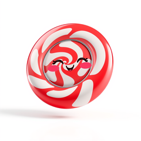
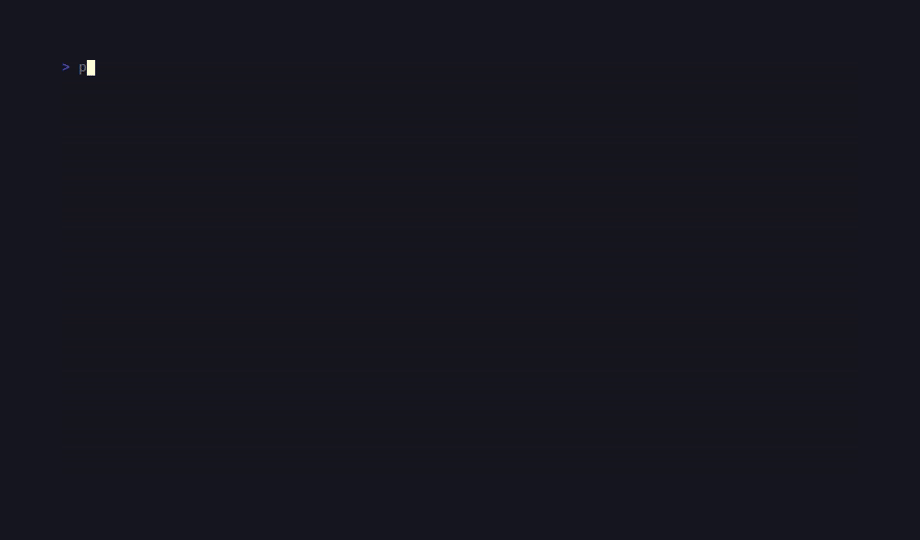

# CandyGifView

<!-- BADGES:BEGIN -->
[](https://github.com/detain/sugarcraft/actions/workflows/ci.yml)
[](https://app.codecov.io/gh/detain/sugarcraft?flags%5B0%5D=candy-gifview)
[](https://packagist.org/packages/sugarcraft/candy-gifview)
[](LICENSE)
[](https://www.php.net/)
<!-- BADGES:END -->




Terminal GIF viewer for PHP 8.3+ — the command-line front end built on
[`sugarcraft/sugar-animation`](https://github.com/detain/sugarcraft/tree/master/sugar-animation). Point it at a `.gif` on
disk and it decodes via `ext-gd`, sizes the frame grid to your terminal, and
plays the animation in the alternate screen as 24-bit background-coloured
blocks or an ASCII luminance ramp. GIF is the only input format it reads.

```bash
composer require sugarcraft/candy-gifview
candy-gifview my-animation.gif         # solid-block preset (default)
candy-gifview my-animation.gif density # ASCII luminance ramp
```

```
candy-gifview [options] <gif> [solid|density]
```

With a project-local install, invoke the binary as `./vendor/bin/candy-gifview`.

A rolling development phar is published on GitHub Releases under
[`candy-gifview/dev`](https://github.com/detain/sugarcraft/releases/tag/candy-gifview/dev)
as `candy-gifview.phar`. **The channel is FROZEN at the 2026-11-04 build
(commit `f1c90bb34`)**: the sibling-pin CI wave (OD-14) has blocked phar
rebuilds fleet-wide, and rolling builds resume only with the fleet
phar-workflow cure. Until the release page shows an artifact newer than
2026-11-04, prefer `composer require sugarcraft/candy-gifview`.

### Verify the phar

The release carries the sidecars `candy-gifview.phar.sha256`,
`candy-gifview.phar.sha256.sig`, `candy-gifview.phar.minisig`,
`candy-gifview.phar.commit`, and `candy-gifview.phar.pins.json` at the URL
above. Check a download with:

```bash
sha256sum -c candy-gifview.phar.sha256   # integrity
grep -m1 . candy-gifview.phar.commit     # which build you actually hold
```

Compare `.phar.commit` to the commit you expected (the release body names
it). No minisign public key is anchored for this app yet — `.minisig` is
published but there is no trusted key to verify it with (gifview has no
self-update consumer), so `.sha256` plus `.phar.commit` are a disclosure of
what you hold, not a cryptographic attestation of who built it.

The viewer paints with pure SGR background blocks rather than a terminal
graphics protocol (kitty/sixel/iTerm2), so it runs anywhere 24-bit colour
works — inline-protocol rendering is a different route, offered by
`sugar-image`.

## Options

| Option                | Meaning                                                          |
|-----------------------|------------------------------------------------------------------|
| `--fps=N`             | Play at a uniform N frames/second instead of the GIF's delays. Values above `Player::MAX_FPS` clamp silently, and the scheduler's one-centisecond tick floor caps the real rate near 100 fps anyway. |
| `--speed=N`           | N × the GIF's nominal rate (decoded delays averaged), landing on the same single uniform period as `--fps`. |
| `--speed=Nfps`        | An absolute rate of N frames/second.                              |
| `--speed=max`         | Burn frames as fast as the scheduler's floors allow.              |
| `--duration=SECONDS`  | Stop after SECONDS of playback time — paused time never accrues (a schedule deadline in the model — no wall-clock kill). Needs at least two frames: a single-frame file combined with `--duration` is refused. |
| `--watch`             | Reload automatically when the source file changes, via a 10 ms event-loop poll. Bare flag — it takes no value. |
| `--paused`            | Start paused on the first frame (step with the arrow keys, `Space` resumes). Bare flag — it takes no value. |
| `--help` / `-h`       | Print the usage line (localised) and exit 0.                      |
| `--version` / `-v`    | Print the version stamp and exit 0.                               |

Flags may appear before or after the positional `<gif>` and preset token.
The rate arithmetic runs on three slots. A **rate slot** is written by both
`--fps=N` and the absolute form `--speed=Nfps` — they share the slot, so the
last of *those* spellings wins. A **multiplier** (`--speed=N`) composes onto
whatever the rate slot holds (the GIF's own nominal rate when the slot is
empty), so it matters not at all whether the multiplier or the rate flag came
first: `--fps=10 --speed=2` plays at 20 fps, and so does `--speed=2 --fps=10`.
And a **max latch**: once any `--speed=max` has been seen it overrides
everything else and is never cleared by a later flag — the gotcha is
first-spelling-wins, so `--speed=max --speed=2` still burns at the ceiling,
and `--fps=10 --speed=2 --speed=3fps` lands on 3 × 2 = 6 fps (the `Nfps`
form overwrote the rate slot, the multiplier composed onto it). An unknown
preset token (a typo like `densiy`) is refused with an explicit message — the
two valid tokens are `solid` and `density`; a third positional argument is
likewise refused. Stdin is not read: a bare `-` is treated as an ordinary
file-path argument and is refused as `could not play '-'`.

The loop count stored in the file is honoured:

- A count of N means N extra repeats after the first play (N+1 passes in total).
- A count of 0 — or a file with no loop extension — plays forever.
- That forever-default deliberately diverges from libnsgif's single-play answer.

## Keys

| Key                    | Action                           |
|------------------------|----------------------------------|
| `Space`                | Pause / resume                   |
| `←`/Left               | Step back one frame, wrapping    |
| `→`/Right              | Step forward one frame, wrapping |
| `d`                    | Toggle solid ↔ density preset    |
| `q` / `Esc` / `Ctrl+C` | Quit                             |

The key table is fixed in the player model; keys are not rebindable.

## Requirements

- **ext-gd** decodes the GIF (declared as a `suggest`). The CLI checks for it
  before touching the file and exits non-zero with a clear message.
- Both presets emit 24-bit truecolor SGR: `solid` paints the cell background
  (`48;2`) with a space glyph, `density` paints the foreground (`38;2`) on a
  ramp character. There is no
  256-colour fallback ladder and no `NO_COLOR` / monochrome mode. On a
  terminal without truecolor the blocks degrade (often to default or
  nearby-index colour); the `density` preset's character ramp stays
  legible there and is the better choice. On `TERM=dumb` or otherwise
  capability-poor terminals, expect raw escape sequences rather than a
  usable frame.
- The viewer switches to the alternate screen and sizes the viewport through
  sugar-core's never-throwing terminal façade: an explicit `COLUMNS`/`LINES`
  environment pair (positive integers) wins first, otherwise stdout is probed;
  off a terminal (piped output, CI) the viewport falls back to a deterministic
  60×24 cell grid. A probe failure can therefore never surface as a crash —
  the worst answer is the fallback grid.
- Off a terminal the viewer does not refuse: it plays to stdout as a raw
  escape stream and still expects its quit keys on stdin. An animation the
  GIF itself never bounds (no finite loop count) repeats forever, so with
  stdin at EOF — `/dev/null`, a closed pipe — the run **never ends on its
  own; it runs until killed**. For scripted or CI use pass `--duration=N`,
  or wrap the call in `timeout(1)`: `timeout 5 bin/candy-gifview loop.gif
  </dev/null` — the wrapper returns 124 when the timer kills the viewer.
- **Platforms**: Linux, macOS and WSL2 are supported. Because sizing now goes
  through the façade, sugar-pty's `SUGARCRAFT_LIBC` rescue environment variable
  is no longer load-bearing for the viewer. On hosts with `ffi.enable=0` the
  size probe cannot fatal: the COLUMNS/LINES hatch or the 60×24 fallback
  answers instead.
- GIF transparency is composited against the terminal's own background —
  transparent cells render as whatever colour your terminal uses there.

## Limits

- The engine decodes at most 256 frames per animation
  (`Decoder::MAX_FRAMES`); longer files are truncated to the first 256 at
  intake and an explicit notice is printed on stderr. The notice fires
  whenever the decoded list fills the window — a file with exactly 256
  frames also gets it, because until the engine reports the total seen,
  "256 decoded" cannot tell a full window from a truncated stream, and
  over-disclosing is the honest direction. `Cli::MAX_FRAMES`
  (4096) is only the outer ceiling.
- Intake is also bounded by file size (`Cli::MAX_INPUT_BYTES`, 64 MiB): files
  over the cap are refused before they are buffered. The size check and the
  read are two separate looks at the path, so a file swapped between them can
  still land a few bytes past the cap. FIFOs and devices are blocked by the
  engine's `is_file()` gate. A resident-cell budget
  (`Cli::MAX_RESIDENT_CELLS`, 6 million frame cells for the current viewport)
  bounds the other axis. The engine separately bounds the requested OUTPUT
  grid at 100,000 cells (`Decoder::MAX_CELLS`) and gates the source GIF's own
  canvas at 2 million pixels (`Decoder::MAX_TOTAL_PIXELS`).
- `--watch`: the reload's decode runs synchronously inside the poll tick — a
  large replacement file can stall one tick — and a reload that trips any cap
  above keeps the stale frames rather than blanking the screen.
- Frames are decoded at the launch size: growing the window reveals no
  extra detail — and not even on a `--watch` reload, which re-decodes at the
  frozen launch budget; only a restart re-queries the terminal. Shrinking
  re-clamps the grid and crops the frame.
- Startup decodes before the first frame is painted; a line announcing the
  decode is written to stderr first, so a long wait is at least not silent.
  Quitting restores the terminal's prior contents — the last frame does not
  stay on screen (the viewer runs in the alternate screen).

## Exit codes

| Code | Meaning                                                                |
|------|------------------------------------------------------------------------|
| 0    | `--help`/`--version` printed, or playback ended normally.              |
| 1    | Flag/argument refusal, the ext-gd capability refusal, or a decode failure — the message lands on stderr. |
| 128+N | The loop was stopped by signal N (e.g. 143 for SIGTERM).              |

## Accessibility

- The `density` preset encodes luminance as character ramp density, not
  only as colour, so it survives colour-blindness and poor-colour
  terminals better than `solid`.
- Playback can start paused (`--paused`) and is fully steppable by key
  (`←`/`→`) — motion is never mandatory to see content.
- The player caps frame rate at its own scheduler floors; `--speed=max` is
  opt-in, never the default.
- All CLI messages are localised into 16 locales. The bin shim calls
  `T::setLocale(T::detect())` before its first message (there is no `--lang`
  flag); `T::detect()` consults `LC_ALL`, then `LC_MESSAGES`, then `LANG`.
  The in-app playback chrome (the status line) is currently English-only.
- **Reduced motion is not auto-detected**: unlike `sugar-spring` and
  `sugar-toast`, this viewer does not read `REDUCE_MOTION` or
  `PREFERS_REDUCED_MOTION`. Motion-averse users must opt in with `--paused`
  (or step with `←`/`→`). This is a known gap against the fleet convention,
  disclosed here rather than silently ignored. The seam already exists —
  `Player`'s `paused:` constructor argument (which `--paused` feeds) and
  `Probe::reducedMotion()` from `sugar-colorprofile` — so auto-detection
  would be a small opt-in change.

## Architecture

The whole animation engine — `Decoder`, `Frame`, `Renderer`, `Player`, and
the separate `.ansi` art surface (`AnsiArt` / `ArtLibrary` / `ArtLoop`,
which this viewer does not expose) — lives in
[`sugarcraft/sugar-animation`](https://github.com/detain/sugarcraft/tree/master/sugar-animation). This package is only the viewer app; the viewport is sized through sugar-core's never-throwing `Util\Tty` façade, and the direct
[`sugarcraft/sugar-pty`](https://github.com/detain/sugarcraft/tree/master/sugar-pty) require keeps that façade's ioctl seat resolvable when this app is published standalone:

| File              | Role                                                                 |
|-------------------|----------------------------------------------------------------------|
| `bin/candy-gifview` | Autoload probe, locale wiring (`T::setLocale(T::detect())` before the first message), and a `Cli::main()` hand-off — deliberately a thin shim. |
| `src/Cli.php`         | Argv parsing, gd preflight, viewport sizing, intake caps, decode-failure exits, Player wiring, Program launch, and signal re-encoding (`stopSignal()` → 128+N). |
| `src/Support/Version.php` | Resolves the version stamp: the phar's embedded `metadata['version']` when running from a phar (release `x.y.z` or an honest `dev-<sha>`/`dev-build` stamp), falling back to the compiled `CURRENT` constant. |
| `src/Lang.php`    | i18n facade over the shared `T` registry, namespace `gifview` (`cli.usage`, `cli.bad_flag`, `cli.bad_value`, `cli.too_many`, `cli.unexpected_value`, `cli.bad_preset`, `cli.no_frames`, `cli.cannot_play`, `cli.reason_frames_over`, `cli.reason_bytes_over`, `cli.reason_cells_over`, `cli.duration_static`, `cli.need_gd`, `cli.decoding`, `cli.truncated`, `cli.no_autoload` — all 16 keys ship in every locale file; `cli.no_autoload` exists so the parity census sees the string the bin shim prints before autoload, where translation cannot run). |

Three cross-cutting behaviours of `src/Cli.php` worth knowing before reading
the source:

- The viewport sizing reserves two rows (status line + trailing newline
  guard) and answers in this order: `COLUMNS`/`LINES` environment hatch,
  then sugar-core's never-throwing `Util\Tty` probe on stdout, then the
  fixed 60×24 fallback off a terminal.
- Every interpolated echo — paths, argv tokens, and the relayed engine
  reason (which itself embeds a raw path) — passes a single `printable()`
  control-char choke before it reaches the terminal.
- The decode-failure rescue catches take any `\Throwable`, so a raw engine
  `\Error` still exits 1 loudly, wrapped in one localised
  `could not play` line.
- The `$play`, `$watchStat` and `$decode` closure seams keep every branch
  testable without entering the blocking loop.

## Test

```bash
composer install
vendor/bin/phpunit
```

`php examples/view.php` is a self-contained hands-on demo: it builds a
synthetic animated GIF in a temporary file (removed on exit) and plays it
through the same CLI entry point, so there is nothing to download.

## Credits & inspiration

Design antecedent: [`namzug16/gifterm`](https://github.com/namzug16/gifterm). The decode/render/playback layer it mirrors is developed here as [`sugarcraft/sugar-animation`](https://github.com/detain/sugarcraft/tree/master/sugar-animation); SugarCraft is a native PHP project.
