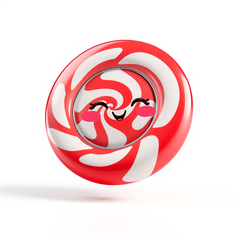
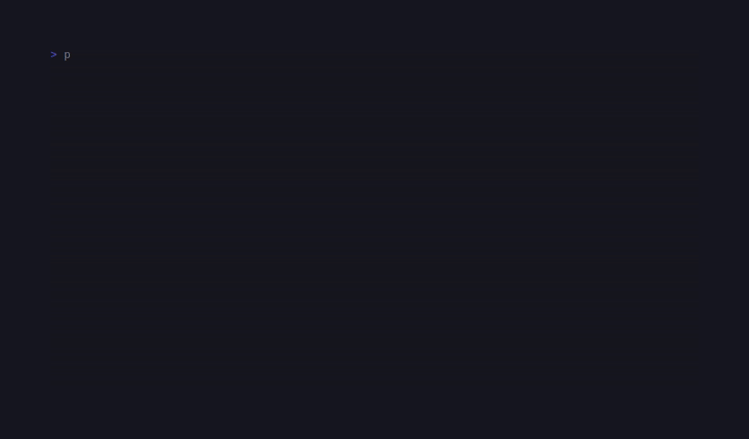

# CandyGifView

<!-- BADGES:BEGIN -->
[](https://github.com/detain/sugarcraft/actions/workflows/ci.yml)
[](https://app.codecov.io/gh/detain/sugarcraft?flags%5B0%5D=candy-gifview)
[](https://packagist.org/packages/sugarcraft/candy-gifview)
[](LICENSE)
[](https://www.php.net/)
<!-- BADGES:END -->




Terminal GIF and `.ansi`-art viewer for PHP 8.3+ — the command-line front end built on [`sugarcraft/sugar-animation`](../sugar-animation/). Point it at a `.gif` on disk and it decodes via `ext-gd`, sizes the frame grid to your terminal, and plays the animation in the alternate screen as 24-bit background-coloured blocks or a Unicode luminance ramp.

```bash
composer require sugarcraft/candy-gifview
candy-gifview my-animation.gif         # solid-block preset (default)
candy-gifview my-animation.gif density # ASCII luminance ramp
```

## Options

| Option                | Meaning                                                          |
|-----------------------|------------------------------------------------------------------|
| `--fps=N`             | Play at a uniform N frames/second instead of the GIF's delays.    |
| `--speed=N\|Nfps\|max`| N × the GIF's nominal rate; `Nfps` is an absolute rate; `max` burns frames as fast as the scheduler floors allow (chicle parity). |
| `--duration=SECONDS`  | Stop after SECONDS of playback (a schedule deadline in the model — no wall-clock kill). |
| `--watch`             | Reload automatically when the source file changes (chicle's run_watch as a 10 ms event-loop poll; E-10). Bare flag — it takes no value. |

Flags may appear before or after the positional `<gif>` and preset token.

A GIF's authored NETSCAPE loop count is honoured by default (E-02): `raw N`
means N extra repeats after the first play (so N+1 total passes) and `raw 0`
— like a file with no loop extension at all, the deliberate divergence from
libnsgif's single-play default — plays forever.

## Keys

| Key                | Action                              |
|--------------------|-------------------------------------|
| `Space`            | Pause / resume                      |
| `←`                | Step back one frame                 |
| `→`                | Step forward one frame              |
| `d`                | Toggle solid ↔ density preset       |
| `q` / `Esc`        | Quit                                |

## Architecture

The whole animation engine — `Decoder`, `Frame`, `Renderer`, `Player`, and the
`.ansi` art surface (`AnsiArt` / `ArtLibrary` / `ArtLoop`) — lives in
[`sugarcraft/sugar-animation`](../sugar-animation/). This package is only the viewer app:

| File              | Role                                                                 |
|-------------------|----------------------------------------------------------------------|
| `bin/candy-gifview` | Autoload probe + `Cli::main()` shim — deliberately two lines of logic. |
| `src/Cli.php`     | Argv parsing (`--help`, preset token, E-09 `--fps`/`--speed`/`--duration`), viewport sizing (`viewportCells()` — descriptor 1 behind a core `stream_isatty` gate), decode-failure exits, Player wiring, Program launch. A `$play` closure seam keeps every branch testable without entering the blocking loop. |
| `src/Lang.php`    | i18n facade over the shared `T` registry, namespace `gifview` (`cli.usage`, `cli.no_autoload`, `cli.bad_flag`, `cli.bad_value`, `cli.too_many`). |

## Test

```bash
composer install
vendor/bin/phpunit
```

## Credits & inspiration

Design antecedent: [`namzug16/gifterm`](https://github.com/namzug16/gifterm). The decode/render/playback layer it mirrors is developed here as [`sugarcraft/sugar-animation`](../sugar-animation/); SugarCraft is a native PHP project on the Charm-inspired TEA stack.
