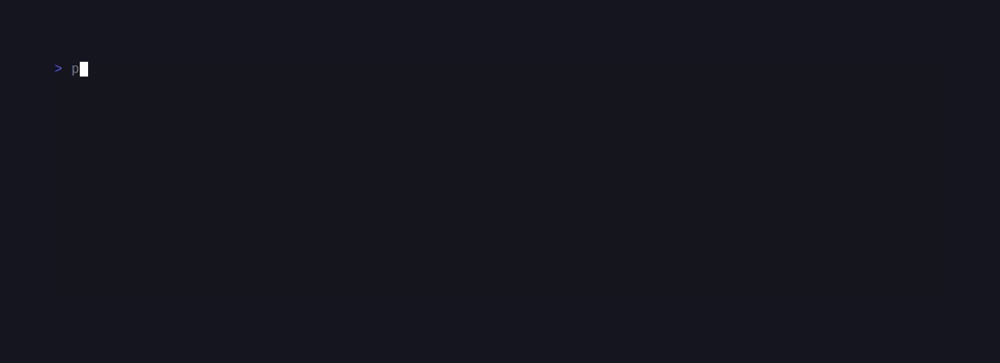

# CandyGit

> Formerly published as `sugarcraft/sugar-stash` (renamed 2026-10). <!-- @rename-keep -->
> Namespace changed: `SugarCraft\Stash\` → `SugarCraft\Git\`. <!-- @rename-keep -->

<!-- BADGES:BEGIN -->
[](https://github.com/detain/sugarcraft/actions/workflows/ci.yml)
[](https://app.codecov.io/gh/detain/sugarcraft?flags%5B0%5D=candy-git)
[](https://packagist.org/packages/sugarcraft/candy-git)
[](LICENSE)
[](https://www.php.net/)
<!-- BADGES:END -->


candy-git — a three-pane git TUI for PHP 8.3+, built on the SugarCraft stack. Status on the left, branches stacked over the log on the right; single-key stage / unstage, refresh, and an ahead/behind summary for branches that track an upstream.

```bash
composer require sugarcraft/candy-git
vendor/bin/candy-git    # run inside any git working tree
```

Add `:@dev` (`composer require sugarcraft/candy-git:@dev`) while your project's
`minimum-stability` is `stable` — Packagist carries only the rolling `dev-master`
branch until a stable tag is cut, so the bare requirement dies with
`does not match your minimum-stability`. This composer channel is distinct from
the GitHub release tags: `candy-git/v*` tags (and the rolling `candy-git/latest`
prerelease) are the phar channel, and until a stable `candy-git/v*` tag is cut
the only release artifact is that prerelease phar.

From a clone of this repository, run `composer install` inside `candy-git/`
first — `vendor/` is gitignored, and without it the launcher exits with
`candy-git: cannot find composer autoload.php`. Then `php candy-git/bin/candy-git`
works. Release users can grab the `candy-git.phar` from the GitHub release and run
`php candy-git.phar`. `--version`, `--help`, and the
`-h` alias short-circuit and exit 0 anywhere; any *other* argument exits 2 with a
usage line rather than being silently ignored.

## Requirements

- PHP 8.3+
- git **2.23 or newer** — the hard floor is `git restore` (candy-git's discard
  and unstage engine); the `--porcelain=v1` status engine predates it. candy-git
  checks `git --version` at launch and refuses older binaries (or a missing git)
  with one readable sentence, exit code 1.
- An interactive terminal: the UI is a full-screen program (alt buffer on
  styling terminals, inline under `TERM=dumb`), so a piped stdout is refused
  instead of rendering escape-sequence soup.
- A checked-out work tree — bare repositories have no status pane to show and
  are refused at launch.

- **Operating systems.** Linux and macOS use the pipe-based runner. On Windows
  the runner takes a polled temp-file ladder instead (`stream_select` cannot poll
  `proc_open` pipes there; child stdin is the `NUL` device or a payload file, and
  a timed-out child's process tree is stopped with `taskkill /F /T`). The OS
  differences live behind the injectable `Platform` seam, both branches are
  unit-tested on every host, and `candy-git` is in the Windows CI leg
  (`WINDOWS_LIBS`) so the real thing is exercised on `windows-latest`. A launch
  failure that is not a missing git (the binary is on PATH but would not start)
  prints the OS reason instead of the install hint.

See **Trust boundary** below for what candy-git disables inside a repository's
own git config.

## Scope (v1)

candy-git v1 covers the local-repository loop: status / stage / unstage /
discard, branches (checkout, create, delete — with remote-tracking branches
listed and their divergence badged), log (fetched in 20-commit pages that deepen
as the cursor walks off the bottom, with a read-only commit details view and
armed revert / reset --hard on it), the diff viewer, commit and
amend, merge, cherry-pick, the sequencer menu (continue / abort / skip), stash
create / apply / pop / drop, worktrees (list / add / remove), an interactive-rebase todo
preview, the remote trio (fetch / pull / push, each behind an armed confirm),
and undo / redo of the last operation.

Not in v1 (absent, not hidden behind a key): **remote management** (add /
rename / remove remotes), **tags**, **reflog**, **bisect**, **submodules**,
hunk- and line-level **patch staging**, an in-app **conflict-resolution** view,
and *executing* the interactive-rebase todo (it is a preview
today). Every git call is a synchronous, timeout-bounded subprocess on the UI
thread; moving git work onto the ReactPHP loop as async commands (so slow
remotes cannot stall rendering) remains the v2 direction.

## Keys

| Key                      | Action                                                  |
|--------------------------|---------------------------------------------------------|
| `Tab`                    | Cycle pane focus                                        |
| `↑/↓` or `k/j`           | Move cursor in active pane                             |
| `PageUp/PageDown`        | Jump the cursor a paneful in active pane                |
| `Home/End`               | Jump the cursor to the first / last entry               |
| `s` (status pane)        | Stage / unstage the highlighted entry — on conflicted or untracked rows the first press stages (there is no staged side to reverse) |
| `a` (status pane)        | Stage all files                                         |
| `d` (status pane)        | Discard changes to the highlighted file (press twice) — on an untracked row it **deletes the file from disk** (press twice; unrecoverable) |
| `Enter` (status pane)    | Open diff viewer for the highlighted file — untracked rows open as an all-additions diff (git's own new-file shape), stageable hunk by hunk |
| `Enter` (log pane)       | Open the commit under the cursor — a read-only details view of `git show --stat --format=full --patch` |
| `f` (press twice)        | Fetch from the remote                                  |
| `p` (press twice)        | Pull from the remote                                   |
| `P` (press twice)        | Push to the remote — the first push of an untracked branch bootstraps `origin` with `--set-upstream`; refuses on detached HEAD |
| `Space` (branches pane)  | Checkout branch                                         |
| `c`                      | Commit — the message collector owns the keyboard: `Tab` inserts a newline (subject+body are typable, and pastes keep their line structure), `Enter` commits, `Esc` cancels. Commits ONLY what you staged — unstaged edits stay in the work tree (stage first with `s` / `a`) |
| `A`                      | Amend the last commit — opens the collector pre-filled with its message; editing it rewrites HEAD, submitting unchanged is the old keep-the-message amend |
| `n`                      | Create and switch to a new branch — opened while the log pane is focused, the branch starts at THAT commit (the collector says so: `new branch from <sha>:`) |
| `u`                      | Undo last operation — undoing a commit resets the boundary and re-arms the collector with the typed message (nothing authored is lost); undoing stage-all restores the exact prior selection, and refuses when a file was partially staged (its staged version lived only in the index). Remembers the last 100 operations — older ones fall off the lane silently — and refuses outright where the inverse would lie: discard, untracked-file delete, amend, merge, revert, and reset --hard, plus the conditional ones: a checkout with no origin to return to, a branch delete whose prior SHA was not recorded, and the partial-stage-all above |
| `Ctrl+r`                 | Redo last undone operation (same 100-entry lane; a fresh operation clears it) |
| `D` (branches pane)      | Delete the selected branch (press twice) — refuses to delete the current branch |

Remote-tracking branches (`~ origin/feature`) are listed under the locals with
per-branch divergence badges (`[↑2 ↓1]`, `[!]` for a vanished upstream). Space
on one DWIMs the way git does: `--track` creates a local branch of that name,
or — when the local already exists — checks it out. They are read-only for
`D`: the branch family manages locals.
| `M`                      | Merge — prompt for a branch/ref to merge into current, seeded with the branch under the cursor when the branches pane has a non-current row selected (still editable) |
| `r`                      | Open the sequencer menu (continue / abort; skip on a rebase) — when stopped only: opens while a rebase, cherry-pick, or conflicted merge is pending; on an idle repo it reports "no rebase in progress" |
| `S`                      | Open stash manager (create / apply / pop / drop; push takes an optional message, `u` includes untracked; pop and drop ask twice, and a drop is undoable from the main view; the overlay stays open after apply so it remains usable) |
| `V`                      | Cherry-pick — type a commit ref and press Enter; from the log pane or the commit details view the ref is pre-filled from the cursor |
| `w` (branches pane)     | Open worktrees manager (list / add / remove) — path collection refuses option-injection and `..` traversal; it does not jail the destination inside the repository |
| `i`                      | Interactive rebase todo list — preview only; the todo is not yet executed |
| `R`                      | Refresh from disk                                       |
| `?`                      | Context-sensitive help — lists the general keys and the focused pane's verbs; the Log pane is deliberately not listed (its actions live inside the read-only commit details view) |
| `q`                      | Quit — while an overlay is open it closes the innermost one (same chain as `Esc`), and while typing in a text buffer `q` is just a letter |
| `Ctrl+C`                 | Quit — the same chord as `q` while idle; while a text buffer owns the keyboard it rides the `Esc` chain instead and CANCELS the innermost overlay (a half-typed commit draft is dropped — `q` would only have typed a letter) |
| `Esc`                    | Cancel the innermost overlay/collection; quits when nothing is open    |

### Signed commits

When the repository resolves `commit.gpgsign` to true (and `gpg.format` is not
`ssh`), `c` / `A` sign through gpg-agent's **pinentry** — which prompts on the
terminal directly, an input channel the app's stdin isolation cannot fence:
the prompt paints over the interface and candy-git sees nothing while it
waits. The collector's amber lane warns about this before you type. Unlock
your key first; if the wait outlives the 120-second mutating budget the child
is terminated mid-signature, the commit fails, and your message survives in
the still-open collector. SSH-format signing (`gpg.format=ssh`) is exempt —
it rides an ssh-agent socket you unlocked outside the app already. Retiring
this into a suspend-the-UI flow is the async work tracked as candy-git-010.

### Text-entry keys

While collecting text (commit message with `c`, branch name with `n`,
merge target with `M`, cherry-pick ref with `V`, worktree path and branch
with `a` + `tab` in the worktrees overlay): printable keys and `Space` append,
`Backspace` deletes the last character (one press erases a whole emoji cluster,
ZWJ families included), `Ctrl+W` kills the previous word, `Ctrl+U` clears the
line, a bracketed `paste` inserts the sanitized text, `Enter` confirms, and
`Esc` cancels. A buffer longer than the bar is shown as a tail window with a
leading `…`, so the caret and the text you just typed are always visible.

### Diff viewer keys

| Key              | Action                          |
|------------------|--------------------------------|
| `Space`          | Stage the current hunk (worktree side) — the viewer stays open and lands on the next hunk. On the staged side it **unstages** instead, armed: press twice |
| `j/k`            | Scroll the view one line (the selected hunk stays selected) |
| `[` / `]`        | Previous / next hunk            |
| `PageUp/PageDown`| Scroll a screenful of lines     |
| `Home/End`       | First / last hunk               |
| `Esc`            | Close diff viewer               |
| `d`              | Close diff viewer (same action as `Esc`) |

A diff whose capture hit the 4 MiB ceiling shows a `tail truncated at 4
MiB` line in the viewer, and the last hunk of such a diff refuses to
stage or unstage - its bytes are incomplete, and a partial patch would
fail in `git apply` with a confusing error. Earlier hunks are complete
and stay actionable.

The overlay title carries a side chip — `worktree` for the unstaged diff,
`staged` for the index diff opened from a staged-only row — so `Space`
can never act on a side you are not looking at.

### Commit details keys

Opened by `Enter` on a log row. It is the same window machinery over a
`git show` blob — scrolling is read-only, and the mutating keys act on
the commit under the cursor instead of asking you to retype it:

| Key              | Action                          |
|------------------|--------------------------------|
| `j/k`            | Scroll one line                 |
| `[` / `]`        | Previous / next hunk            |
| `PageUp/PageDown`| Scroll a screenful of lines     |
| `Home/End`       | First / last hunk               |
| `r` (press twice)| Revert the commit — stacks an inverse commit on HEAD (undo refuses: rewriting published history is the user's business) |
| `R` (press twice)| Reset --hard onto the commit — HEAD moves and uncommitted changes are destroyed (undo refuses: the pre-reset HEAD was never recorded) |
| `v`              | Cherry-pick this commit — closes the view with the ref pre-filled |
| `Space`          | Inert — the commit view never stages anything |
| `Esc` / `d`      | Close                           |

### Overlay keys

**Sequencer menu** — opens on `r` while a rebase, cherry-pick, or conflicted
merge has stopped; the prompt names the armed operation:

| Key              | Action                                          |
|------------------|--------------------------------------------------|
| `c`              | Continue the stopped rebase / cherry-pick / merge (a merge continue is the plain merge commit) |
| `a`              | Abort it                                        |
| `s`              | Skip the stopped commit — rebases only; a cherry-pick or merge stop is `c`/`a` only, dropping commits belongs to the interactive-rebase todo |
| `Esc`            | Close the menu (the operation stays stopped)    |

**Stash manager** (`S`):

| Key              | Action                                          |
|------------------|--------------------------------------------------|
| `j/k` or `↑/↓`  | Move between entries                            |
| `s`              | Stash the working tree — type a one-line message, Enter creates |
| `u`              | Same, but include untracked files               |
| `a`              | Apply the selected stash (the overlay stays open) |
| `p`              | Pop the selected stash — apply then drop (press twice) |
| `d`              | Drop the selected stash (press twice; `u` from the main view restores it) |
| `/`              | Filter the list — type to narrow live, `Enter` commits the narrowing, `Esc` cancels it |
| `Esc`            | Back out of the message buffer, cancel a live filter, then close |

A drop captures the entry's sha and reflog subject first — if either
capture fails the drop is refused outright — so `u` (global undo) can put the
entry back with its message intact. It lands at the TOP of the list, not at
its old position; say `git stash store` to your colleagues, that is the
plumbing underneath.

The `/` filter ranks entries with the sugar-fuzzy Smith-Waterman matcher and
commits as a narrowing of what is on screen: while the bar is open every key
edits the query (action letters included), and the list only changes shape on
`Enter`. Narrowed entries keep their real `stash@{N}` refs — dropping the one
visible match of a renumbered view acts on the right stash — and the next
action that re-lists from git restores the full view. `Esc` before `Enter`
throws the query away untouched.

**Worktrees** (`w`):

| Key              | Action                                          |
|------------------|--------------------------------------------------|
| `j/k` or `↑/↓`  | Move between worktrees                          |
| `a`              | Start adding a worktree — type the path, `Enter` confirms (relative paths anchor to the repo root; an absolute path is used as given; `..` segments are refused). An empty branch field lets git name the new branch from the path basename — the worktree is never born detached |
| `tab` (while adding) | Switch the edit between the path and branch fields; a typed branch is created from HEAD with `-b`, so shadowing an existing branch fails loudly instead of sharing it |
| `d`              | Start removing the selected worktree — `Enter` confirms |
| `c`              | Cancel a pending add/remove                     |
| `Esc`            | Close the whole overlay (even mid-add)          |

**Interactive rebase** (`i`) — opens asking for a commit count:

| Key              | Action                                          |
|------------------|--------------------------------------------------|
| digits + `Enter` | Choose how many commits to rebase               |
| `j/k` or `↑/↓`  | Move through the todo                           |
| `Space` or `l`   | Parked — refused with the preview-only notice (todo editing is not wired) |
| `d`              | Parked — refused with the preview-only notice (rows are never dropped) |
| `Esc`            | Close                                           |

**Help (`?`):** context-sensitive — it covers the general keys (including
`ctrl+c`, which closes the topmost layer or quits), the Status pane with its
porcelain `XY` legend, and the Branches and Log panes. Help is modal: while
it is open the rest of the keyboard is swallowed, and `?` closes it again.
It is also reachable from inside the other overlays (sequencer menu, stash,
worktrees, interactive rebase, diff viewer) — press `?` there to read the
keys, dismiss help, and the overlay underneath is exactly as you left it.
Text buffers keep the keyboard: while a collector is open, `?` types a
question mark.

## Accessibility

Every state the UI needs you to know is carried by **text**, not by color
alone: status rows show git's porcelain `XY` codes, diff lines keep their
leading `+`/`-` markers, the rebase todo spells its actions as words
(`pick`/`reword`/`edit`/`squash`/`drop`), and the ahead/behind summary is git's own
`## …[ahead N, behind M]` upstream header rendered verbatim — so the panes
stay readable under `NO_COLOR`, `TERM=dumb`, or an ASCII-only palette. Pane
**focus** rides two channels too: the accent
border *and* a `▸` text marker prefixed to the focused pane's title — the
marker carries no color, so tab cycling stays visible under `NO_COLOR`,
`TERM=dumb`, and an ASCII-only palette.

- **Row cursor** — on styling terminals the selected row is rendered with
  reverse video (SGR 7). That channel alone would vanish on `TERM=dumb`,
  where sugar-style emits no escape sequences at all, so the frame also
  carries a plain-text `cursor: <target>` modeline row naming the selected
  file, branch, commit, or overlay entry — the same information, on every
  palette. Under `TERM=dumb` the launcher further boots in inline mode (no
  alt buffer, no cursor addressing), so a styleless terminal gets text
  rather than control-sequence garbage.
- **Text buffers** — commit messages, branch names, and merge/cherry-pick
  targets: printable keys and `Space` append, `Backspace` deletes a whole
  character cluster (one press erases a ZWJ emoji), `Ctrl+W`/`Ctrl+U` kill a
  word or the line, and a bracketed `paste` inserts the whole sanitized
  blob — with a tail window under the caret for anything longer than the bar,
  so screen readers and keyboard-only flows never need arrow navigation
  inside an input and nothing you type is ever rendered invisible.
- **Palette contrast (design note)** — the hint strip (`#7d6e98`) lands at
  roughly 3.4:1 and the blurred unfocused border (`#4a3868`) at roughly
  2.1:1 against the dark background the demos ship with; actual ratios move
  with the user's terminal palette. These are observations queued for a
  future palette pass — no WCAG conformance is claimed here.

## Architecture

| File               | Role                                                                                                                             |
|--------------------|-----------------------------------------------------------------------------------------------------------------------------------|
| `Git`             | Concrete `git` shell-out — `status --porcelain=v1 -b`, `for-each-ref`, `log --pretty=format:…`, `add`, `restore --staged`; `stagePatch()` pipes a selected hunk through `git apply --cached --unidiff-zero -`. Throws `RuntimeException` on non-zero exit. |
| `GitDriver`        | Interface for all git operations. Tests inject a fixture-backed driver so transition correctness is asserted without staging a real repo. |
| `Platform`         | OS seam for `Process` — null device (`/dev/null` / `NUL`), PATH lookup, tree-kill (`taskkill /F /T`) — injectable so both ladders are tested on any host. |
| `Process`          | The ONLY proc_open site — bounded drain loop (a polled temp-file loop on Windows), pinned child env (`GIT_TERMINAL_PROMPT=0`, pagers and editors neutered), stdin isolated from the UI tty, TERM->grace->KILL teardown. |
| `HistoryEntry`     | One undoable operation with its forward args and inverse (or a `refuse` marker when undo would lie — discard, amend, merge, plus a checkout with no origin to return to and a branch delete whose pre-delete SHA was not recorded). |
| `HistoryManager`   | Bounded undo/redo stacks (`MAX_HISTORY`); a new operation clears the redo lane. |
| `DiffViewer`       | Immutable diff overlay state — raw lines, hunk starts, selected hunk; `hunkIndex()` / `withHunkIndex()` (0-based positions, clamped) drive navigation, `currentHunkLine()` exposes the stored line index, and `currentHunkPatch()` yields the selection to stage (the empty string when the diff carries no hunks — `App::stageCurrentHunk` refuses that before git sees it; applying it is `Git::stagePatch()`); the `cached` bit remembers which side it renders, and `scrollOffset` keeps the visible window independent of the selection. |
| `DiffHighlighter`  | Per-line hunk-header/old/new token spans for the diff overlay. |
| `Lang`             | i18n lookup over `lang/*.php` (16 locales) on the core `T` registry, namespace `git`. |
| `Support\Version`  | `--version` line + phar build stamping — the archive-first read mirrors candy-top's version channels: the stamp of the phar the process launched from wins, and the `dev-build` sentinel is never read as a version. |
| `Support\GitRequirement` | The git-version floor (`MINIMUM = '2.23'`) as pure parse/compare so launcher and tests share one authority. |
| `Pane`            | Enum — `Status`, `Branches`, `Log` — with `next()` for Tab cycling.                                                               |
| `App` (Model)     | Owns the three lists + cursors + focus + overlays (stash/cherry-pick/worktrees/interactive-rebase). Pure-state — every key returns a fresh App. |
| `Renderer`        | Pure view function — three `Style::border(rounded)` panes joined horizontally / vertically; the focused pane gets a brighter accent **and** a `▸` text prefix on its title, so focus survives color stripping. |
| `StashEntry`        | Immutable stash entry — `index`, `sha`, `branch`, `message` + `stashRef()` / `displayLine()`.                                      |
| `StashManager`     | Immutable stash list state — `stashes`, `cursor`, `withCursor()`, `withStashes()`, `current()`, `count()`.                        |
| `CherryPick`       | Immutable cherry-pick state — `collecting` flag + `commitRef` accumulator + `withCommitRef()` (the only writer; App owns the buffer).                              |
| `WorktreeEntry`    | Immutable worktree entry — `path`, `branch`, `isBare`, `HEAD`.                                                                     |
| `Worktrees`        | Immutable worktree manager state — `worktrees`, `cursor`, `adding`/`removing` modes + two-field path/branch collection (new worktrees get a CREATED branch — typed with `-b`, or named by git from the path basename — never a detached checkout).                     |
| `RebaseAction`      | Enum — `Pick`, `Reword`, `Edit`, `Squash`, `Drop`.                                                                               |
| `RebaseCommit`      | Immutable rebase todo entry — `sha`, `subject`, `action` + `withAction()` / `displayLine()`.                                      |
| `InteractiveRebase` | Immutable interactive-rebase state — `commits` todo list, `cursor`, `selectingN`/`countInput`, `cycleAction()`, `dropCurrent()`.    |

`CandyGit` shells out to `git` directly via the system, so users keep their existing commit hooks and signing config — while the repo-controlled executable hooks that could fire unasked (`core.fsmonitor`, `diff.external`, and any `merge.<name>.driver` the repository's own config defines) are switched off, and git filter drivers (`filter.*.clean|smudge|process`) are detected and announced rather than switched off — disarming those would break git-lfs-class tooling. See **Trust boundary**.

**Note:** All git operations are synchronous and block the event loop. This is by design for v1 — a TTY application naturally runs synchronously at the terminal. Async git operations are planned for v2 (see `GitDriver` interface for deprecation notes).

## Internationalization

User-facing strings are internationalized via `SugarCraft\Git\Lang::t()`.
All translatable strings live in `lang/en.php` under the `'git'` namespace.

**Namespacing:** Pass the `lang/en.php` key verbatim —
`Lang::t('git.timeout')`. The facade bakes the library's `git` namespace into
every lookup, so the core `T` registry sees `git.git.timeout`: namespace
`git`, file key `git.timeout`. Two shapes miss and echo raw text instead of
translating: `Lang::t('timeout')` asks for a file key `timeout` that the
prefixed language file never registers, and `T::translate('git.error')`
bypasses the facade and looks up a bare `error` in namespace `git`. Call
through `SugarCraft\Git\Lang` and nothing else.

**Available keys** (`lang/en.php` — an excerpt; the file is the full roster
of 200 keys):

| Key                    | Default string                                                    | Parameters  |
|------------------------|-------------------------------------------------------------------|------------|
| `git.spawn_failed`      | `git: failed to spawn`                                           | —          |
| `git.error`            | `git: {stderr}`                                                  | `{stderr}` |
| `git.timeout`          | `git: command timed out after {seconds}s`                        | `{seconds}` |
| `git.unsafe_path`      | `git: unsafe worktree path: {path}`                              | `{path}`   |
| `git.unsafe_merge_driver` | `git: the repository defines a merge driver that cannot be safely disabled; merge refused` | — |
| `git.unsafe_filter_driver` | `git: the repository defines a filter driver; strict filter mode refused the command` | — |
| `cli.not_a_repo`       | `candy-git: not a git repository: {cwd}`             | `{cwd}`    |
| `cli.unknown_flag`     | `candy-git: unknown argument: {flag}`                             | `{flag}`   |
| `ui.error_prefix`      | `error: `                                                        | —          |
| `status.clean`          | `clean working tree`                                            | —          |
| `branches.empty`       | `(no branches)`                                                  | —          |
| `log.empty`            | `(empty log)`                                                    | —          |
| `help.keyhints`         | `S  stash  ·  V  cherry-pick  ·  i  rebase-i  ·  w  worktrees  ·  tab  switch pane  ·  j/k  move  ·  s  stage/unstage  ·  a  stage all  ·  d  discard  ·  enter  diff  ·  f  fetch  ·  p  pull  ·  P  push  ·  space  checkout  ·  c  commit  ·  A  amend  ·  n  new branch  ·  R  refresh  ·  u  undo  ·  M  merge  ·  r  rebase  ·  ?  help  ·  q  quit` | —          |

**Switching locale:** 16 locales ship (`lang/*.php`). The `bin/candy-git`
launcher adopts the environment automatically at startup via
`T::setLocale(T::detect())` — the core chain reads `LC_ALL`, then
`LC_MESSAGES`, then `LANG`, strips the encoding suffix (`de_DE.UTF-8` → `de`),
and falls back to `en` (`C` and `POSIX` count as unset). So
`LANG=de_DE.UTF-8 candy-git` gives a German UI. Embedders drive it directly
with `SugarCraft\Core\I18n\T::setLocale('de')`.

To add a locale, copy `lang/en.php` to `lang/<code>.php` and translate the
values. The lookup chain follows `SugarCraft\Core\I18n\T`:
exact locale → base language → `en` → raw key.

**Using the facade:**

```php
use SugarCraft\Git\Lang;

$msg = Lang::t('status.clean');                 // 'clean working tree'
$hint = Lang::t('help.keyhints');               // 'S  stash  ·  V  cherry-pick  ·  i  rebase-i  ·  …'
$err = Lang::t('ui.error_prefix') . $error;     // 'error: <msg>'
```

**Adding new translatable strings:**

```php
// In any source file:
use SugarCraft\Git\Lang;

// Simple key:
$msg = Lang::t('status.clean');

// With placeholder:
$msg = Lang::t('git.error', ['stderr' => $stderr]);
```

## Demos

### Hero tour

The gif at the top of this README is `.vhs/play.gif`: `play.tape` drives
`examples/play.php` — a fixture-backed, repo-less build of the same TUI — so
the tour is hermetic and renders identically on every machine. It is the
friendliest first look: no repository required.

### Staging workflow



> `stage.tape` drives the real `./bin/candy-git` against the CI checkout, so its
> rows are environment-dependent; the hero demo above (`play.tape`) is hermetic.

## Trust boundary

Opening a repository executes its configuration unless told otherwise, and git
has several config keys that name **executables**. CandyGit runs every git
call through a fixed argument prelude that disarms the repo-controlled
execution channels it can neutralize without breaking legitimate tooling;
what it cannot disarm safely, it detects and discloses:

- `-c core.quotepath=off` — git octal-escapes non-ASCII path bytes in porcelain
  output by default; the prelude pins the flag off so a repository with unicode
  filenames lists real paths in the status pane and stage/discard targets
  round-trip correctly.
- `-c core.fsmonitor=false` — `core.fsmonitor` (in the cloned repo's
  `.git/config`) names a program git invokes on the very first `status`; a
  hostile clone would otherwise achieve instant code execution before you see
  a pane. `diff.external` is the same class of hazard and is disabled with
  `--no-ext-diff` on every diff.
- Merge drivers are enumerated and neutralized on every merge-capable command.
  `merge.<name>.driver` is the same species of executable-naming key: one
  `.gitattributes` line (`*.txt merge=evil`) plus a driver definition in the
  repository's *own* config — local, `config.worktree`, or pulled in through
  `include.path` — sends git's 3-way merge machinery to an attacker-chosen
  program — and a merge is exactly what a conflict prompts you to do. The
  neutralization runs in three steps:

  1. **Enumerate and override** — before running `merge`,
     `rebase --continue`/`--skip`, `cherry-pick`, or `stash apply`/`pop`,
     CandyGit lists every reachable `merge.*.driver` key in the merged config
     scope and overrides each one with `false`. Git launches driver values as
     programs, so the override resolves through PATH to the inert exit-1
     coreutils binary: a hostile clone then produces a plain CONFLICT instead
     of code execution.
  2. **Refuse the unrepresentable** — if a driver key exists in a shape that
     cannot be re-expressed as an override, the merge is refused, not run;
     the protection fails closed.
  3. **Accepted side effects** — the enumeration reads the merged config
     scope, so such a key in *your own* global or system config refuses
     CandyGit merges in every repository you open (plain `git` in a terminal
     is unaffected), and **your own** legitimate custom merge drivers —
     global, system, or repo — never execute under CandyGit merges.
- Filter drivers (`filter.<name>.clean|smudge|process`) are the same class of
  repo-controlled executable — `git add`, `commit`, a branch-switching
  `checkout`, `reset`, `restore`, `stash apply` and friends fire them through
  `.gitattributes`. They are **detected and announced, not disarmed**, by
  design: git-lfs and other real filter users depend on their drivers
  *working*, and silently forcing every filter to `false` would corrupt the
  files those tools manage — a worse defect than the disclosed trust gap.

  1. **Detect** — CandyGit reads the merged config with `--list -z
     --show-origin` (so multi-line driver values cannot forge their way past
     a line-matching baseline), then subtracts the origins and values that
     *the operator's own* global/system chains define. What remains are the
     lanes **the repository itself defines**.
  2. **Announce** — on every filter-capable command CandyGit prints a stderr
     notice naming those lanes (re-announcing when the set changes) and
     proceeds: the drivers run, exactly as plain `git` would, and only lane
     names are printed, never config values.
  3. **Identical-value carve-out** — a repo lane whose full value
     byte-matches your global/system value runs *your own* command string
     and stays notice-silent by design: noticing there would nag on the
     git-lfs class of everyday setups without saying anything new. It still
     counts in strict mode.
  4. **Strict mode** — set `CANDY_GIT_STRICT_FILTERS` to `1`, `true`, or
     `yes` (any case) in the environment, or call `withStrictFilters()`
     through the API, and every filter-capable command on which the
     repository defines at least one lane is refused — including the
     identical-value shadow above. Strict refuses repo *definitions*, not
     filters per se: a repo with no filter config whose `.gitattributes`
     still routes paths to your own global git-lfs runs that trusted driver
     in every mode.

  Threat model: a hostile clone that ships `.gitattributes` + filter config
  gets code execution the moment you stage or check out — clone, open, and
  operate only what you trust, and use strict mode if you script CandyGit
  over untrusted directories.
- Child environment is pinned: `GIT_TERMINAL_PROMPT=0`, `GIT_PAGER=cat`,
  `GIT_EDITOR`/`GIT_SEQUENCE_EDITOR=true` (no credential, pager, or editor
  can hijack the TUI's terminal), and `LC_ALL=C`/`LANG=C` because the
  porcelain parsers depend on git's canonical English byte shapes.
- The child's stdin is `/dev/null` unless we deliberately pipe a patch into
  `git apply`, so no git subprocess can read (or block on) your keystrokes.

Deliberately **out of scope**: git's own commit machinery still runs when you
ask CandyGit to commit — that means the standard `pre-commit`, `commit-msg`,
`post-checkout`, and friends, *and* the same redirections that make them
repo-controlled: `core.hooksPath` (a cloned repo can point it at any path,
including one outside itself, and the hooks there fire on your commit) and
`include.path`-delivered hook settings. These are not disarmed on purpose:
running a project's hooks as `false` would silently delete somebody's commit
gate, which is a correctness harm the app has no license to inflict on a
repository you chose to commit in. The exec exception stays bounded and
honest: hooks fire exactly when you invoke a command whose normal git
behavior includes them, never unasked. Treat repository hooks as executing
code: clone, open, and commit only what you trust.

## Shared foundations

candy-git uses [sugar-fuzzy](https://sugarcraft.github.io/lib/sugar-fuzzy.html): `StashManager::fuzzyFilter()` is a live, tested public API backed by its Smith-Waterman scored matcher, ranking stash entries by message and branch. The stash overlay UI is not wired to it yet — that integration is the future work, not the matching engine.

## Testing

```bash
composer install
vendor/bin/phpunit
```

## Credits & inspiration

Design antecedent: [jesseduffield/lazygit](https://github.com/jesseduffield/lazygit); SugarCraft is developed as a native PHP project.
