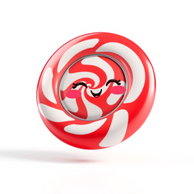
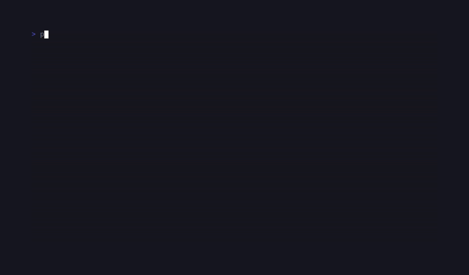

# CandyImage

<!-- BADGES:BEGIN -->
[](https://github.com/detain/sugarcraft/actions/workflows/ci.yml)
[](https://app.codecov.io/gh/detain/sugarcraft?flags%5B0%5D=candy-image)
[](https://packagist.org/packages/sugarcraft/candy-image)
[](LICENSE)
[](https://www.php.net/)
<!-- BADGES:END -->



Terminal image viewer for PHP 8.3+ — the **chafa-independent** front end
built on [`sugarcraft/sugar-image`](../sugar-image/). Point it at an image
file and it detects your terminal, picks the best protocol, and writes the
rendered bytes to stdout. This is the candy-image surface: the usable core of
chafa's flag spellings, distilled to the ones the SugarCraft core can actually
honor — and no shell-out to `chafa`, ever.

```bash
composer require "sugarcraft/candy-image:@dev"   # no stable release yet — see Install
./vendor/bin/candy-image photo.png                    # auto-detect + render
./vendor/bin/candy-image --dump-detect                # why is my image blank?
./vendor/bin/candy-image --format=half --size=80x24 logo.png
./vendor/bin/candy-image --format=symbols --symbols=ascii logo.png   # ASCII-art tier
./vendor/bin/candy-image --format=symbols --canvas=ansi256 --work=7 logo.png
```

Composer's `vendor/bin` is not on your `PATH` by default, so the bare
`candy-image` command above only works if you add it. Inside a checkout the
entry point is `php bin/candy-image …` — the spelling the demo tape runs — and
a rolling dev phar is published too (see Install).

**Long options only.** Apart from `-h`, every flag is `--`-prefixed; chafa's
single-dash muscle memory (`-f`, `-s 80x24`, `-w 7`) is not parsed as options —
the first such token quietly becomes the image filename, so `-f photo.png`
exits 1 with an "unexpected argument" complaint about the value, and a bare
`-v` exits 2 with `File not found: -v`. (Verified against the live bin.)

**Input formats.** Still rendering accepts PNG, JPEG, GIF (87a/89a) and
*static* WebP, recognised by magic bytes; BMP and other formats a built GD
decodes but the magic list does not name ride the `getimagesize()` fallback.
Refused before any decode — exit 2 with a named reason, never a silent blank —
are animated WebP (refused on its VP8X/ANMF structure, host-independently) and
exotic containers (AVIF/HEIF-family `ftyp` brands, JPEG XL codestream, TIFF).
`--animate` plays animated **GIF** only: the sugar-animation decoder rejects
non-GIF bytes outright.

## Install

**Requirements.** PHP 8.3+ and the `gd` extension (`ext-gd`). The `gd`
requirement is a hard requirement of this app: composer consumers get the
platform check transitively through `sugar-image`, but a downloaded phar
carries no platform check at all — so this sentence is the guardrail.

**No released version yet.** Packagist serves `dev-master` only — there is
no tag and no branch-alias — so under a default `minimum-stability: stable`
project a bare `composer require sugarcraft/candy-image` cannot resolve.
Ask for the dev package explicitly (the Packagist version badge above
renders nothing until the first tag, for the same reason):

```bash
composer require "sugarcraft/candy-image:@dev"
```

**Phar channel.** CI rebuilds and republishes a rolling prerelease on every
push to master that touches it or its dependency closure:

```bash
curl -LO https://github.com/detain/sugarcraft/releases/download/candy-image/dev/candy-image.phar
curl -LO https://github.com/detain/sugarcraft/releases/download/candy-image/dev/candy-image.phar.sha256
php candy-image.phar photo.png
```

`--version` prints the `dev-<shortsha>` stamp of the commit the phar was
built from; the `.sha256` (plus `.commit`/`.pins.json`) sidecars sit beside
the asset for verification.

## Options

| Option                  | Meaning                                                          |
|-------------------------|------------------------------------------------------------------|
| `--format=F`            | Force a protocol: `auto` `sixel` `kitty` `iterm2` `half` (`halfblock`) `quarter` (`quarterblock`) `ascii` `ansi16` `ansi256` `truecolor` `symbols` (`symbol`/`sym`). |
| `--symbols=CLASS[+CLASS…]` | Select the symbol tier's glyph corpus with chafa's tag classes — the live set is `all` `none` `space` `solid` `stipple` `block` `border` `diagonal` `dot` `quad` `half` `hhalf` `vhalf` `inverted` `braille` `sextant` `octant` `wedge` `technical` `geometric` `ascii` `alpha` `digit` `narrow` `wide` `ambiguous` `ugly` `extra` `alnum` `bad` `legacy` `latin` `import` `imported` (`+` adds, `-` removes, a leading sign is relative to the default corpus). Names are matched exactly (case-insensitively): chafa's prefix spellings such as `brai` are refused. Default: sugar-image's byte-frozen 676-glyph corpus — that 676 is the DEFAULT prefix; tag selectors expand toward the full 1,251-effective/1,260-entry narrow array (see the compat map below); `wide` carries the opt-in double-width kana tier (rendered by the double-width wide-glyph engine). |
| `--canvas=MODE`         | Colour canvas for the text tiers: `truecolor` (default) `ansi256` `ansi16` `fgbg`. A no-op on backends without the dial. |
| `--work=N`              | Candidate-search effort: chafa's integer `1`–`9`, config float `(N−1)/8` — `1` is the cheapest render, `9` runs the exhaustive path. |
| `--size=WxH`            | Render box in terminal cells (chafa's `WxH` syntax — in **cells** here; chafa's own `--size` takes pixels). |
| `--width=N` / `--height=N` | Individual box legs; cannot be mixed with `--size`. Defaults: viewport columns × aspect-derived rows, with one status row held back when STDOUT is a live tty. When STDOUT is **not** a tty (piped output, CI, examples — e.g. `candy-image x.png > out.txt`) the viewport fallback is a fixed **60×24** cells; size the box explicitly if you need anything else. |
| `--scale=S`             | Fit policy: `fit` `shrink` `fill` `stretch` `none` `crop` (maps onto `SugarCraft\Image\Scale`). |
| `--animate`             | Animated-GIF pass-through into sugar-animation's `Player` (alternate screen). Pause, frame-stepping and the solid/density preset toggle ride this viewer's wired `Player` (Keys below); frame-rate, speed and watch-mode flags (`--fps`/`--speed`/`--duration`/`--watch`) live in `candy-gifview`. |
| `--passthrough=V`       | tmux `allow-passthrough` transaction: `auto` (default) or `none`. |
| `--polite`              | Accepted no-op for chafa muscle-memory — this viewer always renders inline and synchronously. |
| `--dump-detect`         | Print the resolved terminal state. When set, the file path is optional — the dump prints the version banner and a single env line carrying `TERM` and `COLORTERM`, then the detection report (TermDb chain/claims/passthrough/mux fields, Detect capabilities sixel/kitty/iterm2/halfblock/chafa/tmux and summary, cell pixel size, default fg/bg, DA1 reply, `auto()` selection, tmux transaction, palette report). The dump happens *before* the file argument is required, so a supplied path is ignored, and it exits 0. |
| `--version` / `--help` (`-h`) | Print the version / usage and exit 0.         |

## Chafa flag-compat map (what this base honors and why)

| chafa flag       | status here | reason |
|------------------|-------------|--------|
| `--format`       | ✅ subset    | The CLI allow-list is `auto` `sixel` `kitty` `iterm2` `half` (`halfblock`) `quarter` (`quarterblock`) `ascii` `ansi16` `ansi256` `truecolor` `symbols`. `Mosaic::fromModeString()` knows two arms more than the CLI accepts: `chafa` (its own refusal message by design — the whole point is a viewer that never shells out) and `ansi` (halfBlock's legacy alias — refused as an unknown format). Both exit 1. |
| `--size`         | ✅          | cells; `--width`/`--height` as explicit-leg aliases. |
| `--dump-detect`  | ✅          | chafa's debugging gold, re-expressed over `Detect` + `TermDb` + the palette probe. |
| `--passthrough`  | ✅ `auto`/`none` | The GNU Screen envelope **has** landed — sugar-image's `Passthrough\ScreenPassthrough` is applied automatically by detection. What refuses (exit 1, with a pointer mirroring `lang/en.php`) is *forcing* it: `tmux` and `screen` are not accepted values here; use `auto` or `none`. |
| `--polite`       | ✅ no-op    | sugar-image has no async worker model; every render is already "polite". |
| `--symbols`      | ✅ tag classes | chafa's `--symbols=` class grammar over the ported narrow corpus (the byte-frozen DEFAULT corpus is the 676-entry prefix — 1,251 effective glyphs / 1,260 entries count it fully expanded by `all`, with nine AMBIGUOUS-tagged misc-narrow glyphs BAD-vetoed even by `all`, as in the C build: ASCII, Latin, block table, legacy, misc, braille, sextant, octant) plus the opt-in wide kana tier (181 double-width glyphs, `wide`; rendered by the double-width wide-glyph engine). `[chars]` literal sets and codepoint ranges are not implemented. |
| `--scale`      | ✅          | chicle has a `scale` option (chicle-options.c); this CLI honors all six arms — `fit` `shrink` `fill` `stretch` `none` `crop` — mapped straight onto sugar-image's `Scale` enum. |
| `--work`       | ✅          | chicle's integer work factor `1`–`9`, mapped onto the config float `(N−1)/8`, threaded onto whichever backend speaks it. |
| `--probe=off`    | ⏭ refuses   | `Detect` exposes no env-only probe seam yet. |
| everything else  | ⏭ refuses   | out of scope for a thin composition-only viewer (façade law): the capability stays in the libs. |

`--canvas` deliberately does not sit in this map: chafa's CLI has no
`--canvas` flag (its canvas mode is an internal, detected setting), so the
spelling here is sugar-image's `CanvasMode` dial name surfaced for the text
tiers — see Options above.

## Exit codes

| Code | Meaning |
|------|---------|
| 0    | success (including `--help` / `--version` / `--dump-detect`) |
| 1    | usage error — unknown flag, bad value, refused format (`chafa`/`ansi`), **no** file argument (usage is printed), a second file argument; separately, the bin exits 1 printing `cannot find composer autoload.php` when no autoloader resolves |
| 2    | input/decode error — the file path is unreadable or not decodable (a **missing** file lands here, not on the usage path), undecodable image, empty animation, render failure |

## Architecture

`bin/candy-image` is a thin shim by design — an autoload probe with
phar-identity resolution (a phar bundle outranks a working-tree vendor) and a
one-line `Cli::main()` hand-off; all branches live in
`SugarCraft\CandyImage\Cli` and are driven in-process by the tests (in-memory
pipes, plus a `?\Closure $play` seam for the animation loop). Detection,
protocol selection, decode, and scaling are **only ever** sugar-image calls
— no render logic may land in this package (façade law). The namespace is
`SugarCraft\CandyImage\` rather than the mechanical `SugarCraft\Image\`
because the latter is sugar-image's own — per the naming rule in
`PROJECT_NAMES.md`.

## Keys (while `--animate` plays)

| Key         | Action |
|-------------|--------|
| `Space`     | pause / resume (resuming re-anchors the frame clock) |
| `←` / `→`   | step one frame back / forward — works paused **or** playing, wrapping |
| `d`         | toggle the render preset: solid ↔ density |
| `q` / `Esc` | quit |
| `Ctrl+C`    | quit — handled as a key by the player loop, and the SIGINT teardown path also stops playback |

The player paints its own status footer with the same set, abbreviated:
`space pause ←/→ step d preset q quit`.

## Accessibility

Every format this viewer can pick produces *pixels-or-glyphs*, not semantics:
nothing here describes image content, and no output leg is a screen-reader
surface. What the flag surface can do is choose **how the picture reaches
you**:

- The graphics protocols (`--format=sixel` / `kitty` / `iterm2`) hand the
  terminal an encoded payload — they are literally invisible to screen
  readers and to copy/select, and they say nothing on a braille cell.
- The text tiers are characters in the buffer: `--format=ascii` (a luminance
  ramp), `--format=symbols` (the symbol-engine corpus), the block tiers
  `half`/`quarter`, and the colored-character tiers `ansi16`/`ansi256`/
  `truecolor`. They remain selectable and reachable by anything that reads
  terminal text, which the protocol payloads are not.
- `--canvas=fgbg` confines a text-tier render to the terminal's own
  foreground/background pair, so the picture follows the user's contrast
  theme instead of embedding colors chosen from the image.
- `--work=1` is the cheapest candidate-search setting (the shortest path to
  a frame) when the exhaustive ladder is not wanted.
- `--dump-detect` is the diagnostic leg: when a render looks blank or wrong,
  it prints what the stack actually detected instead of guessing.

## Localized

The user-facing CLI strings — usage, flag/value/format refusals, notices —
ship through the sugar-core i18n lookup from `lang/en.php` (namespace
`image`); additional locales follow the repo's add-locale flow. Machine-
facing output deliberately stays English: the `--dump-detect` report labels
and the `--version` line are fixed-format diagnostics meant to be pasted
verbatim into bug reports, not translatable prose.
