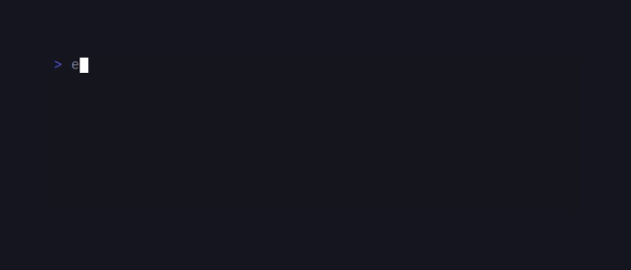

<!-- BADGES:BEGIN -->
[](https://github.com/detain/sugarcraft/actions/workflows/ci.yml)
[](https://app.codecov.io/gh/detain/sugarcraft?flags%5B0%5D=candy-kv)
[](https://packagist.org/packages/sugarcraft/candy-kv)
[](LICENSE)
[](https://www.php.net/)
<!-- BADGES:END -->

# candy-kv

> Formerly published as `sugarcraft/sugar-skate` (renamed 2026-10). <!-- @rename-keep -->
> Namespace changed: `SugarCraft\Skate\` → `SugarCraft\Kv\`. <!-- @rename-keep -->

candy-kv is a personal key/value store for PHP 8.3+: multi-database support,
binary-safe values, glob filtering, TTL expiry, JSON/YAML import/export, and a
small strict CLI. Values land in plain SQLite files you own.

Scope note: upstream [skate](https://github.com/charmbracelet/skate) also ships
an interactive full-screen browser. candy-kv does not — it is the storage
library plus a scriptable command front end. Terminal UIs that want a browse
pane build one on top of `Store::list()`.

## Features

- **Multi-database** — separate stores with the `key@dbname` suffix; the SQLite file for a name is created the first time something is written to it (reads of a missing database just see emptiness)
- **Binary-safe** — values containing NUL bytes or invalid UTF-8 are stored base64-encoded with the binary flag (auto-detected; `--binary`/`--text` override); binary entries export as base64 envelopes and reimport byte-exact
- **Glob patterns** — `list` and `delete` accept `*` and `?`; matching is byte-wise and case-sensitive, `\*`/`\?` stand for literals; `get` takes an exact key only — and that gate is a raw-byte check, so a key whose *name* contains `*` or `?` is unreachable through `get` even when spelled `\*`/`\?` (the backslash does not hide the byte). Reach such keys with `list`/`delete` escape literals, `saveTo()`, or `export`.
- **Ordered, filterable listing** — forward or reverse, keys only, values only, or full entries
- **SQLite-backed** — one file per database under `$XDG_CONFIG_HOME/skate/` (or `~/.config/skate/`; see Data directory)
- **Iterable streams** — `list()` yields results without loading everything into memory
- **TTL / expiry** — integer epoch seconds, so an entry means the same instant on every machine and timezone; `prune` removes expired residue
- **Levenshtein suggestions** — a key miss prints the closest live key (within half the query's character length) to stderr
- **Import/Export** — JSON and YAML (`yml` accepted), fail-fast: a bad document or an unround-trippable value refuses before writing anything
- **Atomic transactions** — `transaction()` wraps a callback in BEGIN IMMEDIATE/COMMIT/ROLLBACK
- **Bounded lock waits** — every SQLite connection opens with a 5-second busy timeout (`Database.php:67`), so two candy-kv processes racing on one database queue on each other's write locks instead of failing instantly with SQLITE_BUSY
- **Plain text output** — no color, no escapes ever, script-friendly by contract

## Install

```bash
composer require sugarcraft/candy-kv
```

The CLI lands at `vendor/bin/candy-kv`; invoke it as `vendor/bin/candy-kv` or
add `vendor/bin` to your `$PATH`. A rolling dev-channel phar (self-contained,
stamped `dev-<sha>`) is also published:

```bash
wget https://github.com/detain/sugarcraft/releases/download/candy-kv/dev/candy-kv.phar -O candy-kv
chmod +x candy-kv
```

YAML import/export works out of the box with candy-kv's own flat YAML dialect.
Installing [symfony/yaml](https://packagist.org/packages/symfony/yaml)
(`composer require symfony/yaml`) upgrades the YAML route to the full
component — same data contract, sturdier quoting. Source-tree builds report
`--version` as `dev-master`; phar builds carry their stamped version.

## Quick Start

```php
use SugarCraft\Kv\Store;

$store = new Store();

// Set and get
$store->set('greeting', 'Hello, World!');
echo $store->get('greeting'); // Hello, World!

// With a database — target it with the `key@db` suffix.
// (set()'s 3rd parameter is `bool $binary`, get()'s is a fallback string —
// a db name NEVER goes there; the suffix is the only routing mechanism.)
// Values are stored UNENCRYPTED (see Privacy & file modes below).
$store->set('token@passwords', 'ghp_xxxx');
echo $store->get('token@passwords');

// List all entries (lazy generator of Entry objects)
foreach ($store->list() as $entry) {
    echo "{$entry->key} => {$entry->rawValue()}\n";
}

// Glob patterns (list/delete only — get is exact-key)
foreach ($store->list(pattern: 'user-*') as $entry) { ... }

// Delete (returns the number of entries removed; patterns too)
$removed = $store->delete('greeting');
```

## CLI

To try the CLI without touching your real store, sandbox it first:
`export XDG_CONFIG_HOME=$(mktemp -d)`.

```bash
candy-kv set <key> [value] [--ttl SECONDS] [--binary|--text]   # no value reads STDIN — silently, no prompt (see STDIN)
candy-kv get <key> [--sanitize]                               # exact stored bytes by default
candy-kv list [-k|-v] [-r] [-d DELIM] [pattern]               # one row per entry
candy-kv delete <key> [--dry-run]                             # exact key or glob pattern
candy-kv list-dbs                                             # databases present in the dir
candy-kv prune                                                # remove expired residue (default db)
candy-kv import <json|yaml|yml> <path> [--no-atomic]          # path=- reads STDIN
candy-kv export <json|yaml|yml> [db] [pattern]
candy-kv --help    # or: help
candy-kv --version
```

- `--ttl` accepts both attached and space forms and must be a positive whole
  number of seconds (`1..999999999`). `--ttl 0` is a usage error, not "expire
  immediately" and not "forever" — omit `--ttl` for a forever entry.
- `set` auto-detects binary: a value containing a NUL byte or invalid UTF-8
  is stored base64-encoded with the binary flag. `--binary` forces that,
  `--text` forbids it.
- `get` prints the exact stored bytes (no added newline, no scrubbing) so
  round-trips and `$(candy-kv get k)` stay honest. `--sanitize` collapses the
  value to one control-free line for terminal printing.
- `--dry-run` reports how many entries `delete` would touch and writes nothing.
- `--` ends option processing: `set backup -- --ttl=60` stores the literal
  value `--ttl=60`. Unknown options and surplus positionals are refused
  (exit 2) rather than silently ignored — a typo'd `--ttl300` never becomes a
  forever secret.
- `-d` accepts the delimiter attached (`-d,`) or spaced (`-d ,`); the printed
  delimiter is the raw bytes you asked for.

### Exit codes

| Situation | Code |
|---|---|
| success | 0 |
| key/pattern found nothing (`get` miss, `delete` miss) | 1 |
| a runtime error (unreadable store, failed write) | 1 |
| usage error: unknown command, unknown option, bad/missing arguments, `--ttl 0`, pattern passed to `get` | 2 |

Nothing is written on exit 2 paths. The "pattern passed to `get`" refusal
inspects the raw key bytes (`bin/candy-kv`: `strpbrk($key, '*?')`), so it fires
on escaped spellings too — see Glob patterns above.

### Output format

Real transcript (sandboxed `$XDG_CONFIG_HOME`; `#` annotations are not part of
the output):

```text
$ candy-kv set greeting 'Hello, World!'        # silent on success
$ candy-kv set color blue
$ candy-kv set note@notes 'buy milk'           # the @ suffix routes to the notes database
$ candy-kv get greeting
Hello, World!                                  # exact bytes, no trailing newline
$ candy-kv list
color	blue                                   # key, TAB, value; rows newline-terminated
greeting	Hello, World!
$ candy-kv get colar
key not found; did you mean 'color'?           # stderr; exit 1
$ candy-kv delete 'user-*' --dry-run
Nothing deleted: no entries match "user-*".    # stderr; exit 1 (no user-* keys exist)
$ candy-kv list -v
blue
Hello, World!
$ candy-kv list-dbs
default
notes
```

Newline discipline: `get` never adds a newline (piped `set` stores stdin
byte-verbatim, so `echo token |` keeps the trailing newline — use `printf %s`
or pass the value as an argument for exact bytes); `list`, `delete`, `prune`,
and import success lines are newline-terminated one-shots. `list` scrubs
control bytes from stored keys/values for the terminal (a multi-line value
prints as one collapsed line); the `-d` delimiter itself prints raw. Binary
entries print as `<binary N bytes>` in `list` — their decoded bytes come from
`get` (exact) or `saveTo()`.

### TTL (Time-To-Live)

```bash
candy-kv set session:abc123 '{"user":"bob"}' --ttl=3600  # expires in one hour
```

Expiry is stored as an integer epoch second, so a database written in one
timezone reads with the same true instants everywhere. Pre-2026-10 databases
stored offset-bearing ISO strings — candy-kv migrates those rows once, on
open, preserving each row's exact instant. A row is live at `expires_at >=
now`; `Entry::isExpired()` applies the same instant rule. Expired entries are
invisible to every reader (`get`, `list`, `delete`, `count`) but still occupy
disk until you `candy-kv prune`, which deletes exactly the complement set.

### STDIN

When no value is given as an argument, `set` reads from stdin. For import, use `-` or `/dev/stdin` as the path:

```bash
printf %s my-secret-token | candy-kv set api-token
candy-kv import json - < backup.json
```

> **Note:** piped values are stored verbatim — the full stdin is read with no
> trimming, byte-for-byte (and without a size bound; see Import/export
> memory).

The `-` stdin sentinel is meaningful only as `import`'s path argument. Option
parsing exempts a bare `-` from the dash prefix for **every** subcommand
(`ArgParser::isOptionLike()`), so elsewhere it is literal data, never a stdin
switch and never an error: `set k -` stores a one-character dash value,
`get -` looks up a key literally named `-`, and `list -` is a pattern matching
the single character `-`.

There is no prompt and no tty check behind the stdin fallback
(`stream_get_contents(STDIN)` in `bin/candy-kv`): running `candy-kv set k`
with nothing piped waits silently for the value, which looks like a hang at a
keyboard until EOF arrives (Ctrl-D). Pipe the value or pass it as the second
argument; `printf %s my-secret-token | candy-kv set api-token` never pauses.

### Key naming, `@`, and escapes

The rightmost **unescaped** `@` routes the key: `cache@notes` stores entry
`cache` in database `notes`. A literal `@` inside an entry key is spelled
`\@`, so `support\@acme` is one key regardless of other `@` signs. A key with
no separator stays in the default database, and a leading `@` (`@x`) is a
literal key, never a database suffix. More than one unescaped `@` in the
entry part (`a@b@c`) is refused rather than guessed. The same law is public
in the library: `Store::splitKey('a\@b@db', 'default')` returns
`['db', 'a@b']`.

### Import / Export

Import and export support JSON and YAML (`yml` alias). Import runs inside an
atomic transaction by default; pass `--no-atomic` for multi-database or
non-atomic imports:

```bash
candy-kv import json backup.json
candy-kv import yaml -              # read from STDIN
candy-kv export json > dump.json
candy-kv export yaml mydb 'user-*'  # export filtered keys from one database
```

The shape contract is strict in both directions. A top-level JSON list or
YAML sequence is refused ("got a list/sequence") instead of importing
indices as keys; values that cannot round-trip as stored text (booleans,
arrays, objects) refuse the whole import **before** anything is written —
no silent drops, no partial loads. `"_ttl"` entries must be whole seconds; a
zero/negative TTL on an entry refuses that import too (a forever entry omits
the TTL instead). An atomic import that would write to more than one database
refuses unless `--no-atomic` (library: `atomic: false`) is given, so the
BEGIN/COMMIT guard cannot be bypassed by value shapes.

Exporting with an explicit `[db]` argument qualifies every key to
`key@dbname` so the dump reimports into the same databases; a pattern or
default-database export prints bare keys. An empty database exports as an
empty JSON object (`{}`), not a list.

Both formats are value-preserving: backslashes, newlines, colons, empty
strings and control bytes round-trip, and binary entries come back as
binary — through JSON **and** both YAML engines. Remaining TTLs are exported
for live entries only (expired rows are invisible to the reader the export
walks). Note that import/export buffer the whole document in memory (a
binary value costs ~1.33× in base64 text); the streaming surface is
`list()`/`saveTo()`.

**JSON envelope.** Plain `"key": "value"` pairs. Binary entries ride
base64; their keys are listed in a reserved `"_binary"` array. Remaining
TTLs (whole seconds) collect into a reserved `"_ttl"` object:

```json
{
  "session:abc123": "{\"user\":\"bob\"}",
  "icon": "iVBORw0KGgo=",
  "_binary": ["icon"],
  "_ttl": { "session:abc123": 3540 }
}
```

**YAML envelope.** A flat `key: value` dialect — one pair per line, keys
quoted when needed, values quoted/escaped as required. Binary entries ride
the same base64; TTLs become `skate_ttl_<key>` integer lines and binary
flags `skate_binary_<key>` lines. When symfony/yaml is installed it renders
and parses the identical flat shape (plus `!!binary` tags for stray control
bytes, which the fallback parser also reads). A single process always uses
one engine; the fallback refuses constructs only symfony wraps for very long
plain scalars, and it says which line failed. Export refuses keys that would
collide with the reserved shapes **of the format being written** — `_ttl` /
`_binary` for JSON, `skate_ttl_…` / `skate_binary_…` for YAML — instead of
emitting unreadable files.

### CLI surface vs library surface

The CLI covers `set`, `get`, `list`, `delete`, `list-dbs`, `prune`, `import`
and `export` — `list-dbs` is a thin loop over `Store::listDatabases()` and
`prune` calls `Store::pruneExpired()` (default database), so those two
library twins do have CLI verbs. Everything else is library-only, by
design: `Store::entry()`, `suggestionFor()`, `setWithTtl()`,
`fuzzyFilter()`, `setFile()`, `saveTo()`, `transaction()`,
`deleteDatabase()`, and the whole single-file surface (`Database::count()`,
`raw()`, `allKeys()`, `pruneExpired()` on any database other than the
default, `close()`) have no CLI verbs — the binary stays a thin front end
for the everyday loop.

Import and export keep that shape programmatically, not just as CLI verbs:
`SugarCraft\Kv\Import\JsonImporter` and `SugarCraft\Kv\Import\YamlImporter` are
public API — constructed with a `Store` (plus options such as `ttl`), each
exposes `importFromFile(string $path, bool $atomic = true): int` and
`importFromString(string $text, bool $atomic = true): int`, where `$atomic =
false` is the `--no-atomic` skip-the-wrapping-transaction path. On the other
side, `SugarCraft\Kv\Cli\ExportCommand` exposes `run(...): int` (writes to
stdout, returns the exit code) and `exportToString(string $format, ?string
$dbName = null, ?string $pattern = null): string` for callers that want the
document as a value. Key-bearing commands route to a named
database through the `key@dbname` suffix; `list` alone always scans the
default database (patterns cannot select a db), while `export <format> [db]`
takes an explicit database name.

## Public API

### Store

| Method | Purpose |
|---|---|
| `__construct(?string $dataDir = null, string $defaultDb = 'default')` | Optional data dir (else `resolveDataDir()`); touches nothing on disk — databases open on first use |
| `resolveDataDir(): string` (static) | `XDG_CONFIG_HOME/skate` → `$HOME/.config/skate` → passwd home; refuses relative env values; throws when no home exists |
| `const DEFAULT_SUBDIR` | `.config/skate` — the directory segment under the home (historical name, see Data directory) |
| `set(string $key, string $value, bool $binary = false, ?int $ttlSeconds = null): Entry` | Store a value; `$binary` base64-wraps it; TTL in whole seconds (the CLI auto-detects what this parameter forces) |
| `setWithTtl(string $key, mixed $value, int $ttlSeconds): void` | Convenience setter — stringable values (scalars plus `__toString` objects); arrays, resources and non-stringable objects throw; `ttlSeconds <= 0` is a documented NO-OP (stores nothing) |
| `get(string $key, string $fallback = ''): string` | Exact-key read; pure — no terminal writes, expired or missing keys return the fallback |
| `entry(string $key): ?Entry` | Full entry (metadata included, live rows only) |
| `suggestionFor(string $key): ?string` | Closest live key within half the query's codepoint count (what the CLI prints on a miss); `null` when nothing is near |
| `list(?string $pattern = null, ?string $dbName = null, bool $reverse = false, string $mode = 'all', string $delimiter = "\t")` | Lazy generator — `Entry` objects, or plain `string` keys/values with `$mode` `'keys'`/`'values'`. The `$delimiter` parameter is accepted for signature compatibility but no path applies it any more (the CLI prints the raw delimiter; kept because removing it breaks the public API — slated for a v2 removal) |
| `delete(string $key): int` | Exact key or glob; returns live entries removed |
| `pruneExpired(): int` | Permanently delete expired rows from the default database (readers never see them; this reclaims the disk) |
| `setFile(string $key, string $filePath): Entry` | Store file contents as a binary entry |
| `saveTo(string $key, string $filePath): bool` | Write an entry to disk, created/tightened `0600` before any byte lands |
| `fuzzyFilter(string $query, ?string $dbName = null): array` | Live Smith-Waterman scored key search (sugar-fuzzy), best match first |
| `listDatabases(): array` | Database names in the data dir (`settings` is reserved — see `Database::listDatabases()`) |
| `deleteDatabase(string $dbName): bool` | Closes the handle, unlinks `<db>.db` + WAL/SHM sidecars; `false` if any file survives |
| `transaction(string $dbName, callable $fn): mixed` | BEGIN IMMEDIATE/COMMIT/ROLLBACK around a callback (no nesting) |
| `sanitizeForTty(string $text): string` (static) | Control-char scrub used for terminal printing (the CLI's lossy `list` preview; exact bytes always come from `get`/`rawValue()`) |
| `splitKey(string $key, string $defaultDb): array{0:string,1:string}` (static) | The escape-aware `@` routing law, public |
| `dataDir(): string` / `defaultDatabase(): string` | Accessors |

### Entry / Database

`Entry` carries `key`, `value` (the stored form — base64 text for binary
entries), `binary`, `createdAt`/`modifiedAt` (`DateTimeImmutable`, display
timestamps only), `expiresAt` (`?DateTimeImmutable`), `isExpired()`, and
`rawValue()` which base64-decodes when `binary` is set (a binary row holding
corrupt base64 raises rather than printing its own encoding as content).
`Entry::binary($key, $bytes)` is the factory for the binary form.
`Database` is the single-file layer behind a store name:
`get/raw/set/delete/deleteMany/list/allKeys/count/pruneExpired/transaction/
close` — `count(?pattern)` counts live entries, `raw()` skips the expiry
filter (the documented bypass: a live-only read never shows residue, `raw`
and `pruneExpired` are how you see and clear it), and pattern operations
share the byte-exact, case-sensitive semantics of exact ones.

## Privacy & file modes

- Values are stored **unencrypted** — SQLite is a container, not a vault. The
  token example above is readable with `sqlite3` or any text editor.
- Database files are created `0600` (owner-only) and existing files are
  tightened to `0600` on open; the data directory is created `0700`. WAL mode
  adds `*-wal` / `*-shm` sidecars, also `0600`. `saveTo()` likewise chmods
  its target before writing.
- `get` on a typo prints the closest key to stderr. On shared machines,
  remember key names can themselves be sensitive — stderr is still a log.
  Suggestions fire only within half the query's length; a far-from-anything
  miss says just `key not found`.
- **Command lines are not secret storage.** Anything passed as an argument
  (`candy-kv set token "$SECRET"`) is visible to `ps`, shell history, and any
  process accounting. Piping the value via stdin keeps it out of argv — that
  is the high-value-entry path. `--binary` has no bearing on exposure: it
  only forces the base64 storage form (see Binary-safe above), it does not
  hide, encrypt, or redact anything, and the value still round-trips through
  `get`.
- Backups: copy the `.db` **together with its `-wal` sidecar** (or checkpoint
  first). Copying only `*.db` under WAL can lose the most recent writes.
  `deleteDatabase()` reports failure (returns `false`) when a sidecar could
  not be removed — a surviving `-wal` can still hold recoverable rows.

## Data directory

Default: `~/.config/skate/` (respects `$XDG_CONFIG_HOME`). Each database is
its own SQLite file: `<dir>/<dbname>.db` (`default.db` for unsuffixed keys).
Neither the directory nor any database file is created until the first
write. `XDG_CONFIG_HOME` and `HOME`, when set, must be absolute paths — a
relative home would silently move the store with the working directory, so
candy-kv refuses it. Database names are `[A-Za-z0-9_-]+`.

The directory keeps the pre-rename **skate** name on disk so existing
installs (and upstream skate itself) keep working; new code can point
`$XDG_CONFIG_HOME` anywhere. If neither `XDG_CONFIG_HOME` nor `$HOME` is set,
candy-kv falls back to the passwd home and throws loudly when even that is
unavailable — it never writes into the install tree.

## Language

CLI diagnostics and success lines are localized: the binary selects a locale
from `LC_ALL` → `LC_MESSAGES` → `LANG` at start-up (16 shipped locales, see
`lang/`). The missing-argument usage line is part of that translated surface —
`usage()` emits `Lang::t('cli.usage_*')` before exit 2, so `LANG=fr candy-kv
get` answers `Usage : candy-kv get <clé>`. Three surfaces stay English by
design and are quoted verbatim by the test suite: `candy-kv --help` (a fixed
heredoc — its option grammar mirrors the flag spellings), `src/Cli/ArgParser.php`'s
own parse errors (unknown option, surplus positional), and the import/export
runtime diagnostics — importer refusals and failure lines such as
`File not found: <path>` throw plain English from outside the catalogs, a
design the `src/Cli/ImportCommand.php` docblock states outright. Library
diagnostics throw English exceptions (matching the rest of the fleet); the
translated surface is what end users see.

## Demos

VHS tapes under `.vhs/`, re-rendered by CI — five GIFs. `glob.gif` is recorded
from live `./bin/candy-kv` calls; the other four drive the library surface
through `php examples/*.php`. For a text walkthrough of the CLI itself, see
the `Output format` transcript above.

### Glob pattern matching



### Basic store/set/get


### Binary-safe values


### Multiple databases (`key@dbname`)


### Reverse-ordered listing


## Shared foundations

candy-kv uses [sugar-fuzzy](https://github.com/detain/sugarcraft/tree/master/sugar-fuzzy/README.md) for Smith-Waterman scored matching: `Store::fuzzyFilter()` is a live API that ranks keys against a free-text query. Glob-to-SQLite `LIKE` pattern filtering remains the active filter path for `list`/`delete`.

## Accessor deprecation (2026-10-24)

Per the house bare-accessor convention (`AGENTS.md`: *"Bare accessors (no* `get`*")*, a fleet-wide sweep), two names were swept. `Database::getRaw()` became its bare twin `raw()` — `raw` was unclaimed on the class (the store verbs `get`/`set`/`list` are the canonical vocabulary, no `raw` among them). `Store::getFile()` became `saveTo()`: the operation writes store data out to disk, so a direction verb is the era-correct name; `saveTo()` won over `export()` because the package's own CLI already owns the `export` command (a whole-database dump) and a per-entry `Store::export()` would blur that vocabulary. The store-side mutator `setFile()` keeps its name — it is the file form of the canonical `set()` verb. The legacy spellings stayed as byte-identical one-line BC forwarders, each marked `@deprecated` with `REMOVED-IN: 2.0.0`; they will be removed in candy-kv v2.0.0 (see [CHANGELOG.md](CHANGELOG.md)).

| Namespace | Class | Deprecated | Use instead |
|-----------|-------|------------|-------------|
| `Kv` | `Database` | `getRaw()` | `raw()` |
| `Kv` | `Store` | `getFile()` | `saveTo()` |

`tests/AccessorDeprecationTest.php` pins each BC leg on live objects (entry
equality through `getRaw()`/`raw()` including the missing-key path; identical
bool and landed bytes through `getFile()`/`saveTo()` on a hit and a miss), the
forwarder shape (single return line + markers), a discovery-first `src/`
census with an inverse leg that reddens any unmarked public `get*()`, and this
table's agreement with the census. Internal call sites in `src/` and
`examples/` use the bare forms. The CLI `get` command is unrelated to the
accessor rule and stays.

## Contributing & extending

Public classes are `final` by design — compose them rather than inherit. The
familiar loop is: store verbs in `Store`, single-file mechanics in
`Database`, argument discipline in `src/Cli/ArgParser.php` (every flag gets
answered or refused — never silently ignored), and copy in `lang/*.php`
(`tests/LocaleParityTest.php` requires every locale to carry every key and
placeholder). Repo-wide conventions live in the monorepo root `AGENTS.md`;
lib-local gotchas accumulate in `CALIBER_LEARNINGS.md`.

## License

MIT

## Credits & inspiration

Originally inspired by the Go [Charm](https://github.com/charmbracelet) ecosystem (and the skate key/value tool that grew out of it); candy-kv is a native PHP project, not a line-by-line port.
