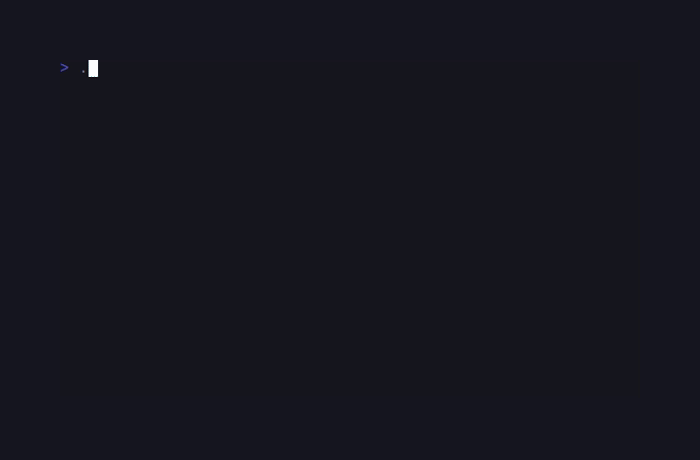
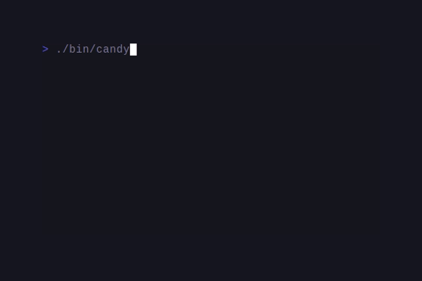

# CandyMinesweeper

> Formerly published as `sugarcraft/candy-mines` (renamed 2026-10). <!-- @rename-keep -->
> Namespace changed: `SugarCraft\Mines\` → `SugarCraft\Minesweeper\`. <!-- @rename-keep -->

<!-- BADGES:BEGIN -->
[](https://github.com/detain/sugarcraft/actions/workflows/ci.yml)
[](https://app.codecov.io/gh/detain/sugarcraft?flags%5B0%5D=candy-minesweeper)
[](https://packagist.org/packages/sugarcraft/candy-minesweeper)
[](LICENSE)
[](https://www.php.net/)
<!-- BADGES:END -->




Minesweeper on the SugarCraft stack for PHP 8.3+. Customisable board, iterative flood-fill, win / lose detection, vim-style movement, mouse support, mid-game save / resume, and a 16-locale interface.

Difficulty presets are available via `Game::withDifficulty()`, passing a `Difficulty` case — `Difficulty::EASY` (9×9, 10 mines), `Difficulty::STANDARD` (10×10, 12 mines — the shape the CLI defaults to), `Difficulty::MEDIUM` (16×16, 40 mines), `Difficulty::EXPERT` (30×16, 99 mines).

## Run it

```bash
composer install
./bin/candy-minesweeper                            # default 10×10, 12 mines
./bin/candy-minesweeper [width] [height] [mines]   # custom board (validated — see CustomDifficulty below)
./bin/candy-minesweeper --easy | --standard | --medium | --expert
```

The two shapes are mutually exclusive: a preset flag together with positional dimensions is refused with exit 1 rather than silently dropping one of them, and passing two preset flags is likewise refused instead of last-wins. After a global install (`composer global require sugarcraft/candy-minesweeper`) the same commands are available as `candy-minesweeper` on your `PATH` from the vendor bin directory.

Custom board arguments are validated through `CustomDifficulty::fromInput()`: each side must be 2–50 and the mine count must leave a safe 3×3 first-click area (`1 ≤ mines ≤ width × height − 9`). Out-of-range values exit with an error rather than starting a broken game.

The board renders in full — there is no scrolling viewport — and the help footer is about 70 columns wide. `EXPERT` (30×16) fits a standard 80×24 terminal comfortably; wide-square custom boards (towards the 50×50 bound) clip in short terminals. Resize-aware viewport fitting is open product work.

**Stats persistence** is opt-in. Set `CANDY_MINESWEEPER_STATS=/path/to/stats.json` and each completed game's outcome (games, wins, best time per preset) is recorded there via `DifficultyStats`, surviving across sessions. The default 10×10/12 board is the `STANDARD` preset, so default games tally too. Boards whose shape matches no preset (explicit custom dimensions) are played without recording — best-times are per-preset, and a mixed-size bucket would make them meaningless (custom games still freeze the end-of-game clock so `elapsed()` reports the real time). Without the env var the game stays entirely in-memory. Concurrent instances sharing one file resolve last-writer-wins: each save is flock-guarded and whole, but an earlier instance's tally can be overwritten — point parallel sessions at separate paths. The pre-rename variable `CANDY_MINES_STATS` is still read, with a deprecation warning. <!-- @rename-keep -->

## Keys

| Key                | Action                           |
|--------------------|----------------------------------|
| `↑/↓/←/→` or `hjkl`| Move cursor                      |
| `Space` / `Enter`  | Reveal cell                      |
| `f`                | Toggle flag                      |
| Right-click        | Toggle flag (mouse)              |
| `c` / middle-click | Chord — reveal safe neighbors    |
| `S`                | Save the live game to the slot   |
| `L`                | Load the saved game              |
| `r`                | Restart with new mines           |
| `q` / `Esc` / `Ctrl+C` | Quit                         |

Flagged cells render as a bright `F` and the cursor as reverse video, so board semantics survive even when adjacent-count colors are hard to distinguish — the number palette leans on hue differences.

## Save / resume

`S` writes the live game to a single save slot; `L` restores it, at any point — including after a win or loss, so you can replay the exact board you saved. Saving is refused once the board is over (the last live position keeps the slot).

The slot is `~/.config/candy-minesweeper/savegame.json`, written mode `0600` through sugar-core's `AtomicJsonFile` (flock sidecar, temp + `fsync` + rename — a crash never yields a half-written save). The payload wraps `Board::serialize()`'s versioned JSON with cursor position and elapsed time; `Board::unserialize()` re-validates every shape and refuses tampered or foreign-version payloads, so a hand-edited slot degrades to "load refused, game untouched" instead of a corrupt board. With `HOME` unset, or an unreadable slot, save and load are quiet no-ops — the game never dies over its save file.

## Language

The interface follows your locale. The binary arms `T::setLocale(T::detect())` before the program starts (`LC_ALL` → `LC_MESSAGES` → `LANG`, `C`/POSIX falling back to English), and every visible string — the mines/flags/remaining/time status line, the win and lose banners, the help footer — routes through `Lang::t`. Sixteen locales ship in `lang/` (ar, cs, de, en, es, fr, it, ja, ko, nl, pl, pt, pt-br, ru, tr, zh-cn); the English file is the source of truth and `LocaleParityTest` fails if any locale drifts in key set or order.

## Architecture

Five pure-state classes plus the runtime Model, renderer, UI helper, and persistence:

| File                    | Role                                                                                              |
|-------------------------|----------------------------------------------------------------------------------------------------|
| `Cell`                  | Value object — mine / revealed / flagged / adjacent count                                          |
| `Board`                 | The grid + every transition (reveal, flag, flood-fill, chord). Win detection is O(1) via `revealedCount` counter. Serialises to versioned JSON for mid-game save/load. |
| `Game` (Model)          | Cursor + key routing + restart + win/lose gate + sub-second timer (`microtime(true)`), advanced on screen by a 1 Hz `TickMsg` subscription armed from the first board change until the board is over — no-op keypresses never start the clock, and the status time runs without keypresses. Records the result into `Stats` on the win/lose transition (custom boards freeze the clock but tally nothing); persists via `DifficultyStats` when an opt-in stats path is configured. `S` / `L` write and restore the single-slot savegame. |
| `Stats`                 | Immutable difficulty stats — games, wins, best time per preset                                    |
| `DifficultyStats`       | Atomic JSON persistence wrapper — delegates to sugar-core `AtomicJsonFile` (flock sidecar, temp + `fsync` + rename) |
| `Ui/CustomDifficulty`   | Validated custom board dimensions — rows (2–50), cols (2–50), mines (1 to rows×cols−9). The mine cap means boards smaller than 10 cells (e.g. 2×2, 3×3) pass the side checks but can never validate; error messages name the violated bound. Throws i18n-aware `InvalidArgumentException` on constraint violation. |
| `Renderer`              | Pure view function. SugarStyle `Style` + `Border::rounded()`                                   |

The first reveal is always safe — mines are placed only after click 1, with the clicked cell's 3×3 neighbourhood excluded so the player gets a non-trivial flood-fill on every game.

**Chord click** (`c` / middle-click): when a revealed number has exactly the right number of flagged neighbours, chord-clicking it safely reveals all remaining neighbours. This mirrors the standard left+right simultaneous press in classic minesweeper.

**O(1) win detection**: `Board::isWon()` compares `revealedCount` (the number of non-mine cells revealed) against `width × height − mineCount`. Win detection is constant-time regardless of board size — no full-grid scan on every move.

**Save / restore mid-game**: `Board::serialize()` produces a versioned JSON payload (`{v:1, w, h, m, p, e, r, c}`) covering every cell and board state. `Board::unserialize()` reconstructs an identical `Board` instance — this is the exact format the in-game `S` / `L` save slot uses (see Save / resume above), so sessions suspend and resume for real.

## Demos

### Gameplay


### Flagging



## Shared foundations

The minefield renderer builds output via [sugar-cellbuffer](https://github.com/detain/sugarcraft/tree/master/sugar-cellbuffer) — each cell is zone-tagged via `Mark::zone("cell:$row:$col", $glyph)` so `Scanner::hit($x, $y)` maps directly to a cell address. `Renderer::resolveClick()` bridges mouse coordinates to row/col. Snapshot tests via [sugar-testing](https://github.com/detain/sugarcraft/tree/master/sugar-testing) pin canonical game states (first-click safe area, cascade reveal, win overlay).

## Test

```bash
composer install
vendor/bin/phpunit
```

## Credits & inspiration

Originally inspired by the Go [Charm](https://github.com/charmbracelet) ecosystem; SugarCraft is developed as a native PHP project.

Design antecedent: [`maxpaulus43/go-sweep`](https://github.com/maxpaulus43/go-sweep).
