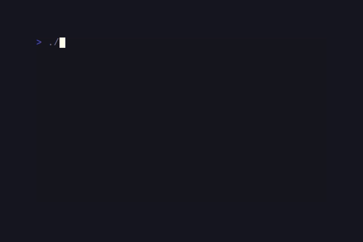

# CandyMinesweeper

Minesweeper on the [SugarCraft stack](https://sugarcraft.github.io) — the PHP port family of the Charm ecosystem — for PHP 8.3+. Customisable board, iterative flood-fill, win / lose detection, vim-style movement, mouse support, mid-game save / resume, and a 16-locale interface.

<!-- BADGES:BEGIN -->
[](https://github.com/detain/sugarcraft/actions/workflows/ci.yml)
[](https://app.codecov.io/gh/detain/sugarcraft?flags%5B0%5D=candy-minesweeper)
[](https://packagist.org/packages/sugarcraft/candy-minesweeper)
[](LICENSE)
[](https://www.php.net/)
<!-- BADGES:END -->


## How to play

**Numbers are the clue**: a revealed cell shows how many of its eight neighbours hide mines — the same rule the in-game help footer teaches on the first line, so a first-timer never has to guess what the digits mean.

**Win**: reveal every cell that is not a mine. Flags are survival notes — the win check counts revealed safe cells only, so a board can be won with zero flags and flagging every mine is neither required nor sufficient on its own.

Difficulty presets are available via `Game::withDifficulty()`, passing a `Difficulty` case — `Difficulty::Easy` (9×9, 10 mines), `Difficulty::Standard` (10×10, 12 mines — the shape the CLI defaults to), `Difficulty::Medium` (16×16, 40 mines), `Difficulty::Expert` (30×16, 99 mines). This package is `candy-minesweeper/` inside the [detain/sugarcraft](https://github.com/detain/sugarcraft) monorepo — the badges above and every issue link point at that canonical copy.

> Formerly published as `sugarcraft/candy-mines` (renamed 2026-10); namespace `SugarCraft\Mines\` → `SugarCraft\Minesweeper\`. <!-- @rename-keep -->
> Nothing under the old name ships updates. <!-- @rename-keep -->

## Requirements

PHP 8.3+ with **ext-mbstring** and **ext-intl**. Both are load-bearing: the cell-width math that positions every glyph in the grid rides mbstring, and the locale machinery behind the 16-locale interface rides intl — sugar-core declares both in its own manifest (`composer.json:34-35`), so the **composer path enforces them transitively**: an install on a host that cannot provide them is refused before anything ships. The **phar path is different**: a downloaded `candy-minesweeper.phar` installs nothing through composer, so the binary carries its own boot preflight (`Support\Requirements`) — a missing extension is named on stderr (`candy-minesweeper requires ext-mbstring`) with exit 1 before the first frame paints, never a half-rendered board dying on an undefined function inside frozen vendor code. If the preflight ever fires, `php -m` shows what is missing; on Debian/Ubuntu the packages are `php8.3-mbstring` and `php8.3-intl`.

## Run it

**Global install** — the player's path; one command, then play from anywhere on `PATH`:

```bash
composer global require sugarcraft/candy-minesweeper
candy-minesweeper                                # default 10×10, 12 mines
```

**Standalone phar** — zero Composer; one self-contained file:

```bash
wget https://github.com/detain/sugarcraft/releases/download/candy-minesweeper/dev/candy-minesweeper.phar
php candy-minesweeper.phar
```

**From a checkout** — the contributor path; per-lib vendor inside the monorepo directory:

```bash
composer install
./bin/candy-minesweeper                          # default 10×10, 12 mines
```

Every block accepts the same options:

```bash
candy-minesweeper 16 10                          # 16 wide by 10 tall — positional order is COLUMNS then ROWS
candy-minesweeper [width] [height] [mines]       # custom board (validated — the rules are just below)
candy-minesweeper --easy | --standard | --medium | --expert
candy-minesweeper --version                      # print the version and exit (also `-v`)
candy-minesweeper --help                         # usage (also `-h`)
```

Library use and worked wiring ship as a runnable example: `php examples/play.php`.

The two shapes are mutually exclusive: a preset flag together with positional dimensions is refused with exit 1 rather than silently dropping one of them, and passing two preset flags is likewise refused instead of last-wins. Any unknown option is refused with exit 1 and the usage on stderr rather than being ignored.

The phar is published under the `candy-minesweeper/dev` release tag; its real sidecar set is `candy-minesweeper.phar.sha256`, `candy-minesweeper.phar.sha256.sig`, `candy-minesweeper.phar.minisig` and `candy-minesweeper.phar.minisig.sha256` — the command that works today is `sha256sum -c candy-minesweeper.phar.sha256` (minisig verification ships wired for the self-updating apps only; this app carries no pinned key). **The phar channels are currently FROZEN:** the live `candy-minesweeper/dev` artifact is the build at `f1c90bb34` (2026-11-04), and the 2026-11-05 sibling-pin wave blocks new publish builds fleet-wide; the versioned `v*` release train shares the same wall. Until the fleet cure lands, the Composer paths above are the only fresh channel. After the cure, builds additionally carry `…phar.commit` and `…phar.pins.json` provenance sidecars, and note that the dev matrix publishes push-AFFECTED apps — not literally every push.

Custom board arguments are validated through `CustomDifficulty::fromInput()`: each side must be 2–50 and the mine count must leave a safe 3×3 first-click area (`1 ≤ mines ≤ width × height − 9`). Boards of fewer than 10 cells in total (2×2 … 3×3) are refused by a dedicated minimum-area message naming the floor — they pass the side checks but can never satisfy the safe-area cap, and the mine-count blame would name a number the player never typed. Out-of-range values exit with an error rather than starting a broken game. Give only width and (optionally) height and the mine count defaults to `max(1, intdiv(width × height, 8))` — an eighth of the board; the shipped 10×10 default's "12 mines" is that formula's result for 100 cells, not a hand-picked constant.

The board renders in full — there is no scrolling viewport — and the help footer fits 80 columns in every shipped locale (guarded by `FooterWidthGuardTest`). `Expert` (30×16) fits a standard 80×24 terminal exactly — with zero headroom: the boot announcement lands on row 24 itself — while wide-square custom boards (towards the 50×50 bound) clip in short terminals. Resize-aware viewport fitting is open product work.

**Stats persistence** is opt-in. Set `CANDY_MINESWEEPER_STATS=/path/to/stats.json` and each completed game's outcome (games, wins, best time per preset) is recorded there via `DifficultyStats`, surviving across sessions. The default 10×10/12 board is the `Standard` preset, so default games tally too. Whether a game tallies keys off the board's *shape*, not how you got it: `16 16 40` on the command line matches `Medium` and tallies just like `--medium` would; only boards whose shape matches no preset are played without recording — best-times are per-preset, and a mixed-size bucket would make them meaningless (unmatched games still freeze the end-of-game clock so `elapsed()` reports the real time). Best times are earned only on live clocks: a session that restores a save (`L`) re-anchors its timer from the file, so restored games record games and wins but never a best time and never the `NEW BEST` badge — the brand is monotonic per session, so `L` cannot be laundered into a record run by restarting. The live clock itself is wall-clock and there is no pause: an AFK spell or a suspended laptop inflates a game in progress, and because a best time is a minimum, one dishonestly slow first entry shadows a preset's bucket until a genuinely faster run beats it. Without the env var the game stays entirely in-memory. Concurrent instances sharing one file resolve last-writer-wins: each save is flock-guarded and whole, but an earlier instance's tally can be overwritten — point parallel sessions at separate paths. The pre-rename variable `CANDY_MINES_STATS` is still read, with a deprecation warning. <!-- @rename-keep -->

## Keys

| Key                | Action                           |
|--------------------|----------------------------------|
| `↑/↓/←/→` or `hjkl`| Move cursor                      |
| `Home` / `End`   | Jump to the start / end of the row |
| `PgUp` / `PgDn`  | Jump half a board height up / down |
| `Space` / `Enter`  | Reveal cell                      |
| `f`                | Cycle marker: flag → question (`?`) → clear |
| Left-click         | Reveal cell (mouse)              |
| Right-click        | Toggle flag (mouse)              |
| `c` / middle-click / double-left-click | Chord — open a number's ring once its flags match exactly |
| `S`                | Save the live game to the slot   |
| `L`                | Load the saved game              |
| `r`                | Restart with new mines           |
| `n`                | New game — pick a preset (1-4) or type a custom board (c) |
| `q` / `Esc`  | Quit (asks once on a live, unsaved board — see below)  |
| `Ctrl+C`     | Quit — always immediate (the terminal contract)        |

A plain launch plays the classic 10×10/12 board without a pre-launch picker
(owner ruling G5-b): the first frame stays one keypress away on any working
terminal, while every other shape — presets and a custom digit form — is one
`n` away, live or after the banner, with no shell round-trip.

**Question marks** (the third marker): `f` walks a cycle — flag → `?` → clear —
and the right-click walks it with the keyboard. `?` is your own memo that "I
suspect a mine here but I don't want to commit a flag". Memos are free and
uncapped: they never count as flags for the mine-count cap, and the `F → ?`
step hands its flag slot back the moment it lands (only the plain→flag step
is ever refused). A `?` never participates in chording — flags are what the
number reads — and opening a questioned cell retires the memo with the reveal.
On a lost board a questioned *safe* cell keeps its `?` (it spoiled nothing),
while a questioned *mine* is overpainted by the red `*` disclosure: the board's
final grade outranks your notes.

Ctrl- and Alt-modified letters are inert (only Ctrl+C quits), so editor
muscle-memory cannot restart or save the game by accident.

Quitting is never silently lossy: the first `q`/`Esc` on a live board whose
mines are not yet in the savegame slot arms a confirm toast — a second press
quits, any other move disarms. Finished boards and unspoiled ones exit on the
first press, and `Ctrl+C` keeps its instant terminal exit (candy-minesweeper-019).

Flag placement follows the classic rulebook: once the flags equal the mine
count, another flag is refused (un-flagging stays free, and the room an
un-flag opens is immediately usable). A board that somehow carries more
flags than mines — a hand-restored savegame — reads a negative remaining
counter rather than a false zero, so the impossibility shows before the
wrong-chord detonation does.

Mouse support arms SGR cell-tracking (`MouseMode::CellMotion`), so a click
plus drag also reports motion rows, not just button presses. Terminals or
multiplexers that do not honour the mode simply never deliver mouse rows —
the game stays fully playable on the keyboard, and the absence is silent.

Flagged cells render as a bold gold `F` (a wrong flag is revealed as `✗` once the board is blown, and missed mines light up in red), and the cursor as reverse video, so board semantics survive even when adjacent-count colors are hard to distinguish — the number palette leans on hue differences. Hidden cells wear a width-safe colon `:`; on terminals that treat East-Asian-ambiguous glyphs as double-width (e.g. `--ambigwidth=2` configurations) the board grid itself no longer doubles. The colour-downgrade boot (NO_COLOR / CLICOLOR=0 / TERM=dumb) additionally switches to the narrow glyph set — wrong-flag `x` and an ASCII `+` border — and the post-mortem legend then teaches exactly the marks that bin paints; a full-colour terminal keeps the `✗` dingbat and the rounded border, whose ambiguous glyphs (with the footer separators `·` and the arrow hints) still render two cells wide under an ambiguous-wide configuration.

## Save / resume

`S` writes the live game to a single save slot; `L` restores it, at any point — including after a win or loss, so you can replay the exact board you saved. Saving is refused once the board is over (the last live position keeps the slot). The slot records the full live mine layout, not just your progress — it is an answer key for the board, so treat the file as private if you sync dotfiles.

The slot is `$XDG_CONFIG_HOME/candy-minesweeper/savegame.json` when `XDG_CONFIG_HOME` is set and `~/.config/candy-minesweeper/savegame.json` otherwise, written mode `0600` through sugar-core's `AtomicJsonFile` (flock sidecar, temp + `fsync` + rename — a crash never yields a half-written save). The payload wraps `Board::serialize()`'s versioned JSON with cursor position and elapsed time; `Board::unserialize()` re-validates every shape and refuses tampered or foreign-version payloads, so a hand-edited slot degrades to "load refused, game untouched" instead of a corrupt board. With `HOME` unset, or an unreadable slot, save and load stay non-fatal no-ops — announced with a toast on the failure path (`no_save` / `save_failed` / `load_refused`), never silent — the game never dies over its save file.

Colour degrades gracefully: with `NO_COLOR` set, `CLICOLOR=0`, or `TERM=dumb`, the renderer drops to plain text through sugar-core's colour profile — counts stay visible as digits and the game remains fully playable without ANSI styling. A light console that declares itself via `COLORFGBG` (a `…;7` background — the classic xterm report) paints darkened twins of every ink instead, each clearing 4.5:1 contrast against white; hosts that never declare light — the overwhelming default — render byte-identically to the dark palette.

## Language

The interface follows your locale. The binary arms `T::setLocale(T::detect())` before the program starts (`LC_ALL` → `LC_MESSAGES` → `LANG`, `C`/POSIX falling back to English), and every visible string — the mines/flags/remaining/time status line, the win and lose banners, the help footer, the new-game picker and its custom-board form — routes through `Lang::t`. Sixteen locales ship in `lang/` (ar, cs, de, en, es, fr, it, ja, ko, nl, pl, pt, pt-br, ru, tr, zh-cn); the English file is the source of truth and `LocaleParityTest` fails if any locale drifts in key set or order.

The sixteen files cover 16 of the 17 codes `LOCALES.md` recommends — `zh-tw` is a deliberate exclusion: traditional wording does not diverge from the shipped simplified file at this app's copy scale, so the house rule for regional variants applies and the code falls through to English until a proper region hand-off changes that. Value style follows target-language convention: the English toasts and banners are deliberately lowercase while locales that capitalise their sentence-style copy do so in their own files — consistency is per-locale, not cross-locale. Each locale also keeps one grammatical register across its `ui.*` strings (cs and tr use informal imperatives, de impersonal infinitives), so the address a player meets in a toast never shifts from the one in a banner.

## Architecture

Pure-state classes plus the runtime Model, renderer, UI helper, and persistence:

| File                    | Role                                                                                              |
|-------------------------|----------------------------------------------------------------------------------------------------|
| `Cell`                  | Value object — mine / revealed / flagged / adjacent count                                          |
| `Board`                 | The grid + every transition (reveal, flag, flood-fill, chord). Win detection is O(1) via `revealedCount` counter. Serialises to versioned JSON for mid-game save/load. |
| `Game` (Model)          | Cursor + key routing + restart + win/lose gate + sub-second timer (`microtime(true)`), advanced on screen by a 1 Hz `TickMsg` subscription armed from the first successful reveal or chord until the board is over — flagging and no-op keypresses never start the clock, and the status time runs without keypresses. Records the result into `Stats` on the win/lose transition (unmatched-shape boards freeze the clock but tally nothing; save-restored clocks never fold a best time); persists via `DifficultyStats` when an opt-in stats path is configured. `S` / `L` write and restore the single-slot savegame. |
| `Difficulty`            | Enum of the four presets — dimensions and mine counts, plus `fromDimensions()` shape lookup       |
| `Stats`                 | Immutable difficulty stats — games, wins, best time per preset                                    |
| `DifficultyStats`       | Atomic JSON persistence wrapper — delegates to sugar-core `AtomicJsonFile` (flock sidecar, temp + `fsync` + rename) |
| `Ui/CustomDifficulty`   | Validated custom board dimensions — rows (2–50), cols (2–50), mines (1 to rows×cols−9), and a minimum 10-cell area rule that refuses sub-10 boards (2×2 … 3×3) by name before any mine logic. Error messages name the violated bound. Throws i18n-aware `InvalidArgumentException` on constraint violation. |
| `Renderer`              | Pure view function. SugarStyle `Style` + `Border::rounded()`                                   |

The first reveal is always safe — mines are placed only after click 1. The normal rule excludes the clicked cell and its whole 3×3 neighbourhood, so the player gets a non-trivial flood-fill on every game; at edges and corners the zone truncates to the cells that exist on the board — 6 or 4 guaranteed-safe cells instead of 9. The fallback rule covers dense boards that cannot afford the full exclusion: only the clicked cell itself is kept mine-free (its neighbours may hold mines), and every requested mine is still placed so win detection stays reachable. Falling into the fallback takes more mines than any CLI or picker game can carry — the −9 cap on custom mine counts always leaves room for the full safe zone — so this is a library-only regime for hand-built boards.

**Chord click** (`c` / middle-click): when a revealed number has exactly the right number of flagged neighbours, chording reveals the neighbours your flags say are clear — the flagged cells stay flagged, and if any of those flags is wrong the chord detonates on it. This follows the classic left+right simultaneous press, tightened against its go-sweep transcription in three ways: the flags must match the number **exactly** (the antecedent swept at `adjFlags >= adjMines`, so over-flagging still fired the sweep — here an over-flagged number is refused with the same toast as an under-flagged one), a revealed zero is not chordable (the antecedent swept at `0 >= 0`, but a zero's flood already cleared its ring, so a chord there could only fake a move), and the chord lives on `c`/middle-click/double-left-click — re-pressing Space/Enter on a satisfied number is a pure no-op here, not the antecedent's re-sweep. **Double-click** (msw-29): two left presses on the same revealed number within ~300 ms chord — the middle-click gesture for trackpads, most macOS terminals and touch, where a middle button does not reliably exist. The first press still resolves immediately (reveal, or the no-op it always was), so the primary action pays no latency; the window measures from press to press, and the keyboard `c` remains the deterministic path.

**O(1) win detection**: `Board::isWon()` compares `revealedCount` (the number of non-mine cells revealed) against `width × height − mineCount`. Win detection is constant-time regardless of board size — no full-grid scan on every move.

**Save / restore mid-game**: `Board::serialize()` produces a versioned JSON payload (`{v:1, w, h, m, p, e, r, c}`) covering every cell and board state. `Board::unserialize()` rebuilds a fresh, fully-valid `Board` — the mine count and revealed count are recomputed from the reconstructed cell grid rather than trusted from disk (the serialized `r` field is ignored on load), so a hand-edited count cannot desync the O(1) win check. This is the exact format the in-game `S` / `L` save slot uses (see Save / resume above), so sessions suspend and resume for real.

## Demos

### Gameplay


### Flagging



## Shared foundations

The minefield renderer builds output via [sugar-cellbuffer](https://github.com/detain/sugarcraft/tree/master/sugar-cellbuffer), and mouse hit-testing via [sugar-mouse](https://github.com/detain/sugarcraft/tree/master/sugar-mouse): the frame sent to the terminal is deliberately built UNMARKED (zone sentinels would leak onto screen and inflate the box), and a throwaway marked copy of the same layout — each cell tagged with `Mark::zone("cell:$row:$col", $glyph)` — feeds `Scanner::hit($x, $y)` so a click maps directly to a cell address. `Renderer::resolveClick()` decodes that hit into `[col, row]`. Snapshot tests via [sugar-testing](https://github.com/detain/sugarcraft/tree/master/sugar-testing) pin canonical game states (first-click safe area, cascade reveal, win overlay).

## Test

```bash
composer install
vendor/bin/phpunit
```

## Differences from the antecedent

The design antecedent [`maxpaulus43/go-sweep`](https://github.com/maxpaulus43/go-sweep) was transcribed, not cloned — the full parity record lives in `docs/old/repo_map/sugarcraft_candy-minesweeper.md`. The rows that still hold at this commit, updated:

| Aspect | go-sweep | candy-minesweeper |
|---|---|---|
| Language | Go | PHP 8.3+ |
| Framework | Bubble Tea | sugar-core (ReactPHP) |
| First-click safety | TODO comment (unimplemented) | **implemented here** — deferred placement with a 3×3 safe zone (dense-board fallback: clicked cell alone) |
| Win detection | O(n) grid scan | O(1) via `revealedCount` |
| Mine placement | Shuffle all cells upfront | Deferred until first click, safe-zone exclusion |
| Recursion | Recursive `sweep()` | Iterative `floodReveal()` (stack-based) |
| Chord rule | Satisfied at `adjFlags >= adjMines`, revealed zeros chordable, re-pressed sweep key chords | Tightened — exact `===` match, revealed zeros not chordable, chord only on `c`/middle-click (`Board::chord()`) |
| RNG | `rand.New(rand.NewSource(time…))` | Injectable `Closure(int):int` |
| Board representation | Mutating `[][]cell` | Immutable `list<list<Cell>>` |
| Serialization | None | Versioned JSON — the in-game `S` / `L` slot uses exactly this format |
| i18n | None | 16 locales |
| Stats persistence | None | `DifficultyStats` atomic JSON, opted in via `CANDY_MINESWEEPER_STATS` |
| Timers | Integer seconds only | Sub-second via `microtime(true)`, shown by a 1 Hz `TickMsg` |

Added with no transcribed upstream counterpart: the `Standard` 10×10 / 12 plain-boot shape and the `n` new-game picker (presets plus the custom-board form), the versioned save payload above, and light-console colour degradation.

## Credits & inspiration

This app is a native PHP project; its design antecedent is the Go minesweeper [`maxpaulus43/go-sweep`](https://github.com/maxpaulus43/go-sweep) (itself part of the Go [Charm](https://github.com/charmbracelet) ecosystem, which shaped SugarCraft's terminal-toolkit ambitions more broadly).
