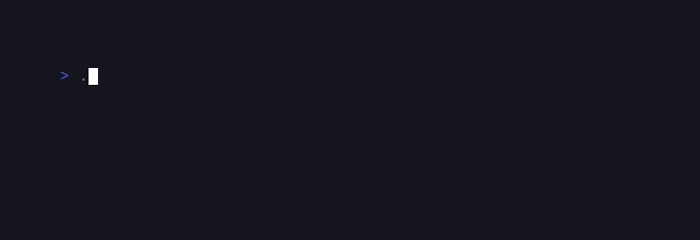
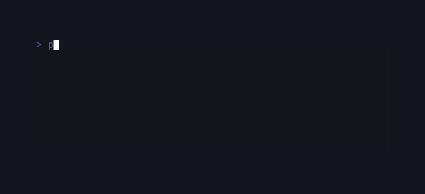
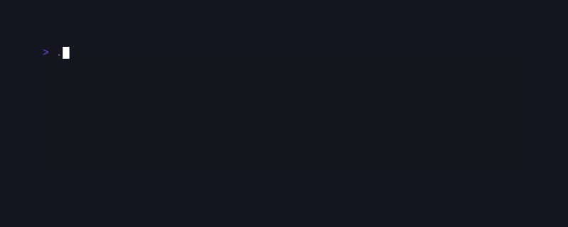
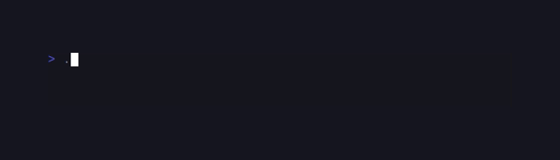

# CandyScriptui

> Formerly published as `sugarcraft/candy-shell` (renamed 2026-10). <!-- @rename-keep -->
> Namespace changed: `SugarCraft\Shell\` → `SugarCraft\ScriptUi\`. <!-- @rename-keep -->

<!-- BADGES:BEGIN -->
[](https://github.com/detain/sugarcraft/actions/workflows/ci.yml)
[](https://app.codecov.io/gh/detain/sugarcraft?flags%5B0%5D=candy-scriptui)
[](https://packagist.org/packages/sugarcraft/candy-scriptui)
[](LICENSE)
[](https://www.php.net/)
<!-- BADGES:END -->


```sh
composer require sugarcraft/candy-scriptui
```

candy-scriptui — a composer-installable CLI of SugarCraft TUI primitives for
shell scripts, for PHP 8.3+.

```sh
# Apply styling.
candy-scriptui style --foreground "#ff5f87" --bold "Hello, candy!"

# Pick one item.
choice=$(candy-scriptui choose Pizza Burger Salad)

# Read a single line.
name=$(candy-scriptui input --placeholder "Your name?")

# Confirm a destructive action.
candy-scriptui confirm "Really delete $file?" && rm "$file"
```

## Subcommands

All 13 gum subcommands ship. Run `candy-scriptui <cmd> --help` for the full
flag list per command.

## Auto-discovery

CandyScriptui uses PHP attributes to auto-discover commands at runtime.
Mark any class extending `Symfony\Component\Console\Command\Command` with
`#[Command]` and it will be picked up by `Application::scan()`.

### Help attributes

Two additional class-level attributes enrich the `--help` output of
your commands (attach them to the command class — method placement
registers nothing):

- **`#[Alias('name')]`** — registers an alternative name for the command
  (e.g. `choose` → `cho`) when the command is discovered through
  `Application::scan()`. Multiple aliases are supported via repeated
  attributes.
- **`#[Example('usage', 'description')]`** — adds an example line to the
  command's help block. The `description` parameter is optional. Multiple
  examples are supported via repeated attributes.

The `HelpFormatter` renders these automatically: when help is requested
for a command that carries them — via `--help`, `-h`, or the gum-compat
`--show-help` — their block is printed ahead of Symfony's standard help.
Commands without the attributes get the stock help verbatim.

### Typo suggestion

When a user types an unknown command name, `Application::find()` runs it
through a `TypoSuggester` that computes Levenshtein distance against all
registered command names. If a match is found within distance ≤ 2, the
error message suggests the single nearest alternative (e.g. "Did you mean
choose?"). Beyond distance 2 the original error propagates silently.

```php
use SugarCraft\ScriptUi\Attribute\Flag;
use Symfony\Component\Console\Command\Command;
use Symfony\Component\Console\Input\InputInterface;
use Symfony\Component\Console\Output\OutputInterface;

// Fully-qualified: the unaliased `Command` name already belongs to the
// Symfony base class.
#[\SugarCraft\ScriptUi\Attribute\Command(name: 'mycmd', description: 'Does something useful.', descriptionSection: 'Longer help text.')]
#[Flag(name: 'format', short: 'f', description: 'Output format.', enum: FormatType::class)]
final class MyCommand extends Command
{
    protected function configure(): void
    {
    }

    protected function execute(InputInterface $input, OutputInterface $output): int
    {
        $format = $input->getOption('format');
        // The scanner registers the option but does not enforce `enum:`;
        // for runtime checking call ValueEnum::validate() on the value.
        // ...
        return self::SUCCESS;
    }
}

enum FormatType: string
{
    case Json = 'json';
    case Yaml = 'yaml';
}
```

`#[Flag]` sits on the **class** (the scanner reads class attributes only);
repeat it once per option.

Register the namespace in your bootstrap:

```php
$app = new \SugarCraft\ScriptUi\Application();
$app->scan('My\\Namespace\\');  // discovers all #[Command] classes
$app->run();
```

`Application::scan($namespace)` iterates all already-loaded classes
under that namespace, picks those bearing `#[Command]`, and registers
them into the application. Classes must be autoloaded (or `require`d)
before `scan()` can find them — the scanner uses `get_declared_classes()`
and does not trigger autoloading.

| Command    | Role |
|------------|------|
| `choose`   | Pick one or many items from a list. |
| `completion` | Emit shell completion script (bash · zsh · fish). |
| `confirm`  | Yes/no prompt — exit `0` on confirm, `1` on cancel. |
| `file`     | Interactive file picker. |
| `filter`   | Fuzzy filter over stdin lines (single- or multi-select). |
| `format`   | Render Markdown / code / template / emoji to the terminal. |
| `input`    | Read a single line; supports `--password` masking. |
| `join`     | Join N strings (or stdin lines) with a separator — raw text, not styled fragments. |
| `log`      | Levelled / structured log output (text · json · logfmt). |
| `pager`    | Scrollable viewer for long input. |
| `spin`     | Run an external command behind a spinner. |
| `style`    | Apply Sprinkles styling to argv (or stdin). |
| `table`    | Render a CSV / TSV table. |
| `write`    | Multi-line text editor. |

## Flag reference (selected highlights)

Some flags from the original `gum` CLI surface are not wired here yet; the
shipped surface covers the 80 % case for shell scripts. Common
flags across commands:

- `--limit N` / `--no-limit` / `--ordered` / `--selected="a,b"` —
  multi-select on `choose` and `filter`.
- `--header "Email:"` / `--prompt "> "` / `--value "$LAST"` /
  `--char-limit N` / `--width N` / `--max-lines N` / `--show-line-numbers`
  on `input` / `write`.
- `--affirmative "Yes"` / `--negative "No"` / `--default=yes|no` /
  `--show-output` on `confirm`. An unknown `--default` word is refused
  (exit `1`) rather than silently treated as "no".
- `--show-output` / `--show-error` plus 12 spinner styles
  (`dot` · `line` · `pulse` · `globe` · `points` · `monkey` · `moon`
  · `meter` · `mini-dot` · `hamburger` · `ellipsis` · `jump`) on `spin`.
- `--min-level info` / `--prefix` / `--time RFC3339` / `--file out.log`
  / `--formatter text|json|logfmt` / `--structured` on `log`. Unknown
  `--formatter` names are refused (exit `1`).
- `--border` / `--border-foreground "#ff0"` / `--height N` / `--trim`
  on `style`.

## Environment

CandyScriptui respects standard CLI colour conventions. They are not
re-implemented here: the decision lives in sugar-core's ColorProfile
detection and is applied by sugar-style when any `Style` renders, so
every styled command inherits it uniformly.

- **`NO_COLOR=1`** disables every SGR escape — output is plain ASCII.
- **`CLICOLOR=0`** disables colour when stdout is not a TTY (otherwise
  defaults to colour).
- **`CLICOLOR_FORCE=1`** keeps colour even when stdout is piped or
  redirected.
- **`FORCE_COLOR=1|2|3`** forces a specific tier (16 / 256 /
  TrueColor).

### `CANDY_SCRIPTUI_*` env var fallbacks

Any command option can be given via an environment variable using the
`CANDY_SCRIPTUI_` prefix followed by the option name in uppercase with
non-alphanumeric characters replaced by `_`. The pre-rename `CANDYSHELL_*` prefix still works as a deprecated fallback (it prints a notice and the new name wins if both are set). <!-- @rename-keep --> For example:

```sh
# Equivalent to: candy-scriptui style --foreground=#ff0000 --bold "Hello"
CANDY_SCRIPTUI_FOREGROUND=#ff0000 CANDY_SCRIPTUI_BOLD=1 candy-scriptui style "Hello"
```

The fallback is applied when no explicit CLI option is provided. An
explicit flag on the command line always takes precedence over the env var.
Negatable options (`--no-<name>`, `InputOption::VALUE_NEGATABLE`) are not
sourced from the environment — the fallback skips them (the shipped
command surface currently defines none).

### Shell completion

```sh
candy-scriptui completion --shell=bash
candy-scriptui completion --shell=zsh
candy-scriptui completion --shell=fish
```

Emit a shell completion script for bash, zsh, or fish. Source the output
directly or drop it into the appropriate completion directory.

### Version

`candy-scriptui --version` reports the version read from the monorepo root
`composer.json` via `Application::versionFromComposer()`. The version is
discovered by walking up from the package directory to find the nearest
`composer.json` with a non-empty `version` field.

## Exit codes

- `0`   — normal completion. For `confirm`, this means the user picked
  the affirmative answer.
- `1`   — generic failure: an unknown command name, `confirm` declined,
  an abort (Esc) from `choose` / `filter` / `input` / `write` / `file`,
  a refused flag value (`--default`, `--formatter`, `--shell`,
  `--cursor-mode`), a `log --level fatal` line, or exit code `1`
  forwarded from the external command run by `spin`.
- `2`   — `confirm` aborted (Esc) — distinct from a "no" answer.
- `124` — a `--timeout` deadline elapsed before the interaction finished
  (gum-compatible, matches GNU `timeout(1)`).
- `130` — interrupted by Ctrl-C / SIGINT (128 + 2).
- `143` — terminated by SIGTERM (128 + 15).

## Keyboard map (interactive commands)

| Key | Effect |
|-----|--------|
| ↑ / ↓ | Move the highlighted item / cursor line. |
| Enter | Submit `choose`, `confirm`, `filter`, `input` (in `write`, inserts a newline). |
| y / n | Answer `confirm` directly. |
| Ctrl+D | Submit `write` (end-of-input convention). |
| Space | Toggle selection in multi-select `choose` / `filter`; page down in `pager`. |
| Tab | Toggle the highlighted item in multi-select `filter`. |
| Any printable key | Filter text in `filter`. |
| `j`/`k` `PgUp`/`PgDn` `b`/`f` `g`/`G` `Home`/`End` `Ctrl+U`/`Ctrl+D` `q` | Paging, scrolling, top/bottom jumps, and quit in `pager`. |
| Esc | Abort (exit `1`, or `2` on `confirm`). |
| Ctrl+C | Abort with exit `130`; `spin` also terminates its child. |
| Backspace | Ascend a directory in `file`; delete before the caret elsewhere. |

The key bindings are owned by each `Model`; the table matches their
doc-comments, and those are exercised by the model tests.

## Compatibility with `gum` invocations

Most `gum X` invocations work as `candy-scriptui X` verbatim. Known
behavioural differences:

- `format` accepts `-t/--type` (`markdown`, `code`, `template`, `emoji`)
  alongside `--theme`. Template support is the lightweight `{{VAR}}`
  expansion — Go template-function helpers are not implemented.
- `--timeout`, `--show-help`, and `--strip-ansi` work on the commands that
  accept them: `--timeout` arms a real deadline (exit `124`) on every
  interactive command including `file`, `--show-help` is honoured as an
  alias for `--help` on every command that defines it, and `--strip-ansi`
  is read by `input`, `format`, and `style`. The `--cursor-mode` flag is
  honoured by `input` and `write` (`hidden` hides the cursor; `blink`
  and `static` leave the terminal default) and refuses any other value.
  Where a flag is meaningless to a non-interactive command (`format`,
  `join`, `log`, `style`, `table`) it is still accepted but treated
  as a no-op.
- `confirm --default=yes|no` is the form to use; the older `--default-yes`
  alias is preserved.

## Test

```sh
cd candy-scriptui && composer install && vendor/bin/phpunit
```

Runnable examples live in [`examples/`](examples/):

- [`examples/cli.php`](examples/cli.php) — drive the `Application`
  in-process (register commands, run, read exit codes).
- [`examples/setup-script.sh`](examples/setup-script.sh) — a shell script
  gating on `candy-scriptui confirm`'s exit code.

## Demos

### choose



### confirm


### file


### filter



### format


### input


### join


### log



### pager


### spin



### style


### table


### write


## Shared foundations

The `filter` command uses [sugar-fuzzy](../sugar-fuzzy/README.md) for
fuzzy-matching via `FilterModel` → `SmithWatermanMatcher`. The
`SubStyleParser` utility parses gum-style `element.prop=value` entries
into per-element `Style` maps for **extension** commands; no built-in
command consumes it today, and `choose`'s `--cursor`/`--header` flags are
plain strings, not sub-style entries.

## Internals

`spin` runs its child through the `RealProcess` wrapper, which is
`@deprecated` in favour of sugar-pty's `PosixProcess`; `SpinCommand` is
currently its only consumer and the wrapper is kept for that path until
the port lands.

## Related

- [SugarCraft monorepo](https://github.com/detain/sugarcraft)
- Originally inspired by [charmbracelet/gum](https://github.com/charmbracelet/gum)

## Credits & inspiration

Originally inspired by the Go [Charm](https://github.com/charmbracelet) ecosystem; SugarCraft is developed as a native PHP project.
