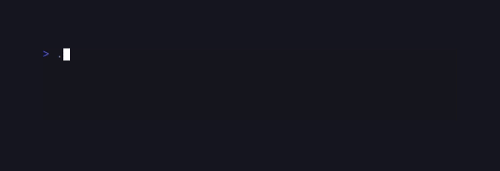
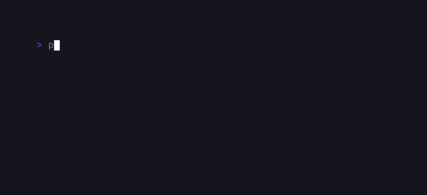
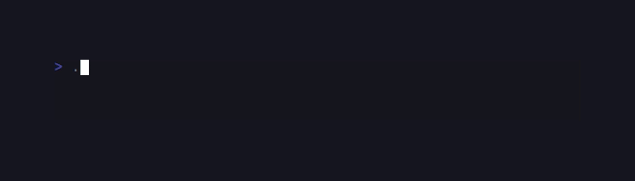
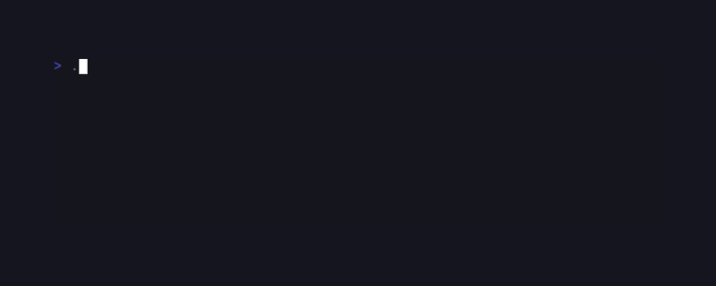

# Candy-Scriptui

<!-- BADGES:BEGIN -->
[](https://github.com/detain/sugarcraft/actions/workflows/ci.yml)
[](https://app.codecov.io/gh/detain/sugarcraft?flags%5B0%5D=candy-scriptui)
[](https://packagist.org/packages/sugarcraft/candy-scriptui)
[](LICENSE)
[](https://www.php.net/)
<!-- BADGES:END -->

candy-scriptui is the PHP sibling of
[charmbracelet/gum](https://github.com/charmbracelet/gum): a
composer-installable CLI of interactive terminal primitives — pickers,
prompts, editors, spinners, tables — whose flags and exit codes follow
gum's, so a `gum X` line in a shell script usually runs verbatim as
`candy-scriptui X` (PHP 8.3+).

```sh
git branch | candy-scriptui filter        # pick a branch, print its name
```

```sh
composer require sugarcraft/candy-scriptui
```

This package develops in the [SugarCraft monorepo](https://github.com/detain/sugarcraft)
— the CI, release, and coverage badges above point there — and publishes
standalone to Packagist as `sugarcraft/candy-scriptui`; either route
installs the same code.


Composer installs the launcher at `vendor/bin/candy-scriptui`. Prebuilt
single-file binaries are published per commit that changes this app as
rolling dev phars:

```sh
curl -fsSLO \
  https://github.com/detain/sugarcraft/releases/download/candy-scriptui/dev/candy-scriptui.phar
curl -fsSLO \
  https://github.com/detain/sugarcraft/releases/download/candy-scriptui/dev/candy-scriptui.phar.sha256
sha256sum -c candy-scriptui.phar.sha256 && chmod +x candy-scriptui.phar
```

The published `.phar.sha256` sidecar is `<hex>  candy-scriptui.phar`, so
`sha256sum -c` verifies the download verbatim before you make it executable.
Whichever route you took, put the launcher on your `PATH` — add `vendor/bin`
from the composer route, or rename the verified phar to `candy-scriptui` on
a `PATH` directory from the phar route — so every example below runs
verbatim; otherwise invoke the full path instead.

```sh
# Apply styling.
candy-scriptui style --foreground "#ff5f87" --bold "Hello, candy!"

# Pick one item.
choice=$(candy-scriptui choose Pizza Burger Salad)

# Read a single line.
name=$(candy-scriptui input --placeholder "Your name?")

# Confirm a destructive action.
file=old-build.log
candy-scriptui confirm "Really delete $file?" && rm "$file"

# Show a spinner while running a command.
candy-scriptui spin --title "Building..." -- make build

# Filter a list (substring by default; --fuzzy for fuzzy matching).
git branch | candy-scriptui filter
```

> Renamed 2026-10: formerly published as `sugarcraft/candy-shell` (renamed 2026-10). <!-- @rename-keep -->
> Namespace changed: `SugarCraft\Shell\` → `SugarCraft\ScriptUi\`. <!-- @rename-keep -->

## Subcommands

Fifteen subcommands ship — thirteen presentation commands plus
`completion` and `version` — all in the table
below. Run `candy-scriptui <cmd> --help` for the full
flag list per command. Bare `candy-scriptui --help` prints Symfony's stock
`list`-command help rather than this roster — a built-in of the default
console application, not a missing feature — so read the table below, or
run `candy-scriptui list` to have the tool print it.

| Command    | Role |
|------------|------|
| `choose`   | Pick one or many items from a list. |
| `completion` | Emit shell completion script (bash · zsh · fish). |
| `confirm`  | Yes/no prompt — exit `0` on confirm, `1` on cancel. |
| `file`     | Interactive file picker. |
| `filter`   | Incremental filter over stdin lines (substring default, `--fuzzy` opt-in). |
| `format`   | Render Markdown / code / template / emoji to the terminal. |
| `input`    | Read a single line; supports `--password` masking. |
| `join`     | Join N strings (or stdin lines) with a separator — raw text, not styled fragments. |
| `log`      | Levelled / structured log output (text · json · logfmt). |
| `pager`    | Scrollable viewer for long input. |
| `spin`     | Run an external command behind a spinner. |
| `style`    | Apply ANSI styling to argv (or stdin). |
| `table`    | Render a CSV / TSV table. |
| `version`  | Print the tool version (same answer as `--version`). |
| `write`    | Multi-line text editor. |

### Per-command examples

The intro block demos `choose`, `confirm`, `input`, `filter`, `spin`,
and `style`. Here is one canonical invocation for each of the rest:

```sh
# Render markdown — a file path or piped text.
candy-scriptui format README.md
candy-scriptui format --type code --language php src/Command/LogCommand.php

# Pick a file under a directory (files only by default; --directory
# also allows directories, --all shows dotfiles).
candy-scriptui file --header "Attach which config?" src/

# Multi-line editor — submit with Ctrl+D, abort with Esc.
notes=$(candy-scriptui write --height 12 --placeholder "Release notes...")

# CSV from a file or a pipe (--separator switches dialects, --header
# promotes the first row, --border picks the frame style).
candy-scriptui table --file sales.csv --header
printf 'name,score\nada,99\ngrace,100\n' \
  | candy-scriptui table --header --border double

# Levelled log lines (--formatter json emits one JSON object per
# message; -o/--file appends to a log file instead of printing).
candy-scriptui log --level warn "disk at 90%"
candy-scriptui log --formatter json --file build.log "deploy finished"

# Join argument strings — one line with a separator…
candy-scriptui join --separator ", " apple pear plum   # apple, pear, plum

# …or the default vertical join (and stdin lines work the same way).
candy-scriptui join apple pear plum                    # three lines

# Page long output (arrows and PgUp/PgDn scroll, --match highlights a
# substring given at launch, q quits).
candy-scriptui pager --file README.md --match FIXME
```

`completion` and `version` are documented under their own headings
below.

## Auto-discovery

CandyScriptui uses PHP attributes to auto-discover commands at runtime.
Mark any class extending `Symfony\Component\Console\Command\Command` with
`#[Command]` and it will be picked up by `Application::scan()`.

### Help attributes

Two additional class-level attributes enrich the `--help` output of
your commands (attach them to the command class — method placement
registers nothing):

- **`#[Alias('name')]`** — registers an alternative name for the command
  (e.g. a custom `treasure` command gaining the name `t`) when the command
  is discovered through `Application::scan()`. Multiple aliases are
  supported via repeated attributes. No shipped command currently
  registers one — the built-in roster answers under its real name only.
- **`#[Example('usage', 'description')]`** — adds an example line to the
  command's help block. The `description` parameter is optional. Multiple
  examples are supported via repeated attributes.

The `HelpFormatter` renders these automatically: when help is requested
for a command that carries them — via `--help`, `-h`, or the gum-compat
`--show-help` — their block is printed ahead of Symfony's standard help.
Commands without the attributes get the stock help verbatim.

### Typo suggestion

When a user types an unknown command name, `Application::find()` refuses it
outright — commands are only ever matched by exact name, never by prefix —
after running the name through a `TypoSuggester`. A candidate qualifies when
it starts with the typed text (prefix matches score distance 0 whatever their
length) or lies within edit distance 2; at most five are kept. One near
alternative is quoted back (`Did you mean "choose"?`), several are listed
(`Did you mean one of: "choose", "completion", "confirm"?` for the input
`c`), and anything neither prefixed nor within distance 2 names no suggestion.

### Output channels

Every subcommand keeps two streams apart. **Data** (the styled text, the
chosen value, the rendered table, the completion script) goes to STDOUT
raw — never through the console formatter, so a value that happens to look
like `<info>` survives byte-exact. **Diagnostics** (refusals, malformed
flag values, I/O failures) go to STDERR — the ones the application emits
itself are plain sentences, while Symfony's own unknown-command and
unknown-option errors arrive as boxed error blocks — and either shape stays
off STDOUT, so scripts that `eval` completion output or capture `confirm`
answers can never consume an error message as data.

```php
use SugarCraft\ScriptUi\Attribute\Flag;
use Symfony\Component\Console\Command\Command;
use Symfony\Component\Console\Input\InputInterface;
use Symfony\Component\Console\Output\OutputInterface;

// Fully-qualified: the unaliased `Command` name already belongs to the
// Symfony base class.
#[\SugarCraft\ScriptUi\Attribute\Command(name: 'mycmd', description: 'Does something useful.', descriptionSection: 'Longer help text.')]
#[Flag(name: 'format', short: 'f', description: 'Output format.', enum: FormatType::class)]
final class MyCommand extends Command
{
    protected function configure(): void
    {
    }

    protected function execute(InputInterface $input, OutputInterface $output): int
    {
        $format = $input->getOption('format');
        // Scans into a ScriptUi application enforce `enum:` before the
        // command runs (invalid values exit 2); custom runners such as
        // CommandTester validate the value themselves via ValueEnum::validate().
        // ...
        return self::SUCCESS;
    }
}

enum FormatType: string
{
    case Json = 'json';
    case Yaml = 'yaml';
}
```

`#[Flag]` sits on the **class** (the scanner reads class attributes only);
repeat it once per option.

Register the namespace in your bootstrap:

```php
$app = new \SugarCraft\ScriptUi\Application();
$app->scan('My\\Namespace\\');  // discovers all #[Command] classes
$app->run();
```

`Application::scan($namespace)` iterates all loaded classes under that
namespace, picks those bearing `#[Command]`, and registers them into the
application. Classes must be autoloaded (or `require`d) before `scan()` can
find them — the scanner harvests through `get_declared_classes()` and never
triggers autoloading itself, though its re-snapshot pass also collects
classes that resolved during the scan window. A scan that matches zero
`#[Command]` classes announces itself loudly on STDERR rather than staying
silently empty, and non-constructible candidates are named, with their
reasons, in `CommandScanner::skipped()`.

## Flag reference (selected highlights)

Some `gum` flags exist here under different spellings and a few niche knobs
were dropped rather than shipped as silent no-ops: every flag listed by
`--help` is live. The shipped surface covers the 80 % case for shell
scripts. Common
flags across commands:

- `--limit N` / `--no-limit` / `--selected="a,b"` — multi-select on
  `choose` and `filter`; `--selected` is repeatable and comma-separated
  lists are split into separate items (previously the whole string named
  ONE item, silently selecting nothing).
- `--ordered` — keep selection order instead of click order on `choose`
  only (`filter` has no such flag).
- `--strict` / `--fuzzy` / `--no-fuzzy` — matching mode on `filter`.
  Substring matching is the default; fuzzy Smith-Waterman is opt-in.
- `--header "Email:"` / `--prompt "> "` / `--value "$LAST"` /
  `--char-limit N` / `--width N` on `input` and `write`; `--max-lines N`
  exists on `write` only, while `--show-line-numbers` exists on `write`
  AND `pager`.
- `--affirmative "Yes"` / `--negative "No"` / `--default=yes|no` /
  `--show-output` on `confirm`. `--default` also accepts the one-letter
  spellings `y` / `n` (case-insensitive); any other unknown word is refused
  (exit `1`) rather than silently treated as "no".
- `--show-output` / `--show-error` (aliased `--show-stdout` /
  `--show-stderr`) plus 12 spinner styles
  (`dot` · `line` · `pulse` · `globe` · `points` · `monkey` · `moon`
  · `meter` · `mini-dot` · `hamburger` · `ellipsis` · `jump`) on `spin`.
  Both `mini-dot` and `minidot` spellings are accepted for the dotted
  style; the help text and refusals name the `mini-dot` form.
- `--min-level info` / `--prefix` / `--time RFC3339` / `--file out.log`
  / `--formatter text|json|logfmt` / `--structured` on `log`. Unknown
  `--formatter` names are refused (exit `1`).
- `--border` / `--border-foreground "#ff0"` / `--height N` / `--trim`
  on `style`.
- Colours on `--foreground` / `--background` / `--border-foreground`
  accept the 16 palette names (`red`, `bright-blue`, …), `#rgb` /
  `#rrggbb` (bare hex too), or a palette index `0-255`.

## Environment

CandyScriptui respects the standard CLI colour conventions. Resolution
lives in `Runtime/ColourGate.php`, which pins sugar-style's ambient
colour profile before each command runs, so every styled byte stream —
flag-built `style` output, `log` badges, and the `format` markdown
theme — renders inside the resolved capability. The tiers are
sugar-core's ColorProfile semantics: `Ascii` drops colour but keeps
decoration, `NoTty` emits no escapes at all, and `Ansi`/`Ansi256`
re-quantise colours to that depth.

- **`--no-ansi`** (global flag) is FINAL — it outranks every other rule,
  including `--ansi`: every SGR escape is dropped, decoration included.
  The interactive frames' hand-composed emphasis — cursor-row reverse
  video, fuzzy-match bold, pager highlight — rides the same gate, so a
  `NoTty` frame is entirely escape-free.
  `--ansi` overrides the ENV tiers only.
- **`NO_COLOR`** (any truthy value) disables colour; decoration (bold,
  underline, …) and layout survive.
- **`CLICOLOR=0`** disables colour when stdout is not a TTY (otherwise
  defaults to colour).
- **`CLICOLOR_FORCE=1`** keeps full colour even when stdout is piped or
  redirected, winning over `NO_COLOR`.
- **`FORCE_COLOR=1|2|3`** forces a specific tier (16 / 256 /
  TrueColor) and wins over every other env rule.
- **`TERM=dumb`** (or an empty/unset `TERM`) emits plain bytes (the
  no-escape tier) — but it is the LAST tier checked: `NO_COLOR` or
  `CLICOLOR=0` resolve earlier to the decoration-kept tier (colour off,
  bold/underline survive), and `FORCE_COLOR` / `CLICOLOR_FORCE` outrank
  the dumb ladder entirely.

Being a pipe does not by itself strip colour — styled bytes flow to
redirected output as always; set `CLICOLOR=0` for pipe-aware muting.

### `CANDY_SCRIPTUI_*` env var fallbacks

Only presentation options may be given via an environment variable, keyed
by the `CANDY_SCRIPTUI_` prefix followed by the option name in uppercase
with non-alphanumeric characters replaced by `_`. A flag option (like
`bold`) arms only on `1`, `true`, or `yes` — case-insensitive — and any
other value is ignored exactly like an unknown name. The permitted names are
`align`, `background`, `bold`, `border`, `border-foreground`,
`cursor-prefix`, `faint`, `foreground`, `height`, `italic`, `prefix`,
`reverse`, `separator`, `strikethrough`, `timeout`, `underline`,
`unselected-prefix`, `width`. For example:

```sh
# Equivalent to: candy-scriptui style --foreground=#ff0000 --bold "Hello"
CANDY_SCRIPTUI_FOREGROUND=#ff0000 CANDY_SCRIPTUI_BOLD=1 candy-scriptui style "Hello"
```

Everything else is CLI-only **by construction**: options that answer for
the user (`--default`, `--selected`, `--value`), grant capability
(`format --allow-env`), or redirect data (`--file`, whose `log` shortcut is
`-o`) are never
read from the environment — a stray `CANDY_SCRIPTUI_*` in a shared CI
image cannot silently weaken a fail-closed flag. Names outside the list
are ignored with no notice.

The pre-rename `CANDYSHELL_<NAME>` spellings still work for the same
allow-listed names: the launcher mirrors them onto `CANDY_SCRIPTUI_<NAME>`
with a deprecation notice, and the new name wins if both are set.

The fallback is applied when no explicit CLI option is provided. An
explicit flag on the command line always takes precedence over the env var.
Negatable options (`--no-<name>`, `InputOption::VALUE_NEGATABLE`) are not
sourced from the environment — the fallback skips them (the shipped
command surface currently defines none).

### Shell completion

```sh
candy-scriptui completion bash
candy-scriptui completion --shell=zsh
candy-scriptui completion fish
```

Emit a shell completion script for bash, zsh, or fish. The positional shell
wins over `--shell`, and a bare `candy-scriptui completion` defaults to bash.
Concrete per-shell installs:

```sh
# bash — drop it where bash-completion looks:
candy-scriptui completion bash \
  | sudo tee /usr/share/bash-completion/completions/candy-scriptui

# zsh — an fpath directory, named with the leading underscore:
candy-scriptui completion zsh > "${fpath[1]}/_candy-scriptui"

# fish — the completions directory:
candy-scriptui completion fish > ~/.config/fish/completions/candy-scriptui.fish
```

New shells pick the function up automatically (zsh may want a rehash or a
fresh terminal); as a fallback any of the three can simply be sourced from
the shell's init file.

### Version

`candy-scriptui --version` (and the matching `candy-scriptui version`
subcommand, scriptui-40) answer through `Application::versionString()`, in
precedence order:

1. When running from a phar, the version stamped into the archive's phar
   metadata at build time (a `dev-build` working-tree stamp is refused, so a
   dev archive never impersonates a release).
2. Otherwise this package's own `composer.json` — the walk is identity-gated
   to `sugarcraft/candy-scriptui` (scriptui-39), so a monorepo checkout
   never reports the host root's version as the tool's own. The package
   manifest carries no `version` field until a release stamps one.
3. Otherwise `0.0.0` — the honest answer when no version metadata is
   reachable. A `composer require`-installed copy inside a project whose
   root `composer.json` declares no `version` sees exactly this; use the
   phar (or the versioned release) when the stamp matters.

### Language

`candy-scriptui` reads `LC_ALL`, then `LC_MESSAGES`, then `LANG` at startup
and answers its UI and hint strings in that language — a handful of
programmer-facing diagnostics (the `format` unknown-value refusal
scaffolding, the `find()` did-you-mean suggestions) are English-only by
design. Seventeen catalogs ship
with the package; a territory spelling falls back to its base language
(`de_DE.UTF-8` → `de`) and then to English. `C`/`POSIX` stay English.
Traditional Chinese is its own catalog (`zh-tw`, Taiwan usage) rather than
a fallback of `zh-cn` — the naming rulebook lists the pair as divergent.

## Exit codes

- `0`   — normal completion. For `confirm`, this means the user picked
  the affirmative answer.
- `1`   — generic failure: an unknown command name, `confirm` declined,
  an abort (Esc) from `choose` / `filter` / `input` / `write` / `file`,
  a refused flag value (`--default`, `--formatter`, `--shell`,
  `--cursor-mode`, and the allowed-set refusals for `--type` and
  `--level`, which report `Invalid value for --…: '<x>'. Allowed: …`
  on STDERR), a `log --level fatal` line, or exit code `1`
  forwarded from the external command run by `spin`. Run without a
  usable controlling terminal, every interactive command (`choose`,
  `confirm`, `filter`, `input`, `write`, `file`, `pager`) also refuses
  up front with this code and a STDERR notice — it never paints a fake
  session.
- `2`   — `confirm` aborted (Esc) — distinct from a "no" answer — and a
  bad value for a scanned option that carries a `#[Flag(enum: …)]`
  constraint, which the pre-flight validator refuses before the command
  runs (the allowed set is named on STDERR). This lane guards embedded
  and extension-discovered commands; no shipped subcommand's flags ride
  it today (the built-in `--type`/`--level` refusals above are the
  command's own check and exit `1`).
- `124` — a `--timeout` deadline elapsed before the interaction finished
  (gum-compatible, matches GNU `timeout(1)`). A malformed `--timeout` value
  is refused up front (exit `1` on STDERR) — it is never coerced to "no
  deadline". For `spin`, the captured child output is still flushed when
  `--show-output` / `--show-error` are set, so a timed-out build or test run
  shows what it managed to print.
- `130` — cancelled with Ctrl+C, whether typed (raw mode reports it as a
  key, and the models record it separately from Esc) or delivered as SIGINT
  (128 + 2). `spin` likewise exits `130` when its child is interrupted with
  Esc and never reports a completion code.
- `143` — terminated by SIGTERM (128 + 15). Other OS signals follow the
  same `128 + signum` convention.

`spin` forwards the external command's own exit code verbatim (gum parity),
which means a child exiting `2`, `124`, `130`, or `143` is indistinguishable
from candy-scriptui's own codes for those numbers; gate on the child's
success (`0`) rather than specific non-zero values.

## Keyboard map (interactive commands)

| Key | Effect |
|-----|--------|
| ↑ / ↓ | Move the highlighted item (`choose`, `filter` paging — see the `filter` row — `file`, `pager`). In `write`, move the caret one line. In `input`, Up/Down walk the widget's command-history slot — a list this CLI never fills — so there they are inert. |
| Enter | Submit `choose`, `confirm`, `filter`, `input` (in `write`, inserts a newline). In `filter`, Enter with zero matches submits the empty selection and exits `0` — the session always ends on Enter. In `choose`, while a typed filter is OPEN the first Enter commits the narrowing (the text and reduced list stay), and the next Enter submits. |
| y / n | Answer `confirm` directly. |
| ← / → · h / l | Toggle the `confirm` answer (like `Tab` there); in `pager`, `h`/`l` scroll sideways. |
| Ctrl+D | Submit `write` (end-of-input convention). |
| Space | Toggle selection in multi-select `choose`; page down in `pager`. In multi-select `filter` the toggle is `Tab` — a Space is typed into the filter text instead, as it is in `input` / `write`. |
| Tab | Toggle the highlighted item in multi-select `filter`; toggle the answer in `confirm`; in `write`, insert four spaces. |
| Any printable key | Filter text in `filter`; in `choose` typing opens the filter immediately too (`--no-filter` keeps the historical inert keys). |
| `j`/`k` · `g`/`G` · `Home`/`End` · `PgUp`/`PgDn` | Move, jump to top / bottom, and page the list in `choose` (and the `pager` view). In `file`, `j`/`k` move and `Home`/`End` jump to the first / last entry. |
| `filter` navigation | `filter` opens in permanent filter mode with no exit, so the vim-style keys above are NOT its navigation: `j`/`k`/`g`/`G` are typed into the query and `Home`/`End` are inert in the default substring mode. Move with ↑/↓, page with `PgUp`/`PgDn`, delete query characters with `Backspace`, and end the session with Enter or Esc; in `--fuzzy` mode ↑/↓, `PgUp`/`PgDn`, `Home`/`End` all navigate the match set. |
| `b`/`f` · `Ctrl+U`/`Ctrl+D` · `q` | Page, half-page, and quit keys of the `pager`. |
| Esc | Abort (exit `1`, or `2` on `confirm`) — except in `pager`, where Esc is a normal finish like `q` (exit `0`). |
| Ctrl+C | Abort with exit `130` everywhere, `spin` included (it also terminates its child). In `write` it cancels — it never copies (copy/cut bindings need a selection, and the shipped `write` surface anchors none). |
| Backspace | Ascend a directory in `file` (`←` does the same); delete before the caret elsewhere. |

There is no mouse: every frame runs with terminal mouse reporting OFF,
so clicks and wheel turns are not consumed (the underlying sugar-forms
widgets implement click-select and wheel-scroll, but no shipped
candy-scriptui command arms the tracking).

### Editing keys (`input` and `write`)

The text widgets keep the usual line-editor bindings (owned by the
`sugar-forms` `TextInput` / `TextArea` widgets, verified live against
their update arms):

| Key | Effect |
|-----|--------|
| Ctrl+A / Ctrl+E | Caret to the start / end of the current line. |
| Ctrl+U / Ctrl+K | Delete from the caret to the line start / line end. |
| Home / End | Same as Ctrl+A / Ctrl+E. |
| ← / → | Move the caret one cluster left / right. |
| Delete | Remove the character after the caret. |
| Backspace | Remove the character before the caret. |
| Tab | In `write`, insert four spaces (an indentation tab). |
| Enter | `input`: submit the line (same as the table above). `write`: insert a newline. |
| Ctrl+D | `write`: submit the whole buffer. |
| Ctrl+O | `write`: round-trip the buffer through the external editor — `$EDITOR` (or the widget's fallback chain) opens a temp file seeded with the text, and the edited contents replace the buffer when it exits. |
| Esc / Ctrl+C | Abort (`input` exits `1`/`130`; `write` likewise). |

The key bindings are owned by each `Model` (the editing keys by the
`sugar-forms` widgets behind them); the tables above match the live
update arms, and those arms are exercised by the model tests.

### Sizing, hints, and terminal modes

- The `pager` sizes itself from the terminal at launch, in both
  dimensions (COLUMNS/LINES, then an ioctl against the controlling
  stream); an explicit `--width`/`--height` wins, and both default to
  `0` = auto. The interactive lists size only their WIDTH from the
  terminal the same way (overridable with `--width`, `0` = auto); their
  HEIGHT is the visible item count (`--height`), a literal defaulting
  to 10 and never read from the terminal. When nothing is knowable the
  historical literals (lists 60 cells, pager 80×20) keep piped output
  byte-stable.
- `pager` re-fits live on resize. The list views do not re-flow live
  (sugar-forms `ItemList` exposes resize, but `--width` is a launch-time
  cap there — following SIGWINCH would silently widen explicitly-sized
  lists; see the sugar-forms seam note below).
- `choose`, `filter`, and `pager` paint a one-line keybinding hint under
  the live view (removed from the resolved/final frame).
- `choose` / `filter` / `pager` / `write` / `file` accept
  `--no-alt-screen` to render inline. Note the flip side: entering the
  alternate screen (the default) ERASES the rendered frames on exit —
  pass `--no-alt-screen` when you want the interaction to remain in
  scrollback.
- On a dumb-equivalent `TERM` — `dumb`, empty, or unset — the runtime
  forces inline mode, keeps the cursor visible, suppresses the DEC 2027
  grapheme-paste mode negotiation, and `ColourGate` lowers colour: the
  DEC-private sequences the renderer would emit are exactly what such
  terminals cannot digest. (The DEC 2026 synchronous-output frame
  wrapper lives in the renderer core and has no per-terminal opt-out
  yet — filed upstream.)

## Accessibility

- **Selection never rides colour alone.** The cursor row is marked by
  reverse video plus its leading cursor glyph (and a `✓` tick when a
  multi-select item is picked); matched characters are emphasised with
  bold. Those decorations are non-colour signals that survive any
  colour-vision profile. They also ride a single capability gate: under
  `--no-ansi`, `NO_COLOR`, or `TERM=dumb` every escape byte — reverse
  and bold included — is dropped from the frame, and the cursor row
  stays identifiable by its glyph alone.
- **Screen readers and scrollback.** Pass `--no-alt-screen` to `choose`,
  `filter`, `pager`, `write`, or `file` and the frames render inline in
  the terminal's normal buffer instead of taking over the alternate
  screen, so a transcript stays linear and inspectable. Diagnostics and
  refusals always go to STDERR, never into the STDOUT payload a script
  captures.
- **Reduced motion is NOT honoured (known gap).** All twelve `spin`
  styles animate on a fixed interval — there is no static/`none` style
  and no environment gate for reduced-motion preference. If animated
  output is a problem, run the command without `spin` and emit plain
  progress via `log` instead.
- **Keyboard complete.** Every interactive command is fully operable
  from the keys in the Keyboard map above; no command arms mouse
  tracking, so pointer input is never required (nor available).

## Untrusted content

This tool's documented purpose is rendering THIRD-PARTY content, so the
data channel of the render commands carries a control-byte policy: `table`
cells, `style` text, `join` parts, and `pager` content have escape
sequences, C0/C1 controls, and invisible bidi/zero-width marks stripped at
intake (sugar-core `Sanitize::untrustedForDisplay`), so no OSC title
spoof, clipboard write, cursor rewrite, or forged SGR can ride output into
the operator's terminal. Decoration comes only from the operator's own
flags. Pipe trusted byte-exact data through `--raw` on `table`, `style`,
and `join` to ship input verbatim instead. `format --type markdown` is the
documented exception to byte-clean output: its renderer strips control
BYTES but leaves visible bracket residue (`\x1b[5m` survives as `[5m`), so
treat markdown-rendered hostile input as corrupted-content-prone and pipe
trusted sources only.

## Limits

`file` navigation lists directories with synchronous readdir/stat/sort
inside the message loop: on network mounts or huge directories a keystroke
may stall behind a listing repaint, and `--timeout` keeps counting
wall-clock across those stalls.

Piped input is read whole before the first frame paints: the
stdin-reading commands (`filter`, `join`, `table`, `pager`, `style`,
`format`) buffer the entire payload with no cap, so memory scales with
the stream — `find / | candy-scriptui filter` on a huge filesystem
grows RSS until the producer finishes. `gum` full-buffers the same way;
this is parity, not a regression, but bound unbounded generators behind
`head` (or `sort -u` if you need dedup) when payload size is in play.

## Compatibility with `gum` invocations

Most `gum X` invocations work as `candy-scriptui X` verbatim. Known
behavioural differences:

- `format` accepts `-t/--type` (`markdown`, `code`, `template`, `emoji`)
  alongside `--theme`. Template support is the lightweight `{{VAR}}`
  expansion — Go template-function helpers are not implemented. Expansion
  is fail-closed: only variables named in `--allow-env=A,B` are read from
  the environment (`"*"` expands every variable — opt-in, and only safe
  for trusted input), and a placeholder that resolves to nothing is
  announced on STDERR instead of vanishing silently.
- `--timeout` arms a real deadline (exit `124`) on every interactive
  command including `file` (on `file` it is capped at 86400 seconds — one
  day). On the four non-interactive commands that still list it
  (`join`, `log`, `style`, `table`) it is an accepted no-op: they run no
  interaction to bound. On `format` it is REFUSED loudly instead (exit `1`
  on STDERR), since a deadline there would be silently ignored.
- `--show-help` is honoured as an alias for `--help` on every command that
  defines it.
- `--strip-ansi` is a live flag on `input`, `format`, and `style` (it
  strips ANSI escapes from the printed result). On `join`, `log`, and
  `table` it is not defined and fails with Symfony's unknown-option error
  (exit `1`) — as does `--cursor-mode` on all five non-interactive
  commands. The `--cursor-mode` flag itself is honoured by `input` and
  `write` (`hidden` hides the cursor; `blink` and `static` leave the
  terminal default) and refuses any other value.
- The rule behind all of this: every flag a command's `--help` lists is
  live — with one named exception, `--timeout` on `join`, `log`, `style`,
  and `table`, which is listed for gum flag-parity and documented above
  as a no-op. Flags a command never defines are never silently accepted.
- `confirm --default=yes|no` is the form to use; the older `--default-yes`
  alias is preserved.

## Testing

```sh
cd candy-scriptui && composer install && vendor/bin/phpunit
```

Runnable examples live in [`examples/`](examples/):

- [`examples/cli.php`](examples/cli.php) — build an `Application`
  in-process and forward its exit code: it registers one custom
  `status` command with `add()` and runs the shell argv through it, so
  `php examples/cli.php stat` demonstrates the built-in typo suggestion
  (`Did you mean "status"?`). The attribute-scanned auto-discovery flow
  the tool itself uses is documented under Auto-discovery above.
- [`examples/setup-script.sh`](examples/setup-script.sh) — a shell script
  gating on `candy-scriptui confirm`'s exit code.

## Demos

### choose



### confirm


### file


### filter



### format


### input



### join


### log



### pager


### spin


### style


### table


### write


## Shared foundations

The `filter` command uses [sugar-fuzzy](../sugar-fuzzy/README.md) for
opt-in fuzzy-matching (`--fuzzy`; the default is substring) via
`FilterModel` → `SmithWatermanMatcher`. All seven interactive commands
embed the lipgloss style surface — `--border`, `--border-foreground`,
`--border-background`, `--padding`, `--margin`, `--align`, `--foreground`,
`--background` and the decoration flags — as real frame chrome painted by
`StyleBuilder` → `Style::render` around the model body; `--width`/`--height`
stay CONTENT dimensions (the frame grows around them), and the ColourGate
keeps themed frames honest under `--no-ansi`/`NO_COLOR`/dumb terminals.
The `SubStyleParser` utility parses gum-style `element.prop=value` entries
into per-element `Style` maps for **extension** commands; no built-in
command consumes it today, and `choose`'s `--cursor`/`--header` flags are
plain strings, not sub-style entries.

The sugar-forms seam note (referenced from the keyboard map): the
`choose` and `filter` lists are painted by sugar-forms' `ItemList` —
the same canonical list widget the sugar-widgets form fields use;
`filter` runs it in its dedicated filter mode, where a typed query
narrows the rows as you type (`file` renders through its own
`FileModel` list view, sized by the same launch-time rules).
`ItemList` exposes a resize
notification, but its `--width` is a launch-time cap rather than a
live re-flow hook, so candy-scriptui does not wire SIGWINCH into the
lists (a re-flow would silently widen lists the scripter sized on
purpose). Only `pager` re-fits live. If sugar-forms ever grows a resize
path that honours explicit widths, the sizing bullet flips to match.

## Internals

`spin` runs its child through the `RealProcess` wrapper, which is
`@deprecated` in favour of sugar-pty's `PosixProcess`; `SpinCommand` is
currently its only consumer and the wrapper is kept for that path until
the port lands.

## Related

- [SugarCraft monorepo](https://github.com/detain/sugarcraft)
- Originally inspired by [charmbracelet/gum](https://github.com/charmbracelet/gum)

## Credits & inspiration

Originally inspired by the Go [Charm](https://github.com/charmbracelet) ecosystem; SugarCraft is developed as a native PHP project.
