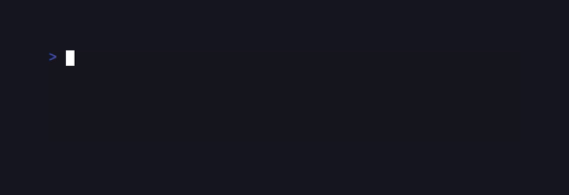

# CandyStarter

<!-- BADGES:BEGIN -->
[](https://github.com/detain/sugarcraft/actions/workflows/ci.yml)
[](https://app.codecov.io/gh/detain/sugarcraft?flags%5B0%5D=candy-starter)
[](https://packagist.org/packages/sugarcraft/candy-starter)
[](LICENSE)
[](https://www.php.net/)
<!-- BADGES:END -->



Skeleton repo for bootstrapping a SugarCraft TUI app — part of the [SugarCraft](https://sugarcraft.github.io) family of terminal libraries and apps. Start from this template and you have a working app.

```bash
composer create-project sugarcraft/candy-starter my-app --stability=dev
cd my-app
./bin/start
```

Run it and you'll see a working counter — quit with `q`, `Esc`, or Ctrl+C. Replace `src/Counter.php` with your own `Model` and keep editing.

## What you get

Every shipped file, and what it demonstrates:

```
my-app/
├── composer.json         # type: project — requires sugar-core + sugar-style
├── phpunit.xml           # failOnWarning gate; tests scan tests/, coverage covers src/
├── LICENSE               # MIT
├── README.md             # this walkthrough
├── CALIBER_LEARNINGS.md  # template gotchas for AI-agent config sync (fine to delete downstream)
├── .gitignore            # vendor/, composer.lock, phpunit caches, *.gif except !.vhs/start.gif
├── .assets/icon.png      # icon for the docs site
├── bin/start             # entry point — Program(new Counter()) + stopSignal() exit tail (128+N)
├── src/
│   └── Counter.php       # demo Model: up/down/quit, styled border
├── tests/
│   ├── BinStartExitTailTest.php           # pins the bin's stopSignal() exit tail (128+N)
│   ├── CounterTest.php                    # pinned behavior matrix — the test-shape reference
│   ├── ModelContractDocumentationTest.php # README fence vs interface drift guard
│   ├── ReadmeSnippetsTest.php             # lint+execute every README php fence
│   └── SiteBodyTruthTest.php              # docs site body matches the README's claims
└── .vhs/
    ├── start.tape        # CI gif recording of the running app
    └── start.gif         # the rendered demo (kept tracked by .gitignore's !.vhs/start.gif; CI regenerates)
```

`bin/start` is a handful of meaningful lines: load the autoloader, instantiate your `Model`, hand it to `Program::run()`, then answer `stopSignal()` so a signal-stopped run exits `128+N` (130 after SIGINT, 143 after `kill`) while cooperative quits keep their 0 — Ctrl+C included: on a raw-mode tty the keypress reaches `update()` as a `KeyMsg` and the demo exits through `Cmd::quit()`, so 130 is the OS-delivered-signal path only (`kill -INT`, or a terminal whose raw-mode setup never landed). The Program harness owns the event loop, render tick, signal installation, raw-mode setup, and alt-screen lifecycle — you only write Models. Inside the monorepo the same script runs as `cd candy-starter && bin/start` once the package-local vendor exists (per-lib `composer install`, or `php ../scripts/refresh-deps.php --mode=linked` from inside the package — equivalently `php scripts/refresh-deps.php --mode=linked` from the repo root); it resolves the autoloader relative to its own file — the one `<package>/vendor/autoload.php` candidate — not the working directory.

## Requirements

PHP 8.3+ with `ext-intl` and `ext-mbstring` (both hard-required by `sugar-core`) and `ext-ffi` (required by `sugar-pty`, which arrives transitively via `sugar-core`). The skeleton declares no `ext-*` of its own; `composer` fails loudly with a platform error if one is missing — enable it with your distro's `php-intl` / `php-mbstring` / `php-ffi` packages (`pecl install ffi` where FFI isn't bundled). A TTY-capable terminal is assumed for interactive use — colour is auto-detected and the demo renders monochrome-safe — see the `openTty` note under "Forking checklist" for piped-stream setups.

Packagist carries only `dev-master` today, so the quickstart passes `--stability=dev` — `create-project` refuses a dev-only package unless told to accept it. The equivalent command shape is `composer create-project sugarcraft/candy-starter:dev-master my-app`. Release tags (`candy-starter/v*`) do not exist yet; until the first one is cut and synced, `dev-master` plus the committed `composer.lock` from the Forking checklist is the only reproducibility lever, and the flag stays required.

## Anatomy of a SugarCraft Model

A `Model` is **four** required methods — omit any one and PHP refuses to instantiate your class with a `contains 1 abstract method` fatal:

```php
use SugarCraft\Core\Model;
use SugarCraft\Core\Msg;
use SugarCraft\Core\Subscriptions;

final class Greeter implements Model
{
    public function init(): ?\Closure { return null; }                     // optional startup Cmd (timers, fetch...)
    public function update(Msg $msg): array { return [$this, null]; }      // [next Model, optional Cmd]
    public function view(): string { return 'hello'; }                     // the current frame
    public function subscriptions(): ?Subscriptions { return null; }       // live Msg sources (ticks, streams...)
}
```

Only the *return* of `init()` is optional — the method itself is required, and returning `null` just means "no startup Cmd". `subscriptions()` is likewise required; return `null` when the model needs no subscriptions. And note the fence above narrows `view(): string` deliberately: the interface's contract is `string|View` (the `View` value object adds cursor placement and shape, window title, taskbar progress (OSC 9;4), terminal foreground/background colours (OSC 10/11), a per-frame mouse-tracking mode, focus reporting, bracketed paste, and a pixel-graphics image layer), so a plain-string app may narrow — but if you ever want those extras your return type must widen back to `string|View`.

The shape follows the MVC-style Model–Update–View architecture. State lives on the value object, transitions are pure functions, side effects (timers, HTTP, file I/O) get *scheduled* as Cmds rather than executed inline. The demo schedules only `Cmd::quit()`; `sugar-core`'s `Cmd` also offers `every()`, `tick()`, `promise()` and friends — return one from `init()` or `update()` and the harness runs it, feeding whatever `Msg` it produces back through `update()`.

`update()` returns the next `Model` — a fresh instance whenever state changes, the current one whenever it doesn't. It never mutates `$this`: that's why the demo declares `public readonly int $n`, and why the "no change" arm can honestly return `$this`.

### Beyond keys

Keys are not the only traffic `update()` sees. The harness also dispatches `WindowSizeMsg` (once at startup, then on every resize) — the demo's one fixed box needs no layout recompute, so it drops them, but any width-aware app must capture that Msg **before** its key filter or resize handling is dead on arrival. Async work reports failure as an `ExceptionMsg` — whether you scheduled it with `Cmd::promise()` or it rides a `WorkerCmd`-backed promise — and through that single channel only: a Model that swallows it loses its errors in silence. `src/Counter.php` sketches both arms, commented, at the top of `update()`.

### Getting Msgs in

`update()` only ever sees what the harness dispatches, and there are exactly three doors in. The terminal is the first: keystrokes, mouse events, resizes and pastes arrive as `Msg` objects with no work from you. The other two are yours to use — and the `bin/start` promise that "you just write the Model" holds only because they exist:

- **`subscriptions()` — the live-source seam.** The required interface method is not decoration. Return a `Subscriptions` collection — e.g. `(new Subscriptions())->withTick('clock', 1.0, $produce)` (also `withKey`, `withSignal`, `withCustom`; each `produce` is a `Closure(): Msg`) — and the harness starts every entry, re-diffs the set after each `update()` cycle (starting new ones, cancelling dropped ones), and dispatches whatever a subscription's `produce` returns for as long as it stays in the set. The demo returns `null`: nothing live, nothing to reconcile.
- **A promise that resolves to a Msg.** `Cmd::promise($factory)` runs work off-loop; when its promise resolves **with a `Msg`**, the harness dispatches that Msg straight into your `update()` (resolving `null` dispatches nothing), and a rejection arrives as an `ExceptionMsg` — the failure channel named above.
- **`Program::send()`.** Public on the harness, and not a test-only back door — the harness itself uses it, e.g. its resize poll injects `WindowSizeMsg` through `send()`. Anything holding the program handle can push a Msg onto the running loop; a `send()` issued before `run()` is buffered and drained when the loop starts.

The demo takes none of these doors (no subscriptions, no promises, external `send()` has no caller in `bin/start`) — but every real app wires at least one, and they are how non-keyboard traffic reaches the Model.

### Trust boundary

`Program` writes whatever `view()` returns to the terminal **unmediated** — the styled frame is the one place your bytes become the user's screen. So render only text you control. Anything from outside — file contents, network responses, another user's input — goes through one of sugar-core's two sanitizer policies: `Sanitize::untrusted()` strips terminal-control payload but deliberately preserves the private-use arena U+E000–U+F8FF (widening that sweep would eat legitimate image-overlay markers and Nerd Font glyphs); `Sanitize::untrustedForMarkedFrames()` does the same pass and additionally sweeps the `sugar-mouse` zone sentinels U+E000/U+E001 — that extra sweep is the one a frame carrying image/mouse-zone markers needs, because forged zone markers ride exactly those two bytes — and those markers are machinery outside the Model contract itself: View's image layer, `ImageOverlay::marker()`, the `Panes` helper. The demo renders an integer it owns, so it needs none — but the line where your app starts rendering the world is exactly the line this rule bites. The fleet-wide law is hubbed in the monorepo's `docs/TRUST-BOUNDARY.md`; the starter keeps the short form.

## Common next steps

| Want to…                          | Reach for…                              |
|-----------------------------------|-----------------------------------------|
| Add a text input                  | `sugarcraft/sugar-forms` — `TextInput`   |
| Show a spinner while loading      | `sugarcraft/sugar-forms` — `Spinner`     |
| Render Markdown help text         | `sugarcraft/sugar-markdown` — `Renderer` |
| Tail a log into a scrollable pane | `sugarcraft/sugar-forms` — `Viewport`    |
| Build a multi-page wizard         | `sugarcraft/sugar-forms` — `Group`       |
| Plot a sparkline                  | `sugarcraft/sugar-charts` — `Sparkline`  |
| Style the frame (bold, faint, colour) | `sugarcraft/sugar-style` — `Style`, `Theme` (the demo already frames itself with a `Style` — built once into a static, the memoize-at-the-boundary pattern for any constant decoration) |
| Translate your UI strings         | `sugarcraft/sugar-core` — `Lang::t()` with `lang/<code>.php` lookup files (see `LOCALES.md`) |
| Make it `ssh`-accessible          | `sugarcraft/sugar-ssh-server`            |

One trust note for the log-tail row: multi-line external text is exactly where CR-overwrite and bidi spoofing apply — pipe log contents (or any other foreign stream) through `Sanitize::untrustedForDisplay()` before it reaches a pane: the `untrusted()` sweep plus CR-to-LF conversion and invisible-format marking (sugar-core).

Add the dep, import its classes, return them from `view()`. Most are renderers on the shared `Style`-based vocabulary — but not all of them are pure: `sugar-ssh-server` runs an authenticated server around your Program, and `sugar-core`'s `Lang` registers its locale dir on first use and reads the locale files lazily per locale (memoised after the first lookup). Check each package's own README for setup and side effects instead of assuming the render-on-call shape. The demo itself covers the happy path only — one static frame, no colour anywhere (the frame is rounded border glyphs, not a palette), and no loading or empty state — and the rows above are where you take it from there.

## Forking checklist

The six things you actually have to change after `create-project`:

1. `composer.json` — rename `name` (and `description`) to your app.
2. `bin/start` — swap the `use App\Counter;` import for your own Model.
3. `src/` and `tests/` — replace the demo Model and its matrix; keep the `App\` / `App\Tests\` namespaces or update the PSR-4 prefixes in `composer.json` to match. Also delete or adapt the three documentation guards that ship here (`ReadmeSnippetsTest`, `ModelContractDocumentationTest`, `SiteBodyTruthTest`): they pin *this* README and site page against the interface, and go red the moment your app stops being this tutorial.
4. `composer.lock` — the shipped `.gitignore` ignores it, which is right for this template repo but wrong for the app you fork it into: apps ship a lockfile for reproducible, auditable builds. Delete the ignore line and commit the lock.
5. Sibling deps (`sugarcraft/sugar-core`, `sugarcraft/sugar-style`) ride `dev-master` — deliberately bleeding-edge so the template never goes stale — and there is no released constraint to pin them to yet: every SugarCraft sibling is dev-only until its first `v*` tag is cut. Your reproducibility lever is the committed `composer.lock` from item 4; switch to released constraints only once tags exist.
6. Re-run `vendor/bin/phpunit` (or `composer test` — the skeleton ships that script alias).

The template's own files read no environment variables — configuration is in code, via `ProgramOptions` (framerate, alt-screen takeover, mouse tracking, raw-mode details, cursor visibility; see `sugar-core`). The harness is a different story: `Program` hands `update()` a full `EnvMsg` snapshot at boot and probes colour support via `ColorProfileMsg` — override the snapshot with `ProgramOptions::$environment` if that matters to you. The shipped demo runs on plain defaults: it renders on the main screen (no alt-screen takeover — that's `useAltScreen`, off by default; the distinct `inlineMode` knob is also off) at 60 fps with the cursor hidden (`hideCursor: true` is the default — pass `hideCursor: false` to leave it visible), and reaches for mouse tracking or alt-screen only when you pass the options yourself. Raw mode gates on the input stream: run the program with piped stdin (`php bin/start < /dev/null`, cron, CI) and it won't get raw mode — note that `cmd | cat` redirects only the output, so stdin stays the tty. Pass `new ProgramOptions(openTty: true)` to grab `/dev/tty` for input on piped streams — it swaps the output to the tty as well, so frames stop reaching your pipe.

## Testing

Inside a `create-project` app the dependencies are already installed — just:

```bash
vendor/bin/phpunit
```

From a plain clone, install first (`composer install`), then the same command.

The included `tests/CounterTest.php` shows how to test `update()` deterministically by constructing `Msg` objects directly. No event loop, no terminal, no mocking — just call methods and assert the returned tuple.

## Panic handler (optional)

SugarCraft supports an opt-in panic handler that catches uncaught exceptions and displays a styled backtrace when the app crashes. To enable it:

```bash
composer require sugarcraft/sugar-log
```

Then uncomment the panic handler block in `bin/start`:

```php
// use SugarCraft\Log\Log;
// Log::installPanicHandler();
```

> **Note:** In a monorepo development setup, add a path-repo to `composer.json` `repositories[]` first:
> ```json
> { "type": "path", "url": "../sugar-log", "options": { "symlink": true } }
> ```
> That block is development scaffolding only — **never ship it**. Remove it before publishing, or before any `composer create-project` of your app: a path repository in a published manifest is a hard fatal for every consumer, who has no `../sugar-log` next to their project.

One more production note about the handler itself: the styled backtrace prints absolute paths and the arguments of every frame — exactly what you want while debugging, and sensitive data if a crash ever renders on a shared or recorded terminal. For shipped apps, configure `sugar-log` to route uncaught errors to a log sink (file, syslog) and reserve on-screen backtraces for debug builds.

## License

MIT.

## Credits & inspiration

Originally inspired by the Go [Charm](https://github.com/charmbracelet) ecosystem; SugarCraft is developed as a native PHP project.
