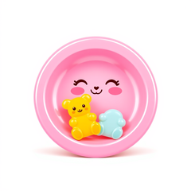
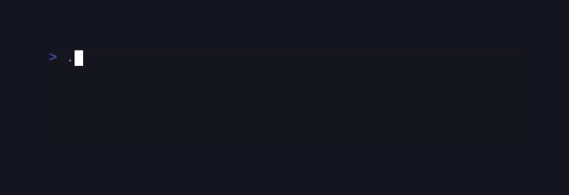

# CandyStarter

> Formerly published as `sugarcraft/candy-mold` (renamed 2026-10). <!-- @rename-keep -->

<!-- BADGES:BEGIN -->
[](https://github.com/detain/sugarcraft/actions/workflows/ci.yml)
[](https://app.codecov.io/gh/detain/sugarcraft?flags%5B0%5D=candy-starter)
[](https://packagist.org/packages/sugarcraft/candy-starter)
[](LICENSE)
[](https://www.php.net/)
<!-- BADGES:END -->




Skeleton repo for bootstrapping a SugarCraft TUI app. Start from this template and you've got a working app.

```bash
composer create-project sugarcraft/candy-starter my-app
cd my-app
./bin/start
```

and you'll see a working counter — quit it with `q`, `Esc`, or Ctrl+C. Replace `src/Counter.php` with your own `Model`, keep editing.

## What you get

Every shipped file, and what it demonstrates:

```
my-app/
├── composer.json         # type: project — requires sugar-core + sugar-style
├── phpunit.xml           # failOnWarning gate; tests scan tests/, coverage covers src/
├── LICENSE               # MIT
├── README.md             # this walkthrough
├── CALIBER_LEARNINGS.md  # template gotchas (agent-facing; fine to delete downstream)
├── .gitignore            # vendor/, composer.lock, phpunit caches, *.gif
├── .assets/icon.png      # icon for the docs site
├── bin/start             # entry point — runs Program(new Counter())
├── src/
│   └── Counter.php       # demo Model: up/down/quit, styled border
├── tests/
│   ├── CounterTest.php                    # pinned behavior matrix — the test-shape reference
│   ├── ModelContractDocumentationTest.php # README fence vs interface drift guard
│   └── ReadmeSnippetsTest.php             # lint+execute every README php fence
└── .vhs/
    ├── start.tape        # CI gif recording of the running app
    └── start.gif         # the rendered demo (force-tracked; CI regenerates)
```

`bin/start` is just three meaningful lines: load the autoloader, instantiate your `Model`, hand it to `Program::run()`. The Program harness owns the event loop, render tick, signal handling, raw-mode setup, and alt-screen lifecycle — you only write Models. Inside the monorepo the same script runs as `cd candy-starter && bin/start`; it resolves the autoloader relative to its own file, not the working directory.

## Anatomy of a SugarCraft Model

A `Model` is **four** required methods — omit any one and PHP refuses to instantiate your class with a `contains 1 abstract method` fatal:

```php
use SugarCraft\Core\Model;
use SugarCraft\Core\Msg;
use SugarCraft\Core\Subscriptions;

final class Greeter implements Model
{
    public function init(): ?\Closure { return null; }                     // optional startup Cmd (timers, fetch...)
    public function update(Msg $msg): array { return [$this, null]; }      // [next Model, optional Cmd]
    public function view(): string { return 'hello'; }                     // the current frame
    public function subscriptions(): ?Subscriptions { return null; }       // live Msg sources (ticks, streams...)
}
```

Only the *return* of `init()` is optional — the method itself is required, and returning `null` just means "no startup Cmd". `subscriptions()` is likewise required; return `null` when the model needs no subscriptions.

The shape follows the MVC-style Model–Update–View architecture. State lives on the value object, transitions are pure functions, side effects (timers, HTTP, file I/O) get *scheduled* as Cmds rather than executed inline. The demo schedules only `Cmd::quit()`; `sugar-core`'s `Cmd` also offers `every()`, `tick()`, `promise()` and friends — return one from `init()` or `update()` and the harness runs it, feeding whatever `Msg` it produces back through `update()`.

`update()` returns the next `Model` — a fresh instance whenever state changes, the current one whenever it doesn't. It never mutates `$this`: that's why the demo declares `public readonly int $n`, and why the "no change" arm can honestly return `$this`.

## Common next steps

| Want to…                          | Reach for…                              |
|-----------------------------------|-----------------------------------------|
| Add a text input                  | `sugarcraft/sugar-widgets` — `TextInput` |
| Show a spinner while loading      | `sugarcraft/sugar-widgets` — `Spinner`   |
| Render Markdown help text         | `sugarcraft/sugar-markdown` — `Renderer` |
| Tail a log into a scrollable pane | `sugarcraft/sugar-widgets` — `Viewport`  |
| Build a multi-page wizard         | `sugarcraft/sugar-forms` — `Group`       |
| Plot a sparkline                  | `sugarcraft/sugar-charts` — `Sparkline`  |
| Make it `ssh`-accessible          | `sugarcraft/sugar-ssh-server`            |

Add the dep, import its classes, return them from `view()`. They're all pure renderers on the same `Style`-based vocabulary. The demo itself covers the happy path only — one static frame with no loading or empty state — and the rows above are where you take it from there.

## Forking checklist

The five things you actually have to change after `create-project`:

1. `composer.json` — rename `name` (and `description`) to your app.
2. `bin/start` — swap the `use App\Counter;` import for your own Model.
3. `src/` and `tests/` — replace the demo Model and its matrix; keep the `App\` / `App\Tests\` namespaces or update the PSR-4 prefixes in `composer.json` to match.
4. Before shipping a real product, pin your sibling deps to a released constraint — the skeleton rides `dev-master` (`sugarcraft/sugar-core`, `sugarcraft/sugar-style`), which is deliberately bleeding-edge so the template never goes stale.
5. Re-run `vendor/bin/phpunit`.

The template reads no environment variables — configuration is in code, via `ProgramOptions` (framerate, alt-screen takeover, mouse tracking, raw-mode details; see `sugar-core`). `./bin/start | cat` won't get raw mode because it has no tty; pass `new ProgramOptions(openTty: true)` to make the program grab `/dev/tty` so it still sees keys on piped streams.

## Testing

Inside a `create-project` app the dependencies are already installed — just:

```bash
vendor/bin/phpunit
```

From a plain clone, install first (`composer install`), then the same command.

The included `tests/CounterTest.php` shows how to test `update()` deterministically by constructing `Msg` objects directly. No event loop, no terminal, no mocking — just call methods and assert the returned tuple.

## Panic handler (optional)

SugarCraft supports an opt-in panic handler that catches uncaught exceptions and displays a styled backtrace when the app crashes. To enable it:

```bash
composer require sugarcraft/sugar-log
```

Then uncomment the panic handler block in `bin/start`:

```php
// use SugarCraft\Log\Log;
// Log::installPanicHandler();
```

> **Note:** In a monorepo development setup, add a path-repo to `composer.json` `repositories[]` first:
> ```json
> { "type": "path", "url": "../sugar-log", "options": { "symlink": true } }
> ```
> That block is development scaffolding only — **never ship it**. Remove it before publishing, or before any `composer create-project` of your app: a path repository in a published manifest is a hard fatal for every consumer, who has no `../sugar-log` next to their project.

## License

MIT.

## Credits & inspiration

Originally inspired by the Go [Charm](https://github.com/charmbracelet) ecosystem; SugarCraft is developed as a native PHP project.
