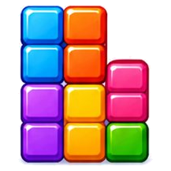
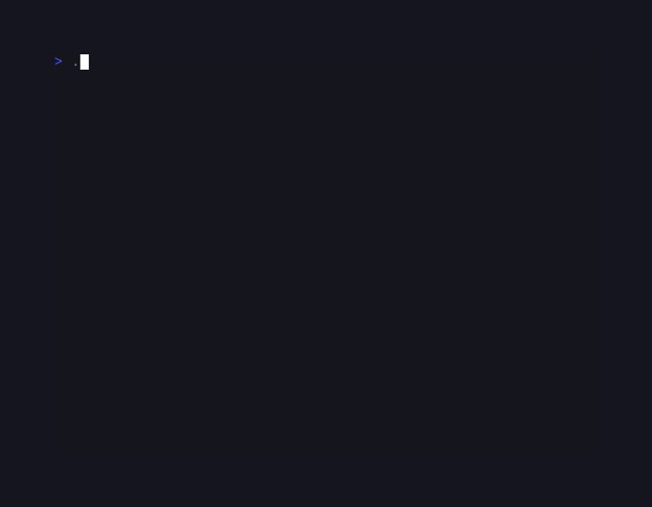
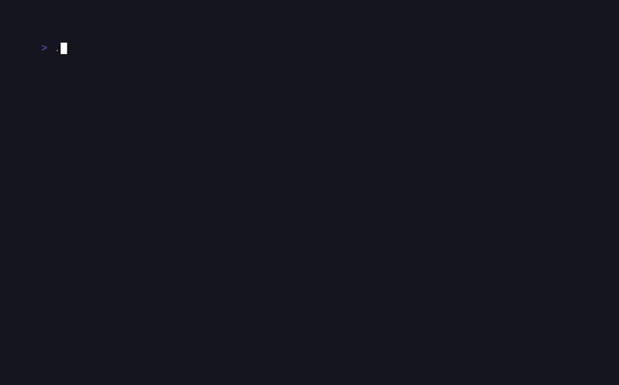

# CandyTetris

<!-- BADGES:BEGIN -->
[](https://github.com/detain/sugarcraft/actions/workflows/ci.yml)
[](https://app.codecov.io/gh/detain/sugarcraft?flags%5B0%5D=candy-tetris)
[](https://packagist.org/packages/sugarcraft/candy-tetris)
[](LICENSE)
[](https://www.php.net/)
<!-- BADGES:END -->




Tetris built on the SugarCraft stack: SugarCraft runtime, SugarStyle for the rounded borders and per-piece colours, a uniform-shuffled 7-bag (with an injectable source for deterministic tests), ghost piece, hard drop, hold, and a level-driven gravity ramp. Scoring is NES-style at its base; the Guideline bonuses ride on top — T-Spin, back-to-back, combo, and perfect clear.

## Run it

From a source checkout (run the commands below from this `candy-tetris/` directory):

```bash
composer install
./bin/candy-tetris         # Single player mode
./bin/candy-tetris -v      # VS Computer mode
./bin/candy-tetris --vs    # VS Computer mode (long form)
./bin/candy-tetris --seed=1234 # Reproducible pieces and garbage
./bin/candy-tetris -h      # Usage screen — flags, the shipped keys, the floor (also --help)
./bin/candy-tetris --version # Print the version and exit 0
```

As a consumer, depend on the published package instead — the `bin` entry
installs the launcher into your project's vendor bin:

```bash
composer require sugarcraft/candy-tetris
./vendor/bin/candy-tetris
```

A rolling latest phar is published on GitHub Releases under
`candy-tetris/latest` as `candy-tetris.phar` together with the
`candy-tetris.phar.sha256`, `candy-tetris.phar.commit` and
`candy-tetris.phar.pins.json` companions every build carries; a run with
the sugarcraft signing key configured adds the three signing assets
(`candy-tetris.phar.sha256.sig`, `candy-tetris.phar.minisig`,
`candy-tetris.phar.minisig.sha256`). Stable cuts ride the same release
pipeline on `candy-tetris/v*` tags. (Dated 2026-11-12: the channel was
structurally dead from the sibling-pin wave until the fleet WF-CURE
commit `191ccd566` restored the build's tree/sidecar flow; the published
`candy-tetris/latest` asset is the last pre-freeze build until the next
green phar-latest CI run advances the tag. The `.phar.commit` companion
names exactly which build is live.)

The launcher detects that it is running from inside a phar and loads
the autoloader bundled in the archive — by archive identity (magic
bytes), so the file also boots after a rename like
`mv candy-tetris.phar tetris`. Nothing needs to be installed for it to
run; what it does need is a plain-PHP floor: `php-cli` 8.3+ with
`ext-intl` and `ext-mbstring`, now declared in the manifest and
preflighted by the launcher itself (one plain refusal line naming the
missing extension).

Verify a download from the repo's release assets
(`https://github.com/detain/sugarcraft/releases/download/candy-tetris/latest/...`):

```bash
gh release download candy-tetris/latest -R detain/sugarcraft -p 'candy-tetris.phar*'
sha256sum -c candy-tetris.phar.sha256
php -r '$m = (new Phar("candy-tetris.phar"))->getMetadata(); echo $m["version"], " ", $m["commit"], PHP_EOL;'
```

The printed commit is the tested SHA the build sealed; compare it with
`git rev-parse <sha>` or the `.phar.commit` companion file.

The interface is localized: sixteen catalogues ship (ar, cs, de, en, es,
fr, it, ja, ko, nl, pl, pt, pt-br, ru, tr, zh-cn) and the launcher picks
one from `$LC_ALL`, then `$LC_MESSAGES`, then `$LANG` at start-up — an empty name or
`C`/`POSIX` does not count; an unset or unknown environment falls back to English.

`--version` short-circuits wherever it appears in the argv — even alongside a
bogus flag — and exits 0. Any *other* unrecognised flag is refused with a usage
note on stderr and exit code 1. The refusal is also how a *combination* of
recognised flags is refused: at most one mode flag is accepted, so `-v -h`
exits 1 naming every flag after the first (the first is taken as the
mode; the surplus is what the refusal lists) rather than silently
preferring one.

The terminal contracts, each pinned by its own suite:

- **The frame.** The full single-player frame is 40 columns by 33 rows; the
  honest floor is 40x24. Between them the sidebar reflows by budget, not by
  scroll: the help card gives way first — and where it goes, a one-row key
  pointer (the live `h` press) replaces it, so a floor terminal never loses
  every key at once (`tests/ViewportTest.php`, `tests/KeyEducationTest.php`).
  Below the floor a resize notice paints instead and play freezes until the
  terminal is big enough again — widening only the *columns* does not
  restore a short frame; rows are what the notice waits for.
- **The duel.** The VS board has one posture: 54x33, exact. There is no
  compact versus frame — the match strip, both boards and the banners all
  need every row, so anything smaller answers the resize notice
  (`tests/VsRendererTest.php`).
- **No TTY, no game.** A launch with no terminal to play on — stdin or
  stdout a pipe or redirect, or `TERM=dumb` — is refused before anything
  paints: one plain line on stderr, zero escape bytes, exit code 1
  (`tests/PaintContractTest.php`).
- **No colour, still playable.** `NO_COLOR` and `CLICOLOR=0` re-render the
  whole frame with zero SGR; shape carries every fact colour used to carry,
  and empty cells render as `·` so the grid stays readable (`·` rides the
  colour postures too) (`tests/ColourPostureTest.php`).

The zero-escape promise covers the default environment. The escape hatches
`CLICOLOR_FORCE=1` and `FORCE_COLOR` vouch for the terminal and skip the
stdout-is-not-a-TTY rung, so under either one a piped stdout is neither
refused nor plain — escapes are painted into the redirect as if the terminal
were there.

## VS Computer Mode

Compete against an AI opponent in split-screen mode. The garbage exchange
has a fixed rate: each line you clear pushes exactly one row at the
opponent, and each line the opponent clears pushes one row back at you —
line clears only, drop points never convert. Every row arrives with exactly
one hole, punched by the receiving board's own seeded stream. The opponent
plays on its own clock: one planned input per tick of its board (a depth-1
placement, re-evaluated the moment a plan leg is blocked), so the AI is
neither throttled by a slow human level nor rushed by a sprint — the
difficulty lives on its own board's pace. Last player standing wins!



### VS Mode Controls

| Key       | Action            |
|-----------|-------------------|
| ← / →     | Move left / right |
| ↑ / x     | Rotate clockwise  |
| z         | Rotate counter-cw |
| a         | Rotate 180        |
| ↓         | Soft drop         |
| Space     | Hard drop         |
| c         | Hold piece        |
| p         | Pause / resume    |
| r         | New game (after game over only; during play it is inert by design — a live forfeit belongs to the solo confirm, not to the duel) |
| q         | Quit (immediate — the duel keeps no confirm toll) |

The versus strip teaches the table itself: its key rows are never budgeted
out, and once a moment is earned the row carries the same award, `xN`
combo and `B2B` tail the solo badges show. The `h` key-card overlay is a
solo surface and deliberately inert here — the strip is already the full
table. Hold works on your field, and the VS sidebar also shows your hold
card — it carries an `(used)` cue while the slot is spent for the current
drop. The computer's queue stays private by design: the strip shows its
score, not its next piece.

The computer opponent uses weighted heuristics (board height, holes, gaps,
lines) to pick the best move available to it — a one-piece greedy search
scored by its weights, not provably optimal play. The plan and the step machine
that walks it can disagree about a jammed board: a plan leg that never
becomes executable counts a stall, and past the ceiling (eight re-evaluations)
the piece locks where it rests — a resting piece always fits, so the duel
can never hang on an unreachable plan. If both boards top out on the same tick, the
computer wins: the player's field is checked first.

## Controls

| Key       | Action            |
|-----------|-------------------|
| ← / →     | Move left / right |
| ↑ / x     | Rotate clockwise  |
| z         | Rotate counter-cw |
| a         | Rotate 180        |
| ↓         | Soft drop         |
| Space     | Hard drop         |
| c         | Hold piece        |
| p         | Pause / resume    |
| h         | Key reference — opens/closes the live card |
| r         | New game (asks first during play, instant after game over) |
| q         | Quit (asks first during play, instant on menus and after game over; `Ctrl+C` leaves in one press) |

The table above is the shipped default. The on-screen help card, the
versus strip, the intro card's key line, the one-row sidebar pointer, the
confirm prompts and the `--help` screen are all derived from the live
table, so a remap shows up wherever the game teaches its own keys (see
"Remapping keys"). The key reference `h` paints the full card over the
frame from any posture — live play, pause, even a floor-sized terminal
where the sidebar card cannot fit — and the world freezes while it reads.
`--help` carries the same derived card plus the terminal floor, read from
the renderer's own constants, so help and code cannot drift.

### Remapping keys

Write overrides to `$XDG_CONFIG_HOME/candy-tetris/keys.json` (falling back
to `$HOME/.config/candy-tetris/keys.json`) as a JSON object that maps an
action id to a non-empty list of key tokens:

```json
{ "hold": ["b"], "hard-drop": ["enter"] }
```

Action ids: `quit`, `pause`, `restart`, `hold`, `move-left`, `move-right`,
`soft-drop`, `rotate-cw`, `rotate-ccw`, `rotate-180`, `hard-drop`, `begin`,
`help`. A token is a single character (`"b"`), a key name (`"left"`,
`"down"`, `"space"`, `"enter"`, …), or a `ctrl+` chord (`"ctrl+c"`),
case-folded when the file loads. An override REPLACES that
action's whole list; ids you do not name keep their shipped binding, and
the versus table is shared — one file drives both fields of a split.

The edges, in table form:

| Edge | What happens |
|------|--------------|
| No file | Byte-identical defaults; the game reads nothing at boot. |
| Malformed file | Refused with one stderr line naming the file (`candy-tetris: ignoring unreadable keys file (…)`), and the session boots on the defaults. One bad entry discards the whole file rather than applying half a map; the old file is left untouched. |
| Non-regular file at the path | A directory, symlink or socket occupying `keys.json` is refused the same way — `lstat` judges the slot, never follows it, never blocks on it. |
| Bad shape | A non-string or empty action name, a tokens value that is not a non-empty JSON list, or a token that is not a single printable key name, is a structural refusal — named in the same stderr line. |
| Unknown key name | The vocabulary door refuses spellings no decoder can ever emit (`"spce"` for `"space"`): a typo'd binding goes deaf with no on-screen trace, so it is a load-time error instead. Chords ride the same door: `ctrl+<name>` is valid exactly when `<name>` is. |
| Unknown action id | Deliberately permissive: the registry is context-free, so an id the game never dispatches loads fine and stays inert. |
| One token, two actions | Allowed (by default `space` is both `hard-drop` and `begin`): each screen dispatches in one context. |
| Modifiers | Chords are load-bearing: a `ctrl` press actuates only the action's `ctrl+…` tokens, and a plain press only plain tokens. `Ctrl+C` quits (the shipped chord); a bare-`q` binding does NOT answer `Ctrl+Q` — the accidental companion of the plain key stays inert by that discipline. |

Config slots are POSIX-only: keys and scores resolve through
`$XDG_CONFIG_HOME`/`$HOME/.config` as shown above. Where the environment
names no absolute home, nothing persists and nothing pretends otherwise.

### First run

Two nouns this section leans on: the **record** is the persistent score
file (`scores.json`) — the best score, the games settled, and the mark of
this first-run card having been seen; the **on-ramp** is that card itself.
A solo launch whose record has never seen the on-ramp opens on a card over
the fresh board: what to do (clear lines), what loses (reaching the top),
which keys start play, where the key reference lives (the live `h` press —
remap it and the card names the new key), and the versus affordance
(`candy-tetris -v`). The
start tokens on the card are the **live** ones — remap `begin` and the card
says so. **Space** or **Enter** (the defaults) dismisses the card and marks
the record onboarded through the same `scores.json`; **q** quits without
marking, so a game closed unseen shows the card again next launch. Versus
mode never opens the card (it is advertised on it instead). A machine with
no resolvable HOME cannot write the mark, so the card honestly re-shows
every launch rather than pretending the visit was remembered.

### Game over

The game ends when the next piece has no room to spawn or the stack reaches
the ceiling; in versus mode, incoming garbage can additionally crush a piece
into the board or push locked content off the top (solo play never receives
garbage rows — they arrive only from the opponent). The banner paints ON the
frame — a band of full-width rows across the playfield, covering the border
cells for its own rows, never changing the frame's row count — naming the
reason and the final score. Press **r** to
start a completely new game — the score does not carry over (it embeds the
level, so a restarted board falls at level-0 gravity again). **q** quits.

The record outlives the run. When a game finishes, the settlement is
written to `$XDG_CONFIG_HOME/candy-tetris/scores.json` (falling back to
`~/.config/candy-tetris/scores.json`): the solo best score, how many solo
games ended, and a win/loss tally for versus matches. The banner reads the
stored best against your final score, says how many games the best came out
of, and flags `new best!` when you beat the stored best. Versus games never
touch the solo best — the two players keep
separate boards and tallies by design, and versus results land only in the
win/loss tally. The file is written atomically at mode 0600 and merged
against the disk on save, so two terminals settling at once lose neither
run's tally. A corrupt or unreadable record at boot is announced on stderr
and the game starts fresh without zeroing the old file; a save refused
mid-session is announced on the frame itself, through the same notice band
the clear and level-up moments ride — never raw text scribbled across a
live screen. A launch with no resolvable HOME writes no
file and shows no best — it plays exactly as a run with no record present.

The game saves no in-progress state: only the record persists, so **r** restarts
from a clean board and quitting mid-drop loses the run (only the record of
*finished* games survives — a confirmed live **r** surrender counts as
unfinished, though the fresh board takes over immediately).

### Hold

Press **c** to stash the falling piece into the hold slot; press it again on
the next piece to swap it back in. You can only hold once per drop — while
the slot is spent for the current drop its card carries an `(used)` cue
until the piece locks.


### Lock delay

A grounded piece does not lock instantly — you get a real-time window
(~500 ms by default, independent of the gravity speed, so it stays a constant
half-second even at level 29) to slide or rotate it before it settles. The
binary arms it via `Game::startWithLockDelay()` — and versus boards use the
same window on the human side; the AI side keeps the plain instant lock,
because its plan locks the piece through the drop-and-settle seam and an
uninteractive slide window there would only dull the opponent (the asymmetry
is a rule, not an oversight). Every successful move or
rotation while grounded re-arms the full window, up to the SRS-style 15-reset
cap — once the budget is spent the open window locks on expiry and further
inputs no longer extend it. Moving the piece back off a surface closes the
window and hands timing back to gravity; a hard drop bypasses it and locks
immediately. Pausing extends the window instead of locking a frozen game:
while paused — or while the `h` key reference is open — gravity and
lock-delay ticks re-arm rather than step, so a paused
board never idles out from under you — nothing falls, nothing locks, and
unpausing resumes the same window where it stopped. The 15-reset cap is
known to be escapable by an alternating move/rotate sequence
(candy-tetris-021, open as a finding while its fix sits owner-gated); the
window's re-arm rule, not the cap, is what a normal player ever meets.

### Reproducible runs

`--seed=N` makes the whole run replayable: every RNG stream the game owns —
the bag permutation and the garbage hole positions — derives from the seed,
so the same seed with the same inputs produces the same pieces and the same
holes (grammar: a single `--seed=` token, negative numbers included). The
score card then carries a `SEED n` stamp (developer replay data, English on
purpose so it stays searchable). A plain launch captures fresh entropy
instead and stamps nothing. See `tests/SeedReproducibilityTest.php`.

## Scoring

### Line-clear scoring

| Lines cleared | Base points × (level + 1) |
|---------------|----------------------------|
| 1             | 40                         |
| 2             | 100                        |
| 3             | 300                        |
| 4 (Tetris)    | 1200                       |

Level rises every 10 lines. Gravity speeds up as levels climb, though consecutive levels can share a speed — by level 9 the row interval is 6 frames (≈100 ms), by level 29+ it is a single frame (≈16.7 ms). `Score::framesPerRow()` sets the interval, and the game treats it as an ABSOLUTE deadline: each fall stamps the next arrival on a monotonic clock and chains from the stamp, so a lagging terminal may delay a piece's arrival but never compresses the cadence or burst-catches-up; a piece that just spawned starts its chain on a fresh baseline.

### Drop points

Drops pay too, and the award is flat (never scaled by level):

| Action | Points |
|--------|--------|
| Soft drop (↓) | +1 per cell moved |
| Hard drop (space) | +2 per cell fallen |

A soft drop that cannot move the piece down pays nothing; a hard drop counts
the cells from the piece's position at release to where it comes to rest. The
awards are applied in `src/Game.php` (`softDrop()` / `hardDrop()`) through
`Score::withDropPoints()`.

### T-Spin scoring

When the **last successful input before a T piece locks was a rotation** (moves,
drops and holds clear that flag; gravity's fall neither sets nor clears it, so a
rotate-then-settle spin is legal) and the guideline **nub-pair three-corner rule**
holds — at least three of the four cells diagonal to the T's centre are filled,
walls and floor counting as filled, and both **nub-side** corners are among
them — it scores as a **T-Spin**:

| Type     | Base points |
|----------|-------------|
| T-Spin   | 400 × (level + 1) |
| T-Spin Mini | 100 × (level + 1) |

The nub side is the corner pair the T's nub points between: the top pair at
rotation 0, the right pair at rotation R, the bottom pair at rotation 2, the
left pair at rotation L. A **T-Spin Mini** is detected when exactly two corners
are filled and at least one sits on the nub side, **or** when three corners are
filled but only one nub-side corner is engaged — the classic kick-out shape,
which competitive rules deny the full award. Two filled corners with no
nub-side corner score nothing — the spin never engaged the slot. A mini that
clears two or more lines is promoted to a full T-Spin: the two-line mini
clears as much as the guideline's full-spin double.

**Last-input rule:** the flag is `Game::$lastActionWasRotation` — set by
rotate, cleared by move/soft drop/hard drop; gravity steps leave it alone. The
corner test runs against the board **before** the piece is written, on the four
diagonals of the T's centre cell. See `Scoring\TSpin::detect()`.

### Back-to-Back (B2B) bonus

Consecutive difficult clears — a 4-line Tetris, or a **full** T-Spin that
actually cleared at least one line — carry a **1.5× multiplier** on that lock's
bonus points:

- 4-line Tetris after a prior Tetris → 1200 × 1.5 × (level + 1)
- Full T-Spin Single/Double/Triple after a prior eligible clear → base × 1.5

A mini that clears two or more lines is promoted to a full T-Spin and is
eligible too. The chain breaks on any line clear that is not a difficult clear
(1–3 lines, or an unpromoted mini); a **clear-less** lock — even a full
nub-pair spin, which still pays its bonus — neither arms nor breaks the
chain. Arming requires a clear: no-clear spins can never start a B2B run.
The level factor throughout is the level as of the lock — the pre-clear
level + 1 — so a clear that promotes the level is paid at the speed it was
earned on.

### Combo bonus

Consecutive line clears (regardless of type) build a **combo counter** — each combo step adds `combo × 10 × (level + 1)` bonus points. The counter resets to 0 on any clean (zero-line) piece placement. The first clear of a chain already scores at combo 1; the sidebar's combo row is gated to appear only from combo 2 up.

### Perfect clear bonus

When all lines are cleared at once and the board becomes completely empty, an additional **+5000 × (level + 1)** bonus is awarded.

### The moments on screen

Every earned moment above announces itself on the frame, in plain
vocabulary. The sidebar score card grows a row only while something is
armed, and a row that cannot fit is never a badge that gives way — the
help card pays first, then the SEED stamp, then (only on a fully armed
floor terminal) the one-row key pointer; badges never drop:

| Row on the card | Means |
|-----------------|-------|
| `T-SPIN` / `T-SPIN MINI` | a full / mini spin locked |
| `T-SPIN+PC` | a spin that also emptied the board |
| `TETRIS` / `TETRIS+PC` | a 4-line clear / one that also emptied the board |
| `PERFECT CLEAR` | a plain clear that emptied the board |
| `combo xN` | the chain is at N clears (shown from 2 up) |
| `B2B armed` | the back-to-back chain is live |
| `SEED n` | this run replays with `--seed=n` (only under `--seed`) |

Single, double and triple clears stay silent — only named moments paint.
The versus strip carries the same story compactly under its whole-or-not-
at-all tail law (the award, then `xN`, then `B2B`, each dropped whole when
the row cannot fit — `candy-tetris-086`).

## Where the seams are

- **Bag / RNG**: `Bag` takes an injectable pick closure; `Game::start(?Bag)`
  and `Game::startWithLockDelay(?Bag)` thread it through, so tests (and any
  deterministic replay tool) pin the sequence.
- **Kick table**: `src/Rotation/SrsKickTable.php` transcribes the published
  SRS offsets verbatim (spec `+y` = up); the only sign conversion to
  board coordinates lives at `Piece::rotationsWithKicks`. Two tables ship,
  JLSTZ and I; the O piece is looked up in the JLSTZ table, and every O
  rotation state is identical, so the first candidate `(0, 0)` always fits
  and the kick list never fires — the spec's no-kick O. The 180° entries are the published naive
  offsets only: a half-turn that would need a wall kick is refused, not
  invented.
- **Scoring**: `src/Scoring/TSpin.php` and `src/Score.php` are pure
  value logic, independent of the renderer.
- **Modes**: VS is a second Model (`VsGame`) wrapping two `Game` instances —
  copy that pattern for a third mode rather than branching inside `Game`.
  `Game::mutate()` is `@internal` model plumbing: public in visibility
  because `VsGame`'s seat bookkeeping calls it as a friend (~10 production
  legs — epoch bumps, pause parity, over/canHold settle), while
  `VsGame::mutate()` itself stays private. Treat it as src/-only API; the
  tripwire in `tests/ConvHygieneTest.php` counts the friend legs, and
  protected is the follow-up if they ever go.
  Narrow your third model the same way.
- **Renderer**: `Renderer::render()` is a pure static view function (state →
  ANSI string); it never mutates the game.

## Shared foundations

The single-player playfield is painted into a canonical [sugar-cellbuffer](https://github.com/detain/sugarcraft/tree/master/sugar-cellbuffer) `Buffer` cell grid (10×20 visible); per-tetromino background style and ghost-piece foreground style are applied per-cell. The hold/next/score sidebar and the VS split-screen panels are [sugar-style](https://github.com/detain/sugarcraft/tree/master/sugar-style) cards joined with its `Layout` (`Layout::joinVertical` / `Layout::joinHorizontal`), composited alongside the buffered playfield. Snapshot tests via [sugar-testing](https://github.com/detain/sugarcraft/tree/master/sugar-testing) pin canonical game states (starting board, T-spin completion, pause overlay,
game-over overlay).
