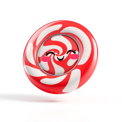
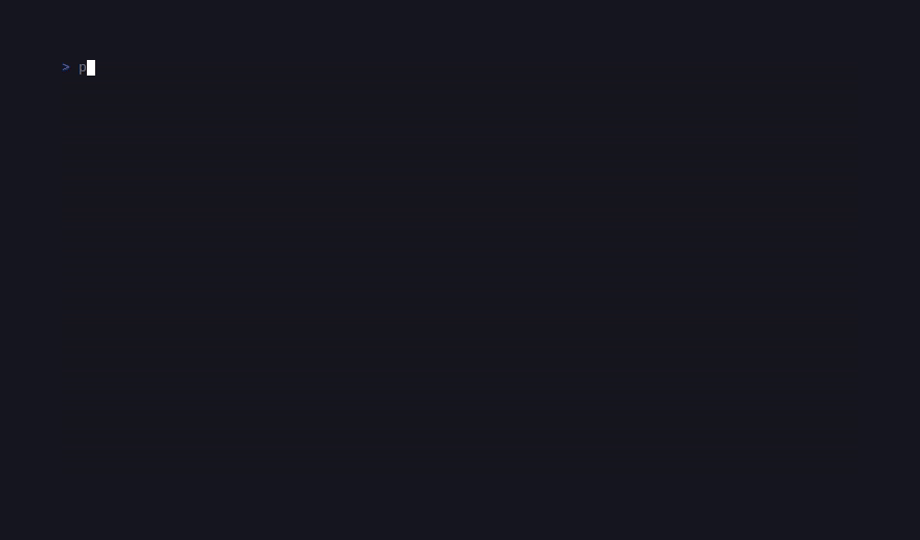

# SugarAnimation

> Formerly published as `sugarcraft/candy-flip`; renamed 2026-10, with the namespace moving `SugarCraft\Flip\` → `SugarCraft\Animation\`. <!-- @rename-keep -->

<!-- BADGES:BEGIN -->
[](https://github.com/detain/sugarcraft/actions/workflows/ci.yml)
[](https://app.codecov.io/gh/detain/sugarcraft?flags%5B0%5D=sugar-animation)
[](https://packagist.org/packages/sugarcraft/sugar-animation)
[](LICENSE)
[](https://www.php.net/)
<!-- BADGES:END -->




SugarAnimation is an ANSI/GIF animation toolkit on the SugarCraft stack for PHP 8.3+. It decodes a `.gif` on disk via `ext-gd`, downsamples each frame to a configurable cell grid, and renders the animation in 24-bit color — the `solid` preset paints full cells with 24-bit background color (space glyphs), the `density` preset picks ASCII glyphs from a luminance ramp and carries the color as a 24-bit foreground.

Separately, it plays back `.ansi` ANSI-art documents — parse, catalog, and timer-free frame pacing (see [ANSI art playback](#ansi-art-playback-ansiart--artlibrary--artloop) below). `.ansi` playback needs no GD at all.

```bash
composer require sugarcraft/sugar-animation
```

Want a ready-made viewer command? **candy-gifview** is the CLI front end built on this library, shipped as its own package ([source](https://github.com/detain/sugarcraft/tree/master/candy-gifview)):

```bash
composer require sugarcraft/candy-gifview
```

```bash
candy-gifview my-animation.gif         # solid preset (default)
candy-gifview my-animation.gif density # ASCII luminance ramp
```

## Requirements

- PHP 8.3+ (`declare(strict_types=1)` codebase, sugar-core TEA stack).
- `ext-gd` for the GIF path only. Without it every `Decoder` entry point throws a loud `RuntimeException` ("sugar-animation: …") — the `.ansi` playback side (AnsiArt/ArtLibrary/ArtLoop) never touches GD.
- The cell grid is fixed at decode time: resizing the terminal clips the already-decoded art, it never re-scales. The Player's status line is not width-clamped, so playback looks its best at 82+ columns; headless decoders should size the grid to their host surface with that in mind.

## Player keys

| Key                | Action                              |
|--------------------|-------------------------------------|
| `Space`            | Pause / resume                      |
| `←`                | Step back one frame                 |
| `→`                | Step forward one frame              |
| `d`                | Toggle solid ↔ density preset       |
| `q` / `Esc` / Ctrl+C | Quit                            |

The keys are fixed — there is no rebind API. A host that wants different chords must intercept or synthesize messages before they reach `Player::update()`.

## Terminal support

Both presets always emit 24-bit truecolor SGR (`38;2;…` / `48;2;…`). There is no 256-color fallback ladder and no `NO_COLOR` / monochrome mode: on a terminal without truecolor the cells degrade (often to default colors), and `density` stays legible there — it is the better preset. On `TERM=dumb` or otherwise capability-poor terminals expect raw escape sequences rather than adapted output.

The `.ansi` side has its own fallback: `ArtLibrary` resolves a slug through a `tc` → `256` → `16` depth cascade, picking a pre-authored variant that matches the detected `ColorProfile` instead of re-coloring at runtime.

## Reduced motion

The library does not consult `REDUCE_MOTION` (or the GNOME `gtk-enable-animations` / debian `reduce-motion` conventions) anywhere — autoplay is autoplay. Hosts and users who need motion restraint have real mitigations: construct the `Player` paused (`new Player($frames, paused: true)`) so nothing moves until `Space`, step manually with `←`/`→`, slow the cadence with `withFixedFps()` below the source frame rate, and bound the run with `playOnce()` / `withMaxSeconds()`. Honoring `REDUCE_MOTION` by default is a plausible code follow-up; this wave documents the state rather than changing it.

## Localization

Refusal and decode errors route through sugar-core `Lang` in the `sugar-animation: …` voice, with translations shipped for every locale in `lang/` (see the repo's `LOCALES.md`). The Player's one-line status overlay is currently English-only; i18n-ing it is a tracked follow-up.

## ANSI art playback (AnsiArt / ArtLibrary / ArtLoop)

`.ansi` art documents (SGR-escaped text, optionally a multi-frame redraw
stream) parse into a cell model — one `AnsiCell` (glyph + canonical resolved
SGR state, accumulated ECMA-48-style across rows and frames like a real
terminal) per codepoint — that hosts paint into any surface, or replay
verbatim via `AnsiArt::sgrText()`. `ArtLibrary` catalogs a directory of
`logo-<slug>[-skinny][-anim]-<16|256|tc>-<WxH>.ansi` files and resolves a slug
at the terminal's detected colour depth with a kind/depth cascade (wide form
preferred; depth fallback is adjacent-first). `ArtLoop` is pure pacing math:
no timers, `frameAt(elapsedSeconds)` maps wall-clock offset to frame index.

```php
use SugarCraft\Core\Util\ColorProfile;
use SugarCraft\Animation\ArtLibrary;
use SugarCraft\Animation\ArtLoop;

$library   = ArtLibrary::fromDir(__DIR__ . '/logo');        // optional ->mergeManifest('logos.jsonl')
$depth     = ArtLibrary::profileTag(ColorProfile::detect()); // 'tc' | '256' | '16'
$art       = $library->pick('art-deco-gilt', $depth);       // ?AnsiArt, cascade-resolved
$startedAt = microtime(true);

if ($art !== null && $art->isAnimated()) {
    $loop  = ArtLoop::new($art->frameCount());              // 0.1 s/frame + 2.5 s closing hold
    $frame = $loop->frameAt(microtime(true) - $startedAt);
    echo $art->sgrText($frame);                             // canonical, SGR-safe replay
}
```

Caveat: parsed cells keep C0 control bytes that were not part of an escape sequence as literal glyph data — echoing `$cell->glyph` raw replays them to your terminal (an audible nuisance at best, cursor/log injection at worst). `sgrText()` is the safe reconstruction: it re-emits only the canonical SGR runs and the glyphs. For a self-contained GIF run, `php examples/play.php` generates a tiny synthetic animated GIF and plays it end-to-end through both presets.

## Implementation notes

The decoder is hand-rolled over the GIF89a byte stream — it never loads the whole animation into a `GdImage` at once — and uses PHP's `imagecreatefromstring()` for per-frame in-memory extraction; no temporary files are written. The walk:

1. Parse the Logical Screen Descriptor and Global Color Table (GCT) from the header.
2. Walk the frame stream, extracting each frame's Graphic Control Extension (GCE) delay (a delay of 0 inherits the previous frame's, defaulting to 10cs), disposal method (0–3), and transparent-color index.
3. Extract the per-frame Local Color Table (LCT) when present; fall back to the GCT otherwise.
4. Reassemble a minimal single-frame GIF payload in memory and pass it to `imagecreatefromstring()`.
5. Area-average downsample the resulting `GdImage` to the requested cell grid, skipping fully transparent pixels in the average.

The caps — 256 frames, a 2,000,000-pixel logical screen, a 100,000-cell output grid, and their joint product `Decoder::MAX_TOTAL_CELLS` (2,000,000 cell-samples per decode: grid × frames, so a full-cap 256-frame stream cannot multiply into multi-GB residency) — bound decoding, compositing, and the cost of `decode()`'s eager collect; the header walk also fails loud (`decoder.too_many_frames`) once a stream carries more than 512 frame descriptors, so a flood never pays its full allocation before the cap bites. Worst-case wall time scales with source pixels × frames inside those caps, so hosts guarding latency should wrap the call. On top of the caps, the file entry points (`Decoder::readFile()`, `Decoder::decode()`, `AnsiArt::fromFile()` — and with it `ArtLibrary`) read at most `Decoder::MAX_INPUT_BYTES` (64 MiB) **+ 1 byte** and refuse on the length actually seen — the gate *is* the bounded read, so a file growing mid-read cannot slip a check-then-read gap and a stat that cannot express the size fails closed rather than open. Bytes you hand in yourself — `Decoder::decodeBytes()`, `AnsiArt::fromString()` — are already resident, but the same ceiling is enforced before the walk, so the line can never be steered around.

## Architecture

| File              | Role                                                                                                  |
|-------------------|------------------------------------------------------------------------------------------------------|
| `Decoder`         | Reads the GIF, extracts per-frame GCE delay + disposal + transparency + local color table + image left/top offset, hands each frame to GD via `imagecreatefromstring()`, area-average downsamples the composited canvas to a cell grid, returns a list of `Frame` objects. Compositing handles DISPOSAL_NONE/KEEP (0/1) to leave the canvas, DISPOSAL_BACKGROUND (2) to clear the prior rect, and DISPOSAL_PREVIOUS (3) to restore a canvas snapshot. `loopCount()` inspects the NETSCAPE2.0/ANIMEXTS1.0 loop extension with libnsgif semantics normalized to total playthroughs (raw 0 = infinite, raw N = N+1; no extension = infinite), and `readFile()` exposes the one-read ingress so hosts feed frames and loop inspection from the same audited bytes. |
| `Frame`           | Pure value — 2-D RGB grid in cell coordinates with per-frame `$delay` (centiseconds), `$disposal` method (0–3), and `$transparent` flag; optional full-canvas RGBA carried alongside. |
| `Renderer`        | ANSI emitter. Two presets: `solid` (24-bit background-colored spaces) or `density` (luminance ramp with 24-bit foreground). `withAdaptiveSize()` queries the TTY via `SizeIoctl` so the art is clipped to the viewport; `renderFrame()` bounds output to the rows/cols it is given — resize clips, it never re-scales. |
| `Player`          | SugarCraft Model — index + paused + preset + renderer state, driven by an ABSOLUTE prefix-sum schedule: each tick arms the DISTANCE to the next frame deadline, so slow renders cost lateness, never drift (late ticks skip ahead). Periods are the per-frame GIF delays (centiseconds) floored at 1cs, or a uniform 1/fps override via `withFixedFps()` (rates above the advertised `MAX_FPS` ceiling clamp to it); `withMaxSeconds()` bounds total play time with a model-side deadline (no wall-clock kill). `withLoops()`/`playOnce()` bound playthroughs on the same schedule — the stop rides the tick that crosses the final lap boundary, last frame left displayed, with forced-advance wraps counted through a carried lap counter. `withWatch()` re-runs a host probe every `WATCH_POLL_SECONDS` — chicle's 10 ms re-stat cycle as an event-loop timer, never a sleep — and `withFrames()` rebinds the stream in place on reload: position resets, policy survives. Handles `WindowSizeMsg` by re-clamping the renderer to the new viewport (rows-1 for the status line). |
| `TickMsg`         | Frame-tick message produced by the Cmd.                                                            |
| `WatchMsg`        | Watch-poll message, armed by the Player itself and re-armed after every run (including reloads and failed reads).                                                            |

## Test

```bash
composer install
vendor/bin/phpunit
```

## Snapshot tests

Rendering output is pinned via `sugar-testing`'s `assertGoldenAnsi` golden-file
snapshots. Any change to the ANSI cell output must be intentional — the flag is
create-only and never rewrites an existing golden, so to accept a new canonical
render delete `tests/fixtures/<name>.golden` first, then re-run once with
`UPDATE_GOLDENS=1 vendor/bin/phpunit`.

## Credits & inspiration

Originally inspired by the Go [Charm](https://github.com/charmbracelet) ecosystem; SugarCraft is developed as a native PHP project.

Design antecedent: [`namzug16/gifterm`](https://github.com/namzug16/gifterm). Cadence, `--watch` polling, and the frame-delay inheritance rules follow chicle, a Go GIF viewer for the terminal; loop-extension playthrough semantics follow libnsgif ([`namzug16/libnsgif`](https://github.com/namzug16/libnsgif)), the NetSurf GIF library.
