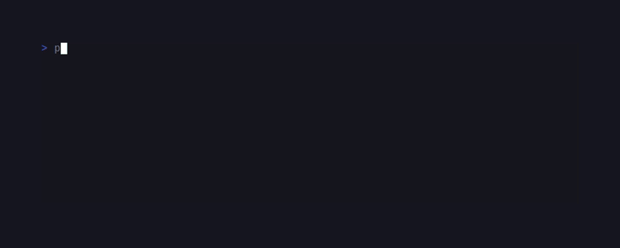
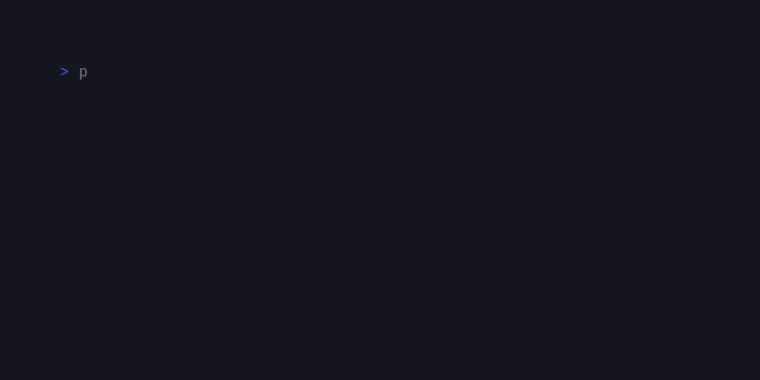
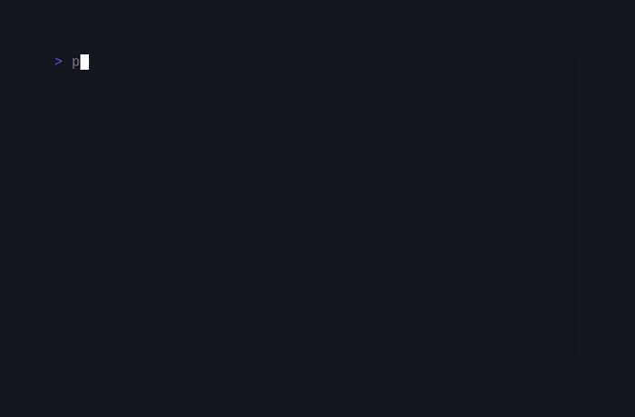
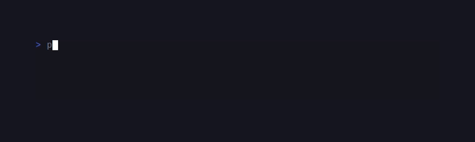
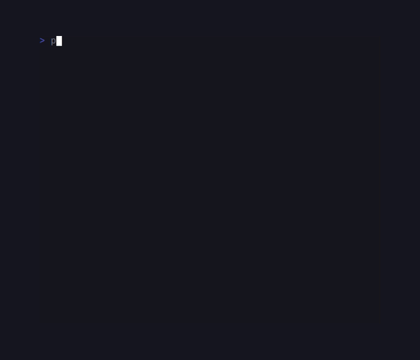
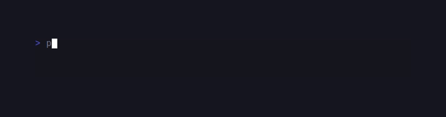
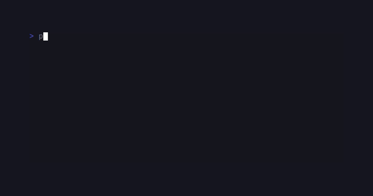

# SugarCharts

<!-- BADGES:BEGIN -->
[](https://github.com/detain/sugarcraft/actions/workflows/ci.yml)
[](https://app.codecov.io/gh/detain/sugarcraft?flags%5B0%5D=sugar-charts)
[](LICENSE)
[](https://www.php.net/)
<!-- BADGES:END -->

sugar-charts is a terminal charting library for PHP 8.3+. It ships the canvas
foundation (Canvas / BrailleGrid / Graph), ten chart renderers — Sparkline,
BarChart, LineChart, TimeSeries, Streamline, Waveline, Heatmap, OHLCChart,
Scatter and Picture — and an Aggregation toolbox. The Components table below
is the fastest way to find the class you need.

```sh
composer require sugarcraft/sugar-charts:dev-master
```

No tagged releases ship yet — Packagist serves the `dev-master` branch only,
so name it explicitly (`:dev-master`, or `@dev` in a `composer.json` require).
On a default-`stable` project a bare `sugarcraft/sugar-charts` request does
not resolve.

The snippets assume a composer project with this package installed and
`require 'vendor/autoload.php';` in scope.

```php
use SugarCraft\Charts\Sparkline\Sparkline;
use SugarCraft\Charts\BarChart\BarChart;
use SugarCraft\Charts\LineChart\LineChart;

echo Sparkline::new([1, 3, 2, 8, 5, 4, 7, 6], 8)->view() . PHP_EOL;
// " ▂▁█▅▃▇▆" (scaled to the window's minimum and maximum; the minimum maps to the blank leading cell)

echo BarChart::new([['cpu', 0.7], ['mem', 0.4], ['disk', 0.9]], 20, 5)->view() . PHP_EOL;
//               ██████
// ██████        ██████
// ██████ ██████ ██████
// ██████ ██████ ██████
// cpu    mem    disk

echo BarChart::new([['cpu', 0.7], ['mem', 0.4], ['disk', 0.9]], 20, 5)
    ->withFractionalHeights()->view() . PHP_EOL;
// ▁▁▁▁▁▁        ██████
// ██████        ██████
// ██████ ▆▆▆▆▆▆ ██████
// ██████ ██████ ██████
// cpu    mem    disk

echo LineChart::new([1, 4, 2, 8, 6, 3, 7], 30, 6)->view() . PHP_EOL;
```

> Every `with*()` fluent setter on the chart classes (and on `Legend`) also has a
> short-form alias: `withFoo()` becomes `foo()` (drop `with`, lcfirst). Fleet-wide
> vocabulary includes `data`, `size`, `min`, `max`, `point`, `xRange`, `yRange`,
> `xyRange`, `colors`, `palette`, `bars`, `barWidth`, `showLabels`, `showAxis`,
> `title`, `canvas`, `theme`, `dataset`, `markLines`, `unicodeConnectors`, `style`,
> `protocol`, `items` and `position`.
> That list is fleet-wide vocabulary, not a per-class promise: each alias exists on
> exactly the classes that expose the matching `with*()` setter — `style()` is on
> `Sparkline`, while neither `BarChart` nor `LineChart` carries `colors()`, `style()`
> or `palette()`. The per-class registry is pinned by `tests/AliasCompletenessTest.php`.
> The legend indicator rune is set with `withLegendIndicator()` / `legendIndicator()`
> (CH-58); the old `withLegendStyle()` / `legendStyle()` names forward to it and
> are `@deprecated` (REMOVED-IN 2.0.0).
>
> A few names deviate from the rule to read better: `withLegendPosition()` →
> `legendPos()` and `withTitlePosition()` → `titlePos()` (`Pos` is the accepted
> shorthand for `Position`), `withDataLabelFormatter()` → `dataLabelFormat()`,
> `withFractionalHeights()` → `fractional()`, and `withXYRange()` → `xyRange()`.
> `Sparkline`'s width setter aliases to `width()`, not `size()` — and
> `Sparkline::width()`/`data()`/`min()`/`max()` are dual-form: called bare they
> **read** the current value, called with an argument they set it exactly like
> the long form. The same dual shape carries `TimeSeries::timeRange()` and
> `Heatmap::cellStyle()`/`autoValueRange()`/`monoRamp()`. The
> `with*` long forms continue to work everywhere; pick the form that reads best at
> the call site.
>
> Read accessors follow the house bare-name law (`cell()`, `cellStyle()` on `Canvas`,
> `circlePoints()` and friends on `Graph`). Where a bare name was already taken by a
> setter alias — `timeRange()` on `TimeSeries`; `autoValueRange()`, `cellStyle()` and
> `monoRamp()` on `Heatmap`; the animation pair on `Chart` — the `get*` spelling
> remains the accessor and is a documented exception, not drift.

## Components

Table paths omit the `SugarCraft\` root namespace for width (`Charts\Canvas\Canvas`
is `SugarCraft\Charts\Canvas\Canvas`); prose and snippets always spell the full FQN.

| Component | Role | Notable knobs |
|---|---|---|
| `Charts\Canvas\Canvas` | Fixed-size cell grid; each cell holds a rune + optional sugar-style `Style`. | `setCell` / `setLines` / `setString` / `setRunes` / `fill` / `fillLine` / `shiftUp` / `shiftDown` / `shiftLeft` / `shiftRight` / `setCellStyle` / `cellStyle` / `cell` (`getCell` / `getCellStyle` kept as compat aliases) |
| `Charts\Canvas\BrailleGrid` | Sub-cell scratch buffer (2 cols × 4 rows of dots per cell). Paint dots, then copy to a `Canvas`. | `set` / `unset` / `toggle` / `isSet` / `rune` / `paint(Canvas, x0, y0, ?Style)` / `clear` |
| `Charts\Canvas\Graph` | Drawing primitives over a `Canvas`. | `drawHLine` / `drawVLine` / `drawXYAxis` / `drawXYAxisLabel` / `drawString` / `drawLine` / `drawLinePoints` / `fillRect` / `drawColumn` / `drawColumns` / `drawRows` / `drawCandlestick` / `drawBrailleRune` / `drawBraillePatterns` / `drawVerticalLineUp` / `drawVerticalLineDown` / `drawHorizontalLineLeft` / `drawHorizontalLineRight` / `circlePoints` / `circlePointsWithLimit` / `fullCirclePoints` / `fullCirclePointsWithLimit` / `linePointsWithLimit` (`get*` spellings kept as ntcharts-mirror compat aliases) |
| `Charts\Sparkline\Sparkline` | Single-row series renderer using the eight Unicode bar glyphs. | `push` / `pushAll` / `clear` / `withMin` / `withMax` / `withStyle(?Style)` / `withNoAutoMaxValue(bool)` (parity shim — the flag never changes output; removal would be breaking) / `withWidth` |
| `Charts\BarChart\BarChart` | Labeled bars — vertical or horizontal (`withHorizontal()`, a second render mode); auto-scales to a configurable min / max. | `withBarWidth` / `withBarGap` / `withNoAutoBarWidth` / `withFractionalHeights` (eighth-block caps) / `withBarColor(?Closure)` (per-bar `fn(Bar, int): ?Color`) / `withHorizontal(bool)` / `withShowAxis(bool)` / `withMin(?float)` / `withMax(?float)` / `withDataLabels(bool)` (values as a row, see Value labels) / `withDataLabelFormatter(?Closure)` / `push(Bar\|array)` / `pushAll(iterable)` / `clear` |
| `Charts\LineChart\LineChart` | Multi-series ASCII or braille plot drawn onto a Canvas with configurable axes. `withDataset()` registers a named series and its legend entry; series colors cycle through the six-name color-blind-safe palette (blue, orange, green, red, purple, cyan) or follow the `withTheme()` palette. The legend strip (the row of color swatches and series names) appears only once `withLegend()` is on — adding datasets never shows it on its own. | `withYRange` / `withXRange` / `withXYRange` / `autoAdjustRange` / `withXLabelFormatter` / `withYLabelFormatter` / `withAxes` / `withXLabels` / `withYLabels` / `withCanvas` / `withTheme` / `withFill` / `withSeriesColorFn(?Closure)` (per-point `fn(string, int, float): ?Color`) |
| `Charts\LineChart\TimeSeries` | Wrapper around `LineChart` (composition, not inheritance — `TimeSeries` is `final`) accepting `[\DateTimeImmutable, value]` tuples and rendering X-axis labels formatted from the timestamps. LineChart knobs such as `withDataset()` / `withTheme()` are not exposed. | `push` / `withPoints` / `withTimeFormat` / `withXLabelCount` / `withTimeRange(?start, ?end)` / `getTimeRange()` |
| `Charts\LineChart\Streamline` | Streaming line windowed to width — renders through a LineChart of configurable height (default 8 rows). | `push` / `pushAll` / `clear` / `isEmpty` / `count` / `withSize` / `withMin` / `withMax` / `withYRange` / `withPoint` |
| `Charts\LineChart\Waveline` | XY scatter / wave plot driven by `(x, y)` pairs. | `push` / `pushAll` / `clear` / `withSize` / `withXRange` / `withYRange` / `withXYRange` / `withPoint` |
| `Charts\Heatmap\Heatmap` | 2D grid colored by value with optional palette / legend. | `withSize` / `withMin` / `withMax` / `withPalette` / `withLegend` / `withColors(cold, hot)` / `withRune` / `withColorProfile` / `withCellStyle(?Style)` / `withAutoValueRange(bool)` / `pushPoint(HeatPoint)` / `pushAll` |
| `Charts\OHLC\OHLCChart` | Candlestick chart for `(open, high, low, close)` rows. | `withBars` / `push` / `withSize` / `withBodyRunes(bull,bear)` / `withWickRune(rune)` / `withMin` / `withMax` / `withColors` / `withTitle` / `withLegend` / `withLegendPosition` |
| `Charts\Scatter\Scatter` | XY scatter plot. | `withPoints` / `withSize` / `withXRange` / `withYRange` / `withRune` / `withTitle` / `withLegend` / `withLegendPosition` / `withLegendItems` |
| `Charts\Aggregation\BucketByTime` | Groups timestamped values into time buckets with configurable aggregation. | Static helpers `BucketByTime::sum($intervalSecs, $rows)` / `mean` / `min` / `max` / `first` / `last` — each returns a **plain array** of `['ts' => …, 'value' => …]` buckets, not a builder. The instance path is separate: `::new($intervalSecs, ?$aggregator, $offsetSeconds)` then `add()` / `addMany()` / `compute()` / `bucket()` / `toTimeSeries()`. |
| `Charts\Aggregation\MovingAverage` | Sliding-window aggregator — SMA and EMA. | Static helpers `MovingAverage::simple($window, $values)` / `centered($window, $values)` / `ema($window, $values, ?$alpha)` — each returns a **plain array** of floats. The instance path: `::new($window, $centered = false)` then `add()` / `addMany()` / `computeSimple()` / `values()` / `clear()` — note `ema()` is static-only, there is no EMA builder. |
| `Charts\Aggregation\Resample` | Upsample or downsample timestamped series to a target cadence. | Static helpers `Resample::last($intervalSecs, $rows)` / `mean` / `linear` / `nearest` — each returns a **plain array** of resampled rows. The instance path: `::new($intervalSecs, $startTimestamp, ?$maxPoints)` then `add()` / `addMany()` / `resample()` (auto-detects up- vs down-sampling; output capped at `MAX_RESAMPLE_POINTS`). |
| `Charts\Picture\Picture` | Inline image renderer — Sixel, Kitty (chunked APC) and iTerm2 (OSC 1337) protocols. `detect()` is multiplexer-first: under tmux or Zellij it returns `null` (their surfaces swallow image escapes) unless you opt in via `CHARTS_PICTURE_PASSTHROUGH=1`; then it routes iTerm2/WezTerm/kitty/Foot/mlterm/Windows Terminal (Sixel since 1.18) by env. | `fromGrid` / `fromPng` / `withProtocol` / `withPaletteSize` / `detect` / `view` |

### Which line chart?

Four renderers draw line-ish series; pick by input shape and update model:

| You have… | Use | Why |
|---|---|---|
| a full value list, static or rebuilt per render | `LineChart` | the general multi-series plot: axes, datasets, theming, fill, marks |
| a stream, keep only the newest `width` samples | `Streamline` | fixed-capacity ring buffer, append-only `push` — drops old samples automatically |
| `(x, y)` pairs on an XY plane, wave/oscilloscope shapes | `Waveline` | points map through an explicit x-range instead of sample index |
| `[DateTimeImmutable, value]` tuples with time-formatted axis | `TimeSeries` | owns the timestamp formatting; chrome follows LineChart via its forwarded knobs |

If two rows fit, prefer the one whose data shape you already hold — the
others coerce it.

### Aggregation

Aggregation classes process raw time-series data before charting:

```php
use SugarCraft\Charts\Aggregation\{BucketByTime, MovingAverage, Resample};

// BucketByTime: group into 1-hour buckets, sum values per bucket.
$buckets = BucketByTime::sum(3600, [
    ['ts' => 1704085800, 'value' => 10],  // 2024-01-01 05:10 UTC
    ['ts' => 1704087900, 'value' => 15],  // 2024-01-01 05:45 UTC
    ['ts' => 1704089100, 'value' => 20],  // 2024-01-01 06:05 UTC
]);
// → [['ts' => 1704085200, 'value' => 25], ['ts' => 1704088800, 'value' => 20]]
// Note: `ts` is the ABSOLUTE epoch bucket start (floor(ts / 3600) * 3600),
// not a relative offset — render it with gmdate(), not epoch-offset math.

// MovingAverage: 3-point SMA and EMA (ema takes an optional smoothing
// alpha in (0,1]; omitted, it uses the standard 2/(window+1) — and window
// must be > 0 for every factory, EMA included).
$sma = MovingAverage::simple(3, [1, 4, 2, 8, 6]);
// → [0.0, 0.0, 2.33…, 4.67…, 5.33…]

$ema = MovingAverage::ema(3, [1, 4, 2, 8, 6]);
// → [1.0, 2.5, 2.25, 5.125, 5.5625]

// Resample: downsample to 30-second cadence (last value), or upsample (linear interp).
$timestampedData = [
    ['ts' => 0,  'value' => 1.0],
    ['ts' => 10, 'value' => 2.0],
    ['ts' => 40, 'value' => 3.0],
    ['ts' => 70, 'value' => 4.0],
];
$down = Resample::last(30, $timestampedData);
$up   = Resample::linear(30, $timestampedData);
```

### Braille dot-grid rendering

Reach for braille when a pane must carry more samples than it has rows
(dense telemetry, overlapping series): it renders at 2×4 sub-cell dot
resolution instead of character cells. Enable it with `withBraille(true)`
— a plain boolean switch that needs **no extra package at all**.
`sugar-dashboard` is only needed if you specifically want its
`BrailleCanvas` class (or dashboard embedding of chart rows); the
dot-grid itself is lib-local. Note the name: this is a braille
*dot-grid* — six-dot cell patterns used as a dense character set — not
screen-reader braille.

`withCanvas(?CellGrid)` composes with it: pass any cell-grid
implementation (`BrailleCanvas`, a sugar-cellbuffer `Buffer`, your own)
and the chart paints into that grid at its declared size instead of a
fresh internal one — a real bridge, writes clipped by the grid's bounds.
Grid choice and braille mode are independent: a braille raster can be
painted into any grid. Both knobs exist only on the `Chart` base that
`LineChart` extends; `BarChart`/`Scatter`/`OHLCChart` compose
`ChartExtras` with no canvas surface, and `Heatmap`, `TimeSeries`,
`Streamline` and `Waveline` expose neither knob.

```php
use SugarCraft\Charts\LineChart\LineChart;
use SugarCraft\Dashboard\Plot\Braille\BrailleCanvas;

$chart = LineChart::new([1, 4, 2, 8, 6], 80, 24)
    ->withBraille(true)        // dot-grid mode, no extra package
    ->withCanvas(new BrailleCanvas(80, 24)); // optional: paint into a caller grid
echo $chart->view();
```

### Named color themes

`LineChart` consumes a [sugar-style](https://github.com/detain/sugarcraft/tree/master/sugar-style)
`Theme` via `withTheme()`: the theme's `primary` / `accent` / `info` /
`success` / `warning` / `secondary` / `error` colors become the series
palette in render order (primary series first, then each `withDataset()`
in turn, cycling), and the legend indicators are recolored to the same
slots. A `withSeriesColorFn()` color still wins per point; `null` from
the resolver falls back to the theme slot. Charts built **without** a
theme render byte-identically to unthemed output, and `withTheme()`
works in both the ASCII and the braille (`withCanvas()`) pass. All ten
`Theme::` factory methods are supported:

```php
use SugarCraft\Charts\LineChart\LineChart;
use SugarCraft\Style\Theme;

$chart = LineChart::new([3, 1, 4, 1, 5, 9, 2, 6], 40, 8)
    ->withTheme(Theme::dracula())
    ->withLegend();
echo $chart->view();   // truecolor 38;2;… runs follow the dracula slots
```

Available themes: `Theme::ansi()` / `Theme::dark()` / `Theme::light()` /
`Theme::dracula()` / `Theme::tokyoNight()` / `Theme::oneDark()` /
`Theme::githubDark()` / `Theme::solarizedDark()` / `Theme::solarizedLight()` / `Theme::adaptive()` (COLORFGBG-aware — dark or light by the reported background, dark when nothing is reported).

Theme consumption is scoped to `LineChart` today. The other renderers do
not read a theme (`BarChart` / `Scatter` / `OHLCChart` never had
`withTheme()` — they compose `ChartExtras`; per-bar / per-point color
closures are their styling surface). Widening theme slots to those
renderers would be new public API and is left as a seam.

### Value labels and animation

`BarChart` prints each bar's value as a **data-label row** — above the
bars in vertical mode, trailing the bar in horizontal mode (truncated to
whatever room the row has left):

```php
use SugarCraft\Charts\BarChart\BarChart;

echo BarChart::new([['cpu', 7], ['mem', 4], ['disk', 9]], 20, 5)
    ->withDataLabels(true)
    ->view() . PHP_EOL;
//   7      4      9
//               ██████
// ██████        ██████
// ██████ ██████ ██████
// ██████ ██████ ██████
// cpu    mem    disk
```

The default format trims to an integer when the value is whole, otherwise
up to two decimals (`2.25`, `2.5`). `withDataLabelFormatter(fn(Bar $bar,
int $i): string)` — alias `dataLabelFormat()` — replaces it. The base
`Chart::withDataLabels()` / `withDataLabelFormatter()` storage exists for
API shape; `LineChart` deliberately renders no value labels — its
braille/ASCII canvas paints one dot per column with no spare cell — so
the knob is honest storage only there, and `BarChart` is the label
renderer.

Animation is caller-driven and `LineChart`-only: `withAnimationProgress(0.0…1.0)`
clamps how much of the series a render paints, honored in both the cell
and the braille pass; no other renderer exposes the knob (verified
`method_exists` — `BarChart`, `Scatter`, `OHLCChart`, `Heatmap`,
`TimeSeries`, `Streamline`, `Waveline`, `Sparkline`, `Picture`).
`withAnimationDuration(int $ms)` is a stored **pacing hint** for the
caller's own clock — the lib runs no timers. Drive frames by advancing
the progress yourself, e.g. `examples/animated_line.php`. For readers who
prefer reduced motion, skip the sweep entirely and render the final frame
at progress `1.0` — the output is the same chart, fully drawn.

### Per-point and per-bar colors

One color per series is too coarse for value-heat graphs — btop (the terminal resource monitor) tints every
graph point and meter by its value through the theme gradient. Two optional resolvers bring
that to SugarCharts:

- `LineChart::withSeriesColorFn(?Closure)` — `fn(string $dataset, int $x, float $value): ?Color`.
  A returned `Color` paints that sample's dot, its `withFill()` run and the
  connector leaving it; `null` falls through to the theme slot for that
    series (with `withTheme()`), else the normal per-series color
  (legend color in braille mode, unstyled in cell mode). `$dataset` is the
  series name — `LineChart::PRIMARY_SERIES` (`'_primary'`) for the unnamed
  `$data` series — and `$x` is the sample's index in the *full* series, even
  when the chart tail-slices to fit its width. Works in both cell and braille
  (`withCanvas()`) modes.
- `BarChart::withBarColor(?Closure)` — `fn(Bar $bar, int $i): ?Color`, `$i`
  being the bar's index. Colors the `█` body and the eighth-block cap;
  labels, gaps and the axis are never colored.

Both have short-form aliases (`seriesColorFn()` / `barColor()`), passing
`null` restores the default path byte-identically, and a resolver returning
anything other than `Color|null` throws `\UnexpectedValueException` at
render time. Equal colors share one memoized `Style`, so a resolver may
return a fresh `Color` per call. The two signatures deliberately differ —
`fn(string $dataset, int $x, float $value)` keys off series identity while
`fn(Bar $bar, int $i)` keys off the bar object; there is no shared adapter,
and normalizing the shapes is tracked as future API work (sugar-charts-090).

```php
use SugarCraft\Charts\BarChart\{Bar, BarChart};
use SugarCraft\Charts\LineChart\LineChart;
use SugarCraft\Core\Util\Color;

$heat = static fn (float $v): Color => match (true) {
    $v >= 7 => Color::hex('#ff5555'),
    $v >= 4 => Color::hex('#f1fa8c'),
    default => Color::hex('#50fa7b'),
};

echo LineChart::new([1, 4, 2, 8, 6, 3, 7], 30, 6)
    ->withSeriesColorFn(
        static fn (string $dataset, int $x, float $v): ?Color =>
            $dataset === LineChart::PRIMARY_SERIES ? $heat($v) : null,
    )
    ->view() . PHP_EOL;

echo BarChart::new([['cpu', 0.7], ['mem', 0.4], ['disk', 0.9]], 20, 5)
    ->withFractionalHeights()
    ->withBarColor(static fn (Bar $bar, int $i): ?Color => $heat($bar->value * 10))
    ->view() . PHP_EOL;
```

### Reference lines: MarkLine, Legend, Position

```php
use SugarCraft\Charts\Chart\Position;
use SugarCraft\Charts\LineChart\LineChart;
use SugarCraft\Charts\MarkLine;

$chart = LineChart::new([3, 1, 4, 1, 5, 9, 2, 6], 40, 8)
    ->withMarkLines([
        MarkLine::at(7.5, 'alarm', MarkLine::STYLE_DASHED),
    ])
    ->withLegend()
    ->withLegendPosition(Position::Bottom);
echo $chart->view();
```

- `MarkLine::at(float $value, string $label = '', string $style = MarkLine::STYLE_DASHED)`
  is the factory (the constructor is private). `STYLE_SOLID` /
  `STYLE_DASHED` / `STYLE_DOTTED` pick the run glyph; the line is drawn
  across the plot at the value's row. Labels are sanitized through the
  untrusted-text guard at construction; non-finite values and unknown styles
  throw at once.
  Data-derived marks: `MarkLine::min($data)`, `MarkLine::max($data)`,
  `MarkLine::average($data)` (each `(array $data, string $style = STYLE_DASHED)`),
  or `MarkLine::fromDataset($data, $type)` with `$type` one of min/max/average.
- `Legend` is the composed strip — `withItems(list<array{label, color}>)`,
  `withPosition(Position)`, `withIndicatorChar(string)`,
  `withShowBorder(bool)`; short aliases `items()` / `position()`. Charts
  build one for you when `withLegend()` is on.
- `Position` (`SugarCraft\Charts\Chart\Position`: `Top` / `Bottom` /
  `Left` / `Right`) is the enum behind both `withLegendPosition()` and
  `withTitlePosition()` — import it; string forms are not accepted.

## Accessibility note

Charts encode series and magnitude through **color** and glyph position.
Color is the channel that fails first — in monochrome output, under a
`NO_COLOR`-style environment, or for readers with color-vision deficiency.
Pair it with the structural channels that survive it.

**What color actually drops out when.** The environment ladder
(`CLICOLOR_FORCE` / `FORCE_COLOR` beat `NO_COLOR`, which beats `CLICOLOR=0`)
is honored by every text renderer's `view()`: under `NO_COLOR` the legend
indicators, bar bodies, Heatmap fills, themed rules, MarkLine runs and
per-point colors all come back SGR-free (the ladder lives in
`Support/ColorLadder.php`). Image payloads are deliberately exempt —
under `NO_COLOR` `Picture::view()` still emits the sixel/kitty/iTerm2
escape because the escapes ARE the image — only its plain-text
placeholder is stripped. There is no automatic non-TTY degradation:
without the env var, piping a chart to a file yields full color.
Heatmap keeps readable structure without color via
`withMonoRamp(true)` (density through shade selection). To force
monochrome by profile instead of env, set the sugar-style profile for the
whole process (`Style::setDefaultProfile(ColorProfile::Ascii)`) and cool
the Heatmap separately with `Heatmap::withColorProfile(ColorProfile::Ascii)`;
the library never installs a profile from the environment on your behalf.

**Structural channels that never carry color.** `withDataLabels()` prints
bar values as text (BarChart renders them; LineChart's flag and formatter
are stored, not drawn — reach for BarChart when you need labels). Cell-mode
LineChart labels its series with six plain-ASCII point runes (`* + o x # .`),
overridable per-series with `withDatasetPoint()`. Legend entries and axis
labels are plain text. `withRune()` (Scatter, Heatmap) and
`withBodyRunes()` (OHLCChart) replace the glyphs themselves. Braille-dot
plots lose per-series identity entirely when printed without their legend,
so keep `withLegend()` on for shared or logged output. When no graphics
protocol is detected, `Picture::view()` degrades to a plain-text
placeholder, and `examples/picture.php` dumps its frames labeled as hex —
both readable without any color channel.

**Glyph widths.** Plain-ASCII defaults hold only for those six point runes.
Bodies and frames default to Unicode: the eight Sparkline block shades,
BarChart's `█`, the Heatmap fill, OHLC's `│ █ ▒`, MarkLine's `─` / `╌`, and
Graph's thin frame rules. Several of these are East-Asian-Ambiguous glyphs
that occupy one or two cells depending on terminal configuration; this
library lays them out by cell index assuming the fleet-wide canon of one
cell each (`Ambiguous = 1`, the same width policy sugar-core's `Width`
applies), so output is correct on every terminal in the CI matrix and a
host configured for `Ambiguous = 2` (legacy GNU-wcwidth CJK) would wrap
dense rows. The per-chart rune levers above cover Scatter/Heatmap fills,
OHLC bodies and LineChart points — **Sparkline's block shades and
BarChart's `█` have no glyph setter today**, so on an Ambiguous-wide host
those two renderers are the escapees; there is no library-wide ASCII
switch (tracked as product option sugar-charts-034).

**High contrast / low vision.** Color-vision deficiency and low vision are
different needs. For the 16-color tier, `Theme::ansi()` keeps every series
distinguishable without truecolor blending; the default Heatmap
cold→hot ramp is dark-heavy and can wash out on black terminals — prefer
an explicit `withPalette()` of light, saturated stops, or
`withMonoRamp(true)` for a single-glyph density ramp that survives any
background.

**Non-visual output.** A rendered chart is a pixel-free text picture: a
screen reader narrates block characters, not trends. The accessible
channel is the data itself — read `Sparkline::cells()`,
`LineChart::cells()` or your source arrays as text/CSV and emit those;
`withDataLabels()` on BarChart is the only renderer-side text
substitution (values as a label row). `Sparkline` in particular is one
unlabeled row with no axis and no title — never the sole carrier of a
number. `Picture` has no alternative-text slot: when its placeholder
prints, it names the protocol and frame size, which is what assistive
output will see.

## Untrusted labels

Every string this library can echo to a terminal passes through
`SugarCraft\Charts\Support\UntrustedText` — the trust boundary for labels
assembled from application data. The sweep:

- deletes every escape-introduced sequence — CSI, OSC-8 hyperlinks, OSC 0
  title writes, and the DCS/SOS/PM/APC string introducers — under **both
  spellings** of each (the 7-bit `ESC [`-style form and its 8-bit C1
  single-byte equivalent);
- deletes C0 controls except TAB/LF/CR, DEL, 8-bit C1, and forged
  U+E000/U+E001 mouse-zone sentinels;
- repairs malformed UTF-8 to U+FFFD **before** the Unicode-aware passes,
  so a hostile fragment can never make a pattern bail and strand the rest
  of the string;
- converts bidi overrides and zero-width characters into printable markers;
- flattens TAB/LF/CR to spaces, so a single surviving newline can never
  desynchronize the fixed-width frame.

Ordinary printable input comes back byte-identical, and the guard is
idempotent.

Static strings are swept at their setters: legend items, dataset names and
runes (`withDatasetPoint()`), axis label arrays, `MarkLine` captions, and
chart titles. Closure-produced text is swept at the resolve and render
sites — `withXLabelFormatter()` / `withYLabelFormatter()` results and
BarChart's `withDataLabelFormatter()` return value — so a formatter that
echoes hostile data cannot bypass the boundary either. The Canvas and
Graph internals that compose the frame are trusted layers and stay
unguarded by design.

## Localization

`lang/` ships sixteen locales. Every user-facing constraint message goes
through `Lang::t()`: chart dimension and non-finite value refusals are
localized, while developer-fault throws (reserved dataset name, unknown
`MarkLine` style, bad resolver return type) stay bare English by design.
`tests/LangTest.php` pins locale key parity against `lang/en.php`, so a
new message must be added to every locale to land.

## Performance

Render cost is linear in width × height. Both canvases are sparse —
empty cells store nothing — so mostly-blank charts render cheaply, and
per-sample style lookups are memoized.

Terminology: a *tick* is a numeric value at an axis position, a *label*
is the text drawn for one of the evenly-spaced *slots* along an axis
(five slots on X, four on Y by default; `withXLabelFormatter` covers the X
axis and `withYLabelFormatter` the Y axis).

Axis tick values are not a nice-number ladder: the live path
(`LineChart::resolveXLabels` / `resolveYLabels`) emits evenly-spaced
**raw** values between the data bounds (a Y axis can read
`8, 5.6667, 3.3333, 1`). Formatter-set axes use your formatter; formatter-
free axes now fall back to a Heckbert "nice numbers" ladder
(`NiceScale::ticks`) pinned to true plot rows, so default output reads
`8, 6, 4, 2` instead of the raw division. `Graph::niceNumbers` and
`NiceScale` are the lib's nice-number primitives (Heckbert antecedent —
a SugarCraft extension, not an upstream mirror); the default LineChart
axes route through `NiceScale::ticks`, and you can call them directly
for custom ladders.

## Shared foundations

`Sparkline` (with the `Buffer` / `BufferHelper` row-composition helpers
it uses) builds through [sugar-cellbuffer](https://github.com/detain/sugarcraft/tree/master/sugar-cellbuffer);
the grid-based renderers (`LineChart`, `Waveline`, `Heatmap`, `Scatter`,
`OHLCChart`) compose the lib-local `SugarCraft\Charts\Canvas\Canvas` —
`BarChart` does not (it composes `ChartExtras` text rows) and `Picture`
emits raw protocol bytes.
Do not re-implement string padding or cell-grid assembly — reuse `Buffer`
or `Canvas` as the shape of your output demands. Display widths come from
`SugarCraft\Core\Util\Width`, so bar labels, gutters and truncation are
**cell-correct** for CJK / emoji text (`BarChart`'s horizontal gutter
included). Label text is split by **grapheme cluster** (ICU via ext-intl,
a hard requirement; the codepoint ladder is a safety fallback), so emoji
families and combining sequences occupy one cell group instead of
shredding into isolated marks.

## Graph primitives at a glance

`Graph` is a static-method utility — every draw call takes a `Canvas`
plus coordinates in canvas (cell) space (top-left origin). Pair with
`BrailleGrid` for sub-cell precision:

```php
use SugarCraft\Charts\Canvas\{Canvas, BrailleGrid, Graph};

$canvas = new Canvas(40, 8);
Graph::drawXYAxis($canvas, 1, 6, 38, 5);
Graph::drawString($canvas, 4, 0, 'Demo');

// Sub-cell line via BrailleGrid.
$grid = new BrailleGrid(38, 6);
foreach (Graph::linePointsWithLimit(0, 0, 75, 23, limit: 200) as [$x, $y]) {
    $grid->set($x, $y);
}
$grid->paint($canvas, 1, 0);
echo $canvas->view();
```

## Palette / color profile

`Heatmap::withPalette([Color, …])` interpolates between an arbitrary
number of stops (≥ 2). `withColors(Color $cold, Color $hot)` is the
two-stop shortcut. `withColorProfile(ColorProfile)` sets the color space
the gradient is emitted in — there is no output autodetection; the default
is TrueColor. `Heatmap::withCellStyle(?Style)` overlays additional attributes
(bold / background / etc.) on top of every cell's foreground gradient.

## Demos

The demo families: ten renderers · nine runnable examples · eight CI-recorded
GIFs. Run one with `php examples/<name>.php` from the `sugar-charts/` directory
(see [examples/README.md](examples/README.md)). The eight GIFs cover Sparkline,
BarChart, Heatmap, OHLCChart, Scatter, Picture, TimeSeries and Streamline
(`line.php` drives `Streamline`); the two renderers without a recorded GIF are
`animated_line` and `braille`, whose example scripts have no `.vhs/` tape.

### Bar chart


### Heatmap



### Streamline (line.gif)



### OHLC (candlestick)



### Picture (Sixel)



### Scatter



### Sparkline



### Time series




## Status

| Component | State |
|---|---|
| Canvas, BrailleGrid, Graph primitives | 🟢 v1 — shipped, nothing pending. |
| Sparkline | 🟢 v1 — shipped, nothing pending. |
| BarChart | 🟢 v1 (data labels + horizontal mode ship; multi-bar grouped datasets pending) |
| LineChart | 🟢 v1 (multi-dataset + per-point colors + theming ship; **Mouse interaction** — the ntcharts BubbleZone equivalent — is a real gap: no hit-testing, zones, or legend-clicks exist; see sugar-mouse for the raw event primitives. Zoom/pan stay pending on top of that.) |
| TimeSeries | 🟢 v1 (multi-dataset + update-handler variants pending) |
| Streamline, Waveline | 🟢 v1 — shipped, nothing pending. |
| Heatmap | 🟢 v1 (auto value-range toggle ships: `withAutoValueRange()` / `getAutoValueRange()`) |
| OHLC | 🟡 candlestick rendering only — volume sub-pane + multi-series pending |
| Scatter | 🟡 single-dataset only — per-point rune/style sets pending |
| Picture | 🟢 v1 — Sixel + Kitty + iTerm2 encoders ship; when no protocol is detected, `view()` prints a plain-text placeholder |

## Snapshot tests

Sparkline render output is covered by golden-file snapshot tests —
`tests/GoldenRenderTest.php` compares actual ANSI bytes against
`sparkline-basic.golden`, `sparkline-minmax.golden` and
`sparkline-styled.golden` in `tests/fixtures/` via
`SugarCraft\Testing\Snapshot\Assertions::assertGoldenAnsi()`. The other
renderers are covered by inline byte assertions in their class suites;
that is the extension path for growing the golden family.

The golden writer is create-only: an existing fixture is never
rewritten, and a mismatch against one still fails even with the
update environment variable set (the branch honoring `UPDATE_GOLDENS` /
`SUGAR_TESTING_UPDATE_GOLDENS` only ever writes a fixture that does not
exist yet). To re-record after an intentional output change, delete first:

```sh
rm tests/fixtures/<name>.golden && SUGAR_TESTING_UPDATE_GOLDENS=1 vendor/bin/phpunit
```

(`UPDATE_GOLDENS=1` is honored as a legacy spelling; the canonical name is
`SUGAR_TESTING_UPDATE_GOLDENS=1`.)

## Testing

```sh
cd sugar-charts && composer install && vendor/bin/phpunit
```

## Related

- [sugar-style](https://github.com/detain/sugarcraft/tree/master/sugar-style) — `Style` / `Color` / `Theme` consumed here
- [sugar-cellbuffer](https://github.com/detain/sugarcraft/tree/master/sugar-cellbuffer) — `Buffer` substrate behind Sparkline composition
- [sugar-dashboard](https://github.com/detain/sugarcraft/tree/master/sugar-dashboard) — provides the `BrailleCanvas` used by braille mode
- [sugar-testing](https://github.com/detain/sugarcraft/tree/master/sugar-testing) — golden-file snapshot assertions used by the suite
- [NimbleMarkets/ntcharts](https://github.com/NimbleMarkets/ntcharts) — design antecedent
- [SugarCraft monorepo](https://github.com/detain/sugarcraft)

## Credits & inspiration

Design antecedent: [NimbleMarkets/ntcharts](https://github.com/NimbleMarkets/ntcharts); SugarCraft is developed as a native PHP project.
