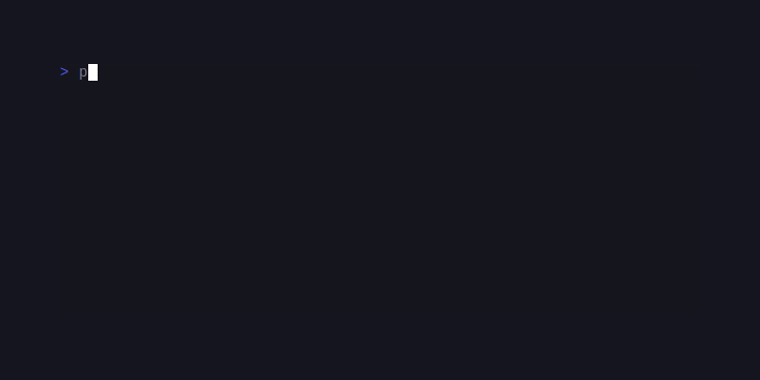
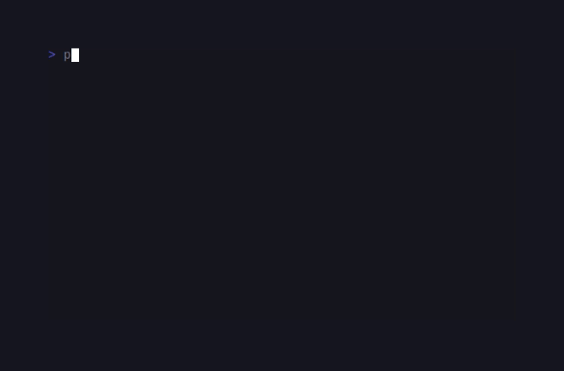
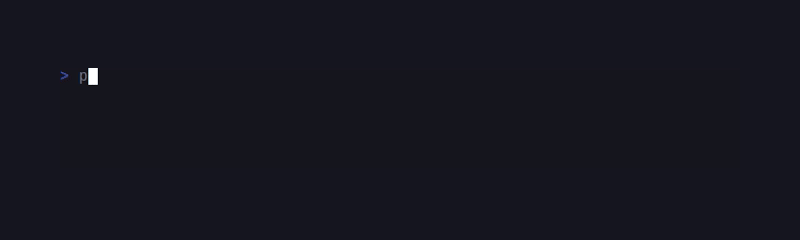
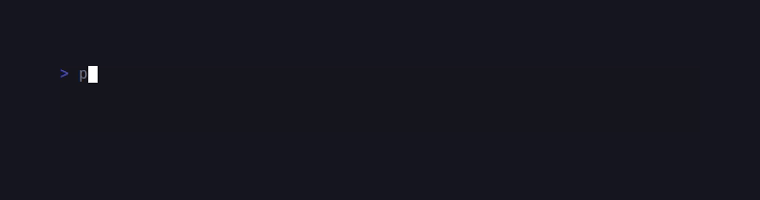
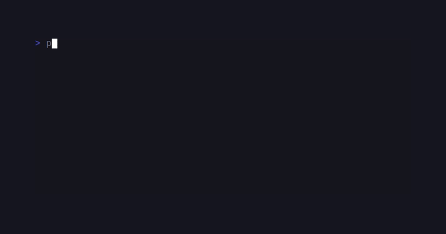

# SugarCharts

<!-- BADGES:BEGIN -->
[](https://github.com/detain/sugarcraft/actions/workflows/ci.yml)
[](https://app.codecov.io/gh/detain/sugarcraft?flags%5B0%5D=sugar-charts)
[](https://packagist.org/packages/sugarcraft/sugar-charts)
[](LICENSE)
[](https://www.php.net/)
<!-- BADGES:END -->


```sh
composer require sugarcraft/sugar-charts
```

sugar-charts — terminal charts for PHP 8.3+. The lib ships the canvas foundation
(Canvas / BrailleGrid / Graph) plus ten chart renderers — Sparkline, BarChart,
LineChart, TimeSeries, Streamline, Waveline, Heatmap, OHLCChart, Scatter and Picture —
and an Aggregation toolbox. The Components table below is the real value map.

```php
use SugarCraft\Charts\Sparkline\Sparkline;
use SugarCraft\Charts\BarChart\BarChart;
use SugarCraft\Charts\LineChart\LineChart;

echo Sparkline::new([1, 3, 2, 8, 5, 4, 7, 6], 8)->view() . PHP_EOL;
// " ▂▁█▅▃▇▆"  (the minimum value maps to the blank GLYPHS[0] cell)

echo BarChart::new([['cpu', 0.7], ['mem', 0.4], ['disk', 0.9]], 20, 5)->view() . PHP_EOL;
//               ██████
// ██████        ██████
// ██████ ██████ ██████
// ██████ ██████ ██████
// cpu    mem    disk

echo BarChart::new([['cpu', 0.7], ['mem', 0.4], ['disk', 0.9]], 20, 5)
    ->withFractionalHeights()->view() . PHP_EOL;
// ▁▁▁▁▁▁        ██████
// ██████        ██████
// ██████ ▆▆▆▆▆▆ ██████
// ██████ ██████ ██████
// cpu    mem    disk

echo LineChart::new([1, 4, 2, 8, 6, 3, 7], 30, 6)->view() . PHP_EOL;
```

> Every `with*()` fluent setter on the chart classes (and on `Legend`) also has a
> short-form alias, so
> `data` / `size` / `min` / `max` / `point` / `xRange` / `yRange` / `xyRange` / `colors` /
> `palette` / `bars` / `barWidth` / `showLabels` / `showAxis` / `title` / `canvas` /
> `theme` / `dataset` / `markLines` / `unicodeConnectors` / `style` / `protocol` / `items` / `position` … are all available.
> The convention is `withFoo()` → `foo()` (drop `with`, lcfirst). A few names deviate to
> read better: `withLegendPosition()` → `legendPos()`, `withTitlePosition()` → `titlePos()`
> (Position shortens to `Pos`), `withDataLabelFormatter()` → `dataLabelFormat()`,
> `withFractionalHeights()` → `fractional()`, and `withXYRange()` → `xyRange()`. These
> deviations are pinned by `tests/AliasCompletenessTest.php` — and note that
> `Sparkline`'s width setter aliases to `width()`, not `size()`. The
> `with*` long forms always still work; pick the form that reads best at the call site.
>
> Read accessors follow the house bare-name law (`cell()`, `cellStyle()` on `Canvas`,
> `circlePoints()` and friends on `Graph`). Where a bare name was already taken by a
> setter alias — `timeRange()`, `autoValueRange()`, `cellStyle()` on `Heatmap`, the
> animation pair on `Chart` — the `get*` spelling remains the accessor and is a
> documented exception, not drift.

## Components

| Component | Role | Notable knobs |
|---|---|---|
| `Charts\Canvas\Canvas` | Fixed-size cell grid; each cell holds a rune + optional sugar-style `Style`. | `setCell` / `setLines` / `setString` / `setRunes` / `fill` / `fillLine` / `shiftUp` / `shiftDown` / `shiftLeft` / `shiftRight` / `setCellStyle` / `cellStyle` / `cell` (`getCell` / `getCellStyle` kept as compat aliases) |
| `Charts\Canvas\BrailleGrid` | Sub-cell scratch buffer (2 cols × 4 rows of dots per cell). Paint dots, then copy to a `Canvas`. | `set` / `unset` / `toggle` / `isSet` / `rune` / `paint(Canvas, x0, y0, ?Style)` / `clear` |
| `Charts\Canvas\Graph` | Drawing primitives over a `Canvas`. | `drawHLine` / `drawVLine` / `drawXYAxis` / `drawXYAxisLabel` / `drawString` / `drawLine` / `drawLinePoints` / `fillRect` / `drawColumn` / `drawColumns` / `drawRows` / `drawCandlestick` / `drawBrailleRune` / `drawBraillePatterns` / `drawVerticalLineUp` / `drawVerticalLineDown` / `drawHorizontalLineLeft` / `drawHorizontalLineRight` / `circlePoints` / `circlePointsWithLimit` / `fullCirclePoints` / `fullCirclePointsWithLimit` / `linePointsWithLimit` (`get*` spellings kept as ntcharts-mirror compat aliases) |
| `Charts\Sparkline\Sparkline` | Single-row series renderer using the 8 Unicode bar glyphs. | `push` / `pushAll` / `clear` / `withMin` / `withMax` / `withStyle(?Style)` / `withNoAutoMaxValue(bool)` / `withWidth` |
| `Charts\BarChart\BarChart` | Labeled bars — vertical or horizontal (`withHorizontal()`, a second render mode); auto-scales to a configurable min / max. | `withBarWidth` / `withBarGap` / `withNoAutoBarWidth` / `withFractionalHeights` (eighth-block caps) / `withBarColor(?Closure)` (per-bar `fn(Bar, int): ?Color`) / `withHorizontal(bool)` / `withShowAxis(bool)` / `withMin(?float)` / `withMax(?float)` / `withDataLabels(bool)` (values as a row, see Value labels) / `withDataLabelFormatter(?Closure)` / `push(Bar\|array)` / `pushAll(iterable)` / `clear` |
| `Charts\LineChart\LineChart` | Multi-series ASCII or braille plot drawn onto a Canvas with configurable axes — `withDataset()` adds named series (legend auto-enables; colors cycle a six-name palette, or follow the `withTheme()` palette). | `withYRange` / `withXRange` / `withXYRange` / `autoAdjustRange` / `withXLabelFormatter` / `withYLabelFormatter` / `withAxes` / `withXLabels` / `withYLabels` / `withCanvas` / `withTheme` / `withFill` / `withSeriesColorFn(?Closure)` (per-point `fn(string, int, float): ?Color`) |
| `Charts\LineChart\TimeSeries` | LineChart variant accepting `[\DateTimeImmutable, value]` tuples. | `push` / `withPoints` / `withTimeFormat` / `withXLabelCount` / `withTimeRange(?start, ?end)` / `getTimeRange()` |
| `Charts\LineChart\Streamline` | Single-row streaming line — auto-windowed to width. | `push` / `pushAll` / `clear` / `isEmpty` / `count` / `withSize` / `withMin` / `withMax` / `withYRange` / `withPoint` |
| `Charts\LineChart\Waveline` | XY scatter / wave plot driven by `(x, y)` pairs. | `push` / `pushAll` / `clear` / `withSize` / `withXRange` / `withYRange` / `withXYRange` / `withPoint` |
| `Charts\Heatmap\Heatmap` | 2D grid coloured by value with optional palette / legend. | `withSize` / `withMin` / `withMax` / `withPalette` / `withLegend` / `withColors(cold, hot)` / `withRune` / `withColorProfile` / `withCellStyle(?Style)` / `withAutoValueRange(bool)` / `pushPoint(HeatPoint)` / `pushAll` |
| `Charts\OHLC\OHLCChart` | Candlestick chart for `(high, open, close, low)` rows. | `withBars` / `push` / `withSize` / `withBodyRunes(bull,bear)` / `withWickRune(rune)` / `withMin` / `withMax` / `withColors` / `withTitle` / `withLegend` / `withLegendPosition` |
| `Charts\Scatter\Scatter` | XY scatter plot. | `withPoints` / `withSize` / `withXRange` / `withYRange` / `withRune` / `withTitle` / `withLegend` / `withLegendPosition` / `withLegendItems` |
| `Charts\Aggregation\BucketByTime` | Groups timestamped values into time buckets with configurable aggregation. | `sum` / `mean` / `min` / `max` / `first` / `last` factory methods + `add` / `addMany` / `compute` |
| `Charts\Aggregation\MovingAverage` | Sliding-window aggregator — SMA and EMA. | `simple` / `centered` / `ema` static factories + `add` / `addMany` / `computeSimple` / `values` / `clear` |
| `Charts\Aggregation\Resample` | Upsample or downsample timestamped series to a target cadence. | `last` / `mean` / `linear` / `nearest` factories + `resample` auto-detection |
| `Charts\Picture\Picture` | Inline image renderer — Sixel, Kitty (chunked APC) and iTerm2 (OSC 1337) protocols, with `detect()` routing on `TERM` / `TERM_PROGRAM`. | `fromGrid` / `fromPng` / `withProtocol` / `withPaletteSize` / `detect` / `view` |

### Aggregation

Aggregation classes process raw time-series data before charting:

```php
use SugarCraft\Charts\Aggregation\{BucketByTime, MovingAverage, Resample};

// BucketByTime: group into 1-hour buckets, sum values per bucket.
$buckets = BucketByTime::sum(3600, [
    ['ts' => 1704085800, 'value' => 10],  // 2024-01-01 05:10 UTC
    ['ts' => 1704087900, 'value' => 15],  // 2024-01-01 05:45 UTC
    ['ts' => 1704089100, 'value' => 20],  // 2024-01-01 06:05 UTC
]);
// → [{ts: 1704085200, value: 25}, {ts: 1704088800, value: 20}]
// Note: `ts` is the ABSOLUTE epoch bucket start (floor(ts / 3600) * 3600),
// not a relative offset — render it with gmdate(), not epoch-offset math.

// MovingAverage: 3-point SMA and EMA.
$sma = MovingAverage::simple(3, [1, 4, 2, 8, 6]);
// → [0.0, 0.0, 2.33…, 4.67…, 5.33…]

$ema = MovingAverage::ema(3, [1, 4, 2, 8, 6]);
// → [1.0, 2.5, 2.25, 5.125, 5.5625]

// Resample: downsample to 30-second cadence (last value), or upsample (linear interp).
$timestampedData = [
    ['ts' => 0,  'value' => 1.0],
    ['ts' => 10, 'value' => 2.0],
    ['ts' => 40, 'value' => 3.0],
    ['ts' => 70, 'value' => 4.0],
];
$down = Resample::last(30, $timestampedData);
$up   = Resample::linear(30, $timestampedData);
```

### Braille canvas rendering

`LineChart` supports high-resolution dot-matrix (braille) rendering via
`SugarCraft\Dashboard\Plot\Braille\BrailleCanvas`. Pass a `BrailleCanvas`
instance via `withCanvas()` to switch from character-cell to 2×4
sub-cell resolution. `withCanvas()` exists only on the `Chart` base that
`LineChart` extends — `BarChart`, `Scatter` and `OHLCChart` compose the
`ChartExtras` trait and have no braille mode, and `Heatmap`,
`TimeSeries`, `Streamline` and `Waveline` have no such method at all.

The passed canvas works as a **mode flag**: its dimensions are ignored
and it is never mutated — the chart's own `width` / `height` still drive
the render, so size the *chart* (not the canvas) below.

```php
use SugarCraft\Charts\LineChart\LineChart;
use SugarCraft\Dashboard\Plot\Braille\BrailleCanvas;

$canvas = new BrailleCanvas(80, 24);
$chart  = LineChart::new([1, 4, 2, 8, 6], 80, 24)
    ->withCanvas($canvas);
echo $chart->view();
```

### Named color themes

`LineChart` consumes a [sugar-style](https://github.com/detain/sugarcraft/tree/master/sugar-style)
`Theme` via `withTheme()`: the theme's `primary` / `accent` / `info` /
`success` / `warning` / `secondary` / `error` colors become the series
palette in render order (primary series first, then each `withDataset()`
in turn, cycling), and the legend indicators are recolored to the same
slots. A `withSeriesColorFn()` color still wins per point; `null` from
the resolver falls back to the theme slot. Charts built **without** a
theme render byte-identically to unthemed output, and `withTheme()`
works in both the ASCII and the braille (`withCanvas()`) pass. All nine
`Theme::` factory methods are supported:

```php
use SugarCraft\Charts\LineChart\LineChart;
use SugarCraft\Style\Theme;

$chart = LineChart::new([3, 1, 4, 1, 5, 9, 2, 6], 40, 8)
    ->withTheme(Theme::dracula())
    ->withLegend();
echo $chart->view();   // truecolor 38;2;… runs follow the dracula slots
```

Available themes: `Theme::ansi()` / `Theme::dark()` / `Theme::light()` /
`Theme::dracula()` / `Theme::tokyoNight()` / `Theme::oneDark()` /
`Theme::githubDark()` / `Theme::solarizedDark()` / `Theme::solarizedLight()`.

Theme consumption is scoped to `LineChart` today. The other renderers do
not read a theme (`BarChart` / `Scatter` / `OHLCChart` never had
`withTheme()` — they compose `ChartExtras`; per-bar / per-point color
closures are their styling surface). Widening theme slots to those
renderers would be new public API and is left as a seam.

### Value labels and animation

`BarChart` prints each bar's value as a **data-label row** — above the
bars in vertical mode, trailing the bar in horizontal mode (truncated to
whatever room the row has left):

```php
use SugarCraft\Charts\BarChart\BarChart;

echo BarChart::new([['cpu', 7], ['mem', 4], ['disk', 9]], 20, 5)
    ->withDataLabels(true)
    ->view() . PHP_EOL;
//   7      4      9
//               ██████
// ██████        ██████
// ██████ ██████ ██████
// ██████ ██████ ██████
// cpu    mem    disk
```

The default format trims to an integer when the value is whole, otherwise
up to two decimals (`2.25`, `2.5`). `withDataLabelFormatter(fn(Bar $bar,
int $i): string)` — alias `dataLabelFormat()` — replaces it. The base
`Chart::withDataLabels()` / `withDataLabelFormatter()` storage exists for
API shape; `LineChart` deliberately renders no value labels — its
braille/ASCII canvas paints one dot per column with no spare cell — so
the knob is honest storage only there, and `BarChart` is the label
renderer.

Animation is caller-driven: `withAnimationProgress(0.0…1.0)` clamps how
much of the series a render paints (honored in every pass), while
`withAnimationDuration(int $ms)` is a stored **pacing hint** for the
caller's own clock — the lib runs no timers. Drive frames by advancing
the progress yourself, e.g. `examples/animated_line.php`.

### Per-point and per-bar colors

One color per series is too coarse for value-heat graphs — btop tints every
graph point and meter by its value through the theme gradient
(`Theme::g(...).at(value)` in `btop_draw.cpp`). Two optional resolvers bring
that to SugarCharts:

- `LineChart::withSeriesColorFn(?Closure)` — `fn(string $dataset, int $x, float $value): ?Color`.
  A returned `Color` paints that sample's dot, its `withFill()` run and the
  connector leaving it; `null` falls through to the theme slot for that
    series (with `withTheme()`), else the normal per-series color
  (legend color in braille mode, unstyled in cell mode). `$dataset` is the
  series name — `LineChart::PRIMARY_SERIES` (`'_primary'`) for the unnamed
  `$data` series — and `$x` is the sample's index in the *full* series, even
  when the chart tail-slices to fit its width. Works in both cell and braille
  (`withCanvas()`) modes.
- `BarChart::withBarColor(?Closure)` — `fn(Bar $bar, int $i): ?Color`, `$i`
  being the bar's index. Colors the `█` body and the eighth-block cap;
  labels, gaps and the axis are never colored.

Both have short-form aliases (`seriesColorFn()` / `barColor()`), passing
`null` restores the default path byte-identically, and a resolver returning
anything other than `Color|null` throws `\UnexpectedValueException` at
render time. Equal colors share one memoized `Style`, so a resolver may
return a fresh `Color` per call.

```php
use SugarCraft\Charts\BarChart\{Bar, BarChart};
use SugarCraft\Charts\LineChart\LineChart;
use SugarCraft\Core\Util\Color;

$heat = static fn (float $v): Color => match (true) {
    $v >= 7 => Color::hex('#ff5555'),
    $v >= 4 => Color::hex('#f1fa8c'),
    default => Color::hex('#50fa7b'),
};

echo LineChart::new([1, 4, 2, 8, 6, 3, 7], 30, 6)
    ->withSeriesColorFn(
        static fn (string $dataset, int $x, float $v): ?Color =>
            $dataset === LineChart::PRIMARY_SERIES ? $heat($v) : null,
    )
    ->view() . PHP_EOL;

echo BarChart::new([['cpu', 0.7], ['mem', 0.4], ['disk', 0.9]], 20, 5)
    ->withFractionalHeights()
    ->withBarColor(static fn (Bar $bar, int $i): ?Color => $heat($bar->value * 10))
    ->view() . PHP_EOL;
```

### Reference lines: MarkLine, Legend, Position

```php
use SugarCraft\Charts\Chart\Position;
use SugarCraft\Charts\LineChart\LineChart;
use SugarCraft\Charts\MarkLine;

$chart = LineChart::new([3, 1, 4, 1, 5, 9, 2, 6], 40, 8)
    ->withMarkLines([
        MarkLine::at(7.5, 'alarm', MarkLine::STYLE_DASHED),
    ])
    ->withLegend()
    ->withLegendPosition(Position::Bottom);
echo $chart->view();
```

- `MarkLine::at(float $value, ?string $label = null, string $style = MarkLine::STYLE_SOLID)`
  is the factory (the constructor is private). `STYLE_SOLID` /
  `STYLE_DASHED` / `STYLE_DOTTED` pick the run glyph; the line is drawn
  across the plot at the value's row.
- `Legend` is the composed strip — `withItems(list<array{label, color}>)`,
  `withPosition(Position)`, `withIndicatorChar(string)`,
  `withShowBorder(bool)`; short aliases `items()` / `position()`. Charts
  build one for you when `withLegend()` is on.
- `Position` (`SugarCraft\Charts\Chart\Position`: `Top` / `Bottom` /
  `Left` / `Right`) is the enum behind both `withLegendPosition()` and
  `withTitlePosition()` — import it; string forms are not accepted.

## Accessibility note

Charts encode series and magnitude through **color** and glyph position.
In monochrome output, under a `NO_COLOR`-style environment, or for
readers with color-vision deficiency, color carries no signal — pair
color with the structural channels that survive it: `withDataLabels()`
(bar values as text), the legend's labels, axis labels, and distinct
runes (`withRune()` / `withBodyRunes()`). Braille-dot plots lose
per-series identity entirely when printed without their legend, so keep
`withLegend()` on for shared or logged output.

## Shared foundations

`Sparkline` (with the `Buffer` / `BufferHelper` row-composition helpers
it uses) builds through [sugar-cellbuffer](https://github.com/detain/sugarcraft/tree/master/sugar-cellbuffer);
the grid-based renderers (`LineChart`, `BarChart`, `Heatmap`, `Scatter`,
`OHLCChart`) compose the lib-local `SugarCraft\Charts\Canvas\Canvas`.
Do not re-implement string padding or cell-grid assembly — reuse `Buffer`
or `Canvas` as the shape of your output demands. Display widths come from
`SugarCraft\Core\Util\Width`, so bar labels, gutters and truncation are
**cell-correct** for CJK / emoji text (`BarChart`'s horizontal gutter
included).

## Graph primitives at a glance

`Graph` is a static-method utility — every draw call takes a `Canvas`
plus coordinates in canvas (cell) space (top-left origin). Pair with
`BrailleGrid` for sub-cell precision:

```php
use SugarCraft\Charts\Canvas\{Canvas, BrailleGrid, Graph};

$canvas = new Canvas(40, 8);
Graph::drawXYAxis($canvas, 1, 6, 38, 5);
Graph::drawString($canvas, 4, 0, 'Demo');

// Sub-cell line via BrailleGrid.
$grid = new BrailleGrid(38, 6);
foreach (Graph::linePointsWithLimit(0, 0, 75, 23, limit: 200) as [$x, $y]) {
    $grid->set($x, $y);
}
$grid->paint($canvas, 1, 0);
echo $canvas->view();
```

### Palette / colour profile

`Heatmap::withPalette([Color, …])` interpolates between an arbitrary
number of stops (≥ 2). `withColors(Color $cold, Color $hot)` is the
two-stop shortcut. `withColorProfile(ColorProfile)` overrides the
auto-detected output profile when piping to non-tty / Sixel-capable
sinks. `Heatmap::withCellStyle(Style)` overlays additional attributes
(bold / background / etc.) on top of every cell's foreground gradient.

## Demos

### Bar chart


### Heatmap


### Line chart



### OHLC (candlestick)



### Picture (Sixel)



### Scatter


### Sparkline



### Time series




## Status

| Component | State |
|---|---|
| Canvas, BrailleGrid, Graph primitives | 🟢 v1 |
| Sparkline | 🟢 v1 |
| BarChart | 🟢 v1 (data labels + horizontal mode ship; multi-bar grouped datasets pending) |
| LineChart | 🟢 v1 (multi-dataset + per-point colors + theming ship; zoom/pan pending) |
| TimeSeries | 🟢 v1 (multi-dataset + update-handler variants pending) |
| Streamline, Waveline | 🟢 v1 |
| Heatmap | 🟢 v1 (auto value-range toggle ships: `withAutoValueRange()` / `getAutoValueRange()`) |
| OHLC | 🟡 candlestick rendering only — volume sub-pane + multi-series pending |
| Scatter | 🟡 single-dataset only — per-point rune/style sets pending |
| Picture | 🟢 v1 — Sixel + Kitty + iTerm2 encoders ship; half-block text fallback is plain text for now |

## Snapshot tests

Render output is covered by golden-file snapshot tests. Fixture files live
in `tests/fixtures/` with a `.golden` extension and are compared against
actual ANSI byte output via `SugarCraft\Testing\Snapshot\Assertions::assertGoldenAnsi()`.
To re-record fixtures after intentional output changes:

```sh
UPDATE_GOLDENS=1 vendor/bin/phpunit
```

## Test

```sh
cd sugar-charts && composer install && vendor/bin/phpunit
```

## Related

- [sugar-style](https://github.com/detain/sugarcraft/tree/master/sugar-style) — `Style` / `Color` / `Theme` consumed here
- [sugar-cellbuffer](https://github.com/detain/sugarcraft/tree/master/sugar-cellbuffer) — `Buffer` substrate behind Sparkline composition
- [sugar-dashboard](https://github.com/detain/sugarcraft/tree/master/sugar-dashboard) — provides the `BrailleCanvas` used by braille mode
- [sugar-testing](https://github.com/detain/sugarcraft/tree/master/sugar-testing) — golden-file snapshot assertions used by the suite
- [NimbleMarkets/ntcharts](https://github.com/NimbleMarkets/ntcharts) — design antecedent
- [SugarCraft monorepo](https://github.com/detain/sugarcraft)

## Credits & inspiration

Design antecedent: [NimbleMarkets/ntcharts](https://github.com/NimbleMarkets/ntcharts); SugarCraft is developed as a native PHP project.
