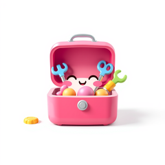
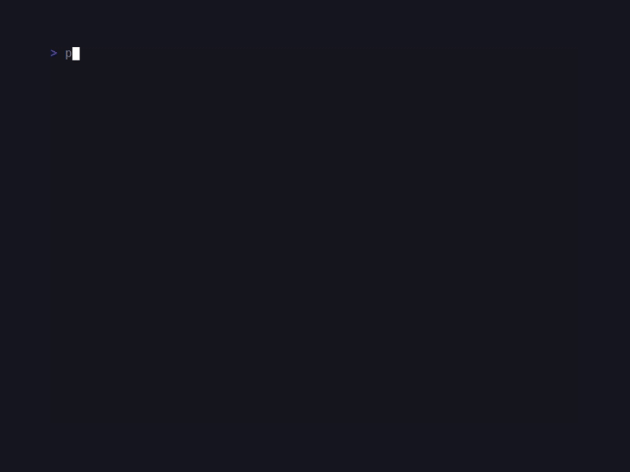

# SugarCli

> Formerly published as `sugarcraft/candy-kit` (renamed 2026-10). <!-- @rename-keep -->
> Namespace changed: `SugarCraft\Kit\` → `SugarCraft\Cli\`. <!-- @rename-keep -->

<!-- BADGES:BEGIN -->
[](https://github.com/detain/sugarcraft/actions/workflows/ci.yml)
[](https://app.codecov.io/gh/detain/sugarcraft?flags%5B0%5D=sugar-cli)
[](https://packagist.org/packages/sugarcraft/sugar-cli)
[](LICENSE)
[](https://www.php.net/)
<!-- BADGES:END -->

```sh
composer require sugarcraft/sugar-cli "@dev"
```

> Install note: sibling `sugarcraft/*` packages track `@dev` and the monorepo sets
> `minimum-stability: dev` with `prefer-stable: true`. A consumer pinning stable releases
> only should mirror that pair in its own root manifest or install fails to resolve.

sugar-cli — opinionated **CLI presentation helpers** that turn ordinary
command-line output into something that matches the rest of the
SugarCraft stack, for PHP 8.3+. SugarCli is library-only — drop it into any Composer project,
no Symfony Console requirement.

```php
<?php

use SugarCraft\Cli\StatusLine;
use SugarCraft\Cli\Banner;

echo Banner::title('MyApp', 'v0.1.0'), "\n\n";
echo StatusLine::info('connecting to https://example.com'), "\n";
echo StatusLine::success('done in 0.4s'), "\n";
echo StatusLine::warn('disk almost full'), "\n";
echo StatusLine::error('connection refused'), "\n";
```

## Components

- **`Theme`** — palette of `SugarCraft\Style\Style` objects keyed by status
  level (success / error / warn / info / prompt / accent / muted).
  `Theme::ansi()` ships the colourful palette; `Theme::plain()` strips all
  colour; `Theme::charm()`, `dracula()`, `nord()` and `catppuccin()` are
  fixed presets; `Theme::auto($bg)` adapts to the background colour only
  when the app passes the parsed OSC-11 reply it requested via
  `Cmd::requestBackgroundColor()` — without a message it is `ansi()`, so
  `Theme::byName('auto')` never adapts; `Theme::byName('nord')` resolves
  any of them
  case-insensitively (roster in `Theme::PRESET_NAMES`). Bring your own
  theme by passing styles to the constructor, or chain `Theme::build()` —
  the builder requires all seven slots before `build()` succeeds.
  `Theme::detect()` is the `ansi()` palette downgraded to what the output
  can show, via sugar-core's `ColorProfile::detect()` — its ladder, in
  order: `CLICOLOR_FORCE` / `FORCE_COLOR` are resolved first and outrank
  tty-ness and `TERM=dumb`, so a forced stream keeps full colour even
  through a pipe; otherwise a non-tty STDOUT (`myapp --help | less`) or
  `TERM=dumb` emits no escape bytes at all; `NO_COLOR` outranks the force
  vars and drops colour while keeping bold; BSD `CLICOLOR=0` drops colour
  unless forced. The roster authority is sugar-core's `ColorProfile`
  docblock — sugar-cli never re-implements the order. **Every presenter
  called without a theme uses
  `Theme::detect()`**; an explicitly passed theme is rendered as given —
  apply the same downgrade to any preset with
  `$theme->withColorProfile(\SugarCraft\Core\Util\ColorProfile::detect(null, STDOUT))`
  (`detect()` throws an `InvalidArgumentException` when a stream you pass
  explicitly is not an open resource; the implicit `STDOUT` substitute
  never errors).
  Two seeded styles bypass the downgrade because they are rendered as
  given and emit SGR even through a pipe: `Frame::new()`'s slate border
  (`#64748b`) and the tint from `Logo::withColor()`. For fully plain
  output under every profile pass `Theme::plain()` and, for a colourless
  Frame border, `->withBorderStyle(Style::new())`.
- **`StatusLine`** — `success` / `error` / `warn` / `info` / `prompt` static
  helpers returning a themed glyph + space + message. Only the glyph and
  its space are styled; the message itself stays plain. Every call takes a
  trailing `int|AutoWidth|null $width` budget: an over-long message is
  clipped with `…` to fit (the glyph is never clipped; `null` renders the
  full message).
- **`Banner`** — render a bordered title block with optional subtitle,
  rounded by default. Useful for app intros / `--version` output.
- **`Logo`** — Unicode box-drawing text art: `Logo::sugarcraft()` (66
  cells wide, deliberately not clamped to the terminal) plus
  `Logo::fromAscii($art)` for custom multi-line art. All escape bytes —
  SGR included — and control bytes are stripped on ingress; newlines are
  the layout;
  `->withColor($hex)` tints the art, and a second call replaces the tint.
- **`Section`** — one-line themed dividers: `header()` label + fill rule,
  bare `rule()`, and indented `subHeader()` for nesting under a parent.
  An explicit `width` is a hard cap: an over-long label is cut with `…`
  rather than overflowing the line. Omitted `width` defaults to the
  terminal width (exported `COLUMNS`, else 80 cells); `null` opts out.
- **`Stage`** — per-line step renderers for progressive CLI output:
  `step()` (numbered), `subStep()`, and `subStepWithProgress()` (bar or
  spinner). Messages take the same width budget as `StatusLine` (tree
  glyphs and the progress bar are never clipped — the bar's cells are
  reserved before the message is measured). `subStepWithProgress()` also
  takes a trailing `?int $frame` to pin the spinner glyph whenever bytes
  must be deterministic (goldens, recorded sessions); omitted, it walks
  the wall clock.
- **`HelpText`** — `--help` page: `USAGE` (retitle via the `usageLabel`
  parameter), an optional description, and titled two-column
  `KEY  description` sections. Wraps to `width` (omitted = the terminal
  width via exported `COLUMNS`, else 80 cells; `null` = never wrap): long
  descriptions continue at the description column, and switch to a
  stacked layout (description under the key) when the key column leaves
  fewer than `HelpText::MIN_DESCRIPTION_WIDTH` (16) cells. Keys and
  section titles are never wrapped or cut — in stacked mode a very long
  key can overflow the width, so keep keys short. `renderRows()` renders
  just the key/description grid, and `renderPage()` renders a complete
  pre-composed page without re-wrapping it by default (`null`); pass an
  `int`/`AutoWidth` to word-wrap over-long rows.
- **`Frame`** — full-screen application chrome: a double-line box that
  fills the terminal exactly (`Frame::new()->withTitle($bar)
  ->withStatus($bar)->render($body, $cols, $rows)`), with a centred title
  bar, dividers, and a status bar. Normalises the body to a constant line
  count and pads ANSI-width-aware so it never overflows the terminal —
  safe for a SugarCraft app whose frame-diff renderer owns the screen.
  Titles, status lines and body lines may carry inline SGR styling; every
  other escape and control byte is stripped on ingress (the SGR-preserving
  `SafeText::styledLine()` gate), and `withTitleText()` / `withBorderStyle()`
  let you style plain text without building escapes yourself. An unclosed
  SGR on width-fitting content can bleed into the surrounding padding —
  close your styles or pass them through `withTitleText()`.
- **`AutoWidth`** — the `int|AutoWidth|null $width` sentinel shared by the
  presenters: `AutoWidth::Auto` resolves the terminal width (exported
  `COLUMNS`, else 80 cells; implausibly large advertised values are
  discarded as junk), an `int` means exactly that many cells, and `null`
  renders without a cap. Most presenters default to `Auto`; the two
  opt-outs are `Banner::title()` (`null` sizes the box to its content) and
  `HelpText::renderPage()` (`null` never re-wraps).

## What this is not

sugar-cli is the **presentation half** of a CLI: it renders strings and
leaves every other decision to you.

- **No argument parsing, exit codes or output routing.** Every helper
  returns a string; whether it goes to STDOUT or STDERR and what the
  process exits with is the application's call.
- **No interaction machinery.** Line editing and prompts live in
  `sugar-readline`; scripted TUI shells in `candy-scriptui`. This library
  only decorates the text you already decided to print.
- **No shell-outs and no terminal ioctls.** Width comes from the
  environment or an explicit parameter — see `AutoWidth` above.
- The charmbracelet/fang label describes the *shape* of the output, not a
  parity promise: sugar-cli renders the same kind of status and help
  pages, without cobra-style typed flag metadata (required/optional/default
  markers are whatever you put in your key strings).

## Demos

### CLI page



## Tests

```sh
cd sugar-cli && composer install && vendor/bin/phpunit
```

## Snapshot tests

Presenter output is pinned via `sugar-testing`'s `assertGoldenAnsi`
golden-file snapshots under `tests/fixtures/`. The comparison is
byte-exact and the fixtures are **create-only**: an existing golden is
never rewritten by a test run, so an intended change to a render must be
re-recorded deliberately — delete the fixture, run once with
`UPDATE_GOLDENS=1 vendor/bin/phpunit` (or `SUGAR_TESTING_UPDATE_GOLDENS=1`)
to mint the new canonical bytes, then re-run plain to confirm it holds.
Review the diff before committing: golden churn means every user sees a
different render.

## Credits & inspiration

Originally inspired by the Go [Charm](https://github.com/charmbracelet) ecosystem; SugarCraft is developed as a native PHP project.
