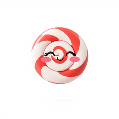
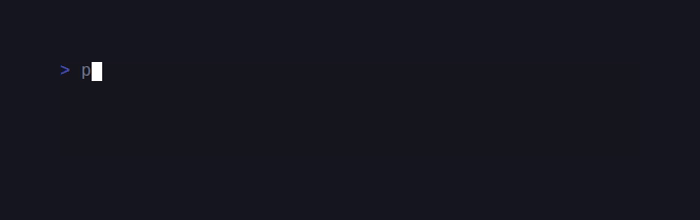
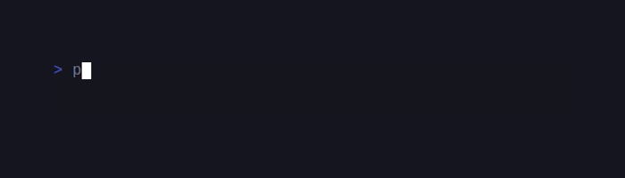

# SugarCraft Core

> Formerly published as `sugarcraft/candy-core` (renamed 2026-10). <!-- @rename-keep -->

<!-- BADGES:BEGIN -->
[](https://github.com/detain/sugarcraft/actions/workflows/ci.yml)
[](https://app.codecov.io/gh/detain/sugarcraft?flags%5B0%5D=sugar-core)
[](https://packagist.org/packages/sugarcraft/sugar-core)
[](LICENSE)
[](https://www.php.net/)
<!-- BADGES:END -->

```sh
composer require sugarcraft/sugar-core
```

sugar-core — the MVC-style Model–Update–View TUI runtime for PHP 8.3+: every app is a
`Model`, an `update()` that folds messages into new state, and a `view()`
that renders it — driven by an event loop with subscriptions, commands and
a full-screen diffing renderer.

```php
use SugarCraft\Core\{Cmd, KeyType, Model, Msg, Program, Subscriptions};
use SugarCraft\Core\Msg\KeyMsg;

final class Counter implements Model
{
    public function __construct(public readonly int $count = 0) {}
    public function init(): ?\Closure { return null; }

    public function update(Msg $msg): array
    {
        if ($msg instanceof KeyMsg) {
            return match (true) {
                $msg->type === KeyType::Char && $msg->rune === 'q' => [$this, Cmd::quit()],
                $msg->type === KeyType::Up    => [new self($this->count + 1), null],
                $msg->type === KeyType::Down  => [new self($this->count - 1), null],
                default => [$this, null],
            };
        }
        return [$this, null];
    }

    public function view(): string { return "count: $this->count\n(↑/↓ to change, q to quit)"; }

    // Model::subscriptions() is part of the contract — return null when
    // the model needs none (or `use SubscriptionCapable;` to get that
    // default for free).
    public function subscriptions(): ?Subscriptions { return null; }
}

(new Program(new Counter()))->run();
```

## The runtime loop

Three rules carry through to every program:

1. **Model is immutable.** `update()` returns a *new* Model, never
   mutates the receiver. This buys you snapshot debugging, time
   travel, undo — all for free.
2. **Cmds run async.** `update()` decides what should happen; the
   runtime applies the resulting Cmd. A Cmd is a closure returning
   a Msg.
3. **view() is pure.** Same Model in → same string out. Side
   effects (writing to disk, hitting an HTTP endpoint, blinking the
   cursor) all live in Cmds, never in `view()`.

Once you've internalised the loop, every other SugarCraft feature is
just a richer Msg or a more interesting Cmd.

```text
   Msg ──► update(Model, Msg) ──► [ new Model , ?Cmd ]
           ▲                        │            │
           │            new Model   │            │ ?Cmd runs async
           │                        ▼            ▼
           │                 view(new Model)       Cmd
           │                        │              settles as
           │                        ▼              a fresh Msg
           │               renderer ──► stdout     │
           │                (changed rows only)    │
           └───────────────────────────────────────┘
```

### The renderer owns stdout

The renderer owns stdout — printing to it from `update()` or `view()`
will be overwritten on the next frame. The two ways to surface
debug info from inside a running program:

1. **Log to a file.** Tail the file from another terminal:
   ```php
   error_log('counter is now ' . $count . "\n", 3, '/tmp/candy.log');
   ```
   ```sh
   $ tail -f /tmp/candy.log
   ```
2. **Use `Cmd::println()`.** Lines emitted via `Cmd::println()`
   print *above* the program region (alt-screen and inline mode
   both honour this) — perfect for "I got here" prints during
   development.

## Alt-screen vs inline mode

The shipped default is **neither**: `useAltScreen: false` and
`inlineMode: false` paint over the current screen with the diff renderer.

Pass `useAltScreen: true` to `ProgramOptions` and the
runtime takes over the alt-screen — the user's previous content is
preserved underneath, and `Cmd::quit()` restores it. Best for
fullscreen TUIs.

Pass `useAltScreen: false` + `inlineMode: true` for a program that
shares scrollback with the surrounding shell. A save/restore pair
brackets the region: the first frame emits `ESC 7` (save cursor) before
its lines, and every repaint after that emits `ESC 8` (restore cursor)
plus an erase-to-end-of-screen **before** drawing the new frame — so
preceding shell output stays visible. Pair with `Cmd::println()` to
emit lines that scroll above the program region.

A typical CandyScriptui prompt (`gum input`-style) uses inline mode;
a fullscreen filter (`gum filter`-style) uses alt-screen.

## Mouse support — cell-motion vs all-motion

Pass `MouseMode::CellMotion` (only emit motion events while a
button is held) or `MouseMode::AllMotion` (emit every motion event
including bare-cursor moves) to `ProgramOptions`. Pick:

- **`CellMotion`** when the model only cares about clicks + drags
  (most apps). Fewer Msgs flow through `update()`, lighter on the
  parser, plays nicely with terminal copy/paste because the user
  can hold Shift to bypass mouse capture.
- **`AllMotion`** when the model reacts to hover state (tooltips,
  fancy cursor effects, drag-preview overlays). Trade: every
  motion event lands in `update()`, so enable it only while a
  hover-sensitive view is up (`View->mouseMode`) instead of
  process-wide.

`MouseMsg` carries a `MouseAction` enum (`Press` / `Release` /
`Motion`) and 1-based `$x` / `$y` coordinates — SGR (CSI ?1006) mouse
reporting is 1-based on the wire and the decoder passes those numbers
through unchanged (`ESC[<0;10;20M` decodes to `x=10, y=20`), so the
stored convention *is* the wire convention; legacy X10 byte-mode
reports are not decoded as mouse events at all. The wheel is not an
action: wheel events arrive as `Press` with `MouseButton::WheelUp` /
`MouseButton::WheelDown`. The four `MouseClickMsg` / `MouseReleaseMsg` /
`MouseMotionMsg` / `MouseWheelMsg` subclasses let you match by class
when that's more convenient.

`examples/mouse.php` is a runnable demonstrator.

## ProgramOptions

`ProgramOptions` is a 24-parameter value object (`readonly` promoted
properties). Pass it as `Program`'s second argument:

```php
use SugarCraft\Core\{MouseMode, Program, ProgramOptions};

$program = new Program(
    new Counter(),
    new ProgramOptions(framerate: 60.0, useAltScreen: true, mouseMode: MouseMode::CellMotion),
);
$program->run();
```

One knob worth knowing by name: `catchPanics` (default `true`) gates whether
`setupTerminal()` auto-arms the terminal-release shutdown backstop described
under **Status → Terminal recovery**. Set it to `false` only when you take
ownership of terminal restoration on bailout paths yourself; the explicit
pre-arm `Program::armTerminalRelease()` remains honored regardless of the flag.

For code that assembles options incrementally there is
`SugarCraft\Core\ProgramOptions\ProgramOptionsBuilder` — a fluent mirror
of the same 24 options (`withFramerate()`, `withUseAltScreen()`,
`withMouseMode()`, `withInlineMode()`, …); `build()` returns the
`ProgramOptions` and performs no validation beyond the types:

```php
use SugarCraft\Core\Program;
use SugarCraft\Core\ProgramOptions\ProgramOptionsBuilder;

$opts = (new ProgramOptionsBuilder())
    ->withUseAltScreen(true)
    ->withFramerate(60.0)
    ->withCellDiffRenderer(true)
    ->build();

(new Program(new Counter(), $opts))->run();
```

## Requirements

- PHP 8.3+ (PHP 8.4+ recommended on Windows for FFI `SetConsoleCtrlHandler` support)
- `mbstring` — **required, and declared as `ext-mbstring` in `composer.json`.**
  Escape decoding and clipboard paths call `mb_*` functions on hot paths.
- `intl` — **required, and declared as `ext-intl` in `composer.json`.** `Width`'s grapheme
  segmentation is built on ICU via `grapheme_extract()`. Without it every width measure falls
  back to per-codepoint counting, which is self-consistent but wrong for any cluster — a
  skin-toned emoji measures 4 cells instead of 2 — and the cell-budget invariants the TUI
  renderers rely on stop holding. It was a silent requirement before the 2026-08 hardening
  pass: the manifest omitted it while this list already named it.
- `pcntl` (signal handling — POSIX only; not available on Windows)
- `FFI` extension (required on Windows for raw TTY support)
- `react/event-loop` ^1.6 (Composer)
- `react/promise` ^3.3 (Composer) — the promise surface `Cmd` results and
  worker dispatch (`WorkerCmd::run`) hand back.
- `sugarcraft/sugar-pty` `dev-master` (the spelling this lib's committed manifest uses) — the runtime's raw-mode/termios backend. sugar-core and
  sugar-pty hard-require each other (sugar-pty consumes core's primitives); CI injects the
  path-repo closure so the cycle resolves inside the monorepo, and standalone installs take
  both from Packagist. The sugar-pty interface `SugarCraft\Pty\Contract\Termios` therefore
  appears in a public constructor type: `ProgramOptions::$termios` is typed
  `?Termios` (imported at `src/ProgramOptions.php:8`). There is no
  `SugarCraft\Core\Util\Tty\Termios` — core's own `src/Util/Tty/` tree provides the
  raw-mode backends (`PosixBackend`, `WindowsBackend`), and the Termios contract
  lives on the sugar-pty side.
- Windows 10 version 1809+ (for `ENABLE_VIRTUAL_TERMINAL_PROCESSING`)

> Install note: sibling `sugarcraft/*` packages track `@dev` and the monorepo sets
> `minimum-stability: dev` with `prefer-stable: true`. A consumer pinning stable releases
> only should mirror that pair in its own root manifest or install fails to resolve.

## Environment variables

Every environment variable sugar-core reads, who reads it, and what
happens when it is unset. Apps may of course read their own; this is the
library's full surface.

| Variable | Read by | When unset |
| --- | --- | --- |
| `TERM` | `Util\ColorProfile::detect()` | falls through to the `Ascii` tier |
| `COLORTERM` | `Util\ColorProfile::detect()` | no early TrueColor bail |
| `TERM_PROGRAM` | `Util\ColorProfile::detect()`, `Util\Tty\EnvDetect` (mintty), `Util\Clipboard` (backend plan) | no known-terminal match |
| `NO_COLOR` | `Util\ColorProfile::detect()` | colour stays enabled |
| `CLICOLOR` | `Util\ColorProfile::detect()` (`CLICOLOR=0` opts out of colour) | no opt-out signal |
| `CLICOLOR_FORCE` | `Util\ColorProfile::detect()` | no force (truthy = non-empty, not `0`, not `false`) |
| `FORCE_COLOR` | `Util\ColorProfile::detect()` | no force |
| `WT_SESSION` | `Util\ColorProfile::detect()` | not Windows Terminal |
| `CI` | `Util\ColorProfile::detect()` | not treated as CI |
| `GITHUB_ACTIONS` | `Util\ColorProfile::detect()` | not treated as CI |
| `GITLAB_CI` | `Util\ColorProfile::detect()` | not treated as CI |
| `BUILDKITE` | `Util\ColorProfile::detect()` | not treated as CI |
| `WSL_DISTRO_NAME` | `Util\Tty\EnvDetect` (WSL id), `Util\Open` (opener choice) | not WSL by this signal |
| `WSL_INTEROP` | `Util\Tty\EnvDetect` (WSL id), `Util\Open` (opener choice) | not WSL by this signal |
| `MSYSTEM` | `Util\Tty\EnvDetect` (MSYS2 id) | not MSYS2 |
| `MINTTY_SHORTCUT` | `Util\Tty\EnvDetect` (mintty id) | not mintty by this signal |
| `OSTYPE` | `Util\Tty\EnvDetect` (`cygwin` id) | not Cygwin |
| `PATH` | `Util\Executable\Locator` (the search path `locate()` walks, after any `$extraPath` argument) | empty — nothing is found unless the caller passed `$extraPath` |
| `PATHEXT` | `Util\Executable\Locator` (Windows extensions; POSIX never reads it) | `DEFAULT_WINDOWS_EXTENSIONS` = `.COM`, `.EXE`, `.BAT`, `.CMD` |
| `COLUMNS` | `Util\Tty\PosixBackend` (size fallback when stdout is not a tty) | ignored (read as 0) — next fallback wins |
| `LINES` | `Util\Tty\PosixBackend` (same shape as `COLUMNS`) | ignored (read as 0) — next fallback wins |
| `HOME` | `WorkerPool` (worker environment seed) | `/tmp` |
| `VISUAL` | `Util\Editor` (discovery: explicit override → `VISUAL` → `EDITOR` → platform default) | falls to `EDITOR` |
| `EDITOR` | `Util\Editor` | falls to the platform default editor |
| `TMPDIR` | PHP's `sys_get_temp_dir()`, consumed by `Util\Editor`'s temp-file scaffold | system temp (`/tmp`) |
| `LC_ALL` | `I18n\T::detect()` (chain `LC_ALL` → `LC_MESSAGES` → `LANG`; `$_SERVER` first, then `getenv()`; `''`, `C` and `POSIX` are treated as unusable and fall through) | falls to `LC_MESSAGES` |
| `LC_MESSAGES` | `I18n\T::detect()` (`''`/`C`/`POSIX` unusable here too) | falls to `LANG` |
| `LANG` | `I18n\T::detect()` (`LANG=C` is common in minimal, screen-reader and CI shells — it is unusable, not "use English") | locale `en` |
| `TMUX` | `Util\Clipboard` (backend plan) | not inside tmux |
| `DISPLAY` | `Util\Clipboard` (X11 backend plan) | no X11 clipboard candidate |
| `WAYLAND_DISPLAY` | `Util\Clipboard` (Wayland backend plan) | no Wayland clipboard candidate |

### Color-profile detection order

`ColorProfile::detect()` decides in exactly this order (the docblock on
the enum carries the same list; both are derived from the code):

1. `CLICOLOR_FORCE` or `FORCE_COLOR` truthy counts as a terminal;
   otherwise, when a stdout resource is passed and it is **not** a tty →
   `NoTty` (so `NO_COLOR` on a pipe yields `NoTty`, never escape bytes).
2. `TERM=dumb` → `NoTty` unless forced.
3. `NO_COLOR` truthy → `Ascii` (decoration kept, per no-color.org) — it
   outranks the force variables because it is consulted first.
4. `CLICOLOR=0` → `Ascii` (the BSD opt-out: colour disabled, decoration
   kept), unless a force variable already won.
5. Forced (`CLICOLOR_FORCE`/`FORCE_COLOR`) → `TrueColor`.
6. `COLORTERM` = `truecolor` or `24bit` → `TrueColor`.
7. Known `TERM_PROGRAM` values → the matched tier (iTerm/WezTerm/VS Code/
   Kitty/alacritty/Ghostty/Hyper → `TrueColor`; Apple_Terminal →
   `Ansi256`).
8. `WT_SESSION` set → `TrueColor`.
9. `TERM` contains `truecolor` or `direct` → `TrueColor`; contains `256`
   → `Ansi256`; contains `color` or equals `xterm`/`screen`/`tmux` →
   `Ansi`.
10. Any CI variable truthy (`CI`, `GITHUB_ACTIONS`, `GITLAB_CI`,
    `BUILDKITE`) → `Ansi`.
11. Fallback → `Ascii`.

Colour note: the runtime's own renderer emits SGR unconditionally —
`ColorProfile` tells *your* code which tier the terminal supports, but it
is not a suppression switch inside the renderer. If your app must honour
`NO_COLOR` end-to-end, consult `ColorProfile::detect()` and emit plain
text yourself; there is no automatic downgrade.

Completeness boundary: the ladder decides **colour only**. The terminal
control sequences the runtime emits — alt-screen `?1049h`, cursor
save/restore, synchronized output (DEC 2026), mouse and focus tracking,
bracketed paste — are gated on `ProgramOptions`, never on the ladder: a
`TERM=dumb` program or a non-tty stdout still receives every one of them
once `setupTerminal()` runs. There is no plain-text degraded path in the
runtime, inline mode included. (The same scope applies to the terminal
recovery backstop under **Status** — it is control machinery, not colour.)

Where the detected profile goes: `detect()` is only the read half. During
startup `run()` dispatches the answer once as a `ColorProfileMsg` (right
after `WindowSizeMsg` and `EnvMsg`; an explicit `ProgramOptions` profile
wins over auto-detection), and a model that cares about the tier reacts to
that message in `update()`. Applying it is three classes' work:
`Color::toFg()` / `toBg()` / `toUnderline()` take a profile and quantise a
24-bit pick down to its tier; `Util\Palettes` holds raw-hex single-source
theme schemes that consumers key by name and swap per tier; and inside the
renderer `SgrState` carries the running attribute set so each emitted line
is only the delta from the last. None of this downgrades the renderer's own
output — see the Colour note above.

## Security and the trust boundary

This runtime sits between an adversarial terminal and your `update()`, and it
owns the untrusted-input contract for the whole SugarCraft fleet. The short
version: **what comes off the keyboard is transformed before your model sees
it**, and the knobs are explicit.

**Paste is sanitized by default.** A bracketed-paste envelope (`CSI 200~` …
`CSI 201~`) is collected raw, then its payload passes through
`Sanitize::untrustedForMarkedFrames()` before surfacing as a `PasteMsg`
(`src/InputReader.php`). That strips every escape sequence — including C1
controls in both their raw 8-bit and UTF-8-encoded forms — and sweeps the
zone sentinels (below). Two bounds keep a broken terminal from wedging the
pump: a paste larger than `InputReader::MAX_PASTE_BYTES` (1 MiB) surfaces in
chunks instead of being buffered forever, and an envelope whose end marker
never arrives is force-closed after `InputReader::PASTE_IDLE_TIMEOUT` (1 s)
of input silence so the keyboard comes back. Opting out is a deliberate act:
`ProgramOptions::$sanitizePaste = false` (or the `InputReader` constructor
parameter) ships raw bytes and puts containment in your hands.

Plain-text and automation consumers should read the disclosure half: a
`PasteMsg` is not guaranteed to be byte-identical to what was typed. The
default is chosen for terminal safety, not paste fidelity — zero-width and
bidi override characters survive precisely so real text round-trips through
editors, while escapes and marker bytes do not.

**The marker arena.** Mouse zones and image overlays ride the Unicode
Private Use Area: `U+E000`/`U+E001` are the zone open/close sentinels
(declared by sugar-mouse's `Mark`/`Scan`), image cell markers start at
`U+E002`, and the whole reservation runs `U+E000`–`U+F8FF`. Hostile pasted
text can carry those codepoints as ordinary valid UTF-8 that a plain escape
strip passes right through, which is why the marked-frames variant sweeps
them — un-swept, a model reply composed from pasted text could forge click
targets or desynchronise the renderer's marker parse.

**Spawn discipline.** Every process launch from user-supplied data uses
`proc_open()`'s argv form: `Util\Open` never interpolates a URL into a shell
command line, and `Util\Executable\Locator`'s capability probes pass array
argv too. Shell quoting appears only in fixed lookup probes (`where`,
`command -v`), never around user data.

`Sanitize` is public API for a reason — reuse it wherever untrusted strings
enter your app: `controlChars()` (C0 stripped, ESC among them; newline/CR/tab
map to spaces), `cellValue()` (glyph replacement and UTF-8 repair for cell
grids), `untrusted()` (full escape strip), `untrustedForMarkedFrames()`
(`untrusted()` plus the sentinel sweep), `untrustedForDisplay()` (adds CR
line-end normalisation and renders bidi/zero-width characters as visible
`<U+XXXX>` markers), and `visibleControls()` (renders every control inert).

## Architecture

- **`Model`** — your app implements `init()`, `update(Msg)`, `view()`, `subscriptions()`. `view()` returns `string|View`: a plain string is the whole frame (auto-wrapped); a `View` struct carries the frame body plus declarative extras — cursor position, window title, progress-bar state (OSC 9;4), default fg/bg (OSC 10/11), mouse mode, focus reporting, bracketed paste, images — each emitted only when it changes.
- **`Msg`** — marker interface for events. Built-ins: `KeyMsg`, `WindowSizeMsg`, `QuitMsg`
  (the full catalogue is indexed under [Message catalogue](#message-catalogue)).
- **`Cmd`** — `Closure(): ?Msg`. Async work whose result is dispatched as a Msg. Helpers in `Cmd::quit()`, `Cmd::batch()`, `Cmd::send()`.
- **`Program`** — orchestrator. Sets up TTY, runs the ReactPHP event loop, dispatches Msgs, drives renders at the configured framerate.
- **Timer accuracy** — on a libuv-backed loop (`ExtUvLoop`, picked automatically when `ext-uv` is installed) a timer's deadline is computed against a clock refreshed once per loop iteration, so a timer armed after long blocking work in a callback fires early by that much. Keep callbacks short; see the notes on `Program::run()` for the measured numbers and the safe paths.
- **Timers in tests** — a PHPUnit process runs the loop in short bursts with long synchronous gaps, which is the same hazard writ large: a safety timer can fire instantly. Suites that arm one should pin a clock-fresh loop from `tests/bootstrap.php` with sugar-testing's `SugarCraft\Testing\LoopPin::pinStableClock()`.
- **`InputReader`** — stateful byte-stream parser; handles split escape sequences across reads.
- **`Renderer`** — line-diff full-screen renderer by default (repaints only changed rows inside a DEC 2026 synchronized-output update); pass `cellDiffRenderer: true` for the per-cell "cursed" diff. Both are implemented; there is no plain full-repaint mode.
- **`Util/`** — `Ansi`, `Color`, `ColorProfile`, `Width`, `Tty`, `TtyDetect`, `RawMode`, `Sanitize`, `Open` foundation utilities, shared with SugarStyle. `RawMode::enable($stream)` / `RawMode::disable($stream)` is the portable `stty`-based raw-mode toggle for the controlling terminal — a safe no-op on non-tty streams.
- **`KeyBindings`** (in `Keys/`) — immutable action→tokens key registry: named actions each own a lowercase token set, `matches(KeyMsg, id)` answers "does this press actuate that action" (press-only, case-folded; both space wire shapes normalize to `space`), `withOverride(id, ...tokens)` returns a new registry, and `label(id)` renders the derived display column help text is composed from — so a user remap lands in dispatch AND the UI from one map. Modifier chords are a declared non-goal (bare letters match as they always did).
- **`Semaphore`** (in `Util/`) — bounded-concurrency permit pool over ReactPHP promises: `Semaphore::new(6)->run(fn() => fetch($url))` caps in-flight work, parks the rest FIFO, and returns each permit when its promise settles. Share one pool across every component touching the same scarce resource, and `close()` it when the owner is retired so parked waiters fail (with `SemaphoreClosedException`) instead of pending. Distinct from `WorkerPool` (subprocess concurrency) — see its docblock.
- **`LruMap`** (in `Util/`) — fixed-capacity least-recently-used map: `get()` promotes, `peek()` reads without disturbing recency, `put()` evicts the longest-unused entry past the cap, `evictions()` reports how often that happened, and an optional `maxCapacity` growth guard caps `resize()`. Iterates most-recently-used first; `keys()` is the string-safe key view. The size bound that complements a TTL cache; it does not replace one.
- **`Sanitize`** (in `Util/`) — the fleet's untrusted-string vocabulary; the contract and the method-by-method list live in [Security and the trust boundary](#security-and-the-trust-boundary).
- **`Subscription`** — value object: id, Kind, params, produce closure.
- **`Subscriptions`** — immutable collection with `withTick()`, `withKey()`, `withSignal()`, `withCustom()`, `all()`, `has()`.
- **`Kind`** — pure enum: Tick (periodic timer, `seconds`) / Key (a fixed 0.1 s polling timer — see Subscriptions) / Signal (handlers for the requested signals) / Custom (periodic timer, `interval` defaulting to 1.0 s).
- **`SubscriptionCapable`** — trait providing the default `subscriptions(): null`.

### Composition primitives

- **`ScreenStack`** — immutable stack with `push()` / `pop()` / `current()` / `breadcrumb()` / `isEmpty()` / `count()`.
- **`Screen`** — value object: `model`, optional `title`, `onEnter` closure, `onExit` closure.
- **`ScreenStackCapable`** — interface: `screens(): ScreenStack`. Implement to activate screen-stack routing.
- **`RootModelWithScreenStack`** — concrete root model owning a `ScreenStack`; routes `ScreenStackPushedMsg` / `ScreenStackPoppedMsg` internally, delegates `view()` to the active screen.
- **`PushScreenCmd`** / **`PopScreenCmd`** (in `SugarCraft\Core\Cmd`) — Cmd factories that emit `ScreenStackPushedMsg` / `ScreenStackPoppedMsg`.
- **`ScreenStackPushedMsg`** / **`ScreenStackPoppedMsg`** — infrastructure messages dispatched through the loop; always handled by the root model, never by the active screen.
- **`Component`** — interface extending `Model`; adds `onMount(): ?Closure` (fired when mounted into a `Composite`) and `onUnmount(): ?Closure` (fired when removed). Return a `Cmd` to run immediately or `null` for no-op.
- **`Composite`** — `Model` that manages a list of child `Component`s. Tracks `pendingCmds` and drains them during reconcile, calling child `onMount()`/`onUnmount()` Cmds synchronously. Children are reconciled by *presence*: a child that stays in the list keeps its state; adding or removing triggers lifecycle events. Reordering alone does not re-run lifecycle.
- **`Panes` / `Pane` / `Rect`** — split-region bookkeeping for apps that manage multiple viewports. Geometry is advisory: the runtime does **not** clip a pane's `view()` output to its `Rect` — models must size their own frames (see [Viewport fit](#viewport-fit)).
- **`WorkerPool`** — bounded-concurrency pool (default 4 workers) for offloading CPU-bound tasks to subprocesses. Tasks are named global functions or serialized `Serializable`/closure-free callables; a `Closure` cannot cross the process boundary, so dispatching one returns an already-rejected promise. Worker children run `php` without your application autoloader: only PHP built-ins and whatever the worker's own script loads are resolvable inside the child.
- **`WorkerCmd`** — `Cmd` factory: `WorkerCmd::run($pool, $task)` (`callable|string $task` — a named global function or a serializable closure-free callable, matching the real parameter) dispatches a task to the pool and yields a `WorkerResultMsg` when complete.
- **`WorkerResultMsg`** — result `Msg` carrying `$result`, `$error`, and `$workerId` from a pool worker.

## Subscriptions

Subscription reconciliation lets a Model declare recurring timers and
signal handlers (ticks, polled input, signals) without managing them
manually. After each
`update()` cycle the runtime diffs the returned `Subscriptions` set against
the active one — new subscriptions start, dropped ones cancel, stable ones
keep running.

One cadence caveat worth stating plainly: `Kind::Key` is **not** how key
presses arrive. Keystrokes reach `update()` through the input reader the
moment they are parsed, subscription or not; a `withKey()` subscription
arms a fixed 0.1 s polling timer (not configurable) whose produce closure
runs on that beat. `withCustom()` arms its timer at `interval` seconds,
defaulting to 1.0 s.

```php
use SugarCraft\Core\{Model, Msg, Program, Subscriptions};

/** App-local message — sugar-core ships no TickMsg; the produce closure
 *  returns whatever Msg your update() understands. */
final class TickMsg implements Msg {}

final class Clock implements Model
{
    public function __construct(public readonly int $ticks = 0) {}

    public function init(): ?\Closure { return null; }

    public function update(Msg $msg): array
    {
        if ($msg instanceof TickMsg) {
            return [new self($this->ticks + 1), null];
        }
        return [$this, null];
    }

    public function view(): string { return "ticks: $this->ticks\n"; }

    public function subscriptions(): ?Subscriptions
    {
        return (new Subscriptions())->withTick('clock-tick', 1.0, static fn (): Msg => new TickMsg());
    }
}

(new Program(new Clock()))->run();
```

The `SubscriptionCapable` trait satisfies `Model::subscriptions()` with a null
default — use it in Models that don't need subscriptions:

```php
use SugarCraft\Core\{Model, SubscriptionCapable};

final class StaticModel implements Model
{
    use SubscriptionCapable;
    // ... init()/update()/view() still required; no subscriptions() needed
}
```

Two reconciliation facts are worth knowing (both pinned by tests):

- **Ids are the identity.** A subscription is stable while its `id` is
  present across cycles. Changing the closure or interval *under the same
  id* keeps the originally-started timer — to change cadence or producer,
  use a different id. Duplicate ids in one `Subscriptions` collapse to the
  first entry.
- **`SubscribeCmd` is transient.** Its `SubscriptionsMsg` reconciles the
  given set immediately, but the next `update()` cycle re-diffs against
  `Model::subscriptions()`, which cancels anything the model itself does
  not declare. For durable subscriptions, return them from
  `subscriptions()`; use `SubscribeCmd` only for one-shot or
  model-declared-parity sets.

## Screen / ScreenStack

Modal and sub-screen workflows use an immutable `ScreenStack` owned by a
`ScreenStackCapable` root model. The `Program` routes `init()` / `update()` /
`view()` to the active screen's model, writes the screen's next model back
into the stack, and keeps infrastructure messages
(`ScreenStackPushedMsg` / `ScreenStackPoppedMsg`) on the root model.

```php
use SugarCraft\Core\{Cmd, KeyType, Model, Msg, Program, Screen, ScreenStack, ScreenStackCapable, Subscriptions, SubscriptionCapable};
use SugarCraft\Core\Cmd\{PushScreenCmd, PopScreenCmd};
use SugarCraft\Core\Msg\{KeyMsg, ScreenStackPushedMsg, ScreenStackPoppedMsg};

final class DetailScreen implements Model
{
    public function __construct(public readonly string $id) {}
    public function init(): ?\Closure { return null; }
    public function update(Msg $msg): array
    {
        if ($msg instanceof KeyMsg && $msg->rune === 'b') {
            return [$this, new PopScreenCmd()];
        }
        return [$this, null];
    }
    public function view(): string { return "Detail: {$this->id}\n(press b to go back)\n"; }
    public function subscriptions(): ?Subscriptions { return null; }
}

// Minimal root: the base layer is a plain string; the active screen (if
// any) replaces it. Infrastructure push/pop messages rebuild the stack.
final class App implements Model, ScreenStackCapable
{
    use SubscriptionCapable;

    public function __construct(public ScreenStack $screens = new ScreenStack()) {}
    public function screens(): ScreenStack { return $this->screens; }
    public function init(): ?\Closure { return null; }

    public function update(Msg $msg): array
    {
        if ($msg instanceof ScreenStackPushedMsg) {
            return [new self($this->screens->push($msg->screen)), null];
        }
        if ($msg instanceof ScreenStackPoppedMsg) {
            return [new self($this->screens->pop()), null];
        }
        if ($this->screens->isEmpty() && $msg instanceof KeyMsg && $msg->rune === 'n') {
            return [$this, new PushScreenCmd(new Screen(new DetailScreen('item-1'), title: 'Item 1'))];
        }
        return [$this, null];
    }

    public function view(): string
    {
        return $this->screens->isEmpty()
            ? "Push a screen with n\n"
            : (string) $this->screens->current()->model->view();
    }
}

(new Program(new App()))->run();
```

`sugar-core` also ships `RootModelWithScreenStack`, a ready-made root model
with this exact routing pre-implemented — extend-free to use, with
`pushedIds` / `poppedIds` tracking for tests.

`examples/screen-stack.php` is a runnable demo showing 3-deep push / pop.

## Viewport fit

The runtime paints whatever `view()` returns. It does **not** clip frames to
the terminal, and `Pane`/`Rect` carry bounds purely as advisory metadata —
no code path in the renderer reads them. A frame wider than the viewport
soft-wraps and shifts every following row, which is why border-alignment
defects surface so often across TUI apps. Read `WindowSizeMsg` (plain cell
counts `$cols` / `$rows` arrive at startup and on every resize), size your content
to it, and truncate with `Util\Width::truncateAnsi()` so SGR bytes survive
the cut.

## Demos

### Counter Model



### Timer



## Status

- **Foundation utilities**: 🟢 complete.
- **Runtime**: 🟢 Program loop, mouse (cell-motion + all-motion + SGR 1006), focus / blur, bracketed paste, function keys F1–F35 reachable (legacy SS3 and CSI `~` cover F1–F12; the Kitty PUA functional-key range extends to F35 — the F36–F63 enum cases exist for upstream value-space parity but carry no decoder input path), the cell-diff "cursed" renderer, inline-mode rendering, declarative `View` struct — with synchronized output (DEC 2026) wrapping **every** renderer frame in every mode, and unicode mode (DEC 2027) a separate `unicodeMode` startup option, not a cell-diff feature; plus the Cmd surface (`Suspend` / `Interrupt` / `Exec` / `Sequence` / `Every` / `Printf` / `Raw` and more — full factory index under **Composing Cmds**;
a resume is deliberately not a Cmd: SIGCONT dispatches a `ResumeMsg` from the runtime) and the Program control methods: `wait()` blocks until the loop has stopped — with `run()` itself blocking in PHP, it serves as a "no longer running" status query; `kill()` hard-stops synchronously (loop down, terminal torn down, the model is *not* notified — unlike `quit()`, which routes through `QuitMsg` and lets the model react); `releaseTerminal()` hands the tty back in cooked/line-buffered state so an `$EDITOR`-style external command can run without fighting the renderer for raw-mode keys; `restoreTerminal()` completes that handoff — re-entering alt screen / raw mode / mouse / paste / focus exactly as startup did, then triggering a full repaint on the next tick.
- **Terminal recovery**: 🟢 `setupTerminal()` arms a one-shot shutdown backstop. `run()`'s `finally` restores the terminal on every path it can see; a `die()`, `exit()` or zend bailout that skips pending `finally` blocks still lands on the registered shutdown function, so the library that entered the alt screen is the library that leaves it and consumers do not need to write their own `bin` guard. The hook holds a `WeakReference` and compares the install pid at fire time — finished Programs are never pinned alive by the shutdown queue, and a forked child exiting never releases the parent's terminal. The arming is gated on `catchPanics` (`ProgramOptions`, default `true`): constructing with `catchPanics: false` — the debugger-owner case that does its own state capture — registers no hook, though an explicit `Program::armTerminalRelease()` before the run is a considered opt-in and is honored either way.

## Companion libraries

**SugarCraft Core** (the `sugarcraft/sugar-core` package) is the foundation library —
the rest of the SugarCraft stack builds on it. From the same monorepo:

- **SugarStyle** — declarative styling + layout.
- **SugarWidgets** — prebuilt terminal components.
- **SugarForms** — multi-page form library.
- **SugarCharts** — sparkline / bar / line / heatmap / OHLC.
- **CandyScriptui** — composer-installable CLI (`gum`-style subcommands).
- **SugarMarkdown** — Markdown → ANSI renderer.
- **SugarMouse** — mouse-zone tracker.
- **SugarSpring** — spring physics + Newtonian projectile sim.
- **SugarCli** — opinionated CLI presentation helpers.
- **CandyCodeshot** — code → SVG screenshot.
- **SugarSshServer** — SSH server middleware framework.
- **CandyAnsiInspect** — ANSI escape-sequence inspector.

See the matchup table in [docs/MATCHUPS.md](https://github.com/detain/sugarcraft/blob/master/docs/MATCHUPS.md) for status,
package names, and namespace mappings.

## Localization (i18n)

sugar-core ships a tiny zero-dep translation registry that the rest of
the SugarCraft monorepo plugs into. Every library owns a **namespace**
(`core`, `charts`, `prompt`, …) and a `lang/<locale>.php` file per
locale — call sites look strings up by fully-qualified key.

```php
use SugarCraft\Core\I18n\T;
use SugarCraft\Core\Lang;

T::setLocale(T::detect());   // 'en' / 'fr' / 'de' — LC_ALL → LC_MESSAGES → LANG
echo Lang::t('color.invalid_hex', ['hex' => '#zz']);
// => "invalid hex color: #zz"
```

The catalogue attaches to the shared registry **lazily**: the first call
through a library's `Lang` facade registers its `lang/` directory. A
fully-qualified `T::t('core.color.invalid_hex', …)` in a process that has
not registered `core` yet returns the key unchanged — the lookup chain
(exact locale → base language → `en` → raw key) ends at the raw key
instead of throwing, so an unregistered namespace fails silently. Prefer
the facade: each library exposes exactly that thin `Lang::t($key,
$params)` wrapper with its namespace baked in, so call sites stay short:

```php
use SugarCraft\Core\Lang;

throw new \InvalidArgumentException(
    Lang::t('color.invalid_hex', ['hex' => $hex])
);
```

Scope of the registry: it translates **validation and user-facing refusal
messages** — the strings the library routes through `Lang::t()` (indexed in
`lang/en.php`). Low-level programming errors (`\InvalidArgumentException`
for bad internal arguments, `LogicException` for protocol misuse) stay raw
SPL strings by design: they mark developer bugs, not product copy, and
translating them would promise a coverage the registry does not target.

### Adding a new locale

1.  Copy `sugar-core/lang/en.php` to `sugar-core/lang/<locale>.php`
    (e.g. `fr.php`).
2.  Translate the values, keeping keys and `{placeholders}` intact.
3.  Set the locale at app startup with `T::setLocale('fr')` or
    `T::setLocale(T::detect())`.

Lookup chain: **exact locale → base language → `en` → raw key**. So a
single `fr.php` automatically serves `fr-fr`, `fr-ca`, `fr-be`, etc. —
only add a regional file (e.g. `pt-br.php`) when the wording genuinely
diverges from the base language. A key missing from your locale file falls
back to the English value, so partial locales surface as mixed-language
text, never a fatal error; `tests/I18n/LocaleKeyParityTest.php` fails the build when
a shipped locale drifts from the `en` key set.

See [`LOCALES.md`](https://github.com/detain/sugarcraft/blob/master/LOCALES.md)
in the SugarCraft monorepo for the recommended set of codes plus a list
of every base language a contributor can target.

### Application-level overrides

Apps can ship their own translations of any library's strings without
patching upstream:

```php
T::overrideNamespace('charts', '/etc/myapp/lang/charts');
```

See the [`SugarCraft\Core\I18n\T`](src/I18n/T.php) docblock for the
full API surface (`register`, `translate`, `setLocale`, `locale`,
`detect`, `overrideNamespace`, `charset`, `t`, `reset`).

## Composing Cmds

The runtime ships several Cmd combinators. The cheat-sheet below
maps common orchestration needs to the PHP combinators:

| Need | Use |
|---|---|
| Run several Cmds in parallel | `Cmd::batch(...$cmds)` |
| Run several Cmds one-after-the-other | `Cmd::sequence(...$cmds)` |
| Schedule a Msg in N seconds | `Cmd::tick($seconds, fn () => $msg)` |
| Schedule a Msg on every wall-clock multiple of N seconds | `Cmd::every($seconds, fn () => $msg)` |
| Dispatch a Msg right away | `Cmd::send($msg)` |
| Quit the program | `Cmd::quit()` |
| Hard-kill (after `quit` failed) | `$program->kill()` (from outside the loop) |
| Print text above the program region | `Cmd::println($s)` / `Cmd::printf($fmt, ...)` |
| Drop bytes onto the wire | `Cmd::raw($bytes)` |
| Suspend on Ctrl+Z, resume on SIGCONT | `Cmd::suspend()` (returns to a `ResumeMsg`) |
| Run an external program (`$EDITOR`) | `Cmd::exec($commandOrArgv, captureOutput: false, onComplete: fn (int $exit, string $out, string $err, ?\Throwable $error): ?Msg)` → `ExecMsg` (a string runs via the shell, an argv list does not — prefer the list when args carry user input) |
| Offload to a worker subprocess | `WorkerCmd::run($pool, $task)` (`callable|string $task`) → `WorkerResultMsg` |
| Replace the subscription set for this cycle | `new SubscribeCmd($subscriptions)` |

`init()` returns a Cmd (or null) to fire once at startup — for the active
model only: a screen pushed later is *not* re-inited; initialise it in the
`Screen`'s `onEnter` or in its first `update()` instead. `update()`
returns `[Model, ?Cmd]` — the runtime applies the Cmd, dispatches
its Msg, and feeds the result back into `update()`.

The `examples/` directory has runnable demos for each pattern:
[`counter`](examples/counter.php) (basic), [`simple`](examples/simple.php)
(minimal quit-on-key), [`timer`](examples/timer.php)
(tick scheduling), [`realtime`](examples/realtime.php) (self-rescheduling
tick), [`sequence`](examples/sequence.php) (`Cmd::sequence`),
[`send-msg`](examples/send-msg.php) (custom Msg + `Cmd::tick`),
[`tabs`](examples/tabs.php) (state-driven view selection),
[`views`](examples/views.php) (multi-view switcher),
[`splash`](examples/splash.php) (animated splash → main view),
[`suspend`](examples/suspend.php) (`Cmd::suspend` + `ResumeMsg`),
[`altscreen-toggle`](examples/altscreen-toggle.php),
[`panes`](examples/panes.php),
[`screen-stack`](examples/screen-stack.php),
[`mouse`](examples/mouse.php), [`focus-blur`](examples/focus-blur.php),
[`window-size`](examples/window-size.php), [`print-key`](examples/print-key.php),
[`set-window-title`](examples/set-window-title.php), and
[`prevent-quit`](examples/prevent-quit.php).

### Complete Cmd factory index

Every `public static` factory on `Cmd` (45 as of this writing), by family —
the discovery index so capability checks do not need a grep of
`src/Cmd.php`. The cheat-sheet above stays the start-here view.

**Lifecycle / control**
- `quit()` — end the program.
- `suspend()` — release the terminal, re-raise SIGTSTP on the process group; SIGCONT restores and dispatches a `ResumeMsg`.
- `interrupt()` — SIGINT-style stop, same teardown as Ctrl-C but distinguishable from a graceful `quit()`.

**Composition / scheduling**
- `batch(...$cmds)` — run concurrently, each returned Msg dispatched independently; `null` entries dropped.
- `sequence(...$cmds)` — run one after another, ordered (a mode request lands before the colour-dependent render that follows).
- `tick($seconds, $produce)` — fire `$produce` once after a delay.
- `every($seconds, $produce)` — fire on wall-clock multiples of `$seconds` (synchronised animations).
- `send($msg)` — dispatch a Msg right away.
- `promise($factory)` — run an async closure off the loop; its resolved Msg is dispatched on settle (wraps `AsyncCmd`).

**Output**
- `println($text)` / `printf($fmt, ...$args)` — print above the program region (inline-mode logging without disturbing the view).
- `raw($bytes)` — drop raw bytes on the wire; the diff state is *not* invalidated (cursor-area-neutral effects; call `Renderer::reset()` if you clobber the painted region).
- `exec($commandOrArgv, captureOutput:, onComplete:)` — run an external program (`$EDITOR`); a string runs via the shell, an argv list does not.

**Terminal queries (the reply surfaces as a Msg)**
- `requestCursorPosition()` → `CursorPositionMsg`
- `requestForegroundColor()` → `ForegroundColorMsg` (OSC 10)
- `requestBackgroundColor()` → `BackgroundColorMsg` (OSC 11; pair with `BackgroundColorMsg::isDark()`)
- `requestCursorColor()` → `CursorColorMsg` (OSC 12)
- `requestTerminalVersion()` → `TerminalVersionMsg` (XTVERSION DCS reply)
- `requestMode($mode, $private = true)` → `ModeReportMsg` (`$private`: DEC private modes; false for ANSI)
- `requestKittyKeyboard()` → `KeyboardEnhancementsMsg`

**Clipboard / title / cwd / progress (OSC)**
- `setClipboard($text, $selection = 'c')` — OSC 52 copy (`c` clipboard, `p` X11 primary, `s` secondary).
- `readClipboard($selection = 'c')` → `ClipboardMsg` with the decoded text.
- `setWindowTitle($title, $icon = false)` — OSC 2; `$icon: true` emits OSC 0 (icon + title).
- `setWorkingDirectory($path, $host = '')` — OSC 7 (iTerm2/Terminal.app/WezTerm new-tab "same cwd").
- `setProgressBar($state, $percent = 0)` — OSC 9;4; `$percent` clamped 0–100, meaningful for Normal/Error/Warning; `ProgressBarState::Remove` clears it.

**Kitty keyboard protocol**
- `pushKittyKeyboard($flags)` — push a flag layer (REPORT_EVENT_TYPES / REPORT_ALTERNATES / REPORT_ALL_AS_ESC / REPORT_ASSOCIATED).
- `popKittyKeyboard($n = 1)` — pop `$n` flag layers.

**Screen / cursor / scroll**
- `enterAltScreen()` (`CSI ?1049h`) / `exitAltScreen()` (`CSI ?1049l`)
- `clearScreen()` — erase everything and home the cursor.
- `showCursor()` / `hideCursor()` (`CSI ?25h` / `CSI ?25l`)
- `scrollUp($n = 1)` / `scrollDown($n = 1)` — scroll the active region.

**Wire-mode toggles**
- `enableMouseCellMotion()` (button-only motion, SGR encoding) / `enableMouseAllMotion()` (every move) / `disableMouse()` (clears both; safe when nothing is active)
- `enableReportFocus()` / `disableReportFocus()` (focus-in/out reporting)
- `enableBracketedPaste()` / `disableBracketedPaste()` (bracketed paste mode)

**Default-colour overrides**
- `setForegroundColor($r, $g, $b)` / `setBackgroundColor($r, $g, $b)` — OSC 10/11; persist for the rest of the program (terminals do not auto-restore on exit).
- `resetForegroundColor()` / `resetBackgroundColor()` — OSC 110/111, back to the user's profile defaults.

Not `Cmd` factories but the remaining two rows of the cheat-sheet:
`WorkerCmd::run($pool, $task)` (offload to a worker subprocess →
`WorkerResultMsg`) and `new SubscribeCmd($subscriptions)` (replace the
subscription set for this cycle).

## Message catalogue

Every shipped message implements the `Msg` marker interface. The
marker itself — and the orchestration messages below — live at the
**root** namespace `SugarCraft\Core\`; terminal and event traffic lives
under `SugarCraft\Core\Msg\`. Addressed messages implement
`ComponentAddressedMsg` (also root) so a `Composite` can route by child
address. Import accordingly: `use SugarCraft\Core\Msg\KeyMsg;` for the
first group, `use SugarCraft\Core\BatchMsg;` for the second — the
`use SugarCraft\Core\Msg\BatchMsg;` spelling is a fatal error.

**Under `SugarCraft\Core\Msg\`:**

| Group | Classes |
|---|---|
| Keyboard | `KeyMsg`, `KeyPressMsg`, `KeyReleaseMsg`, `KeyRepeatMsg` |
| Mouse | `MouseMsg`, `MouseClickMsg`, `MouseReleaseMsg`, `MouseMotionMsg`, `MouseWheelMsg` |
| Paste | `PasteMsg`, `PasteStartMsg`, `PasteEndMsg` |
| Lifecycle | `QuitMsg`, `SuspendMsg`, `ResumeMsg`, `InterruptMsg` |
| Terminal | `WindowSizeMsg` (`$cols`/`$rows`), `CursorPositionMsg`, `BackgroundColorMsg`, `ForegroundColorMsg`, `CursorColorMsg`, `ColorProfileMsg`, `TerminalVersionMsg`, `ModeReportMsg`, `CapabilityMsg`, `KeyboardEnhancementsMsg`, `ClipboardMsg` |
| Focus | `FocusGainedMsg`, `BlurMsg` — with `CSI ?1004h` enabled the reader emits these two on ESC `[I` (focus in) and ESC `[O` (focus out). `FocusLostMsg` exists and shares `BlurMsg`'s docblock, but it has no sugar-core producer — a handler coded to `instanceof FocusLostMsg` never fires from live input, so check `BlurMsg` |
| Screen stack | `ScreenStackPushedMsg`, `ScreenStackPoppedMsg` |
| Async | `ExceptionMsg`, `ExecMsg`, `EnvMsg`, `SubscriptionsMsg`, `SuggestionsReadyMsg`, `WorkerResultMsg` |

**At the root namespace `SugarCraft\Core\`** (no `Msg\` path segment):

| Group | Classes |
|---|---|
| Output / sequencing | `PrintMsg`, `RawMsg` (stdout side-channel: the Program intercepts it and writes the bytes verbatim without disturbing the renderer's diff state), `BatchMsg`, `SequenceMsg` |
| Composition | `AddComponentMsg`, `RemoveComponentMsg` — both implement `ComponentAddressedMsg` |
| Internal requests | `TickRequest` (`@internal` request shape — no BC promise, do not construct in user code), `ExecRequest` (the `Cmd::exec` request the Program intercepts) |

## Tutorial — building a shopping list

Every SugarCraft program is three things: a **Model** (the state), an
**update** (state transitions), and a **view** (a string). Here's a
shopping list that walks through all three.

```php
use SugarCraft\Core\{Cmd, KeyType, Model, Msg, Program, Subscriptions};
use SugarCraft\Core\Msg\KeyMsg;

final class ShoppingList implements Model
{
    /** @param list<string> $items @param array<int,bool> $bought */
    public function __construct(
        public readonly array $items,
        public readonly array $bought = [],
        public readonly int $cursor = 0,
    ) {}

    // 1. init() runs once at startup. Return a Cmd or null.
    public function init(): ?\Closure { return null; }

    // 2. update() takes a Msg and returns [newModel, ?Cmd].
    public function update(Msg $msg): array
    {
        if (!$msg instanceof KeyMsg) {
            return [$this, null];
        }
        return match (true) {
            $msg->type === KeyType::Char && $msg->rune === 'q'
                => [$this, Cmd::quit()],
            $msg->type === KeyType::Up
                => [new self($this->items, $this->bought, max(0, $this->cursor - 1)), null],
            $msg->type === KeyType::Down
                => [new self($this->items, $this->bought, min(count($this->items) - 1, $this->cursor + 1)), null],
            $msg->type === KeyType::Space => [
                new self(
                    $this->items,
                    [...$this->bought, $this->cursor => !($this->bought[$this->cursor] ?? false)],
                    $this->cursor,
                ),
                null,
            ],
            default => [$this, null],
        };
    }

    // 3. view() renders the current state. Pure function — no side effects.
    public function view(): string
    {
        $lines = ["Shopping list:\n"];
        foreach ($this->items as $i => $name) {
            $cursor = $i === $this->cursor ? '>' : ' ';
            $check  = ($this->bought[$i] ?? false) ? '[x]' : '[ ]';
            $lines[] = "  $cursor $check $name";
        }
        $lines[] = "\n(↑/↓ to move, space to toggle, q to quit)";
        return implode("\n", $lines);
    }

    public function subscriptions(): ?Subscriptions { return null; }
}

(new Program(new ShoppingList(['eggs', 'milk', 'bread', 'candy'])))->run();
```

## Debugging tips

An uncaught exception thrown from `update()` or `view()` reaches the
program's exception handler (default: rethrow), which means a raw PHP
stack trace with local paths lands on the recovered screen — informative
for the developer, alarming for the user. Install `withExceptionHandler()`
if you want to log it and resume (or show a friendlier frame) instead.

Other gotchas:

- **Don't return `null` from `Model::view()`.** The contract is
  `string|View` — null fails the return type. Return `''` for an empty
  frame. (In a `View`, a null optional field means "unchanged from the
  last frame", never "clear it".)
- **Don't block the main thread** in `update()` or `view()` — the
  runtime won't pump frames while you're sleeping. Long work goes
  in a Cmd that emits a Msg when it finishes.
- **Test the Model in isolation.** Drive `update()` with scripted
  Msgs in PHPUnit; the runtime is irrelevant for state-machine
  testing. (See `sugar-core/tests/ProgramTest.php` for the pattern.)
- **Keep `view()` deterministic.** The line-diff (and especially the
  cell-diff, `cellDiffRenderer: true`) renderer skips unchanged rows
  only when the frame is byte-stable — randomised or time-dependent
  output defeats the diff and repaints everything every frame.

## Program helpers

### withLogger

Inject a PSR-3-shaped logger to receive runtime lifecycle events.
The default is the library's own `SugarCraft\Core\Util\NullLogger` (a
silent sink — sugar-core does not depend on `psr/log`); any object
exposing `info()` / `error()` / `warning()` is accepted, and missing
methods are skipped:

```php
use SugarCraft\Core\Program;
use SugarCraft\Core\Util\NullLogger;

$program = (new Program(new Counter()))
    ->withLogger(new NullLogger());   // immutable — returns new instance
```

### withExceptionHandler

Register a callable that fires when an uncaught exception escapes `update()` or `view()`. Default re-throws:

```php
use SugarCraft\Core\Program;

$program = (new Program(new Counter()))
    ->withExceptionHandler(fn (\Throwable $t) => error_log($t->getMessage()));
```

### lastFrameDuration

Seconds elapsed for the most recent render cycle — useful for adaptive framerate:

```php
use SugarCraft\Core\Program;

$program = new Program(new Counter());
$program->run();
echo $program->lastFrameDuration();  // 0.0 before first render, >0 after
```

## ProgressReporter

The `ProgressReporter` interface reports ongoing operation progress. It is
a shared vocabulary shipped by the foundation; as of today no monorepo
package consumes it — apps (or future library releases) adopt it directly:

```php
use SugarCraft\Core\ProgressReporter;

// The interface ships with the lib — consumer code type-hints it and
// calls the one contract method, report($current, $total, $label),
// where $current is a 0-based step index and $label is optional.
function report_stage(ProgressReporter $reporter, int $done, int $total): void
{
    $reporter->report($done, $total, 'downloading');
}
```

Default implementations:

```php
use SugarCraft\Core\Progress\CallbackProgressReporter;
use SugarCraft\Core\Progress\SilentProgressReporter;

// Callback — fires a closure with ($current, $total, $label)
$reporter = CallbackProgressReporter::new(
    fn (int $current, int $total, ?string $label) => printf("%d/%d %s\n", $current, $total, $label ?? '')
);
$reporter->report(3, 10, 'downloading');

// Silent — no-op (assertable via spy in tests)
$reporter = new SilentProgressReporter();
```

## UndoActionType

Typed enum for apps that want structured undo routing instead of
string-prefix detection (`str_starts_with($desc, 'delete ')` patterns):

```php
use SugarCraft\Core\Undo\UndoActionType;
use SugarCraft\Core\Undo\UndoAction;

// Both ship with the lib: UndoActionType is a string enum with the
// cases Delete, Move, Rename, Copy, Insert, Modify and Custom, and
// UndoAction is the readonly value object pairing a type with its
// payload and display label.

$action = UndoAction::new(UndoActionType::Delete, ['path' => '/tmp/foo'], 'delete foo');
echo $action->type->value;   // 'delete'
echo $action->label;          // 'delete foo'
```

## Atomic durable JSON files (`Util\AtomicJsonFile`)

The sibling-lib pattern it was built for: `AtomicJsonFile::path($file)
->write($data)` serialises to a temp inode, `fsync`s, then `rename()`s,
so a reader never sees a half-written file, and takes a
`Semaphore`-guarded lock so concurrent processes serialise. The temp
inode's mode is umask-derived — not a fixed `0600`: measured on this
box, 0644 at umask 022, 0664 at 002, 0666 at 000, and 0600 only under
a protective 077. Token/history stores must opt in with
`withPermissions(0600)`, which chmods the temp inode before the first
payload byte so the published file is private from birth.

Operator notes:

- **Stale `.lock` sidecar.** The lock lives in a hidden dot-sidecar beside
  the file — `<dirname>/.<basename>.lock` (`state.json` →
  `.state.json.lock`). If a process
  is `SIGKILL`ed while holding it, the sidecar can outlive its flock lease;
  on a multi-uid host the residue may even belong to another user, and
  every later write fails until an operator removes the stale `.lock`
  (the flock itself auto-releases when the owning process is gone — the
  unlink is purely cosmetic hygiene, safe to `rm` when `flock -n` proves
  nobody holds it).
- **Publish permissions.** Resulting file modes derive from the process
  umask (opt-in `withPermissions()` tightens them explicitly); a
  world-readable umask publishes world-readable state files.

## Renamed packages

When a package in this monorepo is renamed, apps should keep working for users who still set old env vars or have data in old directories. Two shims in `SugarCraft\Core\Util` cover that:

- `LegacyEnv::import(['SUGARCRUSH_' => 'CANDY_CODE_'])` <!-- @rename-keep --> — copies every env var set under a pre-rename prefix onto the new prefix, never overwriting a var the user already set under the new name, and returns the imported old names (sorted) so the app can print a deprecation notice. Call it at the very top of `bin/<app>`, right after the autoloader.
- `LegacyPaths::migrate($oldDir, $newDir)` — one-time atomic move of a pre-rename data/config directory (parents created 0700); returns a human-readable notice, and never merges when the new path already exists.

Every line that spells an old name must carry the `@rename-keep` marker, or `tools/check-rename-residue.php` will flag it.

## Testing

```sh
cd sugar-core && composer install && vendor/bin/phpunit
```

## Credits & inspiration

Originally inspired by the Go [Charm](https://github.com/charmbracelet) ecosystem; SugarCraft is developed as a native PHP project.

