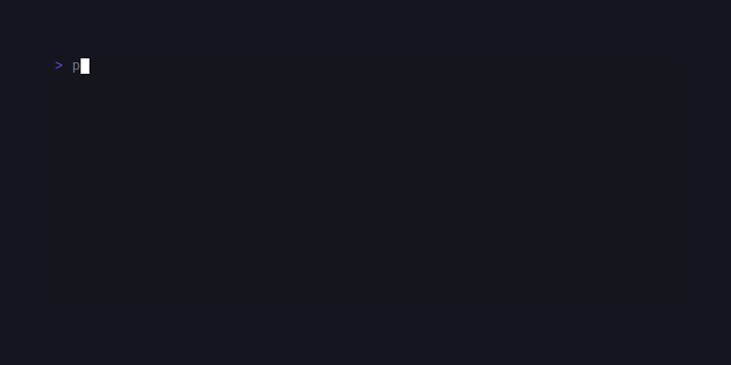
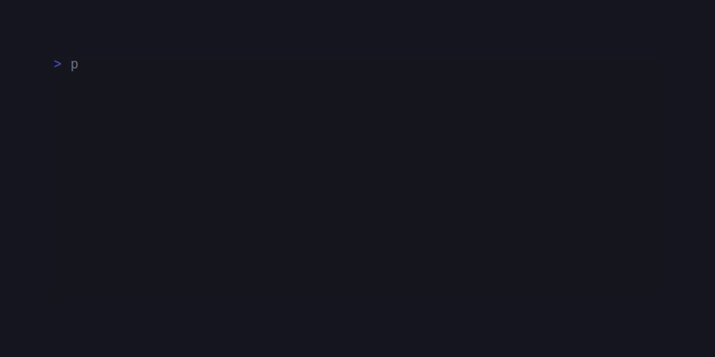

# SugarCraft\Dashboard

sugar-dashboard — a TUI building-block library for PHP 8.3+: column grid,
constraint layout, ratio grid, data grid, tree, modal, status bar, tabs,
plot/canvas, and a module/plugin system, with components organized into the
namespaces below.

## Installation

```bash
composer require sugarcraft/sugar-dashboard
```

## Namespace Structure (13 Namespaces)

| Namespace | Description |
|-----------|-------------|
| `Foundation\` | Pure interfaces + low-level primitives (Item, Sizer, Style, Theme, Color, Rect, Drawable, Buffer, Cell) |
| `Layout\` | Layout primitives (Stack, VStack, HStack, ZStack, FlexLayout, GridLayout, Frame, Panel, Split, Spacer, Window, etc.) |
| `Components\` | UI components (Modal, Select, Toast, Tabs, StatusBar, Form, Feedback, Nav, Card, Calendar, Tree, Table, etc.) |
| `Plot\` | Charts and plotting (Chart, Sparkline, Gauge, Donut, Heatmap, RadarChart, TreeViz, Graph, etc.) |
| `Module\` | Module interface + base implementations |
| `Registry\` | Registry pattern for modules |
| `Plugin\` | Plugin system with JSON protocol |
| `Modules\` | Built-in modules (Clock, System, Weather, etc.) |
| `Msg\` | Host-traffic message types — `AdapterTickMsg`, the scheduled refresh tick that drives legacy panel updates (kept a dedicated type so unrelated traffic, keystrokes above all, passes through without a blocking plugin round-trip) |
| `Keys\` | Key registry and mappings |
| `Position\` | ANSI-aware geometry helpers |
| `Output\` | Extracted helpers (truncate, render bar) |
| `State\` | State management |

---

## Foundation Namespace

### Interfaces & Contracts

| Type | Description | Key Methods |
|------|-------------|-------------|
| `Item` | Anything that can be rendered as a string | `render(): string` |
| `Sizer` | An Item that knows its own dimensions (extends Item) | `setSize(int $width, int $height): Sizer`, `render(): string` |
| `SizedItem` | A `Sizer` that can also report its intrinsic (unconstrained) size — the measurement contract every layout container in the library uses to size its children (extends `Sizer`) | `getInnerSize(): array` |
| `Drawable` | Universal draw contract with getRect/setRect/draw | `getRect(): Rect`, `setRect(Rect): void`, `draw(Buffer): void` |

### Low-Level Primitives

| Type | Description | Key Methods |
|------|-------------|-------------|
| `Cell` | Single terminal cell (rune + Style) — sugar-dashboard SSOT, distinct from `\SugarCraft\Vterm\Cell\Cell` | |
| `Buffer` | Cell grid buffer for drawing — sugar-dashboard SSOT, distinct from `\SugarCraft\Vterm\Buffer\Buffer` | `cell(x,y)`, `setCell(x,y,Cell)`, `fill(rect,Cell)` |
| `Rect` | Rectangle geometry (rectmath bounds model: minX/minY/maxX/maxY) — distinct from `\SugarCraft\Core\Rect` (offset+size model) | `contains()`, `intersect()`, `dx()`, `dy()` |
| `Style` | Terminal styling (inline foreground/background Color slots) — sugar-dashboard SSOT, distinct from `\SugarCraft\Style\Style` (padding/margin/borders) | `withForeground()`, `withBackground()`, `withBold()`, `toAnsi()` |
| `StyleParser` | Parses `[text](fg:red,bg:blue)` into Dash Cell arrays — sugar-dashboard SSOT, NOT drop-in compatible with `\SugarCraft\Style\StyleParser` | |
| `Color` | Backward-compat alias for `\SugarCraft\Core\Util\Color` (true duplicate, replaced by `class_alias` shim — prefer Core import in new code) | |
| `Theme` | Pre-defined theme palettes (9 colour slots + helpers; `fg()`/`bg()` emit at the detected capability, `NO_COLOR` → empty string) — sugar-dashboard SSOT, distinct from `\SugarCraft\Style\Theme` (13 slots, readonly properties, immutable `with*()` builders, no render helpers) | `dark()`, `dracula()`, `oneDark()`, `githubDark()`, `light()` |
| `ColorMode` | Process-wide colour capability gate for every renderer in the library — charts, gauges and chrome route through it instead of each deciding on its own whether to honour TrueColor, `NO_COLOR` and `TERM=dumb` | `use(?ColorProfile): void`, `profile(): ColorProfile` |
| `Threshold` | Maps a numeric value (typically a 0..1 ratio) to a `Color` via ordered stops — the shared "green below 60%, yellow below 80%, red above" pattern that gauges, meters and status indicators would otherwise each reinvent; `health()` is the preset triple | `of(array $stops)`, `health(?ok, ?warn, ?critical)`, `colorFor(float): Color`, `stops()` |
| `EdgeStyle` | String enum `Solid`/`Dashed`/`Dotted`/`Bold` — currently dormant: no consumers in the library (the live tree-edge variant is `Components\Tree\EdgeStyle`, which carries `Double` in place of `Bold` and is consumed by `Network`) | |
| `Segment` | 7-segment display component (digital-clock/calculator style) — renders characters from horizontal and vertical segments | `new(string)`, `withDigitWidth()`, `withShowColon()`, `withOnColor()`, `withOffColor()`, `withContent()` |

> **Dual-SSOT note.** Five Foundation primitives (`Style`/`Theme`/`Rect`/`Buffer`/`Cell`) plus `StyleParser` are intentionally distinct from same-named canonical types in `sugar-style`/`sugar-core`/`sugar-vterm`. The two families have distinct design lineages and the API shapes diverge. Only `Color` was a true duplicate and is now a `class_alias` to `\SugarCraft\Core\Util\Color`. See `CALIBER_LEARNINGS.md` entries `[pattern:dual-foundation-ssot]`, `[pattern:dual-style-ssot]`, `[pattern:dual-theme-ssot]`, `[pattern:dual-rect-models]`, `[pattern:dual-buffer-roles]`, `[pattern:dual-cell-shapes]`.

---

## Layout Namespace

### Layout Enums

| Type | Values |
|------|--------|
| `LayoutDirection` | `Horizontal`, `Vertical` |
| `SplitDirection` | `Horizontal`, `Vertical` |
| `AlignItems` | `Start`, `End`, `FlexStart`, `FlexEnd`, `Center`, `Stretch`, `Baseline` |
| `FlexDirection` | `Row`, `Column`, `RowReverse`, `ColumnReverse` |
| `FlexWrap` | `NoWrap`, `Wrap`, `WrapReverse` |
| `HAlign` | `Left`, `Right`, `Center` |
| `VAlign` | `Top`, `Middle`, `Bottom` |
| `JustifyContent` | `Start`, `End`, `FlexStart`, `FlexEnd`, `Center`, `SpaceBetween`, `SpaceAround`, `SpaceEvenly` |

### Layout Containers

| Type | Description | Key Methods/Factories | GIF |
|------|-------------|----------------------|-----|
| `StackedGrid` | Multi-column stacked grid layout with items in columns | `addItem(Item, ItemOptions)`, `new(Options)` |  |
| `GridLayout` | CSS Grid-style layout with rows/columns/gaps | `columns(int, items)`, `rows(int, items)`, `withGap()`, `withItem()` |  |
| `FlexLayout` | Flexbox-style layout with direction/wrap/justify | `row()`, `column()`, `withJustify()`, `withAlignItems()`, `withGap()` |  |
| `VStack` | Vertical stack with alignment and spacing | `new(...items)`, `spaced(int, ...items)`, `centered(...items)`, `right(...items)` |  |
| `HStack` | Horizontal stack with spacing and alignment | `new(...items)`, `spaced(int, ...items)`, `centered(...items)` |  |
| `ZStack` | Layered stack (items on top of each other) | `new(...items)`, `left(...items)`, `right(...items)`, `top(...items)`, `bottom(...items)` |  |
| `Stack` | Basic vertical stack | `new(...items)`, `spaced(int, ...items)` |  |
| `Split` | Split view with two panes | `new(...items)`, `horizontal()`, `vertical()` | |

### Border & Frame Components

| Type | Description | Key Methods/Factories | GIF |
|------|-------------|----------------------|-----|
| `Frame` | Bordered frame wrapping any Item with title/padding | `new(Item)`, `withBorder()`, `withBorderColor()`, `withPadding()`, `withTitle()` |  |
| `Panel` | Panel with header/content/footer sections | `new(Item|string)`, `titled(Item|string, string)`, `withContent()`, `withHeader()`, `withFooter()`, `withStyle()` |  |

### Spacing & Layout Helpers

| Type | Description | Key Methods/Factories | GIF |
|------|-------------|----------------------|-----|
| `Spacer` | Empty space filler with optional fill character | `new(int $width, int $height)`, `dotted(int)`, `dashed(int)`, `vertical(int, int)` |  |
| `LayoutItem` | Item with flex properties for layouts | `flex(Item, int)`, `fixed(Item)` | |
| `Window` | Window frame with title bar | |  |
| `Screen` | Terminal screen container | | |
| `Viewport` | Scrollable viewport | | |
| `Sidebar` | Sidebar navigation panel | |  |
| `Breakpoint` | Static helpers for responsive breakpoints — `narrow()`/`medium()`/`wide()`/`pick()` (default thresholds 90/140, Homedash convention) | `narrow(int $width, int $threshold = 90): bool`, `medium(int $width, int $narrow = 90, int $wide = 140): bool`, `wide(int $width, int $threshold = 140): bool`, `pick(int $width, array $thresholds): string` | |
| `Pad` | Padding wrapper — CSS-style padding with optional borders (for the tree-structured focus split, see the live `Layout\Boxer` subtree) | | |

### Layout Subsystems (Tile, Boxer, RatioGrid, Focus)

These four subsystems carry the layout names in the GIF grid and the
`dashboard-live` demo but had no API surface documented; each lives under
`src/Layout/` (the data grid they feed, `Components\GridTable`, is documented
in the Components section).

| Type | Description | Key Methods/Factories |
|------|-------------|----------------------|
| `TileLayout` | Constraint-based tile layout (bubbletea tilelayout pattern): a named root splits its region among child `Tile`s horizontally or vertically | `horizontal(name)`, `vertical(name)`, `withTile()`, `withTiles()`, `withDirection()`, `withGap()`, `withTheme()`, `setSize()`, `render()`, `getInnerSize()` |
| `Constraint` | How a child is sized along a container axis (tealeaves constraint law): fixed pixels, a flex weight, or fit-to-content, with min/max clamps; the active flavour is reported as a `ConstraintKind` enum | `fixed(px)`, `flex(weight)`, `fit()`, `withMinSize()`, `withMaxSize()` |
| `Resolver` | Five-phase tile-dimension solver turning constraints into concrete rectangles (`resolveLinear` for one axis, `resolveTile` for the 2-D walk) | `resolveLinear()`, `resolveTile()` |
| `SizeHint` | Min + desired size a widget reports to the solver; widgets supply one through the `SizeHinter` contract | `empty()` |
| `Boxer` | Tree-based layout engine (bubbleboxer pattern): nested horizontal/vertical `Node` splits addressed by path (`Address`); items live beside the tree, so editing a leaf never rebuilds the layout tree | `leaf(address, Item)`, `tree(Node, modelMap)`, `horizontal(...nodes)`, `vertical(...nodes)`, `editLeaf(address, callable)`, `setSize()`, `render()` |
| `RatioGrid` | Grid whose rows/columns are sized by ratio (termui grid pattern); cells placed by `(row, col)` coordinate, `NewColRow` carries the generated guides | `new(columns, rows)`, `withCell(row, col, GridItem)`, `setSize()`, `render()`, `getInnerSize()` |
| `FocusManager` | Persistence wrapper over sugar-focus's `FocusRing` for a layout hierarchy: the ring owns the ordered focusable ids and wrap-around Tab/Shift-Tab traversal; `persistState()`/`restoreState()` park the focused id through a `State\Persistence` file so focus survives panel swaps and reloads | `register(id)`, `unregister(id)`, `focus(id)`, `blur(id)`, `isFocused(id)`, `focusedId()`, `focusNext()`, `focusPrevious()`, `persistState(persistence, path)`, `restoreState(persistence, path)` |

### Layout\Grid (StackedGrid Option Parts)

`StackedGrid` itself is catalogued under Layout Containers; these three are
its `Layout\Grid\` option value parts.

| Type | Description | Key Properties |
|------|-------------|----------------|
| `Options` | Grid-level configuration options — `fitScreen: false` keeps short columns at their natural width (capped at the even share, so the frame never overflows); true (default) pads every column to the even share | `$fitScreen: bool` (default: true) |
| `ItemOptions` | Per-item placement options within StackedGrid | `$column: int` (0-based), `$expandVertical: bool` |
| `ItemWithOptions` | Internal pairing of Item + ItemOptions | `$item: Item`, `$options: ItemOptions` |

---

## Plot Namespace (Charts & Visualization)

### Chart Components

| Type | Description | Key Methods/Factories | GIF |
|------|-------------|----------------------|-----|
| `Plot` | Line/scatter chart with braille plotting | `new(data, width, height)`, `withData()`, `withMode()`, `withColor()`, `withHorizontalScale()`, `withShowAxes()` | |
| `Chart` | Bar/line chart with axes, labels, grid | `new(dataPoints, type)`, `withDataPoints()`, `withType()`, `withColor()`, `withGrid()`, `withShowValues()` |  |
| `AreaChart` | Area chart for time series data | `new(series)`, `withShowGrid()`, `withShowLegend()`, `withMaxValue()`, `withStacked()` |  |
| `Area` | Stacked area chart with gradient fills | `new(dataPoints)`, `sample(int)`, `withDataPoints()`, `withStacked()`, `withShowLegend()` | |
| `AreaPoint` | Area chart data point: `label: string`, `value: float`, `y0: float|null` | | |
| `Bar` | Horizontal status bar with colors | `new(string)`, `withContent()`, `withForeground()`, `withBackground()`, `withAlign()`, `withBorders()` |  |
| `CandlestickChart` | Financial candlestick chart | `new()`, `withCandle()`, `addCandle()`, `withShowGrid()`, `withShowVolume()` | |
| `Candlestick` | Single OHLC candlestick: `label`, `open`, `high`, `low`, `close` | `bullish()`, `bearish()`, `isBullish()` | |
| `Donut` | Donut chart with proportional segments | `new(data)`, `mocha(data)`, `withSize()`, `withCenterLabel()`, `withShowPercentage()` |  |
| `Gauge` | Horizontal progress bar / gauge | `new(float $ratio)`, `withWidth()`, `withFilledColor()`, `withEmptyColor()`, `withPercentage()` |  |
| `GaugeChart` | Circular gauge chart | |  |
| `GaugeCircle` | Circular gauge visualization | |  |
| `HeatMapChart` | 2D heatmap with color gradient | `new(data)`, `sample()`, `withRowLabels()`, `withColumnLabels()`, `withLowColor()`, `withHighColor()` | |
| `Heatmap` | Heat map visualization with legend | `new(data)`, `sample()`, `withLegend()`, `withValues()`, `withLowColor()`, `withHighColor()` |  |
| `RadarChart` | Radar/spider chart for multi-axis data | `new(labels, series)`, `withSize()`, `withGridLines()`, `withShowLabels()` |  |
| `Sparkline` | Inline sparkline chart | `new(data)`, `withData()`, `withWidth()`, `withHeight()`, `withDataPoints()`, `withFill()` |  |
| `SparklineBar` | Bar-style sparkline | |  |
| `SparklineArea` | Area-style sparkline | |  |
| `SparkArea` | Spark area chart | | |
| `FunnelChart` | Funnel chart visualization | |  |
| `Funnel` | Funnel visualization component | | |
| `Meter` | Meter/gauge component | |  |
| `OHLC` | Open-High-Low-Close data | | |
| `OHLCPoint` | OHLC data point | | |
| `Waterfall` | Waterfall chart | | |
| `WaterfallItem` | Waterfall bar item | | |
| `Progress` | Progress indicator | |  |
| `ProgressRing` | Circular progress indicator | |  |

#### Value redundancy (color-vision aids)

Colour alone should never be the only channel carrying a reading. These
shipped toggles encode the same value redundantly as text, position, or
shape, so the panels stay readable in a colour-blind terminal:

- `Chart::withShowValues()` — prints the numeric value on each bar.
- `Gauge::withPercentage()` — prints the fill ratio as a number beside
  the bar length.
- `Heatmap::withValues()` — writes each cell's value over the gradient
  fill. (`HeatMapChart` carries the low→high gradient but no value
  overlay; label it yourself when colour is the only channel.)
- `Plot\Chart\Meter::withGradient($stops, positionWise: true)` — hue maps
  to fill *position*, so the meter reads identically by height alone.
- `Plot\DistanceFade` — selection distance is expressed as a dimming
  falloff, a shape cue independent of the palette.
- `Plot\Braille\DualSampleGraph::withGradient()` and
  `Plot\Braille\BrailleCanvas::withGradient()` — the colour follows the
  sample value; the glyph geometry always carries it on its own.

### Graph & Network Visualization

| Type | Description | Key Methods/Factories | GIF |
|------|-------------|----------------------|-----|
| `Graph` | Graph visualization | | |
| `Bubble` | Bubble chart | |  |
| `BubblePoint` | Bubble chart point | | |
| `WordCloud` | Word cloud visualization | |  |
| `DotMatrix` | Dot matrix display | | |
| `Partition` | Partition chart | | |
| `PartitionSegment` | Partition segment | | |
| `Canvas` | Drawing canvas | | |

### btop-derived graphs, meters & process rows

Ported from [aristocratos/btop](https://github.com/aristocratos/btop) for
[candy-top](https://github.com/detain/sugarcraft/tree/master/candy-top);
every class is a standalone immutable value object, and the integer
colour/quantization laws are byte-faithful to btop (several are pinned
against oracle fixtures generated from btop's own C++).

| Type | Description | Key Methods/Factories |
|------|-------------|----------------------|
| `Plot\Gradient101` | btop `Theme::generateGradients`: expand ≥2 stops into a 101-entry ramp (index = percent) with btop's truncating integer law | `expand(list<Color>): list<Color>` |
| `Plot\Braille\BrailleCanvas` | Dot canvas — now with an optional value→colour ramp | `withGradient(stops, ?scale)`, `withValue()`, `withoutGradient()`, `gradient()`, `value()` |
| `Plot\Braille\DualSampleGraph` | btop `Draw::Graph`: two adjacent samples quantized into one glyph; braille / block / block2 / tty families | `new(width, height, family, invert, noZero, maxValue, offset)`, `push()`, `withData()`, `withGradient()`, `withUnderlay()`, `underlay()`, `render()` |
| `Plot\Chart\Meter` | Analog meter — now with btop's one-row position-coloured `■` bar (value redundancy aid — see **Value redundancy** above) | `withGradient(stops, positionWise)`, `withGlyph()`, `withInvert()`, `withMeterBg()`, `memoStats()`, `resetMemo()` |
| `Foundation\NetAutoScale` | btop net-graph ceiling hysteresis (grow/shrink only after 5 sustained samples) | `new(sync)`, `offer(down, up)`, `downloadMax()`, `uploadMax()`, `maxFor()`, `counters()`, `forceRescale()` |
| `Foundation\GradientStore` | Named 101-entry ramps — `at('cpu', 73)` is btop `Theme::g("cpu")[73]` | `new()`, `fromStops()`, `ramp()`, `withGradient()`, `at()`, `gradient()`, `has()`, `names()` |
| `Plot\DistanceFade` | btop proc-list distance fade (text dims, metrics blend to grey away from the selection; value redundancy aid — see **Value redundancy** above) | `ramp()`, `distance()`, `fadeIndex()`, `fadeColor()`, `metricPosition()`, `metricColor()`, `flatMetricColor()`, `metricValues()` |
| `Plot\ProcRow\ProcRowComposer` | One btop process-list row: pid, name, cmd, threads, user, mem, 5×1 cpu graph on graph_bg, cpu% | `new(width)` (box inner width), `row(ProcRow, row, selected, selectMax, ?graph, followed)`, `withColumns()`, `withPalette()`, `withProcColors()`, `withProcGradient()`, `withFamily()` |
| `Plot\ProcRow\ProcRow` | Process DTO (pid, name, cmd, threads, user, cpu, memPercent, ?memLabel) | `new(...)` |
| `Plot\ProcRow\ProcColumns` | btop column widths | `btop(boxWidth, cpuGraphs)`, `new(prog, cmd, threads, user, cpuGraphs)`, `width()` |
| `Plot\ProcRow\ProcRowPalette` | Theme slots + the `proc` / `proc_color` / `process` ramps | `btop()`, `new(...)`, `withRamps()`, `withSelected()`, `withFollowed()` |
| `Plot\ProcRow\ProcGraphTracker` | Per-pid mini-graph lifecycle: a graph is created when a pid is first seen busy (cpu > 0), dropped after 10 consecutive samples below `IDLE_THRESHOLD` (0.1) | `new(width, family)`, `observe(pid, cpu)`, `retain(pids)`, `graph(pid)`, `sample(cpu)` |

Run `php examples/dual-sample-graph.php` for all four graph families,
an inverted graph, the underlay mini-graph and position-mode meters.

#### Gradient101 + BrailleCanvas gradients

`Gradient101::expand($stops)` is the shared ramp: two stops are one
0..100 leg, three stops split at 50 (btop's start/mid/end), more stops
split evenly. `BrailleCanvas::withGradient($stops, ?Closure $scale = null)`
attaches such a ramp; afterwards every `setPoint()` / `setLine()` with a
`null` colour paints the ramp colour at the canvas' current value
(`withValue()`), while an explicit colour still wins. `$scale` maps a raw
sample onto 0..1 (clamped) — the place for btop's
`(v + offset) * 100 / max_value` law. The ramp, scale and value survive
`setSize()`; `withoutGradient()` detaches it.

```php
use SugarCraft\Core\Util\Color;
use SugarCraft\Dashboard\Plot\Braille\BrailleCanvas;
use SugarCraft\Dashboard\Plot\Gradient101;

$stops = [Color::hex('#80d0a3'), Color::hex('#dcd179'), Color::hex('#d45454')]; // btop Default cpu
$ramp  = Gradient101::expand($stops);   // 101 Colors; $ramp[50] is #dcd179

$canvas = BrailleCanvas::new(16, 8)
    ->withGradient($stops, scale: static fn (int|float $v): float => $v / 100);
$x = 0;
foreach ([10, 35, 60, 90, 40, 20, 75, 100] as $v) {
    $h = (int) round($v / 100 * 7);
    $canvas = $canvas->withValue($v)->setLine($x, 7, $x, 7 - $h)->setLine($x + 1, 7, $x + 1, 7 - $h);
    $x += 2;
}
echo $canvas->render();
```

#### DualSampleGraph

btop's history graph. Each cell pairs the previous and current sample,
each quantized to a band 0..4 per graph row, and looks the pair up in
btop's 5×5 `graph_symbols` table — so braille packs two samples per cell,
and every `push()` scrolls the frame half a cell (a whole cell in `tty`).

- `new(int $width, int $height, string $family = FAMILY_BRAILLE, bool $invert = false, bool $noZero = false, int $maxValue = 0, int $offset = 0)` —
  families `FAMILY_BRAILLE` (`⣿`), `FAMILY_BLOCK` (quadrants; bands 1/2
  share a glyph), `FAMILY_BLOCK2` (2×3 sextants, btop PR #1783 — needs a font
  with Symbols for Legacy Computing; underlay `🬭`) and `FAMILY_TTY` (shades,
  one sample per cell). `DualSampleGraph::FAMILIES` lists all four.
- Values are percents 0..100 unless `$maxValue > 0`, which applies btop's
  `clamp((v + offset) * 100 / maxValue, 0, 100)` (a positive `$offset`
  alone implies `maxValue` 100). `$invert` draws top-down (btop's upload
  graph); `$noZero` keeps the bottom row at band ≥ 1 so idle still shows a
  floor line.
- `push(...$values)` appends, `withData(...$values)` replaces the
  history. History is retained up to the widest width seen (floor
  `HISTORY_CELLS` = 1024), so shrinking and growing back redraws old
  samples.
- `withGradient($stops)` colours through a `Gradient101` ramp: a one-row
  graph colours each cell by `max(prev, cur)`, taller graphs colour each
  row by its vertical position (value redundancy aid — glyph height alone
  still carries the reading; see **Value redundancy** under Chart
  Components).
- `withUnderlay(Color $inactiveFg)` paints btop's `graph_bg` glyph
  (`⣀` / `▄` / `🬭` / `░` for the braille / block / block2 / tty families
  respectively, see `underlayGlyph()`) wherever a one-row graph is
  transparent; static `underlay($family, $cells, $inactiveFg)` returns the
  bare strip for callers that compose it themselves.
- `render(?ColorProfile)` returns `height` lines; it implements `Sizer`,
  so `setSize()` drops it into any layout.

```php
use SugarCraft\Core\Util\Color;
use SugarCraft\Dashboard\Plot\Braille\DualSampleGraph;

$stops = [Color::hex('#80d0a3'), Color::hex('#dcd179'), Color::hex('#d45454')];

echo DualSampleGraph::new(12, 3)
    ->withGradient($stops)
    ->withData(5, 12, 30, 55, 80, 95, 70, 45, 20, 10, 35, 60)
    ->render(), "\n";

// Upload-style: block glyphs, grows downward, raw bytes/s scaled to a 2 KiB ceiling.
echo DualSampleGraph::new(12, 2, DualSampleGraph::FAMILY_BLOCK, invert: true, maxValue: 2048)
    ->push(128, 512, 1024, 2048, 1500, 900)
    ->render(), "\n";

// A btop proc-list mini-graph: 5×1, never fully blank, on the grey underlay.
echo DualSampleGraph::new(5, 1, noZero: true)
    ->withUnderlay(Color::hex('#404040'))
    ->push(0, 40, 90)
    ->render(), "\n";
```

#### Meter position mode

`Meter::withGradient(array $stops, bool $positionWise = false)` attaches a
`Gradient101` ramp. With `positionWise: false` the analog body is coloured
by the meter's value. With `positionWise: true` the meter renders btop's
one-row `Draw::Meter` bar instead: cell `i` (1-based) sits at
`y = round(i * 100 / width)`, is filled while `value >= y` and takes ramp
colour `y` — so a 50% bar on green→red is green-to-yellow, never all
yellow — and the unfilled tail is painted in `meter_bg`.

- `withWidth()` honours widths down to 1 cell in position mode (a layout
  `setSize()` width wins when set).
- `withGlyph(string = '■')`, `withInvert(bool = true)` (leftmost cell takes
  the ramp's high end, e.g. a discharging battery),
  `withMeterBg(?Color)` (null = btop's `#404040`).
- Rendered bars are memoized process-wide per shape (stops, width, invert,
  glyph, meter_bg) × value 0..100, like btop's per-meter
  `std::array<string,101>` cache, bounded to 64 shapes / 4 MiB.
  `Meter::memoStats()` / `Meter::resetMemo()` expose and clear it;
  `Meter::cacheKey(...)` is the shape key.

```php
use SugarCraft\Core\Util\Color;
use SugarCraft\Dashboard\Plot\Chart\Meter;

$stops = [Color::hex('#80d0a3'), Color::hex('#dcd179'), Color::hex('#d45454')];

echo Meter::new(0.62)->withWidth(20)->withGradient($stops, positionWise: true)->render(), "\n";
echo Meter::new(0.30)->withWidth(20)->withGradient($stops, positionWise: true)
    ->withInvert()->withGlyph('▮')->withMeterBg(Color::hex('#202020'))->render(), "\n";
```

#### NetAutoScale + GradientStore

`NetAutoScale` is btop's network-graph ceiling, per direction: a speed
above the ceiling bumps a *fast* counter, one under a tenth of it (with
the ceiling above 10 KiB) bumps a *slow* counter, and only a counter
reaching 5 rescales — to `avg × 1.3` (grow) or `avg × 3` (shrink) of the
last 5 samples, floored at `NetAutoScale::FLOOR` (10 KiB/s). The first
`offer()` always rescales. `new(sync: true)` mirrors btop's `net_sync`
(one shared ceiling). `forceRescale(?$downHistory, ?$upHistory)` arms a
rescale on the next offer; the public `$rescaled` flag says whether the
last offer moved a ceiling.

`GradientStore` is the named-ramp registry a themed monitor reads per
cell. `fromStops()` takes btop-style flat keys (`<name>_start` /
`_mid` / `_end`; keys without `_start` are ignored), `withGradient()`
registers or replaces one (start-only fills all 101 entries), and
`at($name, $percent)` clamps the percent and throws
`\OutOfBoundsException` for an unknown name. Expanded ramps are memoized
process-wide (`MEMO_CAP` = 256).

```php
use SugarCraft\Core\Util\Color;
use SugarCraft\Dashboard\Foundation\{GradientStore, NetAutoScale};

$scale = NetAutoScale::new()->offer(50_000, 4_000);   // first offer rescales
// $scale->downloadMax() === 65000, $scale->uploadMax() === 10240 (floor)
for ($i = 0; $i < 5; $i++) {
    $scale = $scale->offer(200_000, 4_000);           // 5 sustained samples above → grow
}
// $scale->downloadMax() === 260000

$store = GradientStore::fromStops([
    'cpu_start' => Color::hex('#80d0a3'),
    'cpu_mid'   => Color::hex('#dcd179'),
    'cpu_end'   => Color::hex('#d45454'),
])->withGradient('proc', Color::hex('#cccccc'), end: Color::hex('#404040'));
echo $store->at('cpu', 73)->toHex();                  // #d99868
```

#### Process rows: ProcRowComposer, DistanceFade, ProcGraphTracker

`ProcRowComposer::new($width)` (the box's inner width) renders btop's normal-view process
row, exactly `width()` cells wide, with btop's own column sizing
(`ProcColumns::btop()`; pass `withColumns(ProcColumns::new(...))` for a
custom layout). The selected (`$row + 1 === $selected`) or `followed`
row is a bold highlight bar; every other row fades its text by distance
from the selection and colours cpu/name, mem and threads by value
(`withProcGradient()` / `withProcColors()` toggle btop's
`proc_gradient` / `proc_colors`). Control characters in name/cmd/user
become spaces. Colours come from `ProcRowPalette` (`btop()` is btop's
Default theme; `withRamps()` accepts ramps from a `GradientStore`).

`DistanceFade` exposes the underlying law as static helpers — including
btop's deliberate off-by-one (`$selected` is 1-based, `$row` 0-based).
`ProcGraphTracker` owns the per-pid 5×1 `DualSampleGraph`s: `observe()`
once per pid per fresh collection, `retain($livePids)` to sweep dead
pids; `sample()` lifts any cpu in [0.1, 5) to 5 so a barely-busy
process still shows.

```php
use SugarCraft\Dashboard\Plot\ProcRow\{ProcGraphTracker, ProcRow, ProcRowComposer};

$composer = ProcRowComposer::new(78);   // inner width of an 80-column proc box
$tracker  = ProcGraphTracker::new();
$procs = [
    ProcRow::new(1234, 'php', 'php bin/candy-top', threads: 3, user: 'joe', cpu: 42.5, memPercent: 3.2),
    ProcRow::new(888, 'mysqld', '/usr/sbin/mysqld', threads: 38, user: 'mysql', cpu: 7.1, memPercent: 11.0),
];
foreach ([10.0, 30.0, 42.5] as $cpu) {   // three collection ticks
    $tracker = $tracker->observe(1234, $cpu)->observe(888, 7.1);
}
foreach ($procs as $row => $p) {
    echo $composer->row($p, $row, selected: 1, selectMax: count($procs), graph: $tracker->graph($p->pid)), "\n";
}
```

---

## Components Namespace

> **Keyboard, focus, mouse and resize contract.** No class under
> `Components\` reads input itself: nothing in `src/Components/` consumes key,
> mouse, or resize events. Interactive widgets are pure renderers whose entire
> input vocabulary is their state setters (`withValue()`, `withActiveIndex()`,
> `withSelected()`, …), and focus-emphasis is host-driven the same way — a
> focused `Input` gets its highlight through the border colour passed to it,
> not through an internal focus bit.
>
> What the lib provides is the machinery the host wires together:
> `Keys\KeyMap::handle(Key)` dispatches a decoded key to its bound `KeyAction`
> closures (`on()` / `onAny()` / `off()`; `Keys\KeyIdentifier` mints the
> standard binding ids `quit()`, `help()`, `refresh()`, `focusNext()`,
> `focusPrev()`); `Layout\FocusManager` holds the ordered set of focusable ids,
> delegating wrap-around Tab/Shift-Tab traversal to sugar-focus's `FocusRing`
> and adding a per-id focused-history flag with durable save/restore; and
> `Layout\Screen::setup()` / `teardown()` emit the session preamble and trailer
> — alternate screen, hidden cursor, and mouse tracking (`Ansi::mouseAllOn()`)
> when enabled. Resize arrives as sugar-core's `WindowSizeMsg`. Legacy plugins
> see none of this traffic — only the tick and the dimensions, per "What a
> plugin can react to" under Plugin Namespace.
>
> `examples/dashboard-live.php` is the worked end-to-end wiring: `q`/`Ctrl-C`
> quit, `Tab`/`Shift+Tab` and the arrows rotate panel focus through a
> `FocusManager`, and each panel renders into its `Boxer` layout cell.

### Components\GridTable (Data Grid)

The flagship interactive table — a full-featured data grid with sort, filter,
pagination, and column freezing (tealeaves/teagrid law, adapted to PHP with
wither-style immutable setters). The assembly entry point is `GridTable`
itself; everything else in the directory is its value part.

| Type | Description | Key Methods/Factories |
|------|-------------|----------------------|
| `GridTable` | The grid: columns + rows + interactive state, renderable via the `Item` contract | `new(columns, rows)`, `withColumns()`, `withRows()`, `setSize()`, `sort()`, `sortState()`, `filter()`, `filterText()`, `pagination()`, `page()`, `freezeColumns()`, `scrollTo()`, `render()` |
| `Column` / `Row` / `Cell` | Grid geometry value parts — column definition (title, width, format), row, and formatted cell | `Cell` carries `value()`/`format()` |
| `Header` / `Footer` | Column header and summary footer renderers | `Footer` summarises configured columns |
| `Sort` / `SortState` / `SortDirection` | Sort engine and its immutable state: active column, direction, `toggleDirection()` | `isSorted()`, `column()`, `direction()` |
| `Filter` | Text/condition filtering across columns | `filters()`, `hasFilter()`, `isActive()`, `withFilter()`, `withoutFilter()`, `clear()` |
| `Pagination` | Page windowing with clamping | `withPage()`, `clampPage()`, `totalPages()`, `offset()` |
| `Overflow` / `OverflowMode` | Per-cell overflow policy (clip/ellipsis/wrap family) | mode enum + helper |
| `Scrolling` | Vertical/horizontal scroll state feeding `scrollTo()` | |
| `BorderChars` / `BorderConfig` / `BorderRegion` | Border character sets and per-region border configuration | |
| `Calc` | Column-width arithmetic shared by sort/filter/pagination passes | |

### Components\Form (Form & Input)

| Type | Description | Key Methods/Factories | GIF |
|------|-------------|----------------------|-----|
| `Input` | Text input field | `new(?string)`, `labeled()`, `password()`, `withValue()`, `withPlaceholder()`, `withLabel()`, `withError()`, `withBorderColor()` |  |
| `Textarea` | Multi-line text area | |  |
| `Checkbox` | Checkbox group with single/multi-select | `new(options)`, `withSelectedIndex()`, `withOptionChecked()`, `withMultiSelect()`, `withCheckedColor()` |  |
| `Toggle` | Toggle switch | |  |
| `SwitchComponent` | Switch component | |  |
| `Slider` | Slider control | |  |
| `Editor` | Text editor | |  |
| `CommandPalette` | Command palette | |  |
| `Cursor` | Terminal cursor | | |
| `Rating` | Star rating display | |  |

### Components\Select (Choice Inputs)

The choice-input family; `Option`, `OverlayPosition` and `AutoPositionHelper`
in the same namespace are its value parts.

| Type | Description | Key Methods/Factories | GIF |
|------|-------------|----------------------|-----|
| `Radio` | Radio button | |  |
| `Select` | Dropdown select component | `new(options)`, `withSelectedIndex()`, `withOptions()`, `withSelectedColor()` |  |
| `ComboBox` | Combo box | |  |
| `Dropdown` | Dropdown menu | | |
| `DatePicker` | Date picker | |  |
| `ColorPicker` | Color picker | | |

---

### Components\Feedback (Non-Modal Feedback)

| Type | Description | Key Methods/Factories | GIF |
|------|-------------|----------------------|-----|
| `Alert` | Inline non-modal alert (info, warning, error, success) — distinct from `Components\Modal\Alert` below, which is the bordered overlay variant the `alert` demo/GIF renders | `new(string)`, `info()`, `warning()`, `error()`, `success()`, `withMessage()`, `withTitle()`, `withBorderColor()` | |
| `LoadingText` | Animated loading text | |  |
| `Skeleton` | Loading skeleton | |  |
| `Spinner` | Loading spinner | |  |
| `EmptyState` | Empty state placeholder | |  |

### Components\Toast (Transient Feedback)

| Type | Description | Key Methods/Factories | GIF |
|------|-------------|----------------------|-----|
| `Toast` | Toast message | `new()`, `info()`, `success()`, `warning()`, `error()`, `fromNotification()`, `fromQueue()` |  |
| `NotificationQueue` | Dual-ring queue: active `items` + `history`, sized per instance by the constructor (`maxItems = 20`, `maxHistory = 50` defaults, each clamped to at least 1) | `new()`, `push()`, `dismiss()`, `current()`, `recent()`, `all()`, `history()`, `count()`, `historyCount()` | |
| `Level` | Toast level enum: `Info`, `Warning`, `Error`, `Success` | `icon()`, `isError()`, `isHighlighted()` | |
| `Notification` | Toast notification DTO: `message`, `level`, `title` | `info()`, `warning()`, `error()`, `success()` | |
| `Tooltip` | Tooltip popup | |  |
| `Hint` | Hint/caption text line — muted/italic/severity presets, optional icon prefix, wraps long text within the allocated width | `new(string)`, `muted()`, `italic()`, `info()`, `success()`, `warning()`, `danger()`, `withText()`, `withColor()`, `withStyle()`, `withIcon()` | |
| `NoticePosition` | Screen-position enum for toast notifications: the four corners, edge centres, `Center` and `Anchor` — resolves to vertical/horizontal alignment and maps to the sugar-toast `Position` vocabulary | `vertical()`, `horizontal()`, `isCorner()`, `isCenter()`, `isAnchor()`, `toToastPosition()` | |

### Components\Modal (Modal Dialogs)

| Type | Description | Key Methods/Factories | GIF |
|------|-------------|----------------------|-----|
| `Modal` | Modal dialog overlay | |  |
| `Alert` | Modal alert / message box — severity presets, optional title, left border accent and icon prefix (bubbletea/lipgloss lineage). **This** is the variant the `alert` demo renders; the inline non-modal sibling is `Components\Feedback\Alert` above | `new(string)`, `info()`, `warning()`, `error()`, `success()`, `withMessage()`, `withTitle()`, `withBorderColor()`, `withBackgroundColor()` |  |
| `ConfirmModal` | Confirmation dialog — ok/cancel phrasing by default, `yesNo()` for Y/N, `danger()` for the destructive styling | `new(string)`, `ok()`, `yesNo()`, `danger()` | |
| `ListModal` | Modal list of strings with optional per-item edit/delete callbacks | `new(array $items, ?string $title)`, `withSelectedIndex()`, `withOnEdit()`, `withOnDelete()` | |
| `MultiselectModal` | Modal multi-select over an options list | `new(array $options, ?string $title)`, `withSelectedIndices()` | |
| `ProgressModal` | Modal progress readout (current/total with optional label) | `new(int $current, int $total, ?string $label)` | |
| `Notification` | Alert card for modal overlays — styled severity message with optional icon (not the `Components\Toast` DTO above, which is the queue payload) | |  |
| `Drawer` | Drawer panel | |  |
| `Wizard` | Multi-step wizard | | |
| `WizardStep` | Wizard step | | |
| `Popover` | Popover content | |  |

> **Modal message protocol.** `Components\Modal\Msg\` defines the TEA-style answer types a modal interaction produces: `AnsweredYesMsg`, `AnsweredNoMsg`, `AnsweredEditMsg`, `AnsweredDeleteMsg` and `ClosedMsg`, each a `final readonly` class extending a shared abstract readonly `Msg` base so a host can pattern-match the whole family in one `match` arm. The bundled dialogs are renderable `Item`s — turning key presses into these messages is the host program's seam; the library ships the vocabulary, not the dispatcher.

---

### Components\Nav (Navigation)

| Type | Description | Key Methods/Factories | GIF |
|------|-------------|----------------------|-----|
| `Breadcrumb` | Breadcrumb navigation | `new(items)`, `fromPath()`, `withItems()`, `withSeparator()`, `withActiveIndex()` |  |
| `Pagination` | Pagination controls | | |
| `PaginationSimple` | Simple pagination | | |
| `Stepper` | Step progress indicator | | |
| `Navbar` | Navigation bar | |  |
| `Menu` | Menu component | |  |
| `Ladder` | Ladder diagram | | |
| `Sequence` | Sequence diagram | | |
| `Scrollbar` | Custom scrollbar | |  |

### Components\Tabs (Tabbed Views)

| Type | Description | Key Methods/Factories | GIF |
|------|-------------|----------------------|-----|
| `Tabs` | Tabbed interface | `new(tabs)`, `withSelectedIndex()`, `withActiveColor()`, `withTabs()` |  |
| `TabsVertical` | Vertical tab navigation | |  |
| `TabPane` | Pane container for tab content — renders content within a tab-pane context with optional border styling | `new(Item)`, `withBorderColor()`, `withBorderChar()`, `withPadded()` | |

### Components\StatusBar (Status Bar)

| Type | Description | Key Methods/Factories | GIF |
|------|-------------|----------------------|-----|
| `StatusBar` | Status bar with left/center/right zones | `new()`, `withLeft()`, `withCenter()`, `withRight()`, `withSegments()`, `withForeground()`, `withBackground()`, `withBorders()` | |
| `StatusIndicator` | Status indicator dot | |  |

---

### Components\Card (Card & Content Components)

| Type | Description | Key Methods/Factories | GIF |
|------|-------------|----------------------|-----|
| `Card` | Card container component | |  |
| `Header` | Page header | |  |
| `Footer` | Page footer | |  |
| `Cover` | Cover layout | |  |
| `Jumbotron` | Jumbotron hero section | |  |
| `CTA` | Call-to-action component | |  |
| `Profile` | User profile card | |  |
| `Testimonial` | Testimonial quote | |  |
| `Pricing` | Pricing table | | |
| `Features` | Feature grid | | |
| `Accordion` | Accordion/collapsible | |  |
| `Comment` | Comment component | | |
| `ActivityFeed` | Activity feed | |  |
| `Leaderboard` | Leaderboard display | |  |
| `BoxDrawing` | Unicode box-drawing frame generator | `new(?string)`, `titled(string)`, `double()`, `rounded()`, `bold()`, `withStyle()`, `withBorderColor()`, `withBgColor()` |  |
| `BorderText` | Text with ASCII-art border characters | `new(Item|string)`, `withBorders(Item|string)`, `withBorderColor()`, `withTextColor()` |  |
| `Divider` | Horizontal or vertical divider line | `new(?string)`, `h(?string)`, `v(?string)`, `withStyle()`, `withLabel()`, `withColor()` |  |
| `Bullet` | Bullet chart | |  |
| `MetricsGrid` | Grid of metric displays | |  |
| `Label` | Form label | |  |
| `Chip` | Chip/tag component | |  |
| `ChipGroup` | Group of chips | |  |
| `Badge` | Badge/tag component | `new(string)`, `success()`, `warning()`, `error()`, `info()`, `withStyle()`, `withSize()`, `withIcon()` |  |
| `BadgeGroup` | Group of badges | | |
| `Stat` | Single stat display | |  |
| `Stats` | Statistics display | |  |
| `Metric` | Metric display | |  |
| `Text` | Word-wrapped text content | `new(string)`, `withMaxWidth()`, `withTrim()`, `withHorizontalAlign()` |  |
| `Paragraph` | Paragraph text | |  |
| `Code` | Code block with syntax highlighting | |  |
| `Kbd` | Keyboard key display | |  |
| `Markdown` | Markdown rendering | | |
| `Highlight` | Syntax highlighted code | |  |
| `Diff` | Diff view | |  |

### Components\Media (Media Components)

| Type | Description | Key Methods/Factories | GIF |
|------|-------------|----------------------|-----|
| `Image` | Image display | |  |
| `Picture` | Picture frame | |  |
| `Avatar` | User avatar | |  |
| `AvatarGroup` | Group of avatars | |  |
| `Icon` | Icon display | |  |
| `QRCode` | QR code | |  |
| `Barcode` | Barcode | |  |
| `Video` | Video player | |  |
| `Audio` | Audio player | |  |
| `FigletText` | ASCII art text (FIGlet style) | |  |
| `ASCIIBanner` | ASCII banner text | |  |
| `Emoji` | Emoji display | |  |
| `Marquee` | Scrolling marquee text | |  |
| `Shadow` | Drop shadow effect wrapping any Item | `new(Item)`, `withStyle()`, `withColor()`, `withOffset()`, `withHeavy()`, `withNoShadow()` | |
| `Pictogram` | Pictogram display | | |

### Components\Calendar (Calendar & Date Components)

| Type | Description | Key Methods/Factories | GIF |
|------|-------------|----------------------|-----|
| `Calendar` | Calendar view | |  |
| `ListComponent` | List renderer | |  |
| `HeatmapCalendar` | GitHub-style calendar heatmap | `new(data)`, `sample()`, `withLowColor()`, `withHighColor()`, `withEmptyChar()` | |

### Components\System (System/Console Components)

| Type | Description | Key Methods/Factories | GIF |
|------|-------------|----------------------|-----|
| `Console` | Terminal console | |  |
| `Terminal` | Terminal emulator | |  |
| `Log` | Log entry | |  |
| `LogViewer` | Log file viewer | |  |
| `HexDump` | Hex dump viewer | |  |
| `Clock` | Digital clock | |  |
| `Timer` | Countdown timer | |  |
| `Stopwatch` | Stopwatch | |  |
| `NProgress` | npm-style progress bar | |  |
| `ProgressBar` | Progress bar | |  |
| `ProgressList` | List of progress items | |  |

---

### Components\Tree (Tree Structure Components)

| Type | Description | Key Methods/Factories | GIF |
|------|-------------|----------------------|-----|
| `Tree` | Tree structure | |  |
| `TreeNode` | Tree node | | |
| `StateMachine` | UML-style state machine diagram | `new()`, `addState()`, `addTransition()`, `addGuard()`, `withInitialState()` | |
| `StateNode` | Node in a state machine (id/label/isInitial/isFinal/entryActions/exitActions) | | |
| `StateTransition` | Transition between states (from/to/label/trigger/action/guard/type) | | |
| `TransitionType` | Enum: `Normal`, `Guard`, `Internal` | | |
| `Sankey` | Sankey diagram for flow visualization | `new()`, `addNode()`, `addFlow()`, `withHorizontal()`, `withShowLabels()` | |
| `SankeyNode` | Node in Sankey diagram: `id`, `label`, `value`, `color` | | |
| `SankeyFlow` | Flow connection: `source`, `target`, `value`, `color` | | |
| `Sunburst` | Sunburst chart visualization | | |
| `Treemap` | Treemap chart visualization | | |
| `TreemapLeaf` | Leaf node in treemap | | |
| `TreeViz` | Tree visualization | | |
| `Network` | Network diagram | | |
| `NetworkNode` | Node in network | | |
| `NetworkShape` | `Circle`, `Square`, `Diamond`, `Hexagon`, `Star` | | |
| `MindMap` | Mind map visualization | | |
| `OrgChart` | Organization chart | | |
| `ClassDiagram` | UML class diagram | | |
| `Flowchart` | Flowchart diagram | | |
| `FlowchartNode` | Node in flowchart | | |
| `FlowchartNodeType` | `Process`, `Decision`, `StartEnd`, `InputOutput`, `Connector`, `Data` | | |
| `Dendrogram` | Dendrogram/tree diagram | | |
| `DendrogramNode` | Node in dendrogram | | |
| `Gantt` | Gantt chart | | |
| `PERT` | PERT chart | | |
| `Timeline` | Timeline display | |  |
| `TimelineViz` | Timeline visualization | | |
| `TimelineNode` | Node in timeline | | |

### Components\Table (Table Components)

| Type | Description | Key Methods/Factories | GIF |
|------|-------------|----------------------|-----|
| `TableChart` | Table-based chart | | |
| `TableBordered` | Bordered table | |  |
| `TableZebra` | Zebra-striped table | |  |

---

## Keys Namespace (Key Registry)

| Type | Description | Key Properties |
|------|-------------|----------------|
| `Key` | Keyboard key combination; `withCtrl()` / `withAlt()` / `withShift()` return modified copies; `matches()` tests an incoming key | `toString()` |
| `KeyAction` | Action triggered by a key combination | `execute()` |
| `KeyMap` | Keyboard shortcut handler (renderable, implements `SizedItem`) | `on()`, `onAny()`, `off()` |
| `Category` | String-backed enum of key-binding categories | `label()` |
| `KeyIdentifier` | Unique identifier for a key binding, built from a string via `of()` | `of()`, `quit()`, `help()`, `refresh()`, `focusNext()`, `focusPrev()` |
| `KeyMeta` | Metadata for a key binding (display string, full description) | `display()`, `fullDescription()` |
| `KeyRegistry` | Static central registry for key bindings (teautils KeyRegistry pattern) | `register()`, `get()`, `byCategory()`, `categories()`, `match()`, `reset()` |

## State Namespace (State Management)

| Type | Description | Key Methods |
|------|-------------|-------------|
| `Persistence` | Atomic JSON state save/load (final; delegates to sugar-core `AtomicJsonFile`) | `save(path, data)`, `load(path): ?array` |

> **Privacy:** state and cache writes publish private files — both `Persistence` and
> `WeatherModule` use `AtomicJsonFile::withPermissions(0600)`, and directories they
> create are derived to `0700`. The weather cache at `~/.cache/sugar-dashboard/weather.json`
> holds your location data (the `WeatherModule`'s configured location, or the
> IP-derived city when it runs in `auto` mode — the live example reads the
> `WEATHER_LOCATION` environment variable) and is never world-readable. An `AtomicJsonFile` write also leaves a contentless
> `.<basename>.lock` sidecar (mode 0600) beside the file: it is the cross-process
> write lock and is deliberately **never deleted** — removing it re-opens the race
> it exists to close.

> **Note:** `TransitionType`, `StateNode`, and `StateTransition` moved to `Components\Tree\` namespace (PSR-4 one-class-per-file) and are retained here as `@internal` backward-compatibility re-exports via `class_alias`. `StateMachine` lives only in `Components\Tree\` — there is no `State\StateMachine` re-export, and no `State\State` type exists; the state-machine diagram component is documented under the Tree section.

## Position Namespace (ANSI-Aware Geometry)

| Type | Description | Key Methods |
|------|-------------|-------------|
| `Center` | Calculate centered position | |
| `Overlay` | Auto-positioning helper for overlays — computes the optimal position relative to an anchor, choosing above or below based on available space, clamped to container bounds | `calculate(int $overlayWidth, int $overlayHeight, int $anchorX, int $anchorY, int $containerWidth, int $containerHeight): array`, `fitsBelow()`, `fitsAbove()` | |

> Note: `Position\Center` is the geometry helper (computes centered
> coordinates); `Layout\Center` is a separate renderable wrapper that centres
> an item in the `Layout` namespace. Both are live classes — distinct
> responsibilities, same word.

## Output Namespace (Extracted Helpers)

| Type | Description | Key Methods |
|------|-------------|-------------|
| `Truncate` | String truncation with ANSI awareness |
| `RenderBar` | Bar rendering helper — colour follows the detected terminal capability (`?ColorProfile` parameter; `NO_COLOR` strips every escape) |
| `WrapCells` | Cell-aware text wrapping |

## Module Namespace (Module Interface)

| Type | Description | Key Methods |
|------|-------------|-------------|
| `Module` | MVC-style Model–Update–View interface aligned with `Core\Model`: `init(): ?Closure`, `update(Msg): array{0:Module,1:?Cmd}`, `view(): string|View`, `subscriptions(): ?Subscriptions`, plus `name(): string`, `minSize(): array{0:int,1:int}` |
| `BaseModule` | Abstract helper — `withState(array): static` for immutable state, default `update()` returns `[self,null]` |
| `LegacyModule` | Deprecated array-state interface — superseded by `Module` |
| `LegacyModuleAdapter` | `@internal` wrapper that adapts `LegacyModule` to the `Module` contract |
| `ModuleConfig` | Module configuration |
| `ImagePlacer` | Optional interface for image placements |
| `ImagePlacement` | Image placement data |
| `TickEpoch` | Focus-regain epoch counter |
| `BoundedCommand` | One bounded child-process run: argv array (no shell interpolation), wall-clock deadline (default 5s), 1 MiB output ceiling, and a guaranteed TERM→KILL reap before `proc_close` | `run(array $argv, float $timeoutSeconds, int $maxOutputBytes): array` |
| `ProcAvailability` | Probe-once availability of Linux `/proc` pseudo-files — probe once, degrade quietly, show a visible 'n/a' sentinel on hosts without `/proc` instead of failing | `has(string $path): bool` |

## Registry Namespace (Module Registry)

| Type | Description | Key Methods |
|------|-------------|-------------|
| `Registry` | Static register/get/list/reset for modules; auto-wraps `LegacyModule` via `LegacyModuleAdapter` |

## Plugin Namespace (Plugin System)

| Type | Description | Key Methods |
|------|-------------|-------------|
| `Request` | Plugin request DTO |
| `Response` | Plugin response DTO |
| `PluginSdk` | Plugin runner loop |
| `ExternalModule` | Spawns a plugin binary as a `LegacyModule`; the host registers it through `Registry` which wraps it in `LegacyModuleAdapter` to meet the `Module` contract |
| `Discovery` | Plugin discovery from filesystem |

> **Plugin lifecycle (what a plugin author owes).** `ExternalModule` spawns the
> binary with `proc_open` and speaks line-delimited JSON over stdin/stdout. Each
> reply must arrive within 5 s on the same line it was requested on, one line at
> a time, capped at 1 MiB per line — a plugin that answers late, answers twice,
> or floods is disabled for the session rather than silently retried. Teardown is
> bounded: closing the three pipes gives a well-behaved plugin its graceful EOF
> exit, a 2 s polite poll follows, then the shared TERM → grace-poll → KILL →
> reap ladder (sugar-core `BoundedShutdown`) runs, so a wedged plugin binary can
> never outlive the dashboard that started it — the ladder kills the direct
> child; grandchildren it spawns (say, from a shell wrapper) outlive it, so
> authors needing tree-killing wrap the command themselves. Plugin children get
> a small explicit environment allow-list (`PATH`, `HOME`, `USER`, `LANG`,
> `TERM`, `COLORTERM` — `ExternalModule::pluginEnvironment()`); the dashboard's
> own secrets are never handed to third-party binaries by inheritance. Any
> plugin-supplied text reaching terminal chrome (names, error lines) passes
> through `chromeLabel()`, which strips control bytes, CR reflow, and zone
> sentinels and clips over-length labels. The same bounded-teardown story
> covers `GenericModule` and `SystemModule` command runs (5 s deadline, 1 MiB
> output cap via `BoundedCommand`, with the same direct-children-only reap), and
> the weather fetch (synchronous inside the
> dispatched command, bounded by the HTTP client's 5 s timeout —
> `WttrInClient`'s stream context).
>
> **What a plugin can react to.** A legacy plugin panel is non-interactive by
> construction: `LegacyModuleAdapter::update()` forwards exactly two message
> kinds into the round-trip — `Msg\AdapterTickMsg` (the scheduled refresh tick)
> and `Core\Msg\WindowSizeMsg` (a resize). Every other routed message, keys
> above all, is dropped at the wrapper: each keystroke used to trigger a
> synchronous write+read against the plugin child, blocking the frame until the
> answer arrived. The plugin's `view($state, $w, $h)` therefore receives the
> dimensions from the last `WindowSizeMsg`, starting at 80×24 until the host
> forwards a real size, and its refresh cadence is the `interval` the plugin
> advertises from `init()` metadata (default 30 s, floored at 1 s) re-armed as
> the `plugin-refresh` tick subscription — not the host's own tick rate. A
> panel that needs keyboard input is a host component, not a plugin.
>
> **Motion & reduced motion.** The library owns no clock and no event loop:
> every render is a synchronous, pure snapshot, and all apparent motion is
> frame-driven by the host. The moving surfaces are exactly two —
> `Components\Feedback\Spinner`, whose `render()` picks its animation frame
> from wall time against the `withInterval()` speed it was given, and
> `Components\Media\Marquee`, whose `render($frame)` scrolls text by a frame
> offset the host advances (`nextFrame()`, `withSpeed()` characters per frame,
> `withDirection()`, optional `withFadeEdges()`). Everything else that looks
> alive is presentation only: `Components\System\Timer` displays whatever
> `withElapsed()` the host feeds it, the tree's `StateTransition` carries an
> expanded/collapsed state rather than an animation, and the plot canvases
> (`DotMatrix`, `BrailleCanvas`, `DualSampleGraph`) render their input
> statically. Because the host supplies every frame, a reduced-motion
> presentation is always reachable from the outside — render a fixed frame
> (`Spinner::frameAt(0)`, or a constant `$frame` for `Marquee`) and hold the
> redraw cadence still. There is deliberately no `REDUCE_MOTION`/
> `prefers-reduced-motion` runtime knob inside the library; honoring such a
> signal is a host-policy decision (the candy-top app owns that precedent),
> and the frames above stay valid no matter which way that ruling lands.
>
> **Color environment.** Every color emission routes through
> `Foundation\ColorMode`: `NO_COLOR` set to any non-empty value and `TERM=dumb`
> collapse to plain ASCII; otherwise TrueColor. `ColorMode::use($profile)`
> overrides the detection for tests or embedding hosts.
>
> **Sizing.** The library never reads the terminal itself: hosts forward
> `Core\Msg\WindowSizeMsg` to the root model, which is what `LegacyModuleAdapter`
> and the `dashboard-live.php` demo consume (the demo falls back to the
> `COLUMNS`/`LINES` environment when unattended). For a full assembly story —
> event loop, Boxer layout, FocusManager, per-panel tick — read
> `examples/dashboard-live.php` top to bottom.

## Modules Namespace (Built-in Modules)

All built-in modules extend `BaseModule` and use `withState()` for immutable state updates.

> **Requirements & environment.** `SystemModule`, `UptimeModule` and friends read
> Linux interfaces — `/proc/stat`, `/proc/meminfo`, `/proc/cpuinfo` —
> and degrade to empty output on other kernels rather than failing. GPU rows are
> queried through `nvidia-smi` only when that binary is present (memoized probe),
> so non-NVIDIA machines pay nothing. `WeatherModule` reaches `wttr.in` over the
> network and falls back to its cache (and to stale cache) when offline.

| Type | Description |
|------|-------------|
| `Clock\ClockModule` | Single-line clock |
| `System\SystemModule` | CPU/mem/uptime stats (+ GPU via nvidia-smi when present) |
| `Uptime\UptimeModule` | System uptime |
| `Greeting\GreetingModule` | Time-of-day greeting |
| `Generic\GenericModule` | Arbitrary command runner — string commands go to the shell (trusted-input contract); array argv runs without a shell, bounded by a kill ladder |
| `Weather\WeatherModule` | Live weather from wttr.in + 30min cache + stale fallback |
| `Weather\WttrInClient` | wttr.in J1 JSON API client implementing `HttpClient` |
| `Weather\HttpClient` | Interface for weather fetch — allows test doubles |
| `Weather\WeatherSnapshot` | Readonly DTO: `tempC`, `condition`, `location`, `fetchedAt` |

---

## Usage Example

```php
use SugarCraft\Dashboard\Layout\{Frame, VStack, Panel};
use SugarCraft\Dashboard\Layout\Grid\{StackedGrid, Options, ItemOptions};
use SugarCraft\Dashboard\Components\Card\Text;

// Create a stacked grid layout
$grid = new StackedGrid(new Options(fitScreen: true));

// Add items to columns
$grid->addItem(
    Frame::new(
        VStack::centered(
            Text::new('Welcome to SugarDashboard'),
            Text::new('Build beautiful TUIs')
        )
    )->withPadding(1),
    new ItemOptions(column: 0, expandVertical: true)
);

// Add a panel to the second column
$grid->addItem(
    Panel::titled(
        Text::new('This is a panel'),
        'Dashboard'
    ),
    new ItemOptions(column: 1)
);

// Set size and render
$grid->setSize(80, 24);
echo $grid->render();
```

## Testing

```bash
cd sugar-dashboard && composer install && vendor/bin/phpunit
```

## GIF Demos

| Demo | Description |
|------|-------------|
|  | **Interactive dashboard** — Clock/System/Weather panels with keyboard focus rotation (Tab/arrows), q/Ctrl-C quit |
|  | Layout containers demo |
|  | Charts demo |
|  | Form demo |
|  | Navigation demo |
|  | Status indicators demo |
|  | Text components demo |
|  | Time components demo |
|  | UI components demo |
|  | Complex layout demo |
|  | Data display demo |
|  | Devtools demo |
|  | Accordion and timeline components |
|  | Media components demo |
|  | Metrics display demo |
|  | **Three-panel Boxer layout** — horizontal split with three named leaves and visual focus indicator |
|  | **Sortable/filterable GridTable** — pagination, column sort, text filter across 25 rows |
|  | **Plot marker comparison** — side-by-side MarkerDot vs MarkerBraille rendering |

## Example Demos

The `examples/` directory contains standalone demo files that showcase individual components and combinations:

| Demo | Description |
|------|-------------|
| `dashboard-live.php` | **Interactive dashboard** — the headline demo. Program event loop, raw mode, Clock/System/Weather modules, Boxer layout, FocusManager, per-panel tick, keyboard navigation (Tab/arrows), quit (q/Ctrl-C). Run with `php examples/dashboard-live.php` |
| `dashboard-showcase.php` | Multi-component server dashboard with gauges, charts, timeline, breadcrumb, avatar group |
| `dashboard-complex.php` | Full-featured analytics dashboard with charts, stats, funnel, sparkline |
| `dashboard-accordion-timeline.php` | Accordion and timeline components |
| `dashboard-metrics.php` | Key statistics and status indicators |
| `dashboard-status.php` | Spinners, progress bars, gauges, alerts |
| `dashboard-charts.php` | Chart components including area, donut, radar, heatmap |
| `dashboard-form.php` | Form components demo |
| `dashboard-ui.php` | UI components demo |
| `dashboard-nav.php` | Navigation components demo |
| `dashboard-text.php` | Text components demo |
| `dashboard-time.php` | Time components demo |
| `dashboard-media.php` | Media components demo |
| `dashboard-data.php` | Data display components demo |
| `dashboard-devtools.php` | Devtools components demo |
| `dashboard-layout.php` | Layout containers demo |
| `dual-sample-graph.php` | btop-style `DualSampleGraph` in all four families (braille / block / block2 / tty), inverted + underlay graphs, and position-coloured `Meter` bars |

The table lists the headline demos only — `examples/` carries the full set
(one file per component family and beyond); see the directory for anything
not named above.

## Accessor deprecation (2026-10-24)

Per the house bare-accessor convention (`AGENTS.md`: *"Bare accessors (no* `get`*"), ruling 3b)*, 89 `get*()` accessors across 41 classes were renamed to their bare twins (the 2026-10-24 remediation pass added 8 whose names collide with `TreeProvider` members on classes that do not implement that interface). The legacy names remain as byte-identical BC forwarders, each marked `@deprecated` with `REMOVED-IN: 2.0.0` in its docblock — they will be removed in sugar-dashboard v2.0.0.

Out of scope (protocol members only, unchanged): `SizedItem::getInnerSize()` (the `SizedItem` interface and its 187 implementations), `Drawable::getRect()` (protocol) and its implementations, and the `TreeProvider` quintet (`getRoots/getChildren/getNode/getDepth/getTotalValue`) — protocol-bound exactly on `ArrayTreeProvider`, the single class implementing that interface; the same names on classes that do **not** implement `TreeProvider` are violations, not protocol members, and the remediation pass swept them (`Boxer::getNode`, `Node::getChildren`, the `PartitionSegment` and `DendrogramNode` `getTotalValue`/`getDepth` pairs, `SunburstSegment::getTotalValue`, `HeatmapCalendar::getTotalValue`). `Address::getChild()` is a documented carve-out: the bare name `child()` is taken by the static factory `Address::child(self, int)` — an honest carve beats a forced rename. Boolean `is*()`/`has*()` predicates are convention-compliant and stay as-is. External consumers (`candy-sql`, `candy-top`, `sugar-charts`) do import sugar-dashboard classes (`Gauge`, `Badge`, `Card`, `BrailleCanvas`, and more); no external call site reaches a renamed accessor, and the BC forwarders carry any such call until v2.0.0.

Internal call sites in `src/` and `examples/` were switched to the bare forms in the same commit.

| Namespace | Class | Deprecated | Use instead |
|-----------|-------|------------|-------------|
| `Components\Calendar` | `HeatmapCalendar` | `getAverageValue()` | `averageValue()` |
| `Components\Calendar` | `HeatmapCalendar` | `getDataDimensions()` | `dataDimensions()` |
| `Components\Calendar` | `HeatmapCalendar` | `getTotalValue()` | `totalValue()` |
| `Components\Card` | `Diff` | `getStats()` | `stats()` |
| `Components\Feedback` | `LoadingText` | `getCurrentFrame()` | `currentFrame()` |
| `Components\Feedback` | `LoadingText` | `getFrameAt()` | `frameAt()` |
| `Components\Feedback` | `LoadingText` | `getInterval()` | `interval()` |
| `Components\Feedback` | `LoadingText` | `getStyle()` | `style()` |
| `Components\Feedback` | `Spinner` | `getCurrentFrame()` | `currentFrame()` |
| `Components\Feedback` | `Spinner` | `getFrameAt()` | `frameAt()` |
| `Components\Feedback` | `Spinner` | `getFrameCount()` | `frameCount()` |
| `Components\Form` | `CommandPalette` | `getFilteredCommands()` | `filteredCommands()` |
| `Components\Form` | `Cursor` | `getCursorChar()` | `cursorChar()` |
| `Components\Form` | `Editor` | `getContent()` | `content()` |
| `Components\Form` | `Editor` | `getCursorPosition()` | `cursorPosition()` |
| `Components\Form` | `Editor` | `getLine()` | `line()` |
| `Components\Form` | `Editor` | `getLineCount()` | `lineCount()` |
| `Components\GridTable` | `Cell` | `getFormat()` | `format()` |
| `Components\GridTable` | `Cell` | `getValue()` | `value()` |
| `Components\GridTable` | `Filter` | `getFilter()` | `filter()` |
| `Components\GridTable` | `Filter` | `getFilters()` | `filters()` |
| `Components\GridTable` | `Footer` | `getSummaryColumns()` | `summaryColumns()` |
| `Components\GridTable` | `GridTable` | `getFilterText()` | `filterText()` |
| `Components\GridTable` | `GridTable` | `getFrozenColumns()` | `frozenColumns()` |
| `Components\GridTable` | `GridTable` | `getHeight()` | `height()` |
| `Components\GridTable` | `GridTable` | `getPagination()` | `pagination()` |
| `Components\GridTable` | `GridTable` | `getSortState()` | `sortState()` |
| `Components\GridTable` | `GridTable` | `getWidth()` | `width()` |
| `Components\GridTable` | `Header` | `getColumns()` | `columns()` |
| `Components\GridTable` | `Header` | `getSortedColumn()` | `sortedColumn()` |
| `Components\GridTable` | `Overflow` | `getHorizontal()` | `horizontal()` |
| `Components\GridTable` | `Overflow` | `getVertical()` | `vertical()` |
| `Components\GridTable` | `Scrolling` | `getRowHeight()` | `rowHeight()` |
| `Components\GridTable` | `Scrolling` | `getTotalHeight()` | `totalHeight()` |
| `Components\GridTable` | `Scrolling` | `getVisibleRows()` | `visibleRows()` |
| `Components\GridTable` | `Sort` | `getColumn()` | `column()` |
| `Components\GridTable` | `Sort` | `getDirection()` | `direction()` |
| `Components\Media` | `Video` | `getProgressWidth()` | `progressWidth()` |
| `Components\StatusBar` | `StatusIndicator` | `getStatus()` | `status()` |
| `Components\StatusBar` | `StatusIndicator` | `getSymbol()` | `symbol()` |
| `Components\System` | `LogViewer` | `getEntryCount()` | `entryCount()` |
| `Components\System` | `Stopwatch` | `getElapsedMilliseconds()` | `elapsedMilliseconds()` |
| `Components\System` | `Stopwatch` | `getElapsedSeconds()` | `elapsedSeconds()` |
| `Components\System` | `Terminal` | `getHistory()` | `history()` |
| `Components\System` | `Terminal` | `getInput()` | `input()` |
| `Components\System` | `Terminal` | `getOutput()` | `output()` |
| `Components\System` | `Terminal` | `getPrompt()` | `prompt()` |
| `Components\System` | `Timer` | `getRemainingSeconds()` | `remainingSeconds()` |
| `Components\Tree` | `BranchStyle` | `getConnectorChar()` | `connectorChar()` |
| `Components\Tree` | `BranchStyle` | `getEndConnectorChar()` | `endConnectorChar()` |
| `Components\Tree` | `BranchStyle` | `getLineChar()` | `lineChar()` |
| `Components\Tree` | `DendrogramNode` | `getDepth()` | `depth()` |
| `Components\Tree` | `DendrogramNode` | `getTotalValue()` | `totalValue()` |
| `Components\Tree` | `DrilldownTree` | `getBreadcrumbItems()` | `breadcrumbItems()` |
| `Components\Tree` | `DrilldownTree` | `getNavigationStack()` | `navigationStack()` |
| `Components\Tree` | `SunburstSegment` | `getTotalValue()` | `totalValue()` |
| `Components\Tree` | `UMLClass` | `getAttributes()` | `attributes()` |
| `Components\Tree` | `UMLClass` | `getMethods()` | `methods()` |
| `Components\Tree` | `UMLClass` | `getTemplateParams()` | `templateParams()` |
| `Foundation` | `Buffer` | `getCell()` | `cell()` |
| `Foundation` | `Theme` | `getName()` | `name()` |
| `Keys` | `KeyMap` | `getRegisteredKeys()` | `registeredKeys()` |
| `Layout` | `FocusManager` | `getFocusedId()` | `focusedId()` |
| `Layout\Boxer` | `Address` | `getParent()` | `parent()` |
| `Layout\Boxer` | `Boxer` | `getHeight()` | `height()` |
| `Layout\Boxer` | `Boxer` | `getItem()` | `item()` |
| `Layout\Boxer` | `Boxer` | `getModelMap()` | `modelMap()` |
| `Layout\Boxer` | `Boxer` | `getNode()` | `node()` |
| `Layout\Boxer` | `Boxer` | `getRoot()` | `root()` |
| `Layout\Boxer` | `Boxer` | `getWidth()` | `width()` |
| `Layout\Boxer` | `Node` | `getAddress()` | `address()` |
| `Layout\Boxer` | `Node` | `getChildren()` | `children()` |
| `Layout\Boxer` | `Node` | `getHeight()` | `height()` |
| `Layout\Boxer` | `Node` | `getWidth()` | `width()` |
| `Layout\Tile` | `BaseTile` | `getName()` | `name()` |
| `Layout\Tile` | `BaseTile` | `getSize()` | `size()` |
| `Layout\Tile` | `Tile` | `getContent()` | `content()` |
| `Layout\Tile` | `Tile` | `getParent()` | `parent()` |
| `Module` | `BaseModule` | `getState()` | `state()` |
| `Plot\Braille` | `BrailleCanvas` | `getCell()` | `cell()` |
| `Plot\Braille` | `BrailleCanvas` | `getPixelSize()` | `pixelSize()` |
| `Plot\Canvas` | `Canvas` | `getPixel()` | `pixel()` |
| `Plot\Chart` | `Heatmap` | `getDataDimensions()` | `dataDimensions()` |
| `Plot\Chart` | `Heatmap` | `getMaxValue()` | `maxValue()` |
| `Plot\Chart` | `Heatmap` | `getMinValue()` | `minValue()` |
| `Plot\Chart` | `OHLCPoint` | `getBodySize()` | `bodySize()` |
| `Plot\Chart` | `OHLCPoint` | `getRange()` | `range()` |
| `Plot\Chart` | `PartitionSegment` | `getDepth()` | `depth()` |
| `Plot\Chart` | `PartitionSegment` | `getTotalValue()` | `totalValue()` |

## License

MIT License - See LICENSE file for details.

## Credits & inspiration

Originally inspired by the Go [Charm](https://github.com/charmbracelet) ecosystem; SugarCraft is developed as a native PHP project.
