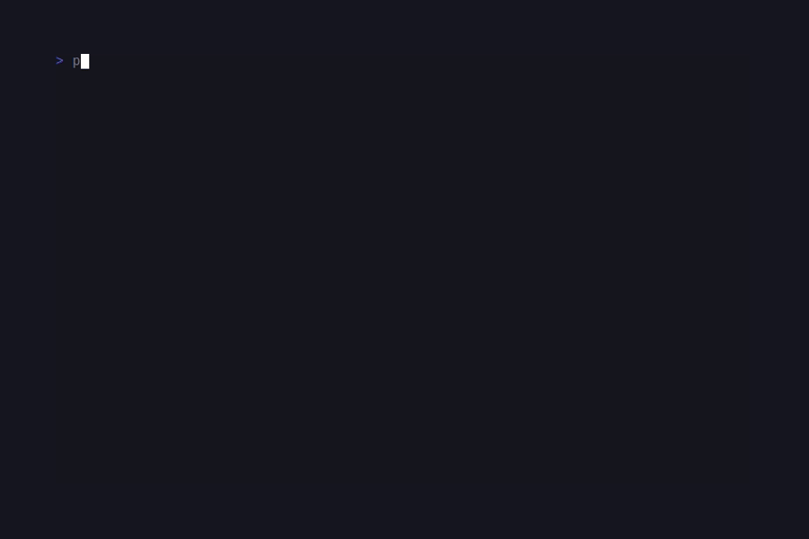
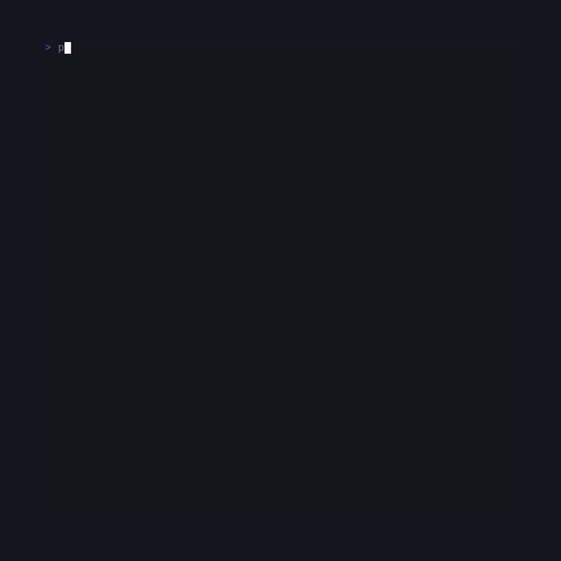

# SugarMarkdown

> Formerly published as `sugarcraft/candy-shine` (renamed 2026-10). <!-- @rename-keep -->
> Namespace changed: `SugarCraft\Shine\` → `SugarCraft\Markdown\`. <!-- @rename-keep -->

<!-- BADGES:BEGIN -->
[](https://github.com/detain/sugarcraft/actions/workflows/ci.yml)
[](https://app.codecov.io/gh/detain/sugarcraft?flags%5B0%5D=sugar-markdown)
[](https://packagist.org/packages/sugarcraft/sugar-markdown)
[](LICENSE)
[](https://www.php.net/)
<!-- BADGES:END -->




sugar-markdown — a Markdown → ANSI renderer for PHP 8.3+, built on
`league/commonmark` and SugarStyle.

```sh
composer require sugarcraft/sugar-markdown
```

> The `Renderer` exposes short-form aliases on every option:
> `theme` / `wordWrap` / `hyperlinks` / `baseURL` / `tableWrap` /
> `inlineTableLinks` / `preservedNewLines` / `emoji` / `standardStyle`.
> The long-form `with*` names still work — pick whichever
> reads better at the call site.

## Quickstart

The example below embeds a fenced code block inside its Markdown sample,
so the snippet itself is fenced with tildes — four backticks would
truncate the heredoc on GitHub too:

~~~~php
use SugarCraft\Markdown\Renderer;

echo (new Renderer())->render(<<<MD
# Welcome

A few **bold** and _italic_ words, with `inline code` and a
[link](https://example.com).

- one
- two
- three

```php
echo "hello world";
```
MD);
~~~~

## Themes

Stock presets:

```php
use SugarCraft\Markdown\{Renderer, Theme};

new Renderer(Theme::ansi());        // default colourful
new Renderer(Theme::plain());       // no SGR
new Renderer(Theme::notty());       // alias for plain — non-TTY fallback
new Renderer(Theme::ascii());       // monochrome bold/italic/underline, no colour
new Renderer(Theme::dark());        // dark-bg optimised
new Renderer(Theme::light());       // light-bg optimised
new Renderer(Theme::dracula());     // #282a36 / #ff79c6 palette
new Renderer(Theme::tokyoNight());  // #1a1b26 / #7aa2f7
new Renderer(Theme::pink());        // playful sweet palette
```

Custom JSON theme (`Theme::fromJson($path)` reads the same JSON from a
file; `fromJsonString()` takes it inline):

```php
use SugarCraft\Markdown\{Renderer, Theme};

$theme = Theme::fromJsonString('{"heading1":{"foreground":"#ff5f87","bold":true}}');
echo (new Renderer($theme))->render("# Styled\n");
```

JSON shape: an object keyed by element name (`heading1`, `paragraph`,
`bold`, `italic`, `code`, `codeBlock`, `link`, `blockquote`,
`listMarker`, `rule`, `keyword`, `string`, `number`, `comment`,
`strike`, `linkText`, `image`, `htmlBlock`, `htmlSpan`,
`definitionTerm`, `definitionDescription`, `text`, `autolink`); each
value carries `foreground` / `background` (hex / `ansi:N` /
`ansi256:N`) plus the SGR flags (`bold`, `italic`, `underline`,
`strike`, `faint`, `blink`, `reverse`).

## Word-wrap + OSC 8 hyperlinks

```php
use SugarCraft\Markdown\{Renderer, Theme};

$renderer = (new Renderer(Theme::dark()))
    ->withWordWrap(80)
    ->withHyperlinks(true);

echo $renderer->render("# Word wrap\n");
```

`withHyperlinks(true)` (default) wraps every `[text](url)` in
`OSC 8 ; ; URL ST text OSC 8 ; ; ST` so terminals that support it
render real clickable links. Falls back to `text (url)` when off.

### Link safety

Only the OSC-8 envelope is actionable; the `(url)` suffix is plain
text. A refused scheme — `javascript:`, `data:`, `vbscript:` — never
opens an OSC-8 target, so a hostile document cannot execute code
through a click: the link text and its `(url)` suffix still render,
visible and inert. Every other scheme passes to the terminal's opener
**unfiltered** — treat non-`http(s)` / `mailto` targets the way you
would treat a raw terminal. Control bytes (C0, DEL, ESC, BEL) are
stripped from every URL unconditionally.

`withSanitize(false)` relaxes only the general text pipeline, for
trusted input where control characters must survive: raw HTML blocks
and inline HTML stay control-stripped regardless of the flag, and URL
stripping is likewise always on. See the fleet-wide trust model in
[docs/TRUST-BOUNDARY.md](../docs/TRUST-BOUNDARY.md).

## Streaming

`Renderer::stream()` consumes Markdown chunk by chunk and yields
styled ANSI as each top-level section is proven complete — so bytes
can reach the terminal while the tail of the document is still
arriving. Chunk boundaries never influence output: for every split of
the same input bytes, `implode('', iterator_to_array($renderer->stream($chunks)))`
equals `$renderer->render($bytes)` byte for byte.

```php
use SugarCraft\Markdown\{Renderer, Theme};

$renderer = (new Renderer(Theme::dark()))->withWordWrap(80);
foreach ($renderer->stream(["# Heading\n\n", "Paragraph **now**.\n"]) as $chunk) {
    echo $chunk; // the heading is on screen while the tail is still arriving
}
```

`Writer` is the push-side twin: `Writer::toPath($renderer, $path)` or
`Writer::toStream($renderer, $resource)` accept chunks through
`feed()` and write every completed section through the sink
immediately, one flush per section. `close()` renders the final
section and finishes; the writer is single-use and `feed()` after
`close()` throws. Renderers whose theme configures document-scope
post-processing (`documentMargin`, `documentIndent`, block
prefix/suffix) or that run `withPreservedNewLines(true)` buffer the
whole document and emit once at the end — `$renderer->defersStreaming()`
reports which regime applies. `Renderer::writer($sink)`,
`Renderer::renderSection()` and `StreamSink` are the same family's
lower-level parts.

```php
use SugarCraft\Markdown\{Renderer, Writer};

$writer = Writer::toStream(new Renderer(), STDOUT);
$writer->feed("# Live\n\n");
$writer->feed("first section proven\n");
$writer->close();
```

## What it renders

- Headings 1-6, paragraphs, `**bold**`, `_italic_`, `~~strike~~`.
- Inline code, fenced code blocks (with regex syntax highlighting for
  PHP / JS / TS / JSON / Python / Go / Bash / SQL), indented code.
- Bullet + ordered + nested lists.
- Block quotes (▎-prefixed).
- GFM tables (rounded border, via the sugar-style table renderer
  `SugarCraft\Style\Table\Table`).
- Task lists (`☑` / `☐`).
- Definition lists (`term` / indented `: description`).
- Links (with OSC 8 hyperlinks), autolinks, images (alt + url).
- HTML blocks + inline HTML — pass through with theme styling.
- Thematic breaks.

## Authoring a custom theme

A `Theme` is a value object — every slot is a `Style` (or scalar).
Build one with the constructor and feed it to `new Renderer($theme)`:

```php
use SugarCraft\Core\Util\Color;
use SugarCraft\Markdown\{Renderer, Theme};
use SugarCraft\Style\Style;

$theme = new Theme(
    heading1:  Style::new()->bold()->underline()->foreground(Color::hex('#ff5f87')),
    heading2:  Style::new()->bold()->foreground(Color::hex('#ffd700')),
    heading3:  Style::new()->bold()->foreground(Color::ansi(14)),
    heading4:  Style::new()->bold()->foreground(Color::ansi(12)),
    heading5:  Style::new()->bold()->foreground(Color::ansi(13)),
    heading6:  Style::new()->bold()->foreground(Color::ansi(10)),
    paragraph: Style::new(),
    bold:      Style::new()->bold(),
    italic:    Style::new()->italic(),
    code:      Style::new()->foreground(Color::hex('#ffd700')),
    codeBlock: Style::new()->faint(),
    link:      Style::new()->underline()->foreground(Color::ansi(12)),
    blockquote: Style::new()->italic()->foreground(Color::ansi(8)),
    listMarker: Style::new()->foreground(Color::hex('#ff5f87')),
    rule:      Style::new()->foreground(Color::ansi(8)),

    // Element extensions:
    headingPrefix:    '❯ ',
    headingCase:      'upper',
    paragraphPrefix:  '  ',
    documentMargin:   1,
    listLevelIndent:  4,
    taskTickedGlyph:  '✓',
    taskUntickedGlyph:'·',
    horizontalRuleGlyph: '═',
    horizontalRuleLength: 60,
);

echo (new Renderer($theme))->render("# Custom\n");
```

The full slot reference (left-to-right reading the constructor):

| Block | Slots |
|---|---|
| Headings | `heading1` … `heading6` (with `headingPrefix`, `headingSuffix`, `headingCase`) |
| Paragraphs | `paragraph` (+ `paragraphPrefix` / `paragraphSuffix`) |
| Inline | `bold` · `italic` · `strike` · `code` · `link` · `linkText` · `autolink` · `image` · `imageText` · `text` |
| Block | `codeBlock` · `blockquote` · `rule` · `listMarker` · `htmlBlock` · `htmlSpan` |
| Document | `documentMargin` · `documentIndent` · `documentBlockPrefix` / `Suffix` |
| Lists | `orderedListMarker` · `unorderedListMarker` · `orderedListMarkerFormat` · `unorderedListMarkerGlyph` · `listLevelIndent` |
| Task list | `taskTickedGlyph` · `taskUntickedGlyph` |
| Horizontal rule | `horizontalRuleGlyph` · `horizontalRuleLength` |
| Tables | `tableHeader` · `tableCell` · `tableSeparator` · `tableCenterSeparator` · `tableColumnSeparator` · `tableRowSeparator` |
| Definition lists | `definitionTerm` · `definitionDescription` · `definitionList` |
| Syntax highlighting | `keyword` · `string` · `number` · `comment` |

Stock themes (`Theme::ansi()`, `Theme::dark()`, `Theme::dracula()`,
`Theme::tokyoNight()`, `Theme::pink()`, `Theme::light()`, `Theme::ascii()`,
`Theme::notty()`, `Theme::plain()`) are good starting points — copy
the constructor call and adjust the slots you care about.

`Theme::fromEnvironment(?$default)` reads `GLAMOUR_STYLE` (case-
insensitive, hyphen / underscore tolerant) so users can override the
theme without code changes:

```sh
GLAMOUR_STYLE=tokyo-night php examples/render.php
```

## Renderer options

```php
use SugarCraft\Markdown\{Renderer, Theme};

$renderer = (new Renderer(Theme::dark()))
    ->withWordWrap(80)               // wrap paragraphs / blockquotes / lists
    ->withHyperlinks(true)           // emit OSC 8 link envelopes
    ->withBaseURL('https://docs.example.com/')  // prefix relative links
    ->withTableWrap(true)            // wrap text inside table cells
    ->withInlineTableLinks(false)    // suppress (url) suffix in cells
    ->withPreservedNewLines(true)    // keep source blank-line runs between blocks
    ->withStandardStyle('dracula')   // re-pick the stock theme
    ->withEmoji(true);               // expand `:smile:` shortcodes

echo $renderer->render("Hello :wave:\n");
```

With emoji on, 1,842 codes resolve: the full 1,837-entry GitHub
cheat-sheet corpus (`GithubEmoji::MAP`) merged under the 39 curated house codes — house bytes
win every collision — and unknown `:codes:` pass through verbatim.

`Renderer::renderMarkdown($md, ?Theme)` is a one-shot static
convenience for ad-hoc rendering. For repeated renders with the same
theme, build a Renderer and reuse it (the parser is cached per
instance).

## Test

```sh
cd sugar-markdown && composer install && vendor/bin/phpunit
```

## Demos

### Render


### Themes



## Snapshot tests

Render output is covered by golden-file snapshot tests. Fixture files live
in `tests/fixtures/` with a `.golden` extension and are compared against
actual ANSI byte output via `SugarCraft\Testing\Snapshot\Assertions::assertGoldenAnsi()`.
To re-record fixtures after intentional output changes:

```sh
UPDATE_GOLDENS=1 vendor/bin/phpunit
```

## Related

- [SugarCraft monorepo](https://github.com/detain/sugarcraft)
- Originally inspired by [charmbracelet/glamour](https://github.com/charmbracelet/glamour)

## Credits & inspiration

Originally inspired by the Go [Charm](https://github.com/charmbracelet) ecosystem; SugarCraft is developed as a native PHP project.
