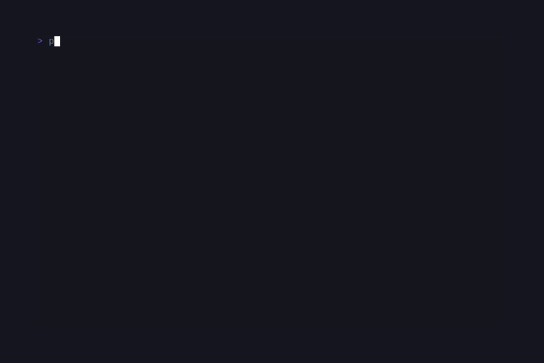
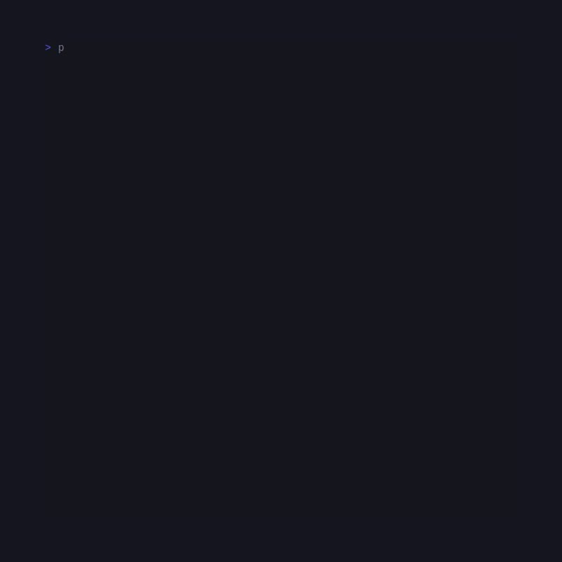

# SugarMarkdown

> Formerly published as `sugarcraft/candy-shine` (renamed 2026-10);
> namespace `SugarCraft\Shine\` → `SugarCraft\Markdown\`.

<!-- BADGES:BEGIN -->
[](https://github.com/detain/sugarcraft/actions/workflows/ci.yml)
[](https://app.codecov.io/gh/detain/sugarcraft?flags%5B0%5D=sugar-markdown)
[](https://packagist.org/packages/sugarcraft/sugar-markdown)
[](LICENSE)
[](https://www.php.net/)
<!-- BADGES:END -->




sugar-markdown — a Markdown → ANSI renderer for PHP 8.3+, built on
`league/commonmark` and sugar-style.

```sh
composer require sugarcraft/sugar-markdown
```

> Every `with*()` builder on the `Renderer` has a short-form method
> alias: `theme` / `sanitize` / `rawControlChars` / `wordWrap` /
> `lineNumbers` / `hyperlinks` / `baseURL` /
> `tableWrap` / `inlineTableLinks` / `tableColumnBudget` /
> `fenceColumnBudget` / `preservedNewLines` / `emoji` / `standardStyle` /
> `styleSheet`. The long-form `with*` names still work — pick whichever
> reads better at the call site. These are builder-method names, not
> constructor spellings: positional construction takes the parameter
> names listed under “API at a glance” below.

## Quickstart

The example below embeds a backtick-fenced code block inside its
Markdown sample, so the snippet itself is fenced with tildes — a
marker different from the inner fence it contains, which is what
makes the nesting legal under CommonMark.

> Note: `render()`'s output deliberately carries no trailing newline — a
> one-chunk document renders through `stream()` to exactly those same bytes.
> The example's `echo` supplies its own `"\n"` as a second operand —
> `echo` itself appends nothing. `write()` and `Writer` follow the
> same law.

~~~php
use SugarCraft\Markdown\Renderer;

echo (new Renderer())->render(<<<MD
# Welcome

A few **bold** and _italic_ words, with `inline code` and a
[link](https://example.com).

- one
- two
- three

```php
echo "hello world";
```
MD), "\n";
~~~

## Themes

Stock presets:

```php
use SugarCraft\Markdown\{Renderer, Theme};

new Renderer(Theme::ansi());        // default colourful
new Renderer(Theme::plain());       // no SGR
new Renderer(Theme::notty());       // alias for plain — non-TTY fallback
new Renderer(Theme::ascii());       // monochrome bold/italic/underline/strikethrough, no colour
new Renderer(Theme::dark());        // dark-bg optimised
new Renderer(Theme::light());       // light-bg optimised
new Renderer(Theme::dracula());     // #282a36 / #ff79c6 palette
new Renderer(Theme::tokyoNight());  // #1a1b26 / #7aa2f7
new Renderer(Theme::pink());        // playful sweet palette
```

A dated divergence to know (2026-11, sugar-markdown-028): glamour's
`NewTermRenderer` defaults to its `dark` style, while `new Renderer()`
with no theme lands on `ansi()`. One-line parity path:
`new Renderer(Theme::dark())`.

Custom JSON theme (`Theme::fromFile($path)` reads the same JSON from a
file, optionally under a byte ceiling; `fromJsonString()` takes it inline):

```php
use SugarCraft\Markdown\{Renderer, Theme};

$theme = Theme::fromJsonString('{"heading1":{"foreground":"#ff5f87","bold":true}}');
echo (new Renderer($theme))->render("# Styled\n");
```

**Two schemas.** The one above is this library's FLAT schema — the flat
reader decodes the listed style slots and leaves the rest (document
margins and indent, affixes, heading prefixes, glyphs) at defaults. A
payload that carries a `document` block follows glamour's `styles.json`
schema and routes through `StyleGuide`, which decodes the full element
(`h1`, `block_quote`, `code_block`, …) and `chroma` token vocabulary.
`StyleGuide`'s whole surface is public — the statics `isGlamourSchema()`
/ `fromFile()` / `fromJsonString()` / `fromDecoded()` and the readers
`element()` / `chroma()` / `indentToken()` / `theme()` — so you can
drive the guide itself, not just the `Theme::fromJsonString()` door.

**Projection.** `theme()` projects sixteen element names (`h1`–`h6`,
`paragraph`, `strong`, `emph`, `codespan`, `code_block`, `link`,
`block_quote`, `list`, `hr`, `strikethrough`), four chroma slots
(keyword, string, number, comment), and the `inline_image` /
`block_image` pair into the alt-text slot — twenty keys in all, two of
them fallback aliases: `heading` feeds every `h1`–`h6` whose own block
is absent, and `blockquote` is an alternate spelling of `block_quote`.
Heading casing carries across too: `"uppercase": true` /
`"lowercase": true` on any `h1`–`h6` block feeds the Theme's
`headingCase` selector, and a document spelling both lands on upper —
a house tie-break, since glamour's own corpora never do. Everything
else stays addressable through `element()` / `chroma()`, nothing is
silently lost.

**Exceptions — lenient keys, strict values.** `Theme::fromFile($path,
?int $maxBytes = null)` throws `RuntimeException` on an unreadable file
or one exceeding the byte ceiling; `Theme::fromJsonString($json)`
throws `InvalidArgumentException` on malformed JSON or a non-object
payload. Inside a well-formed object the reader is lenient about what
it does not understand: unknown keys are ignored, slots the document
omits keep their plain defaults, and a bare colour word matching no
spec (`"crimson"`) yields no colour. But a spec whose shape parses and
whose contents are wrong is refused outright: bad hex (`"#ff5f"`),
non-numeric or out-of-range `ansi:` / `ansi256:` (`"ansi:99"`) all
throw `InvalidArgumentException`.

JSON shape (flat): an object keyed by element name (`heading1`–`heading6`, `paragraph`,
`bold`, `italic`, `code`, `codeBlock`, `link`, `blockquote`,
`listMarker`, `rule`, `keyword`, `string`, `number`, `comment`,
`strike`, `linkText`, `image`, `htmlBlock`, `htmlSpan`,
`definitionTerm`, `definitionDescription`, `text`, `autolink`); each
value carries `foreground` / `background` (hex / `ansi:N` /
`ansi256:N`) plus the SGR flags (`bold`, `italic`, `underline`,
`strike`, `faint`, `blink` — parity-supported, discouraged, see
Accessibility — `reverse`).

## Word-wrap + OSC 8 hyperlinks

Wrapping is **off** unless you call `withWordWrap($cols)` — rendered
lines follow the source (glamour's `NewTermRenderer` defaults to 80;
this port deliberately does not, dated 2026-11: consumers that manage
width downstream would otherwise get double-wrapped).

```php
use SugarCraft\Markdown\{Renderer, Theme};

$renderer = (new Renderer(Theme::dark()))
    ->withWordWrap(80)
    ->withHyperlinks(true);

echo $renderer->render("# Word wrap\n");
```

`withHyperlinks(true)` (default) wraps every `[text](url)` in an OSC-8
hyperlink: the escape is framed `ESC ] 8 ; <params> ; <URI> ESC \` and
this renderer emits it with empty params (`ESC ] 8 ; ; <URI> ESC \`)
before the text, then closes with an empty reset (`ESC ] 8 ; ; ESC \`),
so terminals that support it render real clickable links. The visible
text is `text (url)` in both modes — the toggle adds or removes only
the OSC-8 envelope around it.

### Link safety

Only the OSC-8 envelope is actionable; the `(url)` suffix is plain
text. A refused scheme — `javascript:`, `data:`, `vbscript:` — never
opens an OSC-8 target, so a hostile document cannot execute code
through a click: the link text and its `(url)` suffix still render,
visible and inert. Every other scheme passes the scheme gate
**untouched** — the only universal transformation is the control-byte
strip below — and reaches the terminal's opener as-is: treat non-
`http(s)` / `mailto` targets the way you would treat a raw terminal.
Control bytes (C0, DEL, ESC, BEL) are
stripped from every URL unconditionally, and so are the invisible
formatting characters (soft hyphen, Mongolian vowel separator, zero
width space, word joiner, BOM, right-to-left override) before the
scheme comparison — probes run over the raw, percent-decoded and
HTML-entity-decoded spellings, so a refused scheme split by invisibles
(`java&#8203;script:`) never becomes a target either. A link with an
empty destination renders its text and nothing more — no `()` noise.

`withRawControlChars()` is the loud opt-out of the control-character
sweep: passing `true` (or `withSanitize(false)`, kept as its documented
alias) re-opens the raw ESC / CSI / OSC path for every text byte, so a
code span can carry an OSC-8 bait or a window-title escape straight
through to the terminal — hostile corpora probe exactly this (FUZZ-03).
Use it only for trusted input where control characters are the payload.
Everything else holds regardless of the flag: encoding repair
(malformed UTF-8, stray C1 bytes) runs before parsing unconditionally,
raw HTML blocks and inline HTML stay control-stripped, and URL
stripping is likewise always on. See the fleet-wide trust model in
[docs/TRUST-BOUNDARY.md](https://github.com/detain/sugarcraft/blob/master/docs/TRUST-BOUNDARY.md).

## Accessibility

The posture this library takes, consolidated (each point expands the
region it cross-references):

- **Colour is the first thing to go.** `Theme::fromEnvironment()` lets
  `NO_COLOR` win over every other input, and the stock `plain()` /
  `ascii()` themes drop SGR colour by construction — emphasis in
  `ascii()` survives on bold/italic/underline alone.
- **`auto` trusts `isatty` and nothing else.** It never reads `TERM`,
  so a `TERM=dumb` terminal or a screen-reader pipe sitting behind a
  PTY still receives full SGR from `GLAMOUR_STYLE=auto`. Pin
  `GLAMOUR_STYLE=notty` (or `ascii` when structure-emphasis matters)
  explicitly for those pipelines.
- **Link text stays visible.** The OSC-8 envelope wraps visible
  `text (url)` — a non-clicking terminal loses nothing (Word-wrap +
  OSC 8 hyperlinks). The one exception: `withInlineTableLinks(false)`
  discards table-cell destinations entirely (no `(url)` fallback), so
  avoid it for accessible output.
- **Alt text always renders.** `` keeps `alt`
  unconditionally — the same screen-reader and print fallback posture
  the refused-scheme link text gets via its visible `(url)` suffix
  ("images (alt + url)" under What it renders).
- **Colour-free is not glyph-free.** `plain()` and `notty()` no-op the
  Style slots but still draw the decorative glyphs (▎ ─ ☐ • …);
  screen readers voice them inconsistently, and every glyph is a
  constructor-settable string (the slot roster under Renderer options)
  if you need pure-ASCII output.
- **`blink` is accepted, discouraged.** It lives in the theme-JSON
  flag vocabulary for glamour parity; WCAG 2.2.2 asks you not to ship
  it.

The what-you-can-trust boundary (refused schemes as a deny-list, raw
control characters behind the loud flag) is documented fleet-wide in
[docs/TRUST-BOUNDARY.md](https://github.com/detain/sugarcraft/blob/master/docs/TRUST-BOUNDARY.md).

## Streaming

`Renderer::stream()` consumes Markdown chunk by chunk and yields
styled ANSI as each top-level section is proven complete — so bytes
can reach the terminal while the tail of the document is still
arriving. Chunk boundaries never influence output: for every split of
the same input bytes into string chunks, `implode('', iterator_to_array($renderer->stream($chunks)))`
equals `$renderer->render($bytes)` byte for byte.

```php
use SugarCraft\Markdown\{Renderer, Theme};

$renderer = (new Renderer(Theme::dark()))->withWordWrap(80);
foreach ($renderer->stream(["# Heading\n\n", "body prose\n\n## Next heading\n"]) as $chunk) {
    echo $chunk; // finished sections land as soon as the next heading proves them closed
}
```

A section is proven complete when the next top-level ATX heading
arrives in column one, after a blank line. One edge case: a heading on
the line directly after a closing code fence proves the split with no
blank line at all (the authority is `src/Render/SectionScanner.php`).
And the tail rule: after the final heading the input ending is what
proves the last section — the tail never emits before the stream
finishes. A
section that still holds an unresolved `[label]` pair is held (its
source and first render both kept) and re-rendered only when a later
definition names one of the labels it left unresolved, so
definition-first documents stream correctly at the cost of that hold,
and a definition unrelated to a held section costs it nothing. Seeding
across sections is per-section priced too: a section is seeded only
with the definitions its own bracket spans could look up, so the
document's definition count is not a per-section cost.

`Writer` is the push-side twin: `Writer::toPath($renderer, $path)` or
`Writer::toStream($renderer, $resource)` accept chunks through
`feed()` and write every completed section through the sink
immediately, one flush per section. `close()` renders the final
section and finishes; the writer is single-use and `feed()` after
`close()` throws. Renderers whose theme configures document-scope
post-processing (`documentMargin`, `documentIndent`, block
prefix/suffix) or that run `withPreservedNewLines(true)` buffer the
whole document and emit once at the end — `$renderer->defersStreaming()`
reports which regime applies. `Renderer::writer($sink)`,
`Renderer::renderSection()` and `StreamSink` are the same family's
lower-level parts.

```php
use SugarCraft\Markdown\{Renderer, Writer};

$writer = Writer::toStream(new Renderer(), STDOUT);
$writer->feed("# Live\n\n");
$writer->feed("first section proven\n");
$writer->close();
```

## Resource limits (hostile input)

- Block nesting is capped at `Renderer::MAX_NESTED_BLOCK_DEPTH` (32).
  Past the ceiling a blockquote or list still renders its content, but
  stops adding decoration — no extra bar, no markers, no re-wrap. Quote
  bodies stop re-wrapping below 4 usable cells, and at a 1-cell floor
  text letter-wraps; bytes are never dropped, and output grows linearly
  with the document, never per level.
- Sanitisation is **on** by default (`$sanitize = true` in the
  `Renderer` constructor): it gates the control-character sweep over
  rendered text, code spans, and indented and fenced code. Raw-HTML
  and URL control-stripping run regardless of the flag; see
  Link safety above. The opt-out carries a loud name:
  `withRawControlChars(true)` (alias `withSanitize(false)`).
- Theme files are code. A style/theme JSON drives colours, affixes and
  indent tokens straight into the terminal, so do not auto-load
  workspace-adjacent style files — pin the path from operator config.
  The decoders (`Theme::fromJsonString()`, `StyleGuide::fromJsonString()`)
  sweep every decoded string slot through `Sanitize::untrusted()`, so a
  hostile prefix cannot smuggle a raw OSC/CSI sequence; stock glamour
  `"\n"`-and-space affixes survive byte-identical.
- There is no source-size cap: rendering cost is roughly proportional
  to the input — see the streaming hold-back bound under Streaming,
  above. Only syntax highlighting refuses to try — a fenced body over
  `SyntaxHighlighter`'s `MAX_HIGHLIGHT_BYTES` = 1,000,000 bytes
  (≈ 0.95 MiB) degrades to the plain code-block style instead of
  tokenising. Proportional is not instantaneous though: a 4 MB
  pathologically nested corpus still spends seconds inside the
  league/commonmark parse before any section can be proven, so a
  `cat evil.md | php examples/stdin-stdout.php` pipeline stalls
  silently mid-parse. The caps above bound the output, not the
  intake — put the size guard on hostile stdin yourself.
- Word-wrapping takes a fast path around pathological tokens: a
  whitespace-free run longer than four times the wrap width is packed
  into hard-break rows before the ANSI-aware wrapper sees it, so a
  400 KB base64 blob costs the same as its row count, not a
  per-cluster walk. The output is byte-identical to the plain wrap,
  including runs the fast path declines (tokens carrying escape
  sequences or control bytes).
- The thematic break draws `horizontalRuleLength` cells (default 40)
  while word wrapping is off; once a wrap width is set the rule clamps
  to the current block's available width, so nested breaks never
  overshoot the frame (2026-11, SM-S47). `withTableWrap(true)` wraps each
  cell at the *full* wrap width — pair it with `withTableColumnBudget()`
  to bound the whole table geometry.
- The streaming channel keeps a section that waits on a link-reference
  definition in memory (source plus first render) until the definition
  or the end of input arrives; see Streaming above. A held section
  stores the normalized labels it left unresolved: it is re-rendered
  only when a later definition names one of them, and an unrelated
  definition event just moves a watermark, so a definition costs O(1)
  for every held section it cannot resolve. Only a pair whose `[` and
  `]` sit in different text runs — its raw label contains markup the
  parsed tree no longer shows — keeps the pessimistic bound:
  re-rendered on each later definition event.

## What it renders

- Headings 1-6, paragraphs, `**bold**`, `_italic_`, `~~strike~~`.
- Inline code, fenced code blocks (with regex syntax highlighting for
  PHP / JS / TS / JSON / Python / Go / Bash / SQL / Rust / Java / C / C++ /
  Ruby / YAML / HTML / CSS), indented code.
- Bullet + ordered + nested lists — items always render tight; loose-list
  spacing (blank lines between items) is not honoured, unlike CommonMark and
  glamour — a dated port decision (see the `renderList()` docblock).
- Block quotes (▎-prefixed).
- GFM tables (rounded border, via the sugar-style table renderer
  `SugarCraft\Style\Table\Table`).
- Task lists (`☑` / `☐`).
- Definition lists — emitted as a `term` line followed by a
  flush-left description line; the parser consumes the `:` marker,
  so input indentation is optional.
- Links (with OSC 8 hyperlinks), autolinks, images (alt + url).
- HTML blocks + inline HTML — pass through with theme styling.
- Thematic breaks.

## Authoring a custom theme

A `Theme` is a value object — every slot is a `Style` (or scalar).
Every element slot defaults to a no-op `Style`, so a custom theme from
scratch lists only the slots it actually styles; feed it to
`new Renderer($theme)`:

```php
use SugarCraft\Core\Util\Color;
use SugarCraft\Markdown\{Renderer, Theme};
use SugarCraft\Style\Style;

$theme = new Theme(
    heading1:  Style::new()->bold()->underline()->foreground(Color::hex('#ff5f87')),
    heading2:  Style::new()->bold()->foreground(Color::hex('#ffd700')),
    heading3:  Style::new()->bold()->foreground(Color::ansi(14)),
    heading4:  Style::new()->bold()->foreground(Color::ansi(12)),
    heading5:  Style::new()->bold()->foreground(Color::ansi(13)),
    heading6:  Style::new()->bold()->foreground(Color::ansi(10)),
    paragraph: Style::new(),
    bold:      Style::new()->bold(),
    italic:    Style::new()->italic(),
    code:      Style::new()->foreground(Color::hex('#ffd700')),
    codeBlock: Style::new()->faint(),
    link:      Style::new()->underline()->foreground(Color::ansi(12)),
    blockquote: Style::new()->italic()->foreground(Color::ansi(8)),
    listMarker: Style::new()->foreground(Color::hex('#ff5f87')),
    rule:      Style::new()->foreground(Color::ansi(8)),

    // Element extensions:
    headingPrefix:    '❯ ',
    headingCase:      'upper',
    paragraphPrefix:  '  ',
    documentMargin:   1,
    listLevelIndent:  4,
    taskTickedGlyph:  '✓',
    taskUntickedGlyph:'·',
    horizontalRuleGlyph: '═',
    horizontalRuleLength: 60,
);

echo (new Renderer($theme))->render("# Custom\n");
```

The full slot reference (read the constructor left to right):

| Block | Slots |
|---|---|
| Headings | `heading1` … `heading6` (with `headingPrefix`, `headingSuffix`, `headingCase`) |
| Paragraphs | `paragraph` (+ `paragraphPrefix` / `paragraphSuffix`) |
| Inline | `bold` · `italic` · `strike` · `code` · `link` · `linkText` · `autolink` · `image` · `imageText` · `text` |
| Block | `codeBlock` · `blockquote` · `rule` · `listMarker` · `htmlBlock` · `htmlSpan` |
| Document | `documentMargin` · `documentIndent` · `documentBlockPrefix` / `Suffix` |
| Lists | `orderedListMarker` · `unorderedListMarker` · `orderedListMarkerFormat` · `unorderedListMarkerGlyph` · `listLevelIndent` |
| Task list | `taskTickedGlyph` · `taskUntickedGlyph` |
| Horizontal rule | `horizontalRuleGlyph` · `horizontalRuleLength` |
| Tables | `tableHeader` · `tableCell` · `tableSeparator` · `tableCenterSeparator` · `tableColumnSeparator` · `tableRowSeparator` |
| Definition lists | `definitionTerm` · `definitionDescription` · `definitionList` |
| Syntax highlighting | `keyword` · `string` · `number` · `comment` |

`tableHeader` defaults to `null` = no header styling (set it explicitly
for bold headers). `tableSeparator` is reserved: borders draw their
glyphs from `tableColumnSeparator` / `tableCenterSeparator` /
`tableRowSeparator`, and the style slot is not applied to them yet.

Stock themes (`Theme::ansi()`, `Theme::dark()`, `Theme::dracula()`,
`Theme::tokyoNight()`, `Theme::pink()`, `Theme::light()`, `Theme::ascii()`,
`Theme::notty()`, `Theme::plain()`) are good starting points — swap one
Style slot at a time with `Theme::with(string $slot, Style $style)`
(it returns a copy, throwing `InvalidArgumentException` on a name that
is not a Style slot; the table above is the roster), or pass a full
constructor call as in the example. Scalar decorations such as
`headingPrefix` / `headingCase` stay constructor parameters.

`Theme::fromEnvironment(?$default)` (also `Renderer::fromEnvironment()`)
resolves the theme from the environment without code changes: a
non-empty `NO_COLOR` wins first and returns `plain()`; otherwise
`GLAMOUR_STYLE` names a preset (case-insensitive, hyphen / underscore
tolerant), the literal `auto` picks `dark()` when stdout is a TTY and
`notty()` when it is not, and an unknown name falls back to `$default` (default
`ansi()`). `new Renderer()` keeps its own `ansi()` hard default —
honouring the environment is exactly what this factory is for.
`examples/render.php` prints an extra section when either variable is
set:

```sh
GLAMOUR_STYLE=tokyo-night php examples/render.php
NO_COLOR=1 php examples/render.php
```

User-facing strings route through the shipped i18n surface —
`Lang::t()` (`src/Lang.php`) across the 16 locales in `lang/`; candy-mdview
consumes localized messages such as `theme.read_failed`.

## Renderer options

```php
use SugarCraft\Markdown\{Renderer, Theme};
use SugarCraft\Markdown\Style\StyleSheet;

$renderer = (new Renderer(Theme::dark()))
    ->withWordWrap(80)               // wrap paragraphs / blockquotes / lists
                                     // (headings, code blocks, tables never)
    ->withHyperlinks(true)           // emit OSC 8 link envelopes
    ->withBaseURL('https://docs.example.com/')  // prefix relative links
    ->withTableWrap(true)            // wrap text inside table cells
    ->withInlineTableLinks(false)    // cells drop BOTH (url) + envelope
    ->withTableColumnBudget(true)    // scale table columns into the wrap
    ->withFenceColumnBudget(true)    // clip fenced lines to the wrap
    ->withLineNumbers(true)          // number highlighted fence lines
                                     // (gutter consumes the fence budget)
    ->withPreservedNewLines(true)    // keep source blank-line runs between blocks
    ->withStandardStyle('dracula')   // re-pick the stock theme
    ->withEmoji(true)                // expand `:smile:` shortcodes
    ->withStyleSheet(StyleSheet::base()); // cascade styles per block kind

echo $renderer->render("Hello :wave:\n");
```

`withBaseURL($url)` stores the base with exactly one trailing slash
(added when missing, collapsed when doubled); `withBaseURL(null)` —
or `withBaseURL('')` — disables resolution.

`withInlineTableLinks(false)` is a visual-only knob for OSC-8-capable
terminals: with it off a link inside a table cell loses **both** the
`(url)` suffix and the envelope — the destination disappears from the
rendered bytes entirely. Avoid it for accessible output and for
pipelines whose terminals do not render OSC-8.

With emoji on, expansion runs after parsing — code spans, fenced
blocks and link destinations keep the source bytes. 1,842 codes
resolve: the 1,837-entry GitHub cheat-sheet corpus (`GithubEmoji::MAP`)
merged with 39 curated house codes; the 34 names shared by both sets
resolve to the house glyphs. Unknown `:codes:` pass through verbatim.

`Renderer::renderMarkdown($md, ?Theme)` is a one-shot static
convenience for ad-hoc rendering. For repeated renders with the same
theme, build a Renderer and reuse it (the parser is cached per
instance). A Renderer is not reentrant: each render resets its block
stack, so reuse one instance for sequential renders — never two at
once.

### API at a glance

- Constructors / factories: the full 13-slot signature —
  `new Renderer(?Theme $theme = null, ?int $wrapWidth = null,
  bool $emitHyperlinks = true, ?string $baseUrl = null,
  bool $tableWrap = false, bool $inlineTableLinks = true,
  bool $tableColumnBudget = false, bool $preservedNewLines = false,
  bool $expandEmoji = false, bool $sanitize = true,
  bool $fenceColumnBudget = false, ?StyleSheet $styleSheetOverride = null,
  bool $lineNumbers = false)`;
  plus `Renderer::ansi()`, `Renderer::plain()`, `Renderer::ascii()`,
  `Renderer::fromEnvironment()`, one-shot `Renderer::renderMarkdown($md, ?Theme)`.
- Channels: `render()` (whole string), `stream()` (chunk generator),
  `renderSection()` (per-section — the `parseSection()` /
  `renderParsedSection()` pair behind the streaming family is
  `@internal`), `write()` (render into a stream resource), `writer()`
  / `Writer::toPath()` / `Writer::toStream()` (push side), `StreamSink`
  (the sink both share).
- Readback: `defersStreaming()` tells buffered from streaming regime.
  `Theme::byName()` returns `?Theme` — null on an unknown name, which
  then lands silently on `ansi()` through `new Renderer($theme)`; for
  name-based construction prefer `withStandardStyle()` (throws on
  unknown, naming the `Theme::names()` roster; `Theme::requireName()`
  is the same refusal standalone) or `Theme::fromEnvironment($fallback)`.
  `auto` is not a `byName` slug — it is a `fromEnvironment()` channel,
  so a name lookup never probes the terminal. `Theme::fromFile()`
  and `Theme::fromJsonString()` complete the theme file/inline pair
  (`fromJson()` remains as a deprecated alias),
  and `Theme::mapStyles(callable)` rewrites every `Style` slot through
  one callback — the projection candy-code feeds through its
  `Theme::pair` colour bridge.

## Who uses this (and when not to)

- **In-repo dependents.** candy-mdview renders documents through this
  library's theme files and localized messages (`Lang::t()` keys such
  as `theme.read_failed`); candy-code consumes the `Theme` slots via
  the `mapStyles()` projection above and ships a markdown chat bridge.
- **When not to.** This library renders ANSI for terminals. If you
  want HTML output, use plain `league/commonmark` — the parser this
  library delegates to — directly, and skip the terminal layer.
- **One-stop vs pieces.** `Renderer` is the whole door: parse, style,
  wrap, hyperlink, write. The parts it composes are public if you need
  one alone: `StyleGuide` (glamour schema decoding), `SyntaxHighlighter`
  (tokenising with the plain-style degrade), `StreamSink` / `Writer`
  (the sink and push side of the streaming channels).

## Test

```sh
cd sugar-markdown && vendor/bin/phpunit
```

Inside the monorepo, refresh sibling vendors first (path-linked):
`php scripts/refresh-deps.php --mode=linked` from the repo root. A bare
`composer install` in the standalone split repo resolves siblings from
Packagist instead.

## Demos

### Render


### Themes



## Snapshot tests

Render output is covered by golden-file snapshot tests. Fixture files live
in `tests/fixtures/` with a `.golden` extension and are compared against
actual ANSI byte output via `SugarCraft\Testing\Snapshot\Assertions::assertGoldenAnsi()`.
`UPDATE_GOLDENS=1` is create-only: an existing fixture that differs
still fails and is never rewritten. To re-baseline after intentional
output changes, delete the fixture and re-record it:

```sh
rm tests/fixtures/<name>.golden
UPDATE_GOLDENS=1 vendor/bin/phpunit   # recreates the missing file
```

## Related

- [SugarCraft monorepo](https://github.com/detain/sugarcraft)

## Credits & inspiration

Markdown parsing is delegated to [league/commonmark](https://commonmark.thephpleague.com/);
the rendering layer, themes and ANSI pipeline were originally inspired by
[charmbracelet/glamour](https://github.com/charmbracelet/glamour) and the Go
[Charm](https://github.com/charmbracelet) ecosystem, of which SugarCraft is a
native PHP port.
