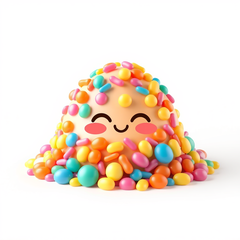
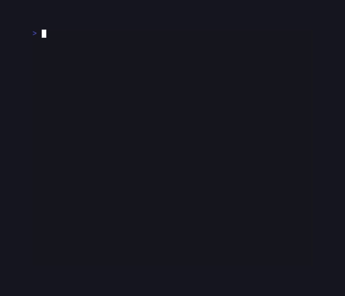
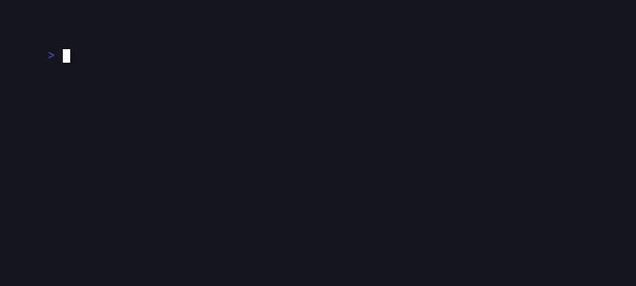
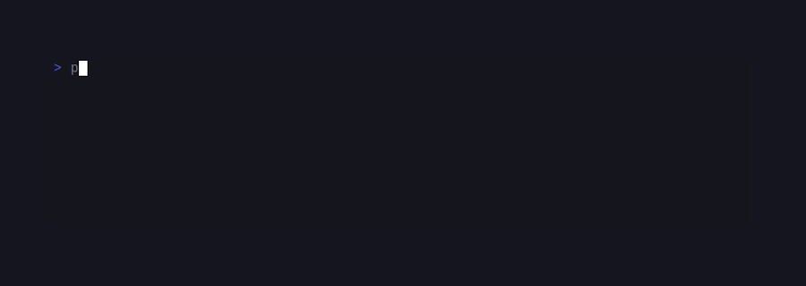
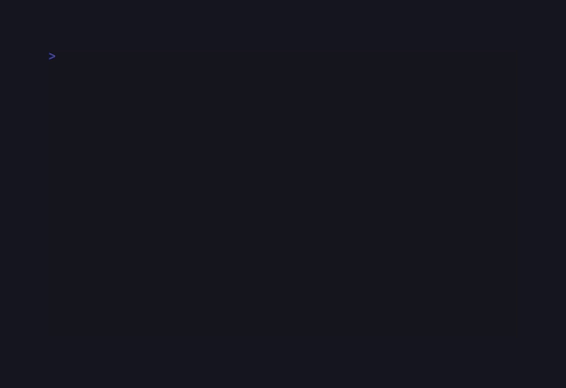
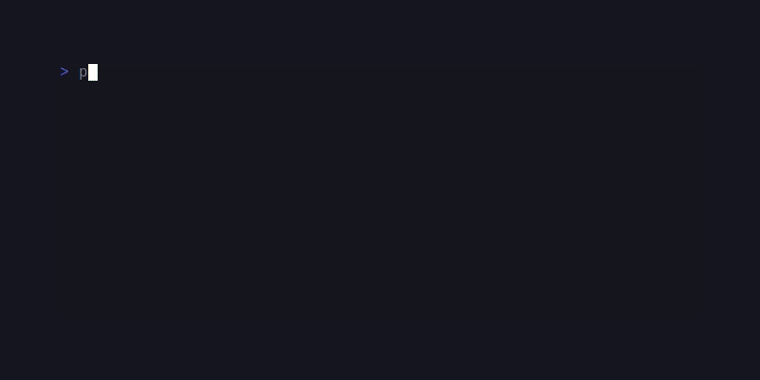
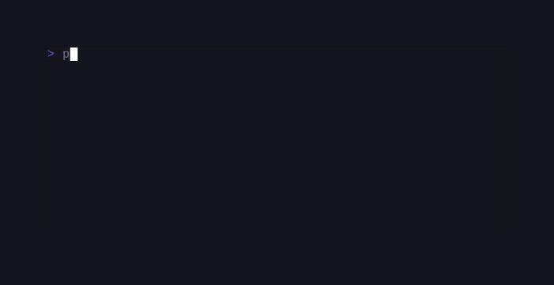
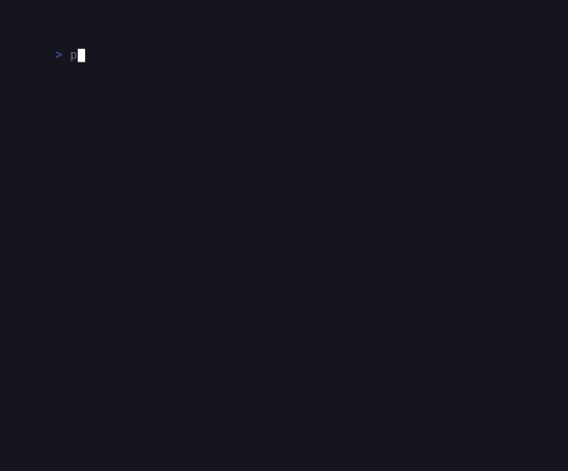

# SugarStyle

> Formerly published as `sugarcraft/candy-sprinkles` (renamed 2026-10). <!-- @rename-keep -->
> Namespace changed: `SugarCraft\Sprinkles\` → `SugarCraft\Style\`. <!-- @rename-keep -->

<!-- BADGES:BEGIN -->
[](https://github.com/detain/sugarcraft/actions/workflows/ci.yml)
[](https://app.codecov.io/gh/detain/sugarcraft?flags%5B0%5D=sugar-style)
[](https://packagist.org/packages/sugarcraft/sugar-style)
[](LICENSE)
[](https://www.php.net/)
<!-- BADGES:END -->


sugar-style — declarative styling and layout for terminal UIs,
for PHP 8.3+.

```sh
composer require sugarcraft/sugar-style
```

## Quickstart

```php
use SugarCraft\Style\Style;

echo Style::new()
    ->bold()
    ->fg('#ff5f87')        // accepts hex string or Color instance
    ->on('#1e1e2e')        // background — reads naturally in chains
    ->pad(0, 2)            // CSS-style 1/2/4-arg padding
    ->of('hello, styled world')
    ->render() . "\n";
```

`fg` / `bg` / `on` / `pad` / `mg` / `of` are short-form ergonomic aliases.
The full-length names (`foreground` / `background` / `padding`
/ `margin` / `setString`) work identically — pick whichever reads better at
the call site:

```php
use SugarCraft\Core\Util\Color;
use SugarCraft\Style\Style;

echo Style::new()
    ->bold()
    ->foreground(Color::hex('#ff5f87'))
    ->background(Color::hex('#1e1e2e'))
    ->padding(0, 2)
    ->setString('hello, styled world')
    ->render() . "\n";
```

## Layout helpers

```php
use SugarCraft\Style\Layout;
use SugarCraft\Style\Position;

$left = 'sidebar';
$right = 'content';
$header = 'top';
$body = 'middle';
$footer = 'bottom';

// Side-by-side
echo Layout::joinHorizontal(Position::TOP, $left, $right);

// Side-by-side with 2-cell gap between blocks
echo Layout::joinHorizontalWithSpacing(Position::TOP, 2, $left, $right);

// Top-down
echo Layout::joinVertical(Position::LEFT, $header, $body, $footer);

// Top-down with 1-line gap between blocks
echo Layout::joinVerticalWithSpacing(Position::LEFT, 1, $header, $body, $footer);

// Place inside a fixed rectangle
echo Layout::place(40, 10, Position::CENTER, Position::CENTER, 'centered text');
```

Only lowercase method names are defined (`joinHorizontal`, `place`, …);
the capitalized spellings inherited from the upstream Go API resolve to the
same functions because PHP method names are case-insensitive.

## Constraint-based layout

The `Layout` sub-namespace provides a ratatui-inspired constraint solver
that partitions a terminal region into rows or columns:

```php
use SugarCraft\Style\Layout\Constraint;
use SugarCraft\Style\Layout\Layout;
use SugarCraft\Style\Layout\Rect;

// Split a 80×24 area into 3 horizontal rows
$rows = Layout::vertical([
    Constraint::length(3),   // header — fixed 3 rows
    Constraint::min(15),     // body   — at least 15 rows, grows with slack
    Constraint::length(1),   // footer — fixed 1 row
])->split(Rect::fromSize(80, 24));

// Further split the body row into 3 columns
$cols = Layout::horizontal([
    Constraint::length(20),     // sidebar — fixed 20 cols
    Constraint::percentage(60), // main    — 60% of the total width
    Constraint::fill(1),        // extra   — absorbs the rest
])->split($rows[1]);
```

Available constraints:

| Constraint | Behaviour |
|---|---|
| `Constraint::length($n)` | Fixed character-cell count |
| `Constraint::min($n)` | At least `$n` cells; takes more if space is available |
| `Constraint::max($n)` | Upper-bound cap; reclaimed space redistributed to other constraints |
| `Constraint::percentage($n)` | `$n`% of the total area (0–100) |
| `Constraint::ratio($num, $denom)` | Proportional size as `$num/$denom` of the area |
| `Constraint::fill($weight)` | Fills all remaining space; weight controls distribution |

Each wrapper exposes its payload through dynamic property reads
(`ReadsConstraintPayload`) — `n` on `length`/`min`/`max`/`percentage`,
`weight` on `fill` — e.g. `Constraint::length(20)->n`. Internally the value
lives in a private constraints-library object and a shared dynamic-read arm
(trait `Layout\ReadsConstraintPayload`, reached through `__get`) forwards the
solver's per-class field reads and carries the ONE unknown-name rejection;
that magic is why reflection-based tooling must not treat the wrappers as
plain property bags. Constraint-layer error strings are hard-coded English
— this sub-namespace is deliberately not routed through `Lang`.

The solver partitions any combination of constraints with a greedy
re-distribution pass (fixed sizes first, then caps, then minimum floors,
then proportional and fill constraints sharing what is left). It is not a
single linear-scan formula: when one constraint is clamped, its reclaimed or
deficit cells are re-spread over the remaining constraints.
See `examples/constraint-dashboard.php` for a full 3-pane dashboard demo.

Each `solve()` call constructs a fresh solver instance (the layout layer is
stateless); the `SUGARCRAFT_LAYOUT_SOLVER` environment decision itself is
read once per process and cached — see “The layout-solver environment
gate” below.

### The layout-solver environment gate

`Solver::solve()` asks `SolverFactory::fromEnvironment()` for a solver, and
the factory reads `SUGARCRAFT_LAYOUT_SOLVER` once per process:

- unset or any value other than `cassowary` → `GreedySolver` (the canonical
  partitioner).
- exactly `cassowary` → `CassowarySolver`, which today **delegates to
  GreedySolver** — sugar-constraints's simplex engine was removed, so the
  opt-in is a deprecated-but-harmless setting that raises an
  `E_USER_DEPRECATED` notice once. Behaviour is identical either way.

The decision (not the instance) is memoized in a static; tests that toggle
the variable mid-process call
`SolverFactory::resetEnvironmentResolutionForTesting()`. `SolverFactory::default()`
is a deprecated alias for `fromEnvironment()`.
`sugar-style`'s factory is the only code in the fleet that reads the
variable; sugar-constraints names it only in `CassowarySolver`'s docblock
(as the legacy opt-in its shim answers to), and no other package consults it.

### Sharing regions across packages (`RegionBridge`)

`sugar-constraints` and `sugar-cellbuffer` each model a screen rectangle,
and `sugar-style` is the lowest package that depends on both. The layout
sub-namespace ships `Layout\RegionBridge` as the converter seam:

```php
use SugarCraft\CellBuffer\Position;
use SugarCraft\CellBuffer\Region as BufferRegion;
use SugarCraft\Constraints\Region as ConstraintsRegion;
use SugarCraft\Style\Layout\RegionBridge;

$constraintsRgn = new ConstraintsRegion(0, 0, 80, 24);
$bufferRegion   = RegionBridge::toBuffer($constraintsRgn);   // Position(0,0), 80×24
$roundTrip      = RegionBridge::toConstraints($bufferRegion); // same rectangle back
```

`toBuffer()` always succeeds. `toConstraints()` throws
`\InvalidArgumentException` when the buffer region carries a negative
origin — the constraints `Region` is non-negative-guarded by design, and
the bridge refuses to paper over that rather than silently clamping.

## Tables

```php
use SugarCraft\Style\Border;
use SugarCraft\Style\Table\Table;
use SugarCraft\Style\Style;

$styled = Table::new()
    ->headers('Name', 'Age')
    ->row('Alice', '30')
    ->row('Bob',   '25')
    ->border(Border::rounded())
    ->styleFunc(static fn(int $row, int $col): Style
        => $row === Table::HEADER_ROW
            ? Style::new()->bold()
            : Style::new())
    ->render();
echo $styled;
```

## Trees & lists

```php
use SugarCraft\Style\Listing\{Enumerator, ItemList};
use SugarCraft\Style\Tree\Tree;

echo ItemList::new()
    ->items(['Apples', 'Bananas', 'Cherries'])
    ->enumerator(Enumerator::roman())
    ->render();

echo Tree::new()
    ->root('Documents')
    ->child(Tree::new()->root('Travel')->child('Italy.md')->child('Japan.md'))
    ->child('Resume.pdf')
    ->render();
```

## Public API

- **`Theme`** — 10 named factories (`dark()` / `light()` / `dracula()` / `tokyoNight()` / `oneDark()` / `githubDark()` / `solarizedDark()` / `solarizedLight()` / `ansi()` / `adaptive()`) and 13 colour slots (`foreground` / `background` / `primary` / `secondary` / `accent` / `muted` / `error` / `warning` / `success` / `info` / `border` / `separator` / `cursor`). `accent`/`muted` default to `primary`/`secondary` in the `dark()`/`light()`/`ansi()` themes, but are set to distinct colour values in the richer named themes (dracula, tokyoNight, oneDark, githubDark, solarizedDark/Light); consumers must NOT assume `$theme->accent === $theme->primary`. Every `with*($color)` setter returns a new `Theme`. `Theme::catalog()` enumerates the factory names as a `list<string>` for programmatic discovery. SSOT for theming across consumer libs.
- **`Style`** — the immutable value object. Style is the fleet's legacy
  builder: its setters are bare-named (`bold()`, `fg()`, `width()`) rather
  than `with*()`-prefixed, yet each returns a **new** `Style` — measured
  2026-10: 72 fluent setters, 0 `with*()` methods, 34 getters (`get*` /
  `is*`), 31 `unset*()`. Re-derive with reflection over non-static public
  methods (return-`self` = setter; `get*`/`is*` = getter; `unset*` =
  unsetter). Every setter and `inherit()` route through one private
  62-positional-parameter `with()` choke. Props covered: fg/bg/border
  colours (incl. per-side), bold/italic/underline/strikethrough/faint/blink/
  rapidBlink/reverse/overline/invisible, padding/margin (1/2/4-arg shorthand
  + per-side) with `paddingChar()`/`marginChar()` fill glyphs, width/height,
  maxWidth/maxHeight, align (Align/VAlign), inline, transform, tabWidth,
  marginBackground, colorWhitespace. Plus `copy()` (shallow clone),
  `inherit($parent)` (unset-only merge), and
  `patch($other)` (incremental merge — only props set in $other are applied;
  a null colour/width/border in $other is skipped, not a clear).
  Bare-named methods exist because PHP cannot overload by arity: the short
  forms (`fg`, `bg`, `pad`, `mg`, `of`) are aliases of the long forms
  (`foreground`, …) — the same rationale upstream lipgloss gives for its
  `GetX` getter family.
- **`Border`** — `normal()`, `rounded()`, `thick()`, `double()`, `block()`,
  `ascii()`, `hidden()`, `markdownBorder()`. `Border::catalog()` enumerates the
  factory names as a `list<string>` for programmatic discovery. Per-side toggles
  via `Style::border*`. Titles via `withTitle()` (laid on the edge) or
  `withEmbeddedTitle()` (btop-style `─┐cpu┌─`); `embedJunctions()` and
  `seam()` answer junction runes — see
  [Embedded border titles + seam junctions](#embedded-border-titles--seam-junctions).
- **`BorderGradientBlend`** — `fromColors(Color ...$colors)` accepts 1–5
  colors and returns a blend whose `sides(): list<Color>` (top / right / bottom /
  left) are interpolated around the perimeter. Apply via
  `Style::borderForegroundBlend()` or the per-side `Style::border*Foreground()`.
- **`AdaptiveColor` / `CompleteColor` / `CompleteAdaptiveColor`** — pick the
  right concrete colour at render time per `ColorProfile` (TrueColor / 256 /
  Ansi) or per dark-vs-light background.
- **`LightDark`** — pick helper for dark-bg vs light-bg colour schemes.
- **`Layout`** (package-level) — `place`, `placeHorizontal`, `placeVertical`,
  `joinHorizontal`, `joinVertical`, `joinHorizontalWithSpacing`,
  `joinVerticalWithSpacing`, `width`, `height`, `size` (all plain-string
  layout primitives from lipgloss). The lowercase spellings are canonical;
  capitalized calls compile identically because PHP resolves method names
  case-insensitively. Note there are **two** `Layout` classes: this
  package-level primitive facade (`SugarCraft\Style\Layout`) and the
  constraint solver in the sub-namespace (`SugarCraft\Style\Layout\Layout`,
  imported as `use SugarCraft\Style\Layout\Layout;`).
- **`Position`** — `TOP / LEFT / CENTER / RIGHT / BOTTOM` floats for layout
  anchors.
- **`Layout`** (sub-namespace) — ratatui-inspired constraint solver:
  `Layout::horizontal($constraints)->split($area)` and
  `Layout::vertical($constraints)->split($area)` return `Rect[]`.
  Constraints: `Constraint::length/min/max/percentage/ratio/fill`.
  State: `Rect` (x, y, width, height) + `Direction` (Horizontal/Vertical).
- **`Listing\ItemList`** + **`Listing\Enumerator`** — bullet, dash, asterisk,
  arabic, alphabet, roman, romanUpper, decimal, none. Nested sublists +
  per-item style hooks.
- **`Tree\Tree`** + **`Tree\Enumerator`** — default / rounded / ascii
  connector sets; per-section style overrides; custom indenter.
- **`Table\Table`** — `headers` / `row(s)` / `border` / `align` /
  `headerAlign` / `rowAlign` / `styleFunc` / per-side border toggles /
  `width` / `offset` / `clearRows` / `data(Data)` / `wrap(\Closure(string $cell,
  int $colWidth): list<string>)` (every returned line renders; a wrapped row
  spans several physical lines).
- **`Table\Data`** — row-reader interface (`rows` / `columns` /
  `at($r, $c)`). Default impl `Table\StringData::fromMatrix(iterable)`.
- **`Output`** — top-level `print` / `println` / `sprint` / `printf` /
  `fprint($stream, …)` (style-agnostic).
- **`Renderer`** — per-writer rendering context: `withColorProfile` /
  `withHasDarkBackground` / `newStyle()` / `lightDark()` /
  `resolveAdaptive(AdaptiveColor)` / `fromEnvironment()`.
- **`Palette`** — the ANSI 16-slot palette as lowercase static factories
  (`Palette::red()`, `Palette::brightWhite()`, … plus a `gray()` alias and
  `Palette::all(): list<Color>`) returning `Color` instances — there are no
  `Palette::Red`-style constants. `Palette::hasDarkBackground(?Color $background)`
  answers `true`/`false` for a *given* background colour and returns `null`
  when you pass `null` (meaning “unknown — don't switch schemes”); it does
  not probe the terminal by itself.
- **`UnderlineStyle`** — enum (None / Single / Double / Curly /
  Dotted / Dashed) for SGR `4:N` sub-style emit.
- **`Hsl`** — CSS-style HSL factory: `Hsl::color($h, $s, $l)` (hue 0-360,
  saturation/lightness 0-100) and `Hsl::parse('hsl(200,80%,50%)')` for
  string input.
- **`Markup`** — Rich-style `[tag]text[/]` parser returning `list<Cell>`.
  Distinct from `StyleParser` (which uses `[text](fg:red,bold)` syntax).
  Supports color names, fg:/bg: shortcuts, and bold/dim/italic/
  underline/reverse/strikethrough.
- **`StyleParser`** — `StyleParser::parse(string)` for the termui-style
  `[text](fg:red,bg:blue,bold)` inline form, returning `list<Cell>`
  (port of sugar-dashboard's inline parser).
- **`Cell`** — one styled grapheme produced by `Markup`/`StyleParser`.
- **`Canvas` / `Layer`** — multi-layer compositor: `Canvas::new()->addLayer(
  Layer::new($block)->withX(...)->withY(...)->withZ(...))->render()`
  composites rectangular styled blocks back-to-front by z-order (see
  `.vhs/canvas.gif`).
- **`Bar\StatusBar` / `Bar\HelpBar`** — one-line chrome widgets: StatusBar
  holds left/center/right `Segment` lists with separator/style/width knobs;
  HelpBar binds key→label pairs (`fromMap`) with key/label styles.
- **`TitleSgr`** — `@internal` border-title alignment enum; not part of the
  public surface.

## Custom Renderer & color-profile

`Style\Renderer` bundles a colour profile + a dark-background
flag so you can branch behaviour without threading the values
through every `Style` call:

```php
use SugarCraft\Core\Util\Color;
use SugarCraft\Core\Util\ColorProfile;
use SugarCraft\Style\Renderer;

$r     = Renderer::new()
    ->withColorProfile(ColorProfile::Ansi256)   // forced 256-colour
    ->withHasDarkBackground(false);              // light terminal
$style = $r->newStyle()->bold()->foreground(Color::hex('#ff5f87'));
$pick  = $r->lightDark();                        // Closure(Color $light, Color $dark): Color
```

Each `Style` owns a `colorProfile()` setter too — the renderer is
just a convenience wrapper. `Renderer::fromEnvironment()` calls
`ColorProfile::detect()` for you (consults `NO_COLOR`,
`CLICOLOR_FORCE`, `TERM_PROGRAM`, etc.).

Output is returned as strings rather than written to a bound writer, so
there is no writer-carrying renderer constructor. Pair with
`Output::fprint($stream, ...)` when you need to write to a
specific stream.

## The ambient default profile — `Style::setDefaultProfile()` (process-global)

`Style::setDefaultProfile($profile)` is a **process-global mutable static**:
it changes the profile that every later `Style::new()` (and each private
`new self()` behind the setters) inherits — fleet-wide, including sugar-code's
TUI renderer and agent status paths, which use it to fold capability
detection into style creation. Pass `null` to restore TrueColor.

```php
use SugarCraft\Core\Util\ColorProfile;
use SugarCraft\Style\Style;

Style::setDefaultProfile(ColorProfile::Ansi256); // everything after is 256-colour
Style::setDefaultProfile(null);                    // back to TrueColor
$was = Style::defaultProfile();                     // read what is in force
```

Because the setting leaks across object boundaries, **tests must save and
restore it** around any change:

```php
use SugarCraft\Core\Util\ColorProfile;
use SugarCraft\Style\Style;

$had = Style::defaultProfile();
Style::setDefaultProfile(ColorProfile::Ascii);
// …assertions…
Style::setDefaultProfile($had); // always, e.g. in tearDown
```

## Color blending utilities

`Util\Color` ships the lipgloss-equivalent helpers:

| Method | Returns |
|---|---|
| `Color::hex('#ff5f87')` | RGB |
| `Color::ansi(13)` | named ANSI slot |
| `Color::ansi256(213)` | xterm-256 |
| `Color::parse('cyan')` / `Color::parse('bright-red')` | lookup by CSS/ANSI name |
| `Color::hsl($h, $s, $l)` | from HSL (0-360, 0-1, 0-1) |
| `$c->blend($other, $t)` | linear LERP, t ∈ [0, 1] |
| `$a->blend1d($b, $steps)` | list of N stops from $a to $b |
| `$tl->blend2d($tr, $bl, $br, $rows, $cols)` | 2D gradient grid |
| `$c->lighten($amount)` / `darken($amount)` | luminance ±amount |
| `$c->alpha($amount, $bg)` | premultiply alpha onto a backdrop |
| `$c->complementary()` | hue + 180° |

Named ANSI slots live on `Style\Palette`: the lowercase factories
`Palette::red()` … `Palette::brightWhite()` (16 slots + a `gray()` alias),
each returning a `Color`. `Palette::hasDarkBackground($bg)` answers
`$bg->isDark()` for a *given* background colour and returns `?bool` — pass
`null` when the terminal's background is unknown and it returns `null`
(“don't switch schemes”); it performs no terminal probing.

## HSL colour factory

`Style\Hsl` provides CSS-style HSL colour construction:

```php
use SugarCraft\Style\Hsl;

// Factory: hue 0-360, saturation 0-100, lightness 0-100
$sky = Hsl::color(200.0, 80.0, 50.0);

// Parse from hsl() string — handles '%' suffixes and whitespace
$teal = Hsl::parse('hsl(174, 70%, 40%)');
$blue = Hsl::parse('hsl(240, 100%, 50%)');
```

## Inline markup parser

`Style\Markup` parses Rich-style `[tag]text[/]` markup into
`Cell` arrays — distinct from `StyleParser`'s `[text](fg:red,bold)`
syntax:

```php
use SugarCraft\Style\{Markup, Style};

$cells = Markup::parse('[bold]hello[/] world', Style::new());
$cells = Markup::parse('[red]error: [bold]oops[/][/]', Style::new());
$cells = Markup::parse('[fg:blue bg:yellow]blue on yellow[/]', Style::new());
```

Supported tags: colour names (black, red, green, yellow, blue,
magenta, cyan, white, bright-\*), bold, dim, italic, underline,
reverse, strikethrough, fg:color, bg:color.

## OSC-8 hyperlinks & underline styles

`Style::hyperlink($url, $id = '')` wraps the rendered output in
OSC 8 escapes — `\x1b]8;;URL\x1b\\` (with the `id=…` parameter segment
inserted only when `$id` is non-empty) and the no-op closing sequence —
so modern terminals turn it into a clickable link, while the rest strip
the sequences and fall through to plain text. URL and id
pass through OSC control-byte stripping, so host-supplied values cannot
inject a second hyperlink.

For underlines, combine `Style::underline()` with
`Style::underlineStyle(UnderlineStyle::Curly)` (the SGR `4:N` sub-style)
and `Style::underlineColor(Color::hex('#ff0000'))` to ask for a wavy red
spell-check-style underline. Truth about the wire: sugar-style emits only
the extended form — **Terminals that understand SGR `4:N` render the
styled underline; terminals that don't typically ignore the extended form
and render no underline at all, since no plain SGR 4 companion is
emitted.** For a guaranteed plain underline, do not set a style: bare
`underline()` alone emits SGR 4.

## Style copy-vs-inheritance

Every `Style` setter returns a new `Style` — the receiver is
never mutated. `Style::copy()` returns a shallow clone for those
moments you want a known checkpoint to branch from.

`Style::inherit($parent)` merges every property the child has not
explicitly set — attribute props (`bold` / `italic` / `underline` /
`strike` / `faint` / `blink` / `reverse`, `fg` / `bg`, `borderFg` /
`borderBg`, …) *and* layout props (`width` / `height` / `padding` /
`margin` / `border` / `borderSides` / alignment). “Explicit wins”: a prop
counts as child-owned only once its setter has been called, tracked via a
per-instance `propsSet` ledger, so an unset child slot takes the parent's
value while a set child slot keeps its own. `unset*()` clears the ledger
slot again, so an un-set prop falls back to the parent on the next
inherit. This matches lipgloss's "explicit wins" inheritance rule.

## Theme — canonical colour palette

`Theme` is the single source of truth for terminal colour schemes
across SugarCraft consumer libs.

```php
use SugarCraft\Core\Util\Color;
use SugarCraft\Style\Theme;

// Pick a built-in theme
$dark = Theme::dark();
$tokyo = Theme::tokyoNight();
$dracula = Theme::dracula();

// Auto-detect from COLORFGBG: the last field's palette slot decides light vs
// dark by luminance (7/15 light, 0/8 dark); unset or unparseable → dark
$theme = Theme::adaptive();

// Enumerate every built-in theme name programmatically
$names = Theme::catalog(); // ['dark', 'light', 'dracula', …, 'adaptive']

// Override one or more colours (all with*() return new Theme)
$custom = $dark->withPrimary(Color::hex('#ff5f87'))
                ->withError(Color::ansi(1));

// Read colours — slots are Color objects (use toHex() to print them)
echo $custom->primary->toHex();      // #ff5f87
echo $custom->foreground->toHex();   // #c5c9d4 — kept from dark()
```

Available factories:

| Method | Palette |
|---|---|
| `Theme::dark()` | Dark, high-contrast |
| `Theme::light()` | Light theme |
| `Theme::dracula()` | Dracula |
| `Theme::tokyoNight()` | Tokyo Night |
| `Theme::oneDark()` | One Dark |
| `Theme::githubDark()` | GitHub Dark |
| `Theme::solarizedDark()` | Solarized Dark |
| `Theme::solarizedLight()` | Solarized Light |
| `Theme::ansi()` | Terminal ANSI 8-colour |
| `Theme::adaptive()` | Auto-detect via `COLORFGBG` env var |

All themes expose 13 colour slots: `foreground`, `background`,
`primary`, `secondary`, `accent`/`muted` (default to primary/secondary in basic
themes; distinct in richer named themes), `error`, `warning`, `success`,
`info`, `border`, `separator`, `cursor`.

## Measurement utilities

`Style\Layout` (the package-level facade) exposes the three measurement
helpers from lipgloss's package level:

- `Layout::width($s)` — visible cell width of a (possibly
  ANSI-coloured, multibyte) string.
- `Layout::height($s)` — number of `\n`-separated lines.
- `Layout::size($s)` — `[width, height]` tuple.

(The capitalized `Width` / `Height` / `Size` spellings resolve to the same
functions — PHP method names are case-insensitive — but only the lowercase
names are declared.)

All three strip ANSI escapes before measuring, honour East-Asian
wide cells, and round the same way `Style::render()` does — so
you can `Layout::Width($style->render('xx'))` to budget a
component's footprint reliably.

## Table StyleFunc + per-section borders

`Table::styleFunc(\Closure(int $row, int $col): Style)` runs once
per cell to pick its style. Row index `Table::HEADER_ROW` (constant
`-1`) identifies the header.

```php
use SugarCraft\Style\Style;
use SugarCraft\Style\Table\Table;

$striped = Table::new()
    ->headers('Name', 'Score')
    ->rows([['Alice', '93'], ['Bob', '87']])
    ->styleFunc(static fn (int $r, int $c): Style =>
        $r === Table::HEADER_ROW
            ? Style::new()->bold()
            : ($r % 2 === 0 ? Style::new()->faint() : Style::new()),
    );
echo $striped->render();
```

The four border-section flags (`borderHeader` / `borderRow` /
`borderColumn` / `borderTop/Right/Bottom/Left`) decide which
separators draw. Defaults: rounded outer + header rule + column
verticals; row separators off.

## Embedded border titles + seam junctions

`Border::withTitle()` lays text straight onto an edge.
`Border::withEmbeddedTitle(string $text, ?TitleAnchor $anchor = null,
?string $open = null, ?string $close = null)` instead brackets it in
junction runes so it reads as cut into the line — btop's box titles and
clock placement are the antecedent design:

```php
use SugarCraft\Style\Border;
use SugarCraft\Style\Border\TitleAnchor;
use SugarCraft\Style\Style;

$border = Border::rounded()
    ->withEmbeddedTitle('cpu')
    ->withEmbeddedTitle('12:00', TitleAnchor::TopCenter)
    ->withEmbeddedTitle('mem', TitleAnchor::BottomLeft)
    ->withEmbeddedTitle('disk', TitleAnchor::BottomLeft);

echo Style::new()->border($border)->width(24)->render('load 0.42');
// ╭─┐cpu┌────┐12:00┌───────╮
// │load 0.42               │
// ╰─┘mem└─┘disk└───────────╯
```

Placement follows btop exactly:

- Left anchors sit one edge rune in from the corner (`╭─┐`); right anchors
  mirror it (`┌─╮`).
- Center anchors open at `floor(run/2) - floor(len/2)` into the full edge
  (btop's clock formula — one cell right of true centre on even/even sizes,
  kept on purpose), falling back to the leftover space only when that would
  overlap a corner title.
- Several embeds on one anchor are glued by one edge rune (`┘mem└─┘disk└`).
- Overflow shrinks the text with a trailing `…`; an embed with no room for
  one text cell plus both junctions is dropped and the edge stays plain.
- An empty `$text` is a no-op; the text is painted verbatim inside the
  edge's title colour, so pass pre-styled text for bold titles.
- `$open` / `$close` override the junctions and must each be exactly one
  cell wide (`\InvalidArgumentException` otherwise).

`Border::embedJunctions(bool $bottom = false): array{string, string}`
returns the default `[open, close]` pair, taken from the border's own
corners with rounded arcs squared off as btop does: `┐┌` / `┘└` for
normal + rounded, `┓┏` / `┛┗` thick, `╗╔` / `╝╚` double, `++` ascii.

`Border::seam(bool $left, bool $right, bool $up, bool $down): string`
answers the rune where lines leave a point in the given directions —
the junction an internal divider makes where it meets the frame (btop's
`div_left ├` / `div_right ┤` / `div_up ┬` / `div_down ┴` law). Every
answer comes from the border's own runes, so the family is preserved:

```php
use SugarCraft\Style\Border;

Border::normal()->seam(left: true, right: true, up: false, down: true); // ┬
Border::thick()->seam(left: false, right: true, up: true, down: true);  // ┣
Border::double()->seam(true, true, true, true);                         // ╬
```

Two-arm turns return the corners as-is (rounded keeps its arcs), a
single arm degrades to the straight edge rune on that axis, and no arms
is a blank cell.

## Graceful colour degradation

A `Style` carries a `ColorProfile` (TrueColor / Ansi256 / Ansi /
Ascii / NoTty). `render()` downsamples every colour to that tier before
emit, matching the degradation a color-profile writer applies:

```
TrueColor  → SGR 38;2;R;G;B  (24-bit)
Ansi256    → SGR 38;5;N      (xterm-256 nearest match)
Ansi       → SGR 30..37 / 90..97  (named slots)
Ascii      → no colour; bold/italic/underline/… and OSC 8 links kept
NoTty      → no escape sequence at all (clean text, layout kept)
```

`Ascii` (what `NO_COLOR` selects) forbids colour, not emphasis, so text
attributes and hyperlinks survive. `NoTty` means the output is not a
terminal: the whole render — including
escapes carried in by pre-styled content, a `transform()` callback or a
border title — is stripped, while padding, borders and alignment stay.

One measured exception to "underline colour tints the underline": SGR `58`
has no 4-bit palette spelling, so at the `Ansi` tier `underlineColor()`
falls back to the *foreground* slot and recolours the glyphs —
`Style::new()->colorProfile(ColorProfile::Ansi)->underline()->underlineColor(Color::hex('#ff0000'))->of('x')->render()`
emits `ESC[4m ESC[91m x ESC[0m` (bright-red text, plain underline). At
TrueColor/Ansi256 the `58;2;…`/`58;5;…` underline colour is emitted as
documented and the text keeps its own colour.

Use `Style::colorProfile(ColorProfile::Ansi)` for a forced
downgrade or `Renderer::fromEnvironment()` to auto-detect from
`NO_COLOR` / `CLICOLOR_FORCE` / `TERM` / `COLORTERM` /
`TERM_PROGRAM` / `WT_SESSION` / CI markers.

## Accessibility

Colour alone must never carry meaning (WCAG 1.4.1): pair colour-coded
state with text, an icon+label, or structure. For constrained displays
this library offers honest degradation paths — `Theme::ansi()` and
`ColorProfile::Ascii` (`NO_COLOR`) drop the palette but keep text
attributes, and OSC 8 hyperlinks survive both, so emphasis- and
link-based affordances still read. `ColorProfile::NoTty` strips every
escape yet preserves padding, borders and alignment, so a piped capture
keeps the document's visual structure. Border *styles* (rounded vs
double vs thick) are decorative: never encode a state distinction in the
border family alone — combine it with a title or colour slot. Adaptive
colours (`AdaptiveColor` / `Theme::adaptive()`) track dark-vs-light
terminals so foreground/background contrast doesn't silently invert on
scheme change.

## Performance — build once, render many

A `Style` instance is a value, and building one is the expensive half of
the pipeline: `Style::new()->border(Border::rounded())->padding(1, 2)`
costs roughly **twice** what `render()`ing a pre-built style costs
(measured on a dev box 2026-10: ~16.5 µs/op to rebuild per frame vs
~8.4 µs/op to `of()`+`render()` a reused instance, and reused instances
additionally benefit from the internal `render()` memo — see the class
docblock). Re-layout-per-frame TUIs should construct each style once at
setup (or keep a small keyed cache) and call `render()` per frame, not
rebuild the chain each time. `copy()` carries a still-valid memo; every
setter and `inherit()` correctly resets it, so only the repeated-render
path pays off.

On the layout side, `Solver::solve()` intentionally constructs a fresh
solver per call (the layout layer is stateless) — what the process-level
memoization removes is the `getenv()` decision, not the allocation
(measured: `SolverFactory::fromEnvironment()` ~350 ns/op after, ~470
ns/op with a per-call `getenv()`, dev box 2026-10).

## Accessor era (2026-10-24)

The fleet-wide bare-accessor sweep landed two renames in sugar-style —
reads whose bare names were free, each keeping a one-line deprecated
forwarder marked `REMOVED-IN: 2.0.0`:

- the static ambient read `getDefaultProfile()` → `defaultProfile()`
  (the `setDefaultProfile()` write keeps its name; no bare slot collided)
- `Style::borderSides()` joins the bare family; `getBorderSides()` is its
  deprecated alias.

`Border::getTitles()` already delegated to the bare `titles()` accessor
before this era and stays as found. The remaining **31 accessors are
owner-pending**: for each one the bare twin (think `foreground()`,
`width()`, `caps()`) is a live fluent setter, and PHP admits one method
per name — renaming either side is a vocabulary ruling, not a mechanical
sweep. The blocked Bar getters carry an in-source NOTE, `Style.php`
frames the family in its NAMING EXCEPTION paragraph, and the full roster
with per-method evidence lives in `tests/BareAccessorEraTest.php`.
Existing callers keep compiling through the deprecated aliases.

## Test

```sh
cd sugar-style && composer install && vendor/bin/phpunit
```

Suite at the 2026-10-24 accessor-era close: 966 tests, 3,275 assertions, 0
failures (cited figure is a point-in-time measurement, not a live-pinned
number).

## Demos

### Border styles



### Canvas (multi-layer compositor)



### Layout dashboard


### Constraint-based layout dashboard



### List



### Style



### Table



### Tree



## Credits & inspiration

Originally inspired by the Go [Charm](https://github.com/charmbracelet) ecosystem; SugarCraft is developed as a native PHP project.
