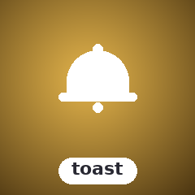

<!-- BADGES:BEGIN -->
[](https://github.com/detain/sugarcraft/actions/workflows/ci.yml)
[](https://app.codecov.io/gh/detain/sugarcraft?flags%5B0%5D=sugar-toast)
[](https://packagist.org/packages/sugarcraft/sugar-toast)
[](LICENSE)
[](https://www.php.net/)
<!-- BADGES:END -->

# SugarToast


sugar-toast — a floating alert notification component for terminal UIs, for PHP 8.3+. Alerts float to the top of your TUI like bubbles in soda.

## Features

- **9 positions**: TopLeft, TopCenter, TopRight, MiddleLeft, MiddleCenter, MiddleRight, BottomLeft, BottomCenter, BottomRight
- **4 alert types**: Error, Warning, Info, Success — each with distinct styling
- **Dynamic width**: fixed or auto-sizing between minWidth and maxWidth
- **Symbol sets**: NerdFont (icons), Unicode (symbols), Ascii (plain text)
- **Auto-dismiss**: duration-based expiry support
- **Multiple alerts**: queue of toasts rendered in order
- **Progress toasts**: inline progress bar (0–100%) beneath the message body
- **Action buttons**: `[Label]` buttons attached to an alert with closure callbacks
- **Styled alerts**: per-alert background/foreground/border colour overrides
- **History log**: immutable, bounded record of dismissed alerts (default cap 100)
- **Pure renderer**: outputs ANSI strings; works with any TUI framework

## Install


```bash
composer require sugarcraft/sugar-toast
```

## Quick Start


```php
use SugarCraft\Toast\{Position, Toast, ToastType};

$toast = Toast::new(50)  // max width 50
    ->withPosition(Position::TopRight)
    ->withDuration(10.0);  // seconds

// Add alerts
$toast = $toast->alert(ToastType::Success, 'File saved!');
$toast = $toast->alert(ToastType::Error, 'Connection failed');

// Render into a viewport
$bg = str_repeat("background content\n", 20);
echo $toast->view($bg);
```

## Alert Types


```php
ToastType::Error
ToastType::Warning
ToastType::Info
ToastType::Success
```

Each type also provides a localized label via `ToastType::label()` (e.g.
`ToastType::Success->label()` → `"Success"` in English).

`alert()` accepts either a `ToastType` enum case or a lowercase string
(`"error"`, `"warning"`, `"info"`, `"success"`). Passing an unknown string
throws `InvalidArgumentException`.

## Positions


```php
Position::TopLeft
Position::TopCenter
Position::TopRight
Position::MiddleLeft
Position::MiddleCenter
Position::MiddleRight
Position::BottomLeft
Position::BottomCenter
Position::BottomRight
```

## Overflow & Concurrency


```php
Overflow::DropOldest  // remove oldest alert to make room (default)
Overflow::DropNewest  // discard the new alert instead of enqueueing
Overflow::Enqueue     // allow queue to exceed maxConcurrent
```

Control the maximum number of concurrent alerts with `withMaxConcurrent(int|null)`:

- Pass an integer to cap the queue size
- Pass `null` for unlimited (default) — expired alerts still leave the queue on
  the next write, but persistent (non-expiring) alerts accumulate until the
  host calls `clear()` or `dismiss()`


When the cap is reached, the configured `Overflow` strategy determines behaviour.

## Persistent Alerts


By default, alerts inherit `withDuration()` for auto-dismiss timing. A `null`
`$expiresAt` means "use the default", not "never expire" — to get a persistent
alert that never expires automatically, keep the toast's duration unset (the
default, or `withDuration(null)`) so queued alerts inherit nothing:

```php
$toast = Toast::new(50)->withPosition(Position::TopRight);  // no duration set
$toast = $toast->alert(ToastType::Info, 'Connected');       // never expires

// Per-alert escape hatch from an inherited expiry:
$alert = (new Alert(ToastType::Info, 'Connected'))->withoutExpiry();
$toast = $toast->push($alert);
```

Persistent alerts never expire, so `pruneExpired()` cannot remove them — take
them down with `dismiss()` (moves live alerts into the history log and stops
rendering until you `clear()`) or `clear()` (drops the queue without
recording). While dismissed, `alert()` throws; call `clear()` first.

## Loop integration


Expired alerts leave the queue on every write (`alert()`/`progressToast()`/
`push()`), and `pruneExpired()` removes them explicitly — but a quiet queue with
no incoming writes still needs something to *call* it. Rather than poll on a
fixed interval, ask the toast when the next prune is due and
schedule a single timer for exactly that moment:

```php
$delay = $toast->secondsUntilNextExpiry();   // seconds until the soonest expiry, or null
if ($delay !== null) {
    // e.g. in a sugar-core app:
    $cmd = Cmd::tick($delay, fn () => new ToastTickMsg());
}

// when the tick fires:
$toast = $toast->pruneExpired();
if ($toast->hasActiveAlert()) {
    // reschedule for the next expiry, repeat
}
```

- **`nextExpiry(): ?float`** — the soonest expiry instant (seconds since epoch)


  among queued alerts that auto-dismiss, or `null` if none expire. May be in the
  past when an alert is already due.

- **`secondsUntilNextExpiry(): ?float`** — the same as a delay from now, clamped


  to `>= 0.0` (an already-due alert yields `0.0`), or `null` if nothing expires.

## Internationalization


User-facing strings are internationalized via `SugarCraft\Toast\Lang::t()`.
All translatable strings live in `lang/en.php` under the `'toast'` namespace.

**Available keys** (`lang/en.php`):

| Key              | Default string                    | Parameters   |
|------------------|-----------------------------------|--------------|
| `type.info`       | `Info`                            | —            |
| `type.warning`    | `Warning`                         | —            |
| `type.error`      | `Error`                           | —            |
| `type.success`    | `Success`                         | —            |
| `dismiss`        | `Press any key to dismiss`        | —            |
| `count`           | `{count} notification(s)`         | `{count}`    |

> **Note:** The `dismiss` and `count` keys are provided as convenience strings
> for host-rendered dismiss-hint and counter UI. They are **not** emitted or
> rendered by `view()` itself — the library outputs only the alert overlay.

To add a locale, copy `lang/en.php` to `lang/<code>.php` and translate the
values. The lookup chain follows `SugarCraft\Core\I18n\T`:
exact locale → base language → `en` → raw key.

**Using the facade:**

```php
use SugarCraft\Toast\Lang;
use SugarCraft\Toast\ToastType;

$label = ToastType::Error->label();        // 'Error' (i18n-aware)
$prompt = Lang::t('dismiss');            // 'Press any key to dismiss'
$counter = Lang::t('count', ['count' => 3]); // '3 notification(s)'
```

**Adding new translatable strings:**

```php
// In any source file:
use SugarCraft\Toast\Lang;

// Simple key:
$msg = Lang::t('dismiss');

// With placeholder:
$counter = Lang::t('count', ['count' => $n]);
```

## Progress Toasts


Add a progress bar beneath the message body using `progressToast()`:

```php
$toast = $toast->progressToast(ToastType::Info, 'Downloading...', 0.65);
// Re-render as progress updates:
$toast = $toast->progressToast(ToastType::Info, 'Downloading...', 0.80);
```

`progressToast()` accepts the same `$expiresAt` override as `alert()`. The
progress value (0.0–1.0) is clamped automatically.

## Action Buttons


Attach clickable buttons to an alert. Either build an `Alert` and enqueue it
with `push()`, or pass `actions:` to `alert()` directly:

```php
use SugarCraft\Toast\{Action, Alert, Toast, ToastType};

$action = Action::new('Retry', function (): void {
    // reconnect logic here
});

$alert = (new Alert(ToastType::Error, 'Connection lost'))
    ->withActions([$action]);
$toast  = $toast->push($alert);

// Equivalent shorthand:
$toast = $toast->alert(ToastType::Error, 'Connection lost', actions: [$action]);
```

The library renders the `[Label]` buttons; dispatching them is the host's job.
`Action` is a value object with `readonly string $label` and
`readonly \Closure(): void $callback`. When the action is triggered, invoke
`$action->callback()` directly in your key/mouse handler.

## Styled Alerts

Each alert accepts explicit background, foreground, and border colours,
falling back to the type's default palette when unset (`null`):

```php
use SugarCraft\Core\Util\Color;
use SugarCraft\Toast\{Alert, Toast, ToastType};

$alert = (new Alert(ToastType::Success, 'Deployed'))
    ->withBackgroundColor(Color::hex('#1a2f23'))
    ->withForegroundColor(Color::hex('#9ece6a'))
    ->withBorderColor(Color::hex('#9ece6a'));

$toast = $toast->push($alert);
```

## History Log


`Toast` maintains an immutable history of every dismissed alert via
`HistoryLog`:

```php
// Dismiss live alerts: they move into the history log and rendering stops
// until clear()
$toast = $toast->dismiss();

// Retrieve the log
$history = $toast->history();  // list<Alert>

foreach ($history as $alert) {
    echo $alert->type->label() . ': ' . $alert->message . "\n";
}
```

`HistoryLog` is immutable — `dismiss()` returns a new `Toast` with an
updated log; prior instances are unchanged. The log is capped at 100 entries
by default, oldest-first eviction; `withHistoryLimit(?int)` adjusts it
(`null` = unbounded).

## API Summary


| Method | Description |
|--------|-------------|
| `Toast::new(int $maxWidth = 50)` | Factory |
| `->withPosition(Position)` | Screen position (9 positions) |
| `->withDuration(?float $seconds)` | Auto-dismiss after N seconds; `null` disables |
| `->withMaxWidth(int)` | Maximum alert width in cells |
| `->withMinWidth(int)` | Minimum alert width in cells |
| `->withSymbolSet(SymbolSet)` | NerdFont, Unicode, or Ascii symbols |
| `->withAllowEscToClose(bool)` | Preference flag the host reads to decide if Escape dismisses (the renderer does not handle input) |
| `->withMaxConcurrent(?int $n)` | Cap concurrent alerts (`null` = unlimited) |
| `->withOverflow(Overflow)` | Strategy when cap exceeded: DropOldest, DropNewest, Enqueue |
| `->withHistoryLimit(?int $n)` | Cap history log, oldest evicted first (default 100; `null` = unbounded) |
| `->alert(ToastType\|string, string, ?float $expiresAt = null, ?array $actions = null)` | Add alert (string type = case-insensitive; `null` expiry inherits `withDuration()`) |
| `->progressToast(ToastType\|string, string, float $progress, ?float $expiresAt = null, ?array $actions = null)` | Add alert with progress bar (0.0–1.0) |
| `->push(Alert $alert): self` | Enqueue a pre-built `Alert` (styled/actioned) |
| `->cancelAlert(int $index): self` | Make a queued alert persistent (never auto-dismisses) |
| `->extendAlert(int $index, float $additionalSeconds): self` | Push one alert's expiry later |
| `->extendAll(float $additionalSeconds): self` | Push every expiring alert's expiry later |
| `->allowEscToClose(): bool` | Read the Escape-dismiss preference flag (host consumes it; the renderer handles no input) |
| `->error/warning/info/success(string)` | Convenience alert helpers |
| `->hasActiveAlert(): bool` | True if non-expired alerts queued |
| `->nextExpiry(): ?float` | Soonest expiry instant (epoch seconds) of an auto-dismissing alert, or `null` |
| `->secondsUntilNextExpiry(): ?float` | Delay until the next expiry, clamped `>= 0.0`, or `null` — schedule one prune tick |
| `->dismiss() / clear() / pruneExpired()` | Lifecycle: `dismiss()` moves live alerts to history (rendering stops until `clear()`, which also resets the flag) |
| `->history(): list<Alert>` | Return all dismissed alerts |
| `->view(string $background, int $w, int $h): string` | Render toast layer over background (the legacy `View()` call sites keep resolving via PHP's case-insensitive method dispatch — there is no alias method) |

| Class | Method | Description |
|-------|--------|-------------|
| `Alert` | `withProgress(float)` | Attach progress bar (0.0–1.0, clamped) |
| `Alert` | `withActions(list<Action>)` | Attach action buttons |
| `Alert` | `isExpired(): bool` | Check expiry |
| `Alert` | `withExpiry(float $duration)` | Set expiry from now |
| `Alert` | `withoutExpiry()` | Make this alert persistent (never auto-dismisses) |
| `Alert` | `withCancelledExpiry()` | Clear the expiry (used by `Toast::cancelAlert()`) |
| `Alert` | `withExtendedExpiry(float)` | Move the expiry later by N seconds |
| `Alert` | `withBackgroundColor(?Color)` | Override box background (`null` = type default) |
| `Alert` | `withForegroundColor(?Color)` | Override text colour (`null` = type default) |
| `Alert` | `withBorderColor(?Color)` | Override border colour (`null` = type default) |
| `Action` | `new(string $label, \Closure(): void $callback)` | Factory |
| `Action` | `->label: non-empty-string` | Button label (readonly) |
| `Action` | `->callback: \Closure(): void` | Callback (readonly) |
| `HistoryLog` | `push(Alert, ?int $limit = null): self` | Append alert, evicting oldest past `$limit`; new log |
| `HistoryLog` | `all(): list<Alert>` | Return all entries |
| `HistoryLog` | `count(): int` | Entry count |

| Enum | Cases |
|-------|-------|
| `Position` | TopLeft, TopCenter, TopRight, MiddleLeft, MiddleCenter, MiddleRight, BottomLeft, BottomCenter, BottomRight |
| `ToastType` | Error, Warning, Info, Success |
| `Overflow` | DropOldest, DropNewest, Enqueue |
| `SymbolSet` | NerdFont, Unicode, Ascii |

## Shared foundations

- **[sugar-cellbuffer](https://github.com/sugarcraft/sugar-cellbuffer)** — alert queue


  composited via `Buffer`; each toast is a sub-`Buffer` composited into the
  screen `Buffer` for per-cell positioning and overlap resolution.

- **[sugar-testing](https://github.com/sugarcraft/sugar-testing)** — golden-file


  snapshot tests via `assertGoldenAnsi()` pin canonical queue layouts.

## Security & trust boundary

Toast content is app-supplied — and in a TUI the terminal is a sink. `view()`
renders alert text through the sugar-cellbuffer grid and re-encodes it, so the
output stream contains only the SGR sequences the renderer itself emits:

- **Control bytes can't escape**: raw ESC payloads, OSC hyperlinks (`\e]8;;…\e\\`)
  and BEL in a message are never forwarded — the output carries no OSC, no BEL,
  and no escape sequence the library did not build from a parsed style. A
  forged `\e[2J` inside a message survives only as styled cells.
- **Inline SGR in a message is honoured as styling** (bold/colour etc. are
  re-encoded through the grid). Treat that as a feature boundary: if the text
  is attacker-authored, sanitise before enqueueing —
  `SugarCraft\Core\Util\Sanitize::untrusted()` (or `untrustedForDisplay()`)
  strips the markup you do not want interpreted.
- **PUA zone sentinels are ordinary printable text here**: the U+E000/U+E001
  markers that sugar-mouse overlay plumbing uses pass through the grid like any
  other glyph — a message containing forged markers WILL carry them into the
  composed frame. Hosts that parse zone markers from rendered output must run
  `Sanitize::untrustedForMarkedFrames()` on attacker-authored text BEFORE
  enqueueing it.

The full fleet-wide contract lives in
[`docs/TRUST-BOUNDARY.md`](../docs/TRUST-BOUNDARY.md)
— §1 "the terminal is a sink".

## License


MIT

## Credits & inspiration

Design antecedent: [DaltonSW/bubbleup](https://github.com/daltonsw/bubbleup); SugarCraft is developed as a native PHP project.
