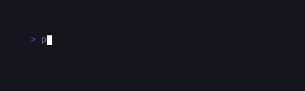
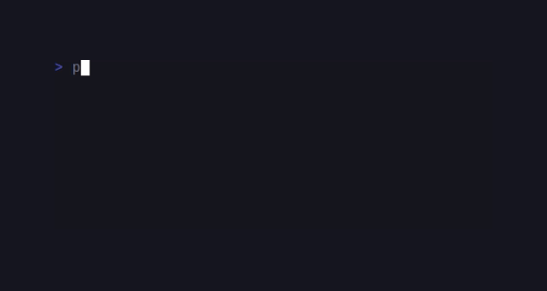
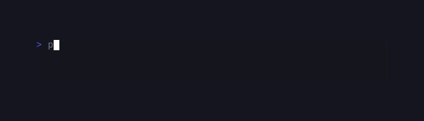
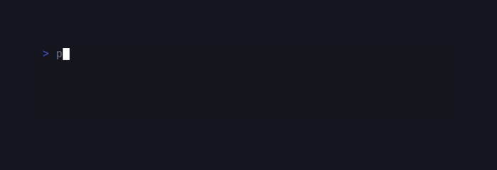
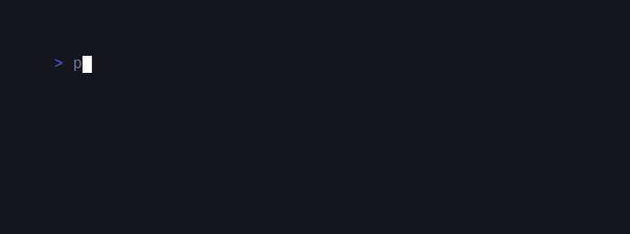
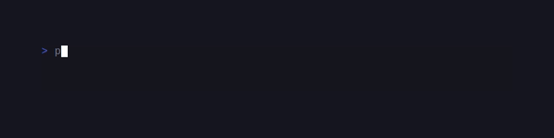
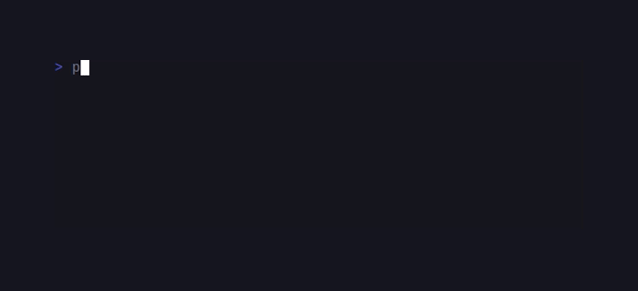

# SugarWidgets

> Formerly published as `sugarcraft/sugar-bits` (renamed 2026-10). <!-- @rename-keep -->
> Namespace changed: `SugarCraft\Bits\` → `SugarCraft\Widgets\`. <!-- @rename-keep -->

<!-- BADGES:BEGIN -->
[](https://github.com/detain/sugarcraft/actions/workflows/ci.yml)
[](https://app.codecov.io/gh/detain/sugarcraft?flags%5B0%5D=sugar-widgets)
[](https://packagist.org/packages/sugarcraft/sugar-widgets)
[](LICENSE)
[](https://www.php.net/)
<!-- BADGES:END -->




sugar-widgets — TUI components for PHP 8.3+: 9 first-party components (Table, Tabs, Tree, Progress, Paginator, Help, Key, Timer, Stopwatch), 8 deprecated alias re-exports from `sugarcraft/sugar-forms` (TextInput, TextArea, Viewport, Cursor, ItemList, FilePicker, Scrollbar, Spinner), and two btop-derived render helpers (`Input\TextEdit`, `Menu\OptionRow`) — including the interactive `Tree` and per-cell `Table::styleFunc(...)`.

```sh
composer require sugarcraft/sugar-widgets
```

Requires PHP ≥ 8.3. Nothing beyond PHP itself is required (mbstring is
bundled with PHP). When you depend on this package standalone, its `sugarcraft/*`
siblings resolve from Packagist.

> The canonical setter vocabulary is `with*()` everywhere. The Bubbles
> short forms still forward, one line each, and every one is dated for
> removal at **2.0**: `Help` — `styles()` / `separator()` / `ellipsis()` /
> `fullSeparator()` / `showAll()` / `width()`; `TextInput` —
> `placeholder` / `prompt` / `charLimit` / `width` / `echoMode` /
> `echoChar` / `suggest` / `validator` / `styles` / `prefix` / `suffix` /
> `placeholderStyle`; `TextArea` — `placeholder` / `charLimit` / `width` /
> `height` / `prompt` / `validator` (the `TextInput`/`TextArea` short
> forms live in canonical `sugar-forms` — their deprecation cadence is
> ruled there, not here). New code: `withShowAll()` / `withWidth()` etc.
> Likewise `Table`'s `set*` verbs — `setColumns()` / `setCursor()` /
> `setRows()` / `setHeaders()` / `setSize()` — are dated BC aliases (they
> always returned new instances; the `with*()` spellings are canonical),
> and `Progress`, `Help` and `Tabs` have PRIVATE constructors: `::new()`
> is the only door, and a direct `new Progress(...)` fails with PHP's
> "Call to private ...::__construct()" Error. The `set*` removal: **2.0**.

> `Help::getStyles()` and `Help::getWidth()` are deprecated BC accessors —
> the house convention is bare accessors, and the property names are the
> readers: the promoted readonly `styles` / `maxWidth`. Removal at 2.0.

## Components

The table below lists the first-party components — Help, Key, Progress
(includes the AnimatedProgress spring-variant), Timer, Stopwatch,
Paginator, Tree, Table, Tabs — plus the two btop-derived render helpers,
`Input\TextEdit` and `Menu\OptionRow`, followed by the deprecated alias
re-exports from `sugarcraft/sugar-forms` (the alias rows name their origin explicitly).
The counted inventory lives once, in the intro at the top of this file.

| Component | What it does | Notable messages |
|---|---|---|
| `Cursor\Cursor` | Animated text cursor _(deprecated alias — re-exported from `SugarCraft\Forms\Cursor`)_ | `BlinkMsg` |
| `Help\Help` | Render short / full key-help footer from a `KeyMap`; `Help::updateWithBinding($msg, $toggle)` flips show-all in response to a key. `Help::new(...)` is the house factory (all eight styling params optional; the constructor is private); gap knobs via `withKeyDescGap()` / `withColumnGap()` / `withWidth()`; `withShowDisabled()` pins greyed-out bindings into the footer so a host can document commands that exist but are inactive (off by default; a disabled toggle never flips show-all) | — |
| `Key\Binding` | One key list + label + help row: readonly `keys`/`help`/`disabled`, `matches()` / static `any()` for dispatch, `withHelp()`, `disable()`/`withEnabled()` (the `setKeys()`/`setHelp()`/`setEnabled()` spellings are dated BC aliases), `unbind()`; factories `Binding::new(...)`, `Binding::withDisabled(...)` | — |
| `Key\KeyMap` | Interface — implement it so `Help` can render your bindings: `shortHelp(): list<Binding>` for the inline row, `fullHelp(): list<list<Binding>>` for the expanded pane (one inner list per column); `Tabs\TabsKeyMap` is the shipped example. Naming, spelled out: three things answer to *KeyMap* in this ecosystem — **this** help-collection contract (`SugarCraft\Widgets\Key\KeyMap`), the sugar-forms submit/abort chords class (`SugarCraft\Forms\...KeyMap`, a different shape entirely), and `Tabs\TabsKeyMap`, which merely *implements* this interface. Likewise two types are called *Help*: the `Key\Help` `{key, desc}` label value object bindings render through, and the `Help\Help` footer component. In a file that needs both, alias one at import: `use SugarCraft\Widgets\Help\Help as HelpFooter;` (or `…Key\Help as HelpLabel`) | — |
| `Spinner\Spinner` | Animated loading glyph — 12 built-in styles _(deprecated alias — re-exported from `SugarCraft\Forms\Spinner`)_ | `Spinner\TickMsg` |
| `Progress\Progress` | Static progress bar (gradient fill optional, `withColors(...)` / `withColorFunc(...)` / `withShowValue(...)`; render modes via `withRenderMode(ProgressRenderMode)` — `Block` / `Line` / `Slim`, see *Render-mode feature matrix* below — and custom percent copy via `withPercentFormat(string)`) | — |
| `Progress\AnimatedProgress` | Spring-physics-animated progress bar (powered by `sugarcraft/sugar-spring`); reduced motion is honoured BY THE ENGINE — every `Spring` consults `Probe::reducedMotion()` (`sugar-colorprofile`; any value outside `''`/`0`/`false`/`no`/`off`) and snaps to target, a per-spring override always winning — not by widget code | `SpringTickMsg` |
| `Timer\Timer` | Countdown timer — `Timer::new($duration, $interval = 1.0)` (duration is required); `remaining` / `interval` are promoted readonly properties, the methods are `interval(): float`, `timeout(): float` (remaining seconds — `0` once `TimeoutMsg` has fired) and `withInterval(float)`; there is no `remaining()` method. When not running, `view()` appends a dim state tag (`paused`, or `timeout` once `TimeoutMsg` has fired) so the state is visible in the frame — running bytes are byte-identical; hosts style it themselves from the plain-text `stateLabel()`. In-flight ticks from stopped generations are refused via the tick `epoch` | `Timer\TimerTick` (deprecated alias `TickMsg`), `TimeoutMsg` |
| `Stopwatch\Stopwatch` | Count-up timer; `elapsed()`, `interval()`, `withInterval(float)`. `elapsed()` measures **wall-clock seconds** — a running stopwatch accrues real time (`microtime(true)`; tests script it via `Stopwatch::setClock()`), ticks are repaint drivers only, matching charmbracelet/bubbles stopwatch which adds message-time deltas; stop/reset freeze the reading. Same dim state tag as `Timer` while not running, with `not started` and `paused` distinct (`stateLabel()`) | `Stopwatch\StopwatchTick` (deprecated alias `TickMsg`) |
| `TextInput\TextInput` | Single-line input with autocomplete + validators + `ValidateOn` timing + restrict pattern + vim mode + placeholder styling + prefix/suffix + `Styles` _(deprecated alias — re-exported from `SugarCraft\Forms\TextInput`)_ | — |
| `TextArea\TextArea` | Multi-line editor with line numbers / set-prompt-func / `focused()` / `cursor()` / `line()` / `column()`; `Ctrl+O` opens the buffer in `$EDITOR` (`withEditorExtension('.md')` to control the syntax-highlight suffix) _(deprecated alias — re-exported from `SugarCraft\Forms\TextArea`)_ | `TextArea\TextAreaEditedMsg` |
| `Viewport\Viewport` | Scrollable text region with mouse-wheel, scrollbar, horizontal scroll, `setWidth(int)` / `setHeight(int)` _(deprecated alias — re-exported from `SugarCraft\Forms\Viewport`)_ | `ViewportTickMsg` |
| `Paginator\Paginator` | Dot / arabic page indicator; nav gated on focus — `focus()` / `blur()` like the family; BLURRED by default (call `focus()` for key routing, as with Table/Tabs/Tree) | — |
| `ItemList\ItemList` | Selectable / scrollable / filterable list with status messages; items are `ItemList\Item` / `ItemList\StringItem` values — `list<Item>` is a phpdoc contract, there is no runtime element guard _(deprecated alias — re-exported from `SugarCraft\Forms\ItemList` — depend on `sugarcraft/sugar-forms` directly)_ | — |
| `Tree\Tree` | Interactive tree — cursor, expand/collapse, viewport scroll. Roots are `Tree\Node` values: `Node::branch($label, ...$children)` / `Node::leaf($label)`. Mind the raw constructor — its second parameter is `$value`, not children, so a 2-arg `new Node(...)` parks the child list in the value slot and renders flat; prefer the factories. Chrome glyphs and prefixes are immutable via `withStyle(...)`, checked at ingress; node labels are sanitised at RENDER (control characters stripped, `Sanitize::untrustedForMarkedFrames()` applied). | — |
| `Table\Table` | Selectable data table with `Column` struct + nav + multi-column sort | — |
| `Tabs\Tabs` | Tabbed panel — keyboard (`Tab`/`Shift+Tab`/`1-9`) + mouse navigation, wrap/clamp modes, scrollable overflow. Setter enforcement matches the vocabulary: `withActive()` throws `tabs.bad_index` out of range (an empty bar is a no-op) and `withWidth()` rejects negatives with `tabs.neg_width`; render-time clamping stays as a defensive belt, not a silent rewriter. Mouse *zones* are opt-in: labels are only advertised to `sugar-mouse` when you attach a supplied manager with `withZoneManager()` (passing `null` detaches); until then, clicks find nothing. While focused, the active tab renders underlined; blurred it renders plain — the focus state is visible in the frame bytes, and forward selection scrolls the window by the minimum that reveals the new tab (no paging) | — |
| `FilePicker\FilePicker` | Directory browser with icons / size / sort modes _(deprecated alias — re-exported from `SugarCraft\Forms\FilePicker`)_ | — |
| `Scrollbar\Scrollbar` | Scrollbar indicator for scrollable viewports _(deprecated alias — re-exported from `SugarCraft\Forms\Scrollbar`)_ | — |
| `Input\TextEdit` | Inline single-line editor value object with an underline caret (no hardware cursor), grapheme-cluster caret, cell-budget windowing, digits-only mode — btop `Draw::TextEdit` | — |
| `Menu\OptionRow` | Static renderer for btop's two-line options-menu row (bold centred name + `← value →` / `↵` line, live `TextEdit` while editing) | — |

### Keyboard control

The first-party widgets below decode these keys inside their own
`update()` — the host forwards `KeyMsg` rows and the component moves:

| Component | Keys |
|---|---|
| `Tabs` | `Tab`/`Shift+Tab` next/prev (wraps by default; `wrap:` construction flag switches to clamp), `1`–`9` direct jump to tab N; only decoded while focused — the bindings are `TabsKeyMap` defaults and the map is replaceable |
| `Table` | `↑`/`k`, `↓`/`j`, `Home`/`g`, `End`/`G`, `PageUp`/`PageDown` by `max(1, height)` rows — rows only, no vim letter bindings |
| `Tree` | `↑`/`k`, `↓`/`j`, `Enter` toggles, `→`/`l` expands, `←`/`h` collapses, `g`/`G` jump, `Home`/`End` jump (same targets), `PageUp`/`PageDown` stride the visible height (whole list at height 0) |
| `Help` | no hardcoded key — `updateWithBinding($msg, $toggle)` flips the full view when `$msg` matches whatever `Binding` the host wires in (the bubbles convention is `?`); plain `update()` is a pass-through |
| `Menu\OptionRow` | renders the `←`/`→`/`↵` control glyphs on the selected row but decodes nothing itself — the consumer's keymap drives the actions |

`Input\TextEdit` is likewise a value object with no key decoding: the
consumer feeds edits.

For the aliased widgets, this table lists the keys the canonical
component decodes (verified against `sugar-forms` dev-master, 2026-11);
the authoritative, kept-current key source is the sugar-forms README:

| Component | Keys |
|---|---|
| `Viewport` _(alias)_ | `↑`/`k` line up, `↓`/`j` line down, `←`/`h` scroll left, `→`/`l` scroll right, `PageUp`/`b`, `PageDown`/`f`/`Space`, `Ctrl+u`/`Ctrl+d` half pages, `Home`/`g`, `End`/`G` (decoded by `sugar-forms` — verified against `sugar-forms` dev-master, 2026-11) |
| `TextInput` / `TextArea` / `ItemList` / `FilePicker` / `Cursor` / `Spinner` / `Scrollbar` _(aliases)_ | decoded in `sugar-forms` — see its Keyboard section; `TextInput` vim-mode bindings are the shared `VimKeyHandler` (next section) |

### Vim mode

`TextInput` vim mode (Insert/Normal/Visual/VisualLine keybindings) is
powered by `sugar-forms`'s shared `VimKeyHandler` — the same handler
backing `sugar-forms`' own fields and `sugar-readline`; this package's
`TextInput` is a façade re-export riding that handler, not an
independent third home. Adding a new binding to the `VimAction` enum
benefits the forms and readline consumers at once. The per-library switch
`withVimMode(true)` is preserved: each consumer decides whether vim mode is on.

### Msg routing cheat-sheet

bubbles ships one `Delegate` every component shares for key handling.
sugar-widgets deliberately diverges: routing is re-implemented per
component (this cheat-sheet + `Key\KeyMap`), so porters must NOT assume
a drop-in delegate — the adoption question is an OPEN owner ruling
recorded in `docs/MATCHUPS.md` (SugarWidgets row), together with the
ruled-out dispositions of the five unported bubbles components
(Button / Ruler / Caret / Checkbox / Group) and where to compose them
instead.

Forward these into your model's `update()` so the embedded component
can react: `SugarCraft\Widgets\Cursor\BlinkMsg` (Cursor / TextInput,
deprecated alias of `Forms\Cursor\BlinkMsg`),
`SugarCraft\Widgets\Spinner\TickMsg` (Spinner),
`SugarCraft\Widgets\Timer\TimerTick` + `SugarCraft\Widgets\Timer\TimeoutMsg`,
`SugarCraft\Widgets\Stopwatch\StopwatchTick`,
`SugarCraft\Widgets\Progress\SpringTickMsg` (AnimatedProgress),
`SugarCraft\Widgets\TextArea\TextAreaEditedMsg` (TextArea's Ctrl+O
round-trip), `SugarCraft\Widgets\Viewport\ViewportTickMsg` (Viewport's
auto-scroll tick — the alias of `Forms\Viewport\ViewportTickMsg` the
component arms through `subscriptions()`). `ItemList\LoadMoreMsg` has
**no** widgets alias — import `SugarCraft\Forms\ItemList\LoadMoreMsg`.
The id-carrying components (`Timer`, `Stopwatch`, `Cursor`,
`Spinner`) filter in `update()` by their own `id()`, so multiple
instances of the same component coexist on one event loop. Every
tick is id-routed: `SpringTickMsg` carries the destination bar's `id`
and generation `epoch` exactly like the Timer/Stopwatch ticks, and
`AnimatedProgress::update()` refuses ticks addressed to another
instance or armed before the current transition, so N animated bars on
one loop advance only their own chain. Timer and
Stopwatch ticks also carry an `epoch` (generation counter bumped by
`start()`): a tick armed before a stop/start flip is refused rather than
double-counted. Ticks are per-widget types: `TimerTick` and
`StopwatchTick` each name their owner (the old shared `TickMsg`
spellings are deprecated aliases, removal at 2.0), and feeding one
widget's tick into the other's `update()` raises `TypeError` at the
loop instead of silently no-oping.
Reduced motion in animated progress is an ENGINE guarantee, not a
widget one: `REDUCE_MOTION` / `PREFERS_REDUCED_MOTION` (any value
outside `''`/`0`/`false`/`no`/`off`) are read by `sugar-spring` — every
`Spring` consults `Probe::reducedMotion()` (`sugar-colorprofile`,
probed once per process
— `Spring::resetReducedMotionProbe()` is the test seam) and snaps
straight to its target; a per-spring `$reducedMotionOverride` always
wins over the environment. The alias components are different:
`Cursor\BlinkMsg` and `Spinner\TickMsg` are not gated in the widget —
hosts that follow WCAG 2.2.2 (Pause, Stop, Hide: moving content that
starts automatically needs a pause/stop/hide mechanism) must stop
forwarding those ticks when the user asks for reduced motion.

### Colour on constrained terminals (NO_COLOR / TERM=dumb)

Nothing in this lib self-detects: `Progress` takes
`ColorProfile::TrueColor` as its constructor default and every component
renders the authored colours — on a `TERM=dumb` or `NO_COLOR` host that
is the host's wiring to fix, and the doc until now only alluded to a
"Progress precedent". The one-stop detector is `sugar-colorprofile`:
`Probe::colorProfile()` runs the full detection chain (CLICOLOR_FORCE,
FORCE_COLOR, **NO_COLOR**, TERM, COLORTERM — NO_COLOR counts only when
set to a NON-EMPTY value; an empty string means unset, per no-color.org)
and `Probe::isNoColor()` answers that preference directly. Host pattern:
detect once at startup, then pass the result down — `withColorProfile()`
on Progress, and palette-chosen shades in any `styleFunc` / `colorFunc`
closure (the `Progress` precedent is spelled out under
*Table — per-cell styles* below).
Components deliberately do not read the environment themselves so a
single detection point keeps every widget consistent.

### Empty collections render blank — per-surface truth

| Surface | Empty input renders |
| --- | --- |
| `Table::view()` | no columns → the empty string; columns present → header lines only, zero body rows |
| `Tree::view()` | no roots (or all collapsed out of the window) → the empty string |
| `Tabs::view()` | no labels → the empty string |
| `Paginator::view()` | no pages (`perPage <= 0` or `totalItems <= 0`) → the empty string — a lone dot claiming a page that does not exist was the old bug |

No surface above signals emptiness with a placeholder — an invisible
empty pane is the host's to detect and label (supply your own
placeholder row in the data, or branch before calling `view()`). A
shared `emptyPlaceholder()` / empty-state message concept is PARKED
behind an owner ruling (W-40/063); it is deliberately not invented here.

### The `0` dimension sentinel — one table, per-surface meanings

One law (W-35): `0` means auto / unbounded; a negative throws. Each
surface below applies it next to its setter and is pinned by
`tests/DimensionLawTest.php`:

| Surface | `0` means |
| --- | --- |
| `Table::withSize()` width | auto — columns take their content width |
| `Table::withSize()` height | unbounded — every row paints (`withPageSize()` still caps the window) |
| `Table::withPageSize()` | pagination disabled — all rows are one page |
| `Tree::withSize()` either axis | unbounded — all rows, no truncation |
| `Tabs` `width:` / `withWidth()` | no clip — the full bar renders (`::new()` defaults to 0, like Table) |
| `TextEdit::view(limit)` | `<= 0` = unlimited cells |
| `Progress::withWidth()` | bar collapses to its label text only |
| `Help::withWidth()` | no cap on either view (the W-17 clamp idles) |

### Verb return-shape parity

The house law (W-10): a value verb returns `self`; only `update()` — and
the explicitly command-carrying `*WithCmd` / state-machine verbs — return
the `[model, ?Cmd]` tuple that the Program dispatches. `subscriptions()`
already carries the tick-arming capability, so nothing else needs to.

| Component | Value verbs (`self`) | Command-carrying (`[model, ?Cmd]`) |
|---|---|---|
| `Progress` | `withPercent` / `incrPercent` / `decrPercent` / `with*` | `update()` (pass-through) |
| `AnimatedProgress` | `setPercent` / `incrPercent` / `decrPercent` / `jumpTo` / `with*` | `setPercentWithCmd` / `incrPercentWithCmd` / `decrPercentWithCmd`, `update()` |
| `Timer` | `stop` / `reset` / `withInterval` | `start()` / `toggle()`, `update()` |
| `Stopwatch` | `stop` / `reset` / `withInterval` | `start()` / `toggle()`, `update()` |
| `Tabs` / `Table` / `Tree` | `focus` / `blur` / `with*` / cursor moves | `update()` |
| `Paginator` | `with*` / `focus` / `blur` | `update()` (nav keys inert while blurred) |
| `Help` | `with*` — not a `Model`; `update()`/`updateWithBinding()` are bespoke `self` verbs (rationale in its docblock) | — |

`AnimatedProgress` previously contradicted *itself* (`setPercent` array
vs `jumpTo` self), and `focus()` wrapped an always-`null` command on
Tabs/Table/Tree while `blur()` returned `self` — both are now resolved;
dropping the empty tuple from `focus()` carries zero lost capability
(no in-repo consumer needed the null), and the old array flows migrate to
the `*WithCmd` spellings. A static→animated drop-in that calls
`withPercent`-style verbs compiles without a `TypeError` either way.

## Quickstart — TextInput with autocomplete

> `TextInput` (and `Spinner`) are deprecated `sugar-forms` re-exports.
> New code should `composer require sugarcraft/sugar-forms` and import
> `SugarCraft\Forms\…` — as the example below does; the
> `SugarCraft\Widgets\TextInput\…` spellings resolve to the very same
> classes through the alias and keep working until the aliases are
> removed in the next major.
```php
use SugarCraft\Forms\TextInput\TextInput;
use SugarCraft\Core\{Cmd, Model, Msg, Program};
use SugarCraft\Core\Msg\KeyMsg;
use SugarCraft\Core\KeyType;

final class Search implements Model
{
    public function __construct(public readonly TextInput $ti) {}

    public function init(): ?\Closure { return null; }

    public function update(Msg $msg): array
    {
        if ($msg instanceof KeyMsg && $msg->type === KeyType::Enter) {
            return [$this, Cmd::quit()];
        }
        if ($msg instanceof KeyMsg && $msg->type === KeyType::Tab) {
            return [new self($this->ti->acceptSuggestion()), null];
        }
        [$ti, $cmd] = $this->ti->update($msg);
        return [new self($ti), $cmd];
    }

    public function view(): string
    {
        $body = $this->ti->view();
        if (($s = $this->ti->currentSuggestion()) !== null) {
            $body .= "\n  → $s";
        }
        return $body;
    }

    public function subscriptions(): ?\SugarCraft\Core\Subscriptions
    {
        return null;
    }
}

[$ti, $cmd] = TextInput::new()
    ->withSuggestions(['apple', 'apricot', 'banana', 'cherry'])
    ->showSuggestions()
    ->withValidator(fn(string $v) => strlen($v) >= 2 ? null : 'too short')
    ->focus();

(new Program(new Search($ti)))->run();
```

## Quickstart — animated progress bar

```php
use SugarCraft\Widgets\Progress\AnimatedProgress;

$bar = AnimatedProgress::new()
    ->withWidth(40)
    ->withDefaultGradient();

[$bar, $cmd] = $bar->setPercentWithCmd(0.75);
// dispatch $cmd via the Program — ticks re-fire from inside update()
// until the bar settles within 5e-4 of the target.
```

## Quickstart — TextInput with placeholder styling and prefix/suffix

```php
use SugarCraft\Forms\TextInput\TextInput;
use SugarCraft\Style\Style;
use SugarCraft\Core\Util\Color;

$ti = TextInput::new()
    ->withPlaceholder('Enter command…')
    ->withPlaceholderStyle(Style::new()->faint())           // default: dim
    ->withPrefix('$ ')                                      // fixed prefix
    ->withSuffix(' <');                                     // fixed suffix

echo $ti->view();
// $ > Enter command… <   (the built-in '> ' prompt precedes the dim placeholder;
//   once focused the placeholder is replaced by the reverse-video block cursor)
```

## TextInput — ValidateOn and restrict

`TextInput` supports deferred and filtered validation via the builders below:

### ValidateOn timing control

```php
use SugarCraft\Forms\TextInput\{TextInput, ValidateOn};

$ti = TextInput::new()
    ->withValidateOn(ValidateOn::Blur);   // validate when focus leaves
```

| Case | When validation fires |
|------|-----------------------|
| `ValidateOn::None` | On every edit (default — immediate, like `Change`; nothing is deferred) |
| `ValidateOn::Blur` | When the input loses focus |
| `ValidateOn::Change` | On every keystroke |
| `ValidateOn::Submit` | Only on `Enter` keypress |

### Keystroke filter (restrict)

```php
use SugarCraft\Forms\TextInput\TextInput;

// Accept only digits
$numeric = TextInput::new()->withRestrict('[0-9]');

// Accept alphanumeric only
$alphanum = TextInput::new()->withRestrict('[a-zA-Z0-9]');
```

### TextInput notable builders

| Method | What it does |
|--------|--------------|
| `withValidateOn(ValidateOn $timing)` | Set validation timing — `None` (default) and `Change` validate on every edit; `Blur` / `Submit` defer |
| `withRestrict(string $pattern)` | Set a PCRE regex — only matching characters are accepted (no delimiters) |

## Table — multi-column sort

```php
use SugarCraft\Widgets\Table\{Table, SortDirection, SortState};

// Primary sort by Name ascending
$t = $table->withSort('Name');

// Tiebreaker: Age descending
$t = $table->thenSortBy('Age', SortDirection::Desc);

// Reset to insertion order
$t = $table->clearSort();

// Inspect current sort criteria
$state = $t->sortState(); // SortState
foreach ($state->criteria as [$colIndex, $dir]) {
    // $colIndex is an int, $dir is SortDirection::Asc or SortDirection::Desc
}
```

### SortDirection enum

| Case | Value | Description |
|------|-------|-------------|
| `SortDirection::Asc` | `'asc'` | Sort in ascending order |
| `SortDirection::Desc` | `'desc'` | Sort in descending order |

`SortDirection::toggle()` returns the opposite direction.
`SortDirection::marker()` returns the header glyph (`↑` / `↓`).

When a sort is active the header cell gains that marker (`Name ↑`), so
the visible state matches `sortState()` — and when the selection cursor
is on a row, `focused` state follows `focus()`/`blur()`.

### SortState DTO

Immutable list of sort criteria — each entry is a `(column index, direction)` pair. Applied in order: first entry is primary sort, second is tiebreaker, etc.

| Method | Returns | Description |
|--------|---------|-------------|
| `SortState::empty()` | `SortState` | Factory for no criteria |
| `SortState::withCriterion(int $col, SortDirection $dir)` | `SortState` | Append a criterion |
| `SortState::isEmpty()` | `bool` | True when no criteria are set |
| `SortState::$criteria` | `list<array{0:int,1:SortDirection}>` | Raw criteria list |

### Table sort builders

| Method | Description |
|--------|-------------|
| `withSort(string $column, SortDirection $dir = SortDirection::Asc)` | Set primary sort — clears any prior sort chain |
| `thenSortBy(string $column, SortDirection $dir = SortDirection::Asc)` | Add a secondary (or further) tiebreaker criterion |
| `clearSort()` | Remove all sort criteria, restoring insertion order |
| `sortState(): SortState` | Return the current sort criteria (readonly accessor) |

Sorting throws `\InvalidArgumentException` when a column name is not
found; the message comes from the `table.sort_unknown_column` locale key
(English: `sort column not found: {column}`). See Localization below.

## Table — filtering

```php
use SugarCraft\Widgets\Table\Table;

// Enable the filter feature (opt-in)
$t = $table->withFilterable(true);

// Set a query string — default: case-insensitive substring match across every cell of every row
$t = $table->withFilter('foo');

// Custom filter: receives a row (list<string>), returns true to keep
$t = $table->withFilterPredicate(fn(array $row): bool =>
    str_contains(strtolower(implode("\t", $row)), 'foo')
);

// Inspect current filter state
$isFilterable = $t->filterable();   // bool
$query        = $t->filter();        // string
$predicate    = $t->filterPredicate(); // ?Closure(list<string>): bool
```

When `withFilterPredicate()` is set, it overrides the default substring-match behaviour. Pass `null` to restore the default.

### Table filter builders

| Method | Description |
|--------|-------------|
| `withFilterable(bool $filterable)` | Enable or disable the filter feature |
| `withFilter(string $query)` | Set the filter query string (non-empty enables filtering) |
| `withFilterPredicate(?Closure(list<string>): bool $predicate)` | Custom filter callable — `null` restores the default |
| `filterable(): bool` | Return whether filtering is enabled |
| `filter(): string` | Return the current filter query string |
| `filterPredicate(): ?Closure` | Return the current custom predicate |

The default filter applies case-insensitive substring matching across every cell of every row (there is no column-visibility filtering — every cell participates).

## Table — pagination

```php
use SugarCraft\Widgets\Table\Table;

// Enable pagination: 10 rows per page
$t = $table->withPageSize(10);

// Navigate pages
$t = $t->withPage(1);   // zero-based — go to page 1 (second page)
$t = $t->nextPage();
$t = $t->prevPage();
$t = $t->pageFirst();
$t = $t->pageLast();

// Inspect pagination state
$pageSize   = $t->pageSize();      // int — rows per page (0 = pagination disabled)
$current   = $t->currentPage();   // int — zero-based current page
$totalPages = $t->paginator()->totalPages();  // int — 1 when pagination is disabled and at least one row exists (empty table → 0)

// Wire a Paginator to the table for UI rendering
$paginator = $t->paginator();    // Paginator instance
```

### Table pagination builders

| Method | Description |
|--------|-------------|
| `withPageSize(int $size)` | Set rows per page — `0` disables pagination; `≥1` enables it |
| `withPage(int $page)` | Navigate to a zero-based page (clamps to valid range) |
| `nextPage()` | Advance one page |
| `prevPage()` | Retreat one page |
| `pageFirst()` | Jump to the first page |
| `pageLast()` | Jump to the last page |
| `pageSize(): int` | Return rows per page (`0` = pagination off) |
| `currentPage(): int` | Return the current zero-based page |
| `paginator()->totalPages(): int` | Return the total page count (`1` when pagination is disabled and the table has at least one row; an empty table reports `0`) |
| `paginator(): Paginator` | Return a `Paginator` instance wired to the table's current page state |

Pagination works with sort and filter, but nothing "re-clamps to the page head". `withFilter()`, `withFilterPredicate()` and `withPageSize()` reclamp through `moveCursor()`, which preserves the cursor's row index (only bounding it to the surviving rows) and re-derives the page as `intdiv(cursor, pageSize)` — the visible page follows the cursor. Sorting (`withSort()`, `thenSortBy()`, `clearSort()`) never moves the cursor and never reclamps: the cursor keeps pointing at the same row index under the new ordering, and its page is recomputed from there.

## Table — per-cell styles (`styleFunc`)

`Table::styleFunc(?Closure $fn)` installs a per-cell composer,
`fn(int $row, int $col): Style` (row `-1` is the header). Each returned
style is merged *under* the row's own style via `Style::inherit()` — the
selection inversion (and the header underline) therefore always survives
the cell paint. Each cell still ends with its own `ESC[0m` terminator,
and that reset only closes the cell's own attributes: it cannot clobber
the row wrapper, so even an aggressive `styleFunc` output leaves a
focused table rendering differently from an unfocused one.

```php
use SugarCraft\Widgets\Table\Table;
use SugarCraft\Style\Style;
use SugarCraft\Core\Util\Color;

$table = Table::new(['Name', 'Status'], $rows)
    ->styleFunc(static function (int $row, int $col) use ($rows): Style {
        if ($col === 1 && $row >= 0 && $rows[$row][1] === 'FAIL') {
            return Style::new()->foreground(Color::hex('#ff5555'));
        }
        return Style::new();
    });

[$focused, ] = $table->focus();   // red FAIL cells now ride UNDER the reverse cursor
```

The composer returns *style* only — colours and attributes, never cell
text. A fixed TrueColor hex renders as authored on TrueColor hosts; to
degrade gracefully on palettes that cannot carry it, follow the
`Progress` precedent (detection itself is `Probe::colorProfile()` — see
*Colour on constrained terminals* above): accept a
`SugarCraft\Core\Util\ColorProfile`
(Progress takes one as its constructor default `ColorProfile::TrueColor`
and offers `withColorProfile()`) and choose the shades from the detected
profile inside your closure.

`getStyleFunc(): ?Closure` reads the seam back for host-side
re-composition. Partial `Table\Styles` objects no longer delete the
cursor either — unset slots fall back to the same defaults the
no-styles path renders (header underline, selected reverse).

## btop helpers — TextEdit, OptionRow, position-coloured Progress

The three helpers added for [candy-top](https://github.com/detain/sugarcraft/tree/master/candy-top) (the btop-inspired system monitor) that are
useful to any TUI drawing overlays, option screens or gradient meters.

### `Input\TextEdit` — underline-caret inline editor

A pure immutable value object (not a Model–Update–View component) mirroring btop
`Draw::TextEdit` — the proc filter bar and options-menu value editor. The
caret is drawn as an SGR underline (`TextEdit::UL` / `TextEdit::UUL`) on
the cluster under it, so several editors can be on screen while the
hardware cursor stays hidden. For a focusable, blinking, validated input
use `TextInput` instead.

```php
use SugarCraft\Widgets\Input\TextEdit;

$edit = TextEdit::new('firefox')   // caret defaults to the end
    ->home()->right()->right()     // caret on "r"
    ->insert('X')                  // "fiXrefox"
    ->backspace();                 // "firefox", caret 2
echo $edit->view();                // "fi\e[4mr\e[24mefox"
echo TextEdit::new('a-very-long-filter-string')->view(10); // "er-string\e[4m \e[24m"

$pid = TextEdit::new('', numeric: true)->insert('12')->insert('a')->insert('3');
echo $pid->text();                 // "123" — non-digit input is rejected whole
```

- `new(string $text = '', ?int $caret = null, bool $numeric = false)`;
  accessors `text()` / `caret()` / `numeric()` / `length()`.
- Editing: `left()` / `right()` / `home()` / `end()` / `withCaret(int)`
  (clamped) / `insert(string)` / `backspace()` / `delete()` / `clear()`.
- The caret counts **grapheme clusters** (a ZWJ emoji or combining
  sequence moves and deletes as one); `view(int $limit = 0)` budgets in
  **display cells**, windowing around the caret with btop's half-budget
  law. Unlike btop, the end-caret cell is charged to the budget, so
  output never exceeds `$limit` — with one carve-out: when `$limit < 2`
  a lone wide cluster sitting under the caret stays visible and the
  output may overrun the budget by one cell (clipping the caret away
  would hide the position). `$limit <= 0` is unlimited.
- `withNumeric(bool $on = true)` strips existing non-digits (keeping the
  caret on the same surviving digit) so `text()` is always parseable.

### `Menu\OptionRow` — btop options-menu geometry

`OptionRow::renderRow(...)` is the primary API: the single-line btop
option row `← label … value ↵ →` sized to the field width the caller
provides, floored at 16 cells (`max(16, $field)`) so a row always
renders into at least 16 columns even when the caller budgets less —
label and value share the budget. Caller-supplied label/value data is
run through the lib-wide marked-frames sanitizer (raw ESC and forged
zone sentinels are neutralized, and clipping preserves ANSI emitted
for the row), so styles belong in the `Style` slots, not in the data.

> `OptionRow::render(...)` — the older two-line form (bold name centred
> in `$nameCol`, value line centred in `$valueCol`) — is **deprecated**:
> its second line was built `valueCol + 4` cells wide regardless of
> `$nameCol`, overrunning the next column whenever
> `nameCol < valueCol + 4` (the default 29/25 pair makes that read
> `nameCol < 29`); it now clips to `$nameCol` (byte-identical at the
> default pair) and stays supported for candy-top, but prefer
> `renderRow()`.

The row draws `←` / `→` on the selected row while it is not editing and
`$hasArrows` is set; it draws `↵` (or `E` with `tty: true`) only when
the row is *both* selected and `$editable`. Passing a
`TextEdit` with `editing: true` renders its underline-caret view inline
in the value band (clipped to its slot; the arrows hide while editing).

```php
use SugarCraft\Widgets\Input\TextEdit;
use SugarCraft\Widgets\Menu\OptionRow;
use SugarCraft\Core\Util\Color;
use SugarCraft\Style\Style;

echo OptionRow::renderRow(
    'Update ms',
    TextEdit::new('2000', numeric: true),
    selected: true,
    editing: true,
    hasArrows: true,
    editable: true,
    selBg: Style::new()->background(Color::hex('#3d59a1')),
    selFg: Style::new()->foreground(Color::hex('#ffffff')),
);
```
`render()` remains supported as the legacy two-line shim above.

Centring follows btop `cjust` (the odd spare column goes on the left,
the opposite of `Width::padCenter()`); over-wide text truncates to the
column in display cells. The selected style deliberately bleeds into the
value line, so the selected option reads as one two-row block. Optional
`title:` / `main:` styles colour the unselected name / value.

### `Progress::withColorFunc` — bar width as a 4th argument

The colour closure is now called
`fn(int $i, int $filledCells, float $percent, int $barWidth): Color` —
`$barWidth` is the true cell width (filled + empty, after any percent
suffix). That lets each filled cell take its colour from its *position*
on a 101-stop ramp, btop-style. Three-parameter closures keep working.

```php
use SugarCraft\Widgets\Progress\Progress;
use SugarCraft\Core\Util\Color;

$ramp = Color::hex('#50fa7b')->blend1d(Color::hex('#ff5555'), 101);
echo Progress::new()
    ->withWidth(20)
    ->withShowPercent(false)
    ->withPercent(0.6)
    ->withColorFunc(static fn (int $cell, int $filledCells, float $percent, int $barWidth): Color
        => $ramp[(int) round(($cell + 1) * 100 / $barWidth)])
    ->view();
```

This gives btop's *colouring*, not its fill count (Progress fills
`round(percent * barWidth)` cells, where `barWidth` is the total width minus the width
of the measured percent-suffix when the `%` label fits — see the `computeBarLayout()`
reserved-suffix maths). For an exact btop meter use sugar-dashboard
`Meter::withGradient($stops, positionWise: true)`.

## Render-mode feature matrix (Line / Slim / Block)

`withRenderMode()` picks the glyph vocabulary; which colour APIs are
honoured **depends on the mode** (verified against the source branches,
pinned by `ProgressTest::testRenderModeFeatureMatrixMatchesCode`):

| API | `Block` (default) | `Line` | `Slim` |
|---|---|---|---|
| runes via `withRunes()` | ✓ | ✗ fixed `━`/`─` | ✗ fixed `▌`/`▒` |
| `withGradient()` / `withColorFunc()` | ✓ | ✗ | ✗ |
| solid `withColors()` | ✓ | ✓ | ✓ |
| percent suffix | ✓ (reserved inside width) | ✗ never printed | ✓ (yields: hidden if it cannot fit) |

The per-cell colouring Line and Slim drop is a deliberate announcement,
not a silent gap — upgrading those modes is an open design call. Also
keep `width >= label + 6` when the percent suffix is on: Block reserves
the suffix inside the configured width, Line mode lets the whole row
overflow, and `viewWidth()` reports the honest rendered width.

## Localization

Exception messages and label copy resolve through
`SugarCraft\Widgets\Lang` (the `sugar-core` i18n lookup: exact locale →
base language → `en` → raw key). `lang/en.php` is the source of truth,
mirrored into 15 further locales (ar, cs, de, es, fr, it, ja, ko, nl,
pl, pt, pt-br, ru, tr, zh-cn); placeholder tokens such as `{column}`
survive in every locale, and `tests/LangTest.php` fails closed when the
per-locale key sets diverge, when a locale drops a placeholder, or when
`src/` requests a key the catalogue does not ship.

## Snapshot tests

Render output is covered by golden-file snapshot tests. Fixture files live
in `tests/fixtures/` with a `.golden` extension and are compared against
actual ANSI byte output via `SugarCraft\Testing\Snapshot\Assertions::assertGoldenAnsi()`.
Re-recording is create-only — an existing fixture is never silently
overwritten — so after an intentional output change delete the affected
fixtures first:

```sh
rm tests/fixtures/<name>.golden
UPDATE_GOLDENS=1 vendor/bin/phpunit --filter <owningTest>
git diff tests/fixtures/   # the rewrite must be the disclosed delta
```

## Tests

```sh
cd sugar-widgets && composer install && vendor/bin/phpunit
```

## Demos

The three `Program`-driven demos (Tabs, Timer loop, Tree) refuse fast
with exit 1 when stdin is not a TTY (CI/cron/piped runs); the rest are
plain scripts that render and exit.

### Cursor


### File picker


### Help


### Item list



### Paginator



### Progress



### Spinners


### Stopwatch


### Table


### Tabs



### Text area


### Text input



### Text input (enhanced)


### Timer



For a tick-driven countdown on a real event loop — the
`Subscriptions::withTick` → `TickMsg` → `update()` chain — see
[`examples/timer-loop.php`](examples/timer-loop.php).

### Tree


### Viewport


## Related

- [SugarCraft monorepo](https://github.com/detain/sugarcraft)

## Credits & inspiration

Originally inspired by the Go [Charm](https://github.com/charmbracelet) ecosystem; SugarCraft is developed as a native PHP project.
